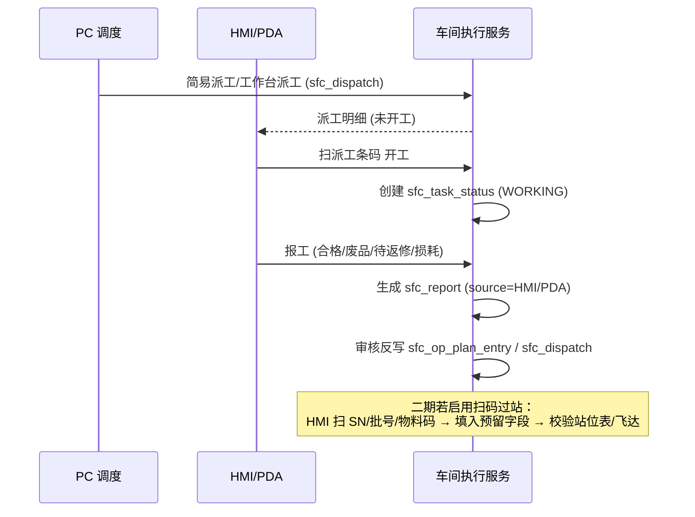

# WP12 车间执行 详细设计

> **正文由 Nemotron-3-Ultra 生成，【核对】与第 0 节、文末“人工核对补充”为人工核对。**
> 生成模型 `nvidia/nemotron-3-ultra-550b-a55b`（NVIDIA API，`nvx.py`），分段调用后合并。除下方已注明的人工补丁（M02、M04、M05）外，没有改写模型正文；只去掉各段重复的一级标题，并插入【核对】行。
> 工作目录：`/workspace/nvidia/jobs/wp12-14/`。编码尚未开始，不改代码仓库、不切分支。

## 0. 说明（人工）

### 0.1 生成依据与过程

- 输入材料：`需求说明书.md`（第 3–5 章、第 7 章 SMT 上料防错、第 8 章三维车间接口）、`技术方案与分工.md`（第 3–6、9 章）、`待老板确认.md`（2026-11-13 13:49 Asia/Shanghai，老板回复“按建议”：Q04/Q08/Q17/Q18/Q19/Q28 等）、`parts/G1b-车间执行与设备-需求.md`，以及金蝶摘要（`kingdee-digest/`、`kingdee-modules/`）。三维仿真对照 `/workspace/erp-3d/src/app/runtime.js`、`src/data/plant.js`（实有 **33** 台设备，需求写“32 台”，按代码 33 台设计并把差异列入待确认）。
- 平台实施形态以 `/workspace/erp-3d/fullsys/code/docs/平台开发约定.md` **V0.1**（2026-11-13）为准。w12a/w12b 初稿生成时约定刚发布，已按约定做人工补丁，并在后续分段提示词中附上约定要点。
- 分段：共享命名约定 C00（另附人工修订单 E1–E14）→ w12a（范围+DDL）→ w12b（状态机+转换反写）→ w12c（接口）→ w12c2（算法 5.1–5.11）→ w12d（测试用例+待确认）。调用日志：`logs/calls.log`；原始输出：`out/`（`*.model.md` 为打补丁前的模型原文）。
- 业务模块只能通过单据引擎的元数据、状态机、转换/反写规则和钩子改状态、做反写，不得直接 UPDATE 上游累计数量或主状态。

### 0.2 拼接说明

- w12a、w12c、w12c2、w12d 均为一次输出完整（`finish=stop`）。
- w12b 末尾“与共享约定的差异”表最后一行被 16000 token 截断，人工补上闭合的 `| E11 |`（M02）；该表保留在③节末，如与第 0.3 节冲突，以 0.3 节为准。
- 人工改过的正文：M04（w12a 行状态默认值、汇报上下限比例列、`mto_no` 注释）、M05（w12b 状态码、反写公式、检验单源表名）。

### 0.3 与《平台开发约定》V0.1 的对齐说明（人工核对）

约定文件：`/workspace/erp-3d/fullsys/code/docs/平台开发约定.md`（V0.1）。下列事项在正文中如与模型初稿不一致，**以本节与约定为准**。

1. **建表方式（约定 3.2、3.5、10.3）**：单据表不能把正文里的 `CREATE TABLE` 当迁移脚本，要用 `BillMeta`（字段 snake_case）配合 `ensureBillTables(qr, META)` 在幂等迁移里建表；公共列由框架自动加，元数据里不得再声明。非单据系统记录（`sfc_task_status`、`sfc_task_flow` 等）用 `ensureTable` / `addColumnIfMissing` / `addIndexIfMissing`。迁移放 `apps/api/src/db/migrations/` 并登记 `ALL_MIGRATIONS`，禁止 DROP TABLE/COLUMN 和改列类型。
2. **元数据与类型（约定 3.1–3.4）**：`FieldType` 仅限约定枚举；数量用 DECIMAL，接口里是 string；`version` 默认 0；主键 53 位安全雪花，JSON 里是 number。模块目录 `apps/api/src/sfc/`，`onModuleInit` 调用 `BillEngineRegistry.registerBill({ meta, stateMachine, hooks, converts, writebacks })`。钩子仅限 `beforeSave/afterSave/beforeAudit/afterAudit/beforeUnaudit/afterUnaudit/beforeCancel/afterCancel/beforeDelete/rowGuards`。消息与 WebSocket 必须 `DbService.afterCommit`。TypeORM `DataSource` + `DbService` 原生 SQL，不用 Repository。
3. **状态机（约定 5.1–5.5）**：头表 `status` 只有 `DRAFT/CREATED/AUDITING/AUDITED/REAUDIT`。关闭/作废改 `close_status`/`cancel_status`（A/B），不改 `status`。**已审核必须先反审核才能作废**；**有下游有效单据禁止反审核**（`BIZ_HAS_DOWNSTREAM`）。`ops` 为 `Record<string, OpDef>`；`fieldLock` 是可编辑白名单。行级用 `rowStatus` + `POST /bills/{form}/{id}/ops/exec_to?target=`。工序计划行业务状态按修订单：`CREATED/PLANNED/RELEASED/STARTED/FINISHED`（DDL 注释里若仍出现 `PLAN_CONFIRMED`/`CLOSED`，实施时不要把它们写入行 `status`；关闭走 `close_status`/`biz_close`）。
4. **反写（约定 6.2、6.5）**：`WritebackRuleConfig.srcForm` = 被反写的上游，`tgtForm` = 触发反写的下游。两段反写：保存写关联/选单数量，审核写执行数量；删除或作废释放占用，反审核冲减执行数量。`overExpr`/`closeExpr` 禁止 SQL 子查询，使用行上的 `report_upper_ratio` / `report_lower_ratio`（百分数，默认 100）。增量 UPDATE，上游行按 `id ASC` 加 `FOR UPDATE`，同一 `DbService.tx`。
5. **接口（约定 4）**：前缀 `/api/v1`；通用单据走引擎；响应 `{code,msg,data,traceId,errors?}`，成功 `code='OK'` 且 `msg=''`；日期 `YYYY-MM-DD`，时间 `YYYY-MM-DD HH:mm:ss.SSS`（禁止带 Z）；写操作支持 `Idempotency-Key`。WebSocket 为 Socket.IO，路径 `/ws`。
6. **模型初稿已改正的点（A01–A06）**：状态机不再把 CLOSED/CANCELLED 当头表 `status`；反写方向已按官方 src/tgt 纠正；超额公式去掉对不存在的 `pl_route_entry` 的 SQL 子查询；钩子名映射到 `BillHooks`；接口补齐 `/api/v1` 与响应外壳。

编码阶段（本设计完成后由主 bot 安排）分支建议：`wp12-sfc`；提交 `feat(sfc): …` 中文说明，只本地提交不 push。

### 0.4 范围与依据（模型正文）

| 项目 | 说明 |
|---|---|
| **本 WP 做什么** | 设计车间执行核心单据与系统记录的数据模型：工序计划、派工明细、工序汇报、工序转移、工序不良品、人员任务状态/流水、车间调度汇报权限。所有业务状态流转、反写、下推均通过单据引擎（WP02）的状态机配置、转换规则、反写规则、关联表实现，**业务代码不直接 UPDATE 上游累计数量或状态**。非单据系统记录（人员任务状态/流水）由业务服务直接写。 |
| **本 WP 不做什么** | 不做生产订单、生产入库单、检验单、库存、条码主档、设备档案/采集/OEE/安灯/SMT 上料（属 WP06/WP10/WP11/WP13/WP14），不写前端页面、不写具体业务服务代码。 |
| **依赖 WP** | WP01（平台基建）、WP02（单据引擎：元数据/状态机/转换/反写/关联）、WP03（审批流）、WP04（基础资料：组织/物料/BOM/工艺路线/工作中心/资源/日历）、WP06（生产订单下推工序计划）、WP10（库存/领料为上料表提供可上料上限）、WP11（检验单反写首检状态）。 |

【依据:需求说明书 3.2 D20–D24、4.8–4.10、5.2 R04/R09/R10/R12/R13/R14、技术方案 3.2.6 #130–#142、G1b 车间管理 0.1–0.5、共享约定 C00 表归属清单】

---

> 【核对】第 0.4 节是模型对范围的表述。人员任务状态/流水虽非单据，但设备状态日志、`eqp_task_rt`、安灯属于 WP13，本 WP 只通过内部服务方法被 WP13 调用（见 4.3）。

## ① MySQL 建表 DDL

> 约定：库 `erp3d`、utf8mb4、主键 `BIGINT` 雪花 ID、时间 `DATETIME(3)`、数量/金额/单价 `DECIMAL(23,10)`、头表/行表含公共列、`org_id` 冗余、乐观锁 `version`。所有表名/列名用英文代码。DDL 可直接执行。

> 【核对】“DDL 可直接执行”已过时。实施时单据表必须改写为 `ensureBillTables(qr, META)` 幂等迁移（非单据表用 `ensureTable`），本 DDL 仅作字段对照。见第 0.3 节。【依据:平台开发约定 3.5、10.3】

### 1. sfc_op_plan —— 工序计划头（单据头，D20/SM-08）
用途：生产订单按工艺路线生成的工序级计划单据头。【依据:技术方案 3.2.6 #130】【依据:需求说明书 3.2 D20】

```sql
CREATE TABLE `sfc_op_plan` (
  `id` BIGINT NOT NULL COMMENT '主键，雪花ID',
  `org_id` BIGINT NOT NULL COMMENT '组织ID，冗余',
  `bill_no` VARCHAR(40) NOT NULL COMMENT '单据编号，OP+yyMM+4位流水',
  `bill_type_id` BIGINT NOT NULL COMMENT '单据类型ID',
  `bill_date` DATE NOT NULL COMMENT '单据日期',
  `biz_date` DATE NOT NULL COMMENT '业务日期',
  `status` VARCHAR(20) NOT NULL DEFAULT 'DRAFT' COMMENT '单据状态：DRAFT/CREATED/AUDITING/AUDITED/REAUDIT',
  `close_status` CHAR(1) NOT NULL DEFAULT 'A' COMMENT '关闭状态：A=正常 B=已关闭',
  `cancel_status` CHAR(1) NOT NULL DEFAULT 'A' COMMENT '作废状态：A=未作废 B=已作废',
  `wf_instance_id` BIGINT NULL COMMENT '审批实例ID',
  `creator_id` BIGINT NOT NULL COMMENT '创建人',
  `created_at` DATETIME(3) NOT NULL DEFAULT CURRENT_TIMESTAMP(3) COMMENT '创建时间',
  `modifier_id` BIGINT NOT NULL COMMENT '修改人',
  `modified_at` DATETIME(3) NOT NULL DEFAULT CURRENT_TIMESTAMP(3) ON UPDATE CURRENT_TIMESTAMP(3) COMMENT '修改时间',
  `auditor_id` BIGINT NULL COMMENT '审核人',
  `audited_at` DATETIME(3) NULL COMMENT '审核时间',
  `remark` VARCHAR(500) NULL COMMENT '备注',
  `src_system` VARCHAR(20) NULL COMMENT '来源系统',
  `version` INT NOT NULL DEFAULT 1 COMMENT '乐观锁版本号',
  -- 业务字段
  `mo_id` BIGINT NOT NULL COMMENT '生产订单ID',
  `mo_entry_id` BIGINT NOT NULL COMMENT '生产订单分录ID',
  `route_id` BIGINT NOT NULL COMMENT '工艺路线ID',
  `route_version` INT NOT NULL COMMENT '工艺路线版本',
  `plan_start` DATETIME(3) NULL COMMENT '计划开工时间（整单最早）',
  `plan_end` DATETIME(3) NULL COMMENT '计划完工时间（整单最晚）',
  `act_start` DATETIME(3) NULL COMMENT '实际开工时间（整单最早）',
  `act_end` DATETIME(3) NULL COMMENT '实际完工时间（整单最晚）',
  `dispatch_enabled` TINYINT(1) NOT NULL DEFAULT 0 COMMENT '是否启用派工明细',
  `auto_schedule` TINYINT(1) NOT NULL DEFAULT 0 COMMENT '是否自动排程',
  PRIMARY KEY (`id`),
  UNIQUE KEY `uk_bill_no` (`bill_no`),
  KEY `idx_org_bizdate` (`org_id`, `biz_date`),
  KEY `idx_mo` (`mo_id`),
  KEY `idx_status` (`status`, `close_status`, `cancel_status`)
) ENGINE=InnoDB DEFAULT CHARSET=utf8mb4 COMMENT='工序计划头';
```

### 2. sfc_op_plan_entry —— 工序计划分录（单据行，D20/SM-08）
用途：工序号、工作中心、数量、计划/实际时间、执行累计、首检、条码、理论节拍。【依据:技术方案 3.2.6 #131】【依据:需求说明书 4.8】【依据:待老板确认 Q28】

```sql
CREATE TABLE `sfc_op_plan_entry` (
  `id` BIGINT NOT NULL COMMENT '主键，雪花ID',
  `bill_id` BIGINT NOT NULL COMMENT '关联头表 sfc_op_plan.id',
  `org_id` BIGINT NOT NULL COMMENT '组织ID，冗余',
  `line_no` INT NOT NULL COMMENT '行号',
  `seq_no` INT NOT NULL COMMENT '序列号（工艺路线序列号）',
  `seq_type` VARCHAR(20) NOT NULL COMMENT '序列类型：MAIN/PARALLEL/ALTERNATE/REWORK',
  `op_no` VARCHAR(40) NOT NULL COMMENT '工序号',
  `work_center_id` BIGINT NOT NULL COMMENT '工作中心ID',
  `activity_id` BIGINT NOT NULL COMMENT '作业ID',
  `ctrl_code_id` BIGINT NOT NULL COMMENT '工序控制码ID',
  `is_instock_point` TINYINT(1) NOT NULL DEFAULT 0 COMMENT '是否入库点工序',
  `qty` DECIMAL(23,10) NOT NULL COMMENT '工序数量',
  `unit_id` BIGINT NOT NULL COMMENT '单位ID',
  `base_unit_id` BIGINT NOT NULL COMMENT '基本单位ID',
  `base_qty` DECIMAL(23,10) NOT NULL COMMENT '基本单位数量',
  `plan_start` DATETIME(3) NULL COMMENT '计划开工时间',
  `plan_end` DATETIME(3) NULL COMMENT '计划完工时间',
  `act_start` DATETIME(3) NULL COMMENT '实际开工时间',
  `act_end` DATETIME(3) NULL COMMENT '实际完工时间',
  -- 执行累计（由反写维护）
  `report_sel_qty` DECIMAL(23,10) NOT NULL DEFAULT 0 COMMENT '汇报选单数量',
  `ok_qty` DECIMAL(23,10) NOT NULL DEFAULT 0 COMMENT '合格数量',
  `scrap_work_qty` DECIMAL(23,10) NOT NULL DEFAULT 0 COMMENT '工废数量',
  `scrap_mat_qty` DECIMAL(23,10) NOT NULL DEFAULT 0 COMMENT '料废数量',
  `loss_qty` DECIMAL(23,10) NOT NULL DEFAULT 0 COMMENT '损耗数量',
  `rework_qty` DECIMAL(23,10) NOT NULL DEFAULT 0 COMMENT '待返工数量',
  `trans_in_qty` DECIMAL(23,10) NOT NULL DEFAULT 0 COMMENT '转入数量',
  `trans_out_qty` DECIMAL(23,10) NOT NULL DEFAULT 0 COMMENT '转出数量',
  `rework_trans_out_qty` DECIMAL(23,10) NOT NULL DEFAULT 0 COMMENT '返工转出数量',
  `return_qty` DECIMAL(23,10) NOT NULL DEFAULT 0 COMMENT '退库数量',
  `check_diff_qty` DECIMAL(23,10) NOT NULL DEFAULT 0 COMMENT '工序盘点差异',
  `report_upper_ratio` DECIMAL(10,4) NOT NULL DEFAULT 100 COMMENT '汇报上限比例(%)，下达时取工艺路线工序 md_route_oper.report_upper_ratio【人工补】',
  `report_lower_ratio` DECIMAL(10,4) NOT NULL DEFAULT 100 COMMENT '汇报下限比例(%)，自动完工判定用，取 md_route_oper.report_lower_ratio【人工补】',
  -- 派工相关
  `dispatch_enabled` TINYINT(1) NOT NULL DEFAULT 0 COMMENT '是否启用派工明细',
  `dispatched_qty` DECIMAL(23,10) NOT NULL DEFAULT 0 COMMENT '已派工数量',
  -- 条码
  `barcode` VARCHAR(80) NULL COMMENT '分录条码：单号-序列号-工序号',
  -- 首检
  `first_inspect` TINYINT(1) NOT NULL DEFAULT 0 COMMENT '是否首检',
  `first_inspect_status` VARCHAR(20) NOT NULL DEFAULT 'NONE' COMMENT '首检状态：NONE/PENDING/INSPECTING/PASSED',
  `first_inspect_mode` VARCHAR(20) NULL COMMENT '首检控制方式：STRICT/NON_STRICT',
  -- 理论节拍（秒），老板 Q28：存工艺路线工序上，下达时带到工序计划行
  `ideal_cycle_sec` DECIMAL(10,3) NULL COMMENT '理论节拍(秒)',
  -- 二期预留：柔性扫码过站字段
  `data_collect_seq` VARCHAR(20) NULL COMMENT '二期预留：数据采集顺序 MATERIAL/EQUIP_MATERIAL/EQUIP_ORDER',
  `scan_feature_code` VARCHAR(20) NULL COMMENT '二期预留：扫描特征码 NONE/GEN_SN/BIND_PRODUCT',
  -- 公共行字段
  `material_id` BIGINT NULL COMMENT '物料ID（入库点工序的产品）',
  `aux_prop_id` BIGINT NULL COMMENT '辅助属性ID',
  `lot_no` VARCHAR(60) NULL COMMENT '批号',
  `mto_no` VARCHAR(60) NULL COMMENT '计划跟踪号',
  `src_form` VARCHAR(40) NULL COMMENT '来源单据form',
  `src_bill_id` BIGINT NULL COMMENT '来源单据头ID',
  `src_entry_id` BIGINT NULL COMMENT '来源单据分录ID',
  `biz_close` CHAR(1) NOT NULL DEFAULT 'A' COMMENT '业务关闭：A=正常 B=已关闭',
  `biz_freeze` CHAR(1) NOT NULL DEFAULT 'A' COMMENT '业务冻结：A=正常 B=冻结',
  `biz_terminate` CHAR(1) NOT NULL DEFAULT 'A' COMMENT '业务终止：A=正常 B=终止',
  `status` VARCHAR(20) NOT NULL DEFAULT 'CREATED' COMMENT '行业务状态：CREATED/PLANNED/PLAN_CONFIRMED/RELEASED/STARTED/FINISHED/CLOSED',
  PRIMARY KEY (`id`),
  UNIQUE KEY `uk_bill_line` (`bill_id`, `line_no`),
  KEY `idx_bill` (`bill_id`),
  KEY `idx_op_no` (`op_no`),
  KEY `idx_work_center` (`work_center_id`),
  KEY `idx_status` (`status`, `biz_close`),
  KEY `idx_src` (`src_form`, `src_bill_id`, `src_entry_id`)
) ENGINE=InnoDB DEFAULT CHARSET=utf8mb4 COMMENT='工序计划分录';
```

### 3. sfc_dispatch —— 派工明细头（单据头，D21/SM-09）
用途：派工数量、设备、班次、班组、状态。【依据:技术方案 3.2.6 #132】【依据:需求说明书 3.2 D21】

```sql
CREATE TABLE `sfc_dispatch` (
  `id` BIGINT NOT NULL COMMENT '主键，雪花ID',
  `org_id` BIGINT NOT NULL COMMENT '组织ID',
  `bill_no` VARCHAR(40) NOT NULL COMMENT '单据编号，DSP+yyMMdd+4位流水',
  `bill_type_id` BIGINT NOT NULL COMMENT '单据类型ID',
  `bill_date` DATE NOT NULL COMMENT '单据日期',
  `biz_date` DATE NOT NULL COMMENT '业务日期',
  `status` VARCHAR(20) NOT NULL DEFAULT 'DRAFT' COMMENT '单据状态：DRAFT/CREATED/AUDITING/AUDITED/REAUDIT',
  `close_status` CHAR(1) NOT NULL DEFAULT 'A' COMMENT '关闭状态：A=正常 B=已关闭',
  `cancel_status` CHAR(1) NOT NULL DEFAULT 'A' COMMENT '作废状态：A=未作废 B=已作废',
  `wf_instance_id` BIGINT NULL COMMENT '审批实例ID',
  `creator_id` BIGINT NOT NULL COMMENT '创建人',
  `created_at` DATETIME(3) NOT NULL DEFAULT CURRENT_TIMESTAMP(3) COMMENT '创建时间',
  `modifier_id` BIGINT NOT NULL COMMENT '修改人',
  `modified_at` DATETIME(3) NOT NULL DEFAULT CURRENT_TIMESTAMP(3) ON UPDATE CURRENT_TIMESTAMP(3) COMMENT '修改时间',
  `auditor_id` BIGINT NULL COMMENT '审核人',
  `audited_at` DATETIME(3) NULL COMMENT '审核时间',
  `remark` VARCHAR(500) NULL COMMENT '备注',
  `src_system` VARCHAR(20) NULL COMMENT '来源系统',
  `version` INT NOT NULL DEFAULT 1 COMMENT '乐观锁版本号',
  -- 业务字段
  `op_entry_id` BIGINT NOT NULL COMMENT '工序计划分录ID',
  `qty` DECIMAL(23,10) NOT NULL COMMENT '派工数量',
  `shift_id` BIGINT NULL COMMENT '班次ID',
  `team_id` BIGINT NULL COMMENT '班组ID',
  `resource_id` BIGINT NULL COMMENT '资源ID',
  `equipment_id` BIGINT NULL COMMENT '设备ID',
  `plan_start` DATETIME(3) NULL COMMENT '计划开始时间',
  `plan_end` DATETIME(3) NULL COMMENT '计划结束时间',
  `act_start` DATETIME(3) NULL COMMENT '实际开始时间',
  `act_end` DATETIME(3) NULL COMMENT '实际结束时间',
  `done_sel_qty` DECIMAL(23,10) NOT NULL DEFAULT 0 COMMENT '完成选单数量',
  `rework_sel_qty` DECIMAL(23,10) NOT NULL DEFAULT 0 COMMENT '待返工选单数量',
  `rework_done_qty` DECIMAL(23,10) NOT NULL DEFAULT 0 COMMENT '返工完成数量',
  `dispatch_status` VARCHAR(20) NOT NULL DEFAULT 'NOT_STARTED' COMMENT '派工状态：NOT_STARTED/STARTED/FINISHED',
  `barcode` VARCHAR(80) NULL COMMENT '派工单条码标签',
  PRIMARY KEY (`id`),
  UNIQUE KEY `uk_bill_no` (`bill_no`),
  KEY `idx_org_bizdate` (`org_id`, `biz_date`),
  KEY `idx_op_entry` (`op_entry_id`),
  KEY `idx_equipment` (`equipment_id`),
  KEY `idx_dispatch_status` (`dispatch_status`)
) ENGINE=InnoDB DEFAULT CHARSET=utf8mb4 COMMENT='派工明细头';
```

### 4. sfc_dispatch_operator —— 派工操作工明细（单据行，D21/SM-09）
用途：派工关联的多个操作工。【依据:技术方案 3.2.6 #133】

```sql
CREATE TABLE `sfc_dispatch_operator` (
  `id` BIGINT NOT NULL COMMENT '主键，雪花ID',
  `dispatch_id` BIGINT NOT NULL COMMENT '派工明细头ID',
  `org_id` BIGINT NOT NULL COMMENT '组织ID',
  `line_no` INT NOT NULL COMMENT '行号',
  `employee_id` BIGINT NOT NULL COMMENT '员工ID',
  PRIMARY KEY (`id`),
  UNIQUE KEY `uk_dispatch_emp` (`dispatch_id`, `employee_id`),
  KEY `idx_dispatch` (`dispatch_id`),
  KEY `idx_employee` (`employee_id`)
) ENGINE=InnoDB DEFAULT CHARSET=utf8mb4 COMMENT='派工操作工明细';
```

### 5. sfc_report —— 工序汇报单头（单据头，D22/SM-01）
用途：单据类型（生产/入库汇报）、来源。【依据:技术方案 3.2.6 #134】【依据:需求说明书 3.2 D22】

```sql
CREATE TABLE `sfc_report` (
  `id` BIGINT NOT NULL COMMENT '主键，雪花ID',
  `org_id` BIGINT NOT NULL COMMENT '组织ID',
  `bill_no` VARCHAR(40) NOT NULL COMMENT '单据编号，RPT+yyMMdd+5位流水',
  `bill_type_id` BIGINT NOT NULL COMMENT '单据类型ID：工序生产汇报/工序入库汇报',
  `bill_date` DATE NOT NULL COMMENT '单据日期',
  `biz_date` DATE NOT NULL COMMENT '业务日期',
  `status` VARCHAR(20) NOT NULL DEFAULT 'DRAFT' COMMENT '单据状态：DRAFT/CREATED/AUDITING/AUDITED/REAUDIT',
  `close_status` CHAR(1) NOT NULL DEFAULT 'A' COMMENT '关闭状态：A=正常 B=已关闭',
  `cancel_status` CHAR(1) NOT NULL DEFAULT 'A' COMMENT '作废状态：A=未作废 B=已作废',
  `wf_instance_id` BIGINT NULL COMMENT '审批实例ID（一期不挂审批流，预留）',
  `creator_id` BIGINT NOT NULL COMMENT '创建人',
  `created_at` DATETIME(3) NOT NULL DEFAULT CURRENT_TIMESTAMP(3) COMMENT '创建时间',
  `modifier_id` BIGINT NOT NULL COMMENT '修改人',
  `modified_at` DATETIME(3) NOT NULL DEFAULT CURRENT_TIMESTAMP(3) ON UPDATE CURRENT_TIMESTAMP(3) COMMENT '修改时间',
  `auditor_id` BIGINT NULL COMMENT '审核人',
  `audited_at` DATETIME(3) NULL COMMENT '审核时间',
  `remark` VARCHAR(500) NULL COMMENT '备注',
  `src_system` VARCHAR(20) NULL COMMENT '来源系统',
  `version` INT NOT NULL DEFAULT 1 COMMENT '乐观锁版本号',
  -- 业务字段
  `bill_type` VARCHAR(20) NOT NULL COMMENT '汇报类型：PRODUCTION/INSTOCK',
  `source` VARCHAR(10) NOT NULL DEFAULT 'HMI' COMMENT '数据来源：HMI/PDA/EQP/PC',
  `shift_id` BIGINT NULL COMMENT '班次ID',
  `team_id` BIGINT NULL COMMENT '班组ID',
  PRIMARY KEY (`id`),
  UNIQUE KEY `uk_bill_no` (`bill_no`),
  KEY `idx_org_bizdate` (`org_id`, `biz_date`),
  KEY `idx_status` (`status`, `close_status`, `cancel_status`),
  KEY `idx_source` (`source`)
) ENGINE=InnoDB DEFAULT CHARSET=utf8mb4 COMMENT='工序汇报单头';
```

### 6. sfc_report_entry —— 工序汇报单分录（单据行，D22/SM-01）
用途：合格/废品/待返工/损耗、工时、设备、来源、首检标识。【依据:技术方案 3.2.6 #135】【依据:需求说明书 4.8】【依据:G1b 0.2 工序汇报字段】

```sql
CREATE TABLE `sfc_report_entry` (
  `id` BIGINT NOT NULL COMMENT '主键，雪花ID',
  `bill_id` BIGINT NOT NULL COMMENT '关联头表 sfc_report.id',
  `org_id` BIGINT NOT NULL COMMENT '组织ID',
  `line_no` INT NOT NULL COMMENT '行号',
  `op_entry_id` BIGINT NOT NULL COMMENT '工序计划分录ID',
  `dispatch_id` BIGINT NULL COMMENT '派工明细ID',
  -- 数量
  `ok_qty` DECIMAL(23,10) NOT NULL DEFAULT 0 COMMENT '合格数量',
  `rework_qty` DECIMAL(23,10) NOT NULL DEFAULT 0 COMMENT '待返工数量',
  `scrap_work_qty` DECIMAL(23,10) NOT NULL DEFAULT 0 COMMENT '工废数量',
  `scrap_mat_qty` DECIMAL(23,10) NOT NULL DEFAULT 0 COMMENT '料废数量',
  `loss_qty` DECIMAL(23,10) NOT NULL DEFAULT 0 COMMENT '损耗数量',
  `done_qty` DECIMAL(23,10) NOT NULL DEFAULT 0 COMMENT '完工数量=合格+待返工+工废+料废+损耗',
  `confirm_mode` VARCHAR(20) NOT NULL DEFAULT 'AUTO' COMMENT '确认工序状态：MANUAL/AUTO',
  -- 设备/班次/班组
  `equipment_id` BIGINT NULL COMMENT '设备ID',
  `shift_id` BIGINT NULL COMMENT '班次ID',
  `team_id` BIGINT NULL COMMENT '班组ID',
  -- 时间/工时
  `start_at` DATETIME(3) NULL COMMENT '开始时间',
  `end_at` DATETIME(3) NULL COMMENT '结束时间',
  `work_min` DECIMAL(10,2) NOT NULL DEFAULT 0 COMMENT '加工实作工时(分钟)',
  `pause_min` DECIMAL(10,2) NOT NULL DEFAULT 0 COMMENT '加工暂停工时(分钟)',
  -- 缺陷/返修
  `defect_type_id` BIGINT NULL COMMENT '缺陷类型ID',
  `is_rework_report` TINYINT(1) NOT NULL DEFAULT 0 COMMENT '是否返修汇报',
  `src_report_entry_id` BIGINT NULL COMMENT '来源汇报分录ID（返修时引用）',
  -- 首检/检验
  `inspect_sel_qty` DECIMAL(23,10) NOT NULL DEFAULT 0 COMMENT '检验选单数量',
  `in_sel_qty` DECIMAL(23,10) NOT NULL DEFAULT 0 COMMENT '入库选单数量',
  `first_inspect_flag` TINYINT(1) NOT NULL DEFAULT 0 COMMENT '首检标识',
  -- 来源
  `source` VARCHAR(10) NOT NULL DEFAULT 'HMI' COMMENT '数据来源：HMI/PDA/EQP/PC',
  -- 二期预留：柔性扫码过站字段
  `product_track_no` VARCHAR(60) NULL COMMENT '二期预留：产品跟踪号(SN)',
  `serial_no` VARCHAR(60) NULL COMMENT '二期预留：序列号',
  `lot_no` VARCHAR(60) NULL COMMENT '二期预留：批号',
  `input_material_json` JSON NULL COMMENT '二期预留：投入物料表(JSON数组，含物料类型/SN/批号/数量/返修处理类型/物料状态/缺陷类型/投料作业/预装跟踪号/关键件不良单据/操作工/投料时间)',
  -- 公共行字段
  `material_id` BIGINT NULL COMMENT '物料ID',
  `aux_prop_id` BIGINT NULL COMMENT '辅助属性ID',
  `unit_id` BIGINT NOT NULL COMMENT '单位ID',
  `base_unit_id` BIGINT NOT NULL COMMENT '基本单位ID',
  `base_qty` DECIMAL(23,10) NOT NULL DEFAULT 0 COMMENT '基本单位数量',
  `mto_no` VARCHAR(60) NULL COMMENT '计划跟踪号',
  `src_form` VARCHAR(40) NULL COMMENT '来源单据form',
  `src_bill_id` BIGINT NULL COMMENT '来源单据头ID',
  `src_entry_id` BIGINT NULL COMMENT '来源单据分录ID',
  `biz_close` CHAR(1) NOT NULL DEFAULT 'A' COMMENT '业务关闭：A=正常 B=已关闭',
  `biz_freeze` CHAR(1) NOT NULL DEFAULT 'A' COMMENT '业务冻结：A=正常 B=冻结',
  `biz_terminate` CHAR(1) NOT NULL DEFAULT 'A' COMMENT '业务终止：A=正常 B=终止',
  PRIMARY KEY (`id`),
  UNIQUE KEY `uk_bill_line` (`bill_id`, `line_no`),
  KEY `idx_bill` (`bill_id`),
  KEY `idx_op_entry` (`op_entry_id`),
  KEY `idx_dispatch` (`dispatch_id`),
  KEY `idx_equipment` (`equipment_id`),
  KEY `idx_src` (`src_form`, `src_bill_id`, `src_entry_id`)
) ENGINE=InnoDB DEFAULT CHARSET=utf8mb4 COMMENT='工序汇报单分录';
```

### 7. sfc_report_operator —— 汇报操作工明细（单据行，D22/SM-01）
用途：多人分摊工时。【依据:技术方案 3.2.6 #136】

```sql
CREATE TABLE `sfc_report_operator` (
  `id` BIGINT NOT NULL COMMENT '主键，雪花ID',
  `report_entry_id` BIGINT NOT NULL COMMENT '汇报分录ID',
  `org_id` BIGINT NOT NULL COMMENT '组织ID',
  `line_no` INT NOT NULL COMMENT '行号',
  `employee_id` BIGINT NOT NULL COMMENT '员工ID',
  `work_min` DECIMAL(10,2) NOT NULL DEFAULT 0 COMMENT '分摊工时(分钟)',
  PRIMARY KEY (`id`),
  UNIQUE KEY `uk_entry_emp` (`report_entry_id`, `employee_id`),
  KEY `idx_report_entry` (`report_entry_id`),
  KEY `idx_employee` (`employee_id`)
) ENGINE=InnoDB DEFAULT CHARSET=utf8mb4 COMMENT='汇报操作工明细';
```

### 8. sfc_report_bin —— 汇报 BIN 分选明细（单据行，D22/SM-01，扩展）
用途：测试分选各档数量（扩展）。【依据:技术方案 3.2.6 #137】【依据:需求说明书 E11】

```sql
CREATE TABLE `sfc_report_bin` (
  `id` BIGINT NOT NULL COMMENT '主键，雪花ID',
  `report_entry_id` BIGINT NOT NULL COMMENT '汇报分录ID',
  `org_id` BIGINT NOT NULL COMMENT '组织ID',
  `line_no` INT NOT NULL COMMENT '行号',
  `bin_code` VARCHAR(20) NOT NULL COMMENT 'BIN档位代码，如 BIN1/BIN2...',
  `qty` DECIMAL(23,10) NOT NULL DEFAULT 0 COMMENT '该档数量',
  PRIMARY KEY (`id`),
  UNIQUE KEY `uk_entry_bin` (`report_entry_id`, `bin_code`),
  KEY `idx_report_entry` (`report_entry_id`)
) ENGINE=InnoDB DEFAULT CHARSET=utf8mb4 COMMENT='汇报 BIN 分选明细';
```

### 9. sfc_transfer —— 工序转移单（单据头，D23/SM-01）
用途：转出/转入工序、数量、类型。【依据:技术方案 3.2.6 #138】【依据:需求说明书 3.2 D23】

```sql
CREATE TABLE `sfc_transfer` (
  `id` BIGINT NOT NULL COMMENT '主键，雪花ID',
  `org_id` BIGINT NOT NULL COMMENT '组织ID',
  `bill_no` VARCHAR(40) NOT NULL COMMENT '单据编号，TRF+yyMMdd+4位流水',
  `bill_type_id` BIGINT NOT NULL COMMENT '单据类型ID',
  `bill_date` DATE NOT NULL COMMENT '单据日期',
  `biz_date` DATE NOT NULL COMMENT '业务日期',
  `status` VARCHAR(20) NOT NULL DEFAULT 'DRAFT' COMMENT '单据状态：DRAFT/CREATED/AUDITING/AUDITED/REAUDIT',
  `close_status` CHAR(1) NOT NULL DEFAULT 'A' COMMENT '关闭状态：A=正常 B=已关闭',
  `cancel_status` CHAR(1) NOT NULL DEFAULT 'A' COMMENT '作废状态：A=未作废 B=已作废',
  `wf_instance_id` BIGINT NULL COMMENT '审批实例ID（一期不挂审批流，预留）',
  `creator_id` BIGINT NOT NULL COMMENT '创建人',
  `created_at` DATETIME(3) NOT NULL DEFAULT CURRENT_TIMESTAMP(3) COMMENT '创建时间',
  `modifier_id` BIGINT NOT NULL COMMENT '修改人',
  `modified_at` DATETIME(3) NOT NULL DEFAULT CURRENT_TIMESTAMP(3) ON UPDATE CURRENT_TIMESTAMP(3) COMMENT '修改时间',
  `auditor_id` BIGINT NULL COMMENT '审核人',
  `audited_at` DATETIME(3) NULL COMMENT '审核时间',
  `remark` VARCHAR(500) NULL COMMENT '备注',
  `src_system` VARCHAR(20) NULL COMMENT '来源系统',
  `version` INT NOT NULL DEFAULT 1 COMMENT '乐观锁版本号',
  -- 业务字段
  `from_op_entry_id` BIGINT NOT NULL COMMENT '转出工序计划分录ID',
  `to_op_entry_id` BIGINT NOT NULL COMMENT '转入工序计划分录ID',
  `transfer_type` VARCHAR(20) NOT NULL DEFAULT 'NORMAL' COMMENT '转移类型：NORMAL/RETURN/OTHER(二期扩展9种)',
  `qty` DECIMAL(23,10) NOT NULL COMMENT '转移数量',
  `transfer_status` VARCHAR(20) NOT NULL DEFAULT 'APPLY' COMMENT '转移状态：APPLY/CONFIRMED',
  PRIMARY KEY (`id`),
  UNIQUE KEY `uk_bill_no` (`bill_no`),
  KEY `idx_org_bizdate` (`org_id`, `biz_date`),
  KEY `idx_from_entry` (`from_op_entry_id`),
  KEY `idx_to_entry` (`to_op_entry_id`),
  KEY `idx_status` (`status`, `close_status`, `cancel_status`)
) ENGINE=InnoDB DEFAULT CHARSET=utf8mb4 COMMENT='工序转移单';
```

### 10. sfc_defect —— 工序不良品明细（单据头，D24/SM-01）
用途：缺陷原因、数量、处理决策、责任人。【依据:技术方案 3.2.6 #139】【依据:需求说明书 3.2 D24】

```sql
CREATE TABLE `sfc_defect` (
  `id` BIGINT NOT NULL COMMENT '主键，雪花ID',
  `org_id` BIGINT NOT NULL COMMENT '组织ID',
  `bill_no` VARCHAR(40) NOT NULL COMMENT '单据编号，NG+yyMMdd+4位流水',
  `bill_type_id` BIGINT NOT NULL COMMENT '单据类型ID：REWORK/SCRAP/OTHER',
  `bill_date` DATE NOT NULL COMMENT '单据日期',
  `biz_date` DATE NOT NULL COMMENT '业务日期',
  `status` VARCHAR(20) NOT NULL DEFAULT 'DRAFT' COMMENT '单据状态：DRAFT/CREATED/AUDITING/AUDITED/REAUDIT',
  `close_status` CHAR(1) NOT NULL DEFAULT 'A' COMMENT '关闭状态：A=正常 B=已关闭',
  `cancel_status` CHAR(1) NOT NULL DEFAULT 'A' COMMENT '作废状态：A=未作废 B=已作废',
  `wf_instance_id` BIGINT NULL COMMENT '审批实例ID（一期不挂审批流，预留）',
  `creator_id` BIGINT NOT NULL COMMENT '创建人',
  `created_at` DATETIME(3) NOT NULL DEFAULT CURRENT_TIMESTAMP(3) COMMENT '创建时间',
  `modifier_id` BIGINT NOT NULL COMMENT '修改人',
  `modified_at` DATETIME(3) NOT NULL DEFAULT CURRENT_TIMESTAMP(3) ON UPDATE CURRENT_TIMESTAMP(3) COMMENT '修改时间',
  `auditor_id` BIGINT NULL COMMENT '审核人',
  `audited_at` DATETIME(3) NULL COMMENT '审核时间',
  `remark` VARCHAR(500) NULL COMMENT '备注',
  `src_system` VARCHAR(20) NULL COMMENT '来源系统',
  `version` INT NOT NULL DEFAULT 1 COMMENT '乐观锁版本号',
  -- 业务字段
  `report_entry_id` BIGINT NOT NULL COMMENT '来源汇报分录ID',
  `defect_reason_id` BIGINT NOT NULL COMMENT '缺陷原因ID',
  `qty` DECIMAL(23,10) NOT NULL COMMENT '缺陷数量',
  `decision` VARCHAR(20) NOT NULL COMMENT '处理决策：WORK_SCRAP/MAT_SCRAP/REWORK',
  `resp_dept_id` BIGINT NULL COMMENT '责任部门ID',
  `resp_emp_id` BIGINT NULL COMMENT '责任人ID',
  `analysis` VARCHAR(1000) NULL COMMENT '原因分析',
  `correction` VARCHAR(1000) NULL COMMENT '纠正措施',
  `prevention` VARCHAR(1000) NULL COMMENT '预防措施',
  PRIMARY KEY (`id`),
  UNIQUE KEY `uk_bill_no` (`bill_no`),
  KEY `idx_org_bizdate` (`org_id`, `biz_date`),
  KEY `idx_report_entry` (`report_entry_id`),
  KEY `idx_decision` (`decision`),
  KEY `idx_status` (`status`, `close_status`, `cancel_status`)
) ENGINE=InnoDB DEFAULT CHARSET=utf8mb4 COMMENT='工序不良品明细';
```

### 11. sfc_task_status —— 人员任务实时状态（系统记录，非单据）
用途：员工×工序×派工的当前状态（空闲/作业/暂停）。【依据:技术方案 3.2.6 #140】【依据:G1b 0.2 人员任务状态表】

```sql
CREATE TABLE `sfc_task_status` (
  `id` BIGINT NOT NULL COMMENT '主键，雪花ID',
  `org_id` BIGINT NOT NULL COMMENT '组织ID',
  `employee_id` BIGINT NOT NULL COMMENT '员工ID',
  `op_entry_id` BIGINT NOT NULL COMMENT '工序计划分录ID',
  `dispatch_id` BIGINT NULL COMMENT '派工明细ID',
  `status` VARCHAR(20) NOT NULL DEFAULT 'IDLE' COMMENT '任务状态：IDLE/WORKING/PAUSED',
  `since` DATETIME(3) NOT NULL DEFAULT CURRENT_TIMESTAMP(3) COMMENT '进入当前状态时间',
  `current_pause_event_id` BIGINT NULL COMMENT '当前暂停原因事件ID',
  `updated_at` DATETIME(3) NOT NULL DEFAULT CURRENT_TIMESTAMP(3) ON UPDATE CURRENT_TIMESTAMP(3) COMMENT '更新时间',
  PRIMARY KEY (`id`),
  UNIQUE KEY `uk_emp_op_dispatch` (`employee_id`, `op_entry_id`, `dispatch_id`),
  KEY `idx_employee` (`employee_id`),
  KEY `idx_op_entry` (`op_entry_id`),
  KEY `idx_dispatch` (`dispatch_id`)
) ENGINE=InnoDB DEFAULT CHARSET=utf8mb4 COMMENT='人员任务实时状态';
```

### 12. sfc_task_flow —— 人员任务流水（系统记录，非单据）
用途：开始/暂停/报工动作流水、暂停原因事件。【依据:技术方案 3.2.6 #141】【依据:G1b 0.2 人员任务流水表】

```sql
CREATE TABLE `sfc_task_flow` (
  `id` BIGINT NOT NULL COMMENT '主键，雪花ID',
  `org_id` BIGINT NOT NULL COMMENT '组织ID',
  `employee_id` BIGINT NOT NULL COMMENT '员工ID',
  `op_entry_id` BIGINT NOT NULL COMMENT '工序计划分录ID',
  `dispatch_id` BIGINT NULL COMMENT '派工明细ID',
  `action` VARCHAR(20) NOT NULL COMMENT '动作：START/PAUSE/REPORT/FINISH/REWORK_REPORT',
  `at` DATETIME(3) NOT NULL DEFAULT CURRENT_TIMESTAMP(3) COMMENT '动作时间',
  `pause_event_id` BIGINT NULL COMMENT '暂停原因事件ID（PAUSE时必录）',
  `work_min` DECIMAL(10,2) NULL COMMENT '本段工时(分钟，REPORT/FINISH时)',
  `remark` VARCHAR(200) NULL COMMENT '备注',
  PRIMARY KEY (`id`),
  KEY `idx_employee_time` (`employee_id`, `at`),
  KEY `idx_op_entry_time` (`op_entry_id`, `at`),
  KEY `idx_dispatch_time` (`dispatch_id`, `at`)
) ENGINE=InnoDB DEFAULT CHARSET=utf8mb4 COMMENT='人员任务流水';
```

### 13. sfc_permission —— 车间调度汇报权限（基础资料，B30）
用途：用户/角色 × 工作中心，含代理报工。【依据:技术方案 3.2.6 #142】【依据:需求说明书 B30】

```sql
CREATE TABLE `sfc_permission` (
  `id` BIGINT NOT NULL COMMENT '主键，雪花ID',
  `org_id` BIGINT NOT NULL COMMENT '组织ID',
  `user_id` BIGINT NULL COMMENT '用户ID（二选一）',
  `role_id` BIGINT NULL COMMENT '角色ID（二选一）',
  `work_center_id` BIGINT NOT NULL COMMENT '工作中心ID',
  `can_report` TINYINT(1) NOT NULL DEFAULT 1 COMMENT '允许汇报',
  `can_proxy` TINYINT(1) NOT NULL DEFAULT 0 COMMENT '允许代理报工',
  `forbid_status` CHAR(1) NOT NULL DEFAULT 'A' COMMENT '禁用状态：A=启用 B=禁用',
  `creator_id` BIGINT NOT NULL COMMENT '创建人',
  `created_at` DATETIME(3) NOT NULL DEFAULT CURRENT_TIMESTAMP(3) COMMENT '创建时间',
  `modifier_id` BIGINT NOT NULL COMMENT '修改人',
  `modified_at` DATETIME(3) NOT NULL DEFAULT CURRENT_TIMESTAMP(3) ON UPDATE CURRENT_TIMESTAMP(3) COMMENT '修改时间',
  PRIMARY KEY (`id`),
  UNIQUE KEY `uk_user_wc` (`user_id`, `work_center_id`),
  UNIQUE KEY `uk_role_wc` (`role_id`, `work_center_id`),
  KEY `idx_work_center` (`work_center_id`),
  KEY `idx_user` (`user_id`),
  KEY `idx_role` (`role_id`)
) ENGINE=InnoDB DEFAULT CHARSET=utf8mb4 COMMENT='车间调度汇报权限';
```

---

## 表/列与资料对照小表

| 表名 | 关键列 | 来源资料 |
|---|---|---|
| sfc_op_plan | id, bill_no, mo_id, mo_entry_id, route_id, status, close_status, cancel_status, dispatch_enabled, auto_schedule | 需求说明书 3.2 D20、4.8、技术方案 #130、G1b 车间管理 0.2 工序计划 |
| sfc_op_plan_entry | id, bill_id, seq_no, seq_type, op_no, work_center_id, activity_id, ctrl_code_id, is_instock_point, qty, plan_start, plan_end, act_start, act_end, report_sel_qty, ok_qty, scrap_work_qty, scrap_mat_qty, loss_qty, rework_qty, trans_in_qty, trans_out_qty, dispatched_qty, barcode, dispatch_enabled, first_inspect, first_inspect_status, first_inspect_mode, ideal_cycle_sec, data_collect_seq, scan_feature_code, status | 需求说明书 4.8、G1b 0.2 工序计划、技术方案 #131、待老板确认 Q28、G1b 柔性生产-工序计划 |
| sfc_dispatch | id, bill_no, op_entry_id, qty, shift_id, team_id, resource_id, equipment_id, plan_start, plan_end, act_start, act_end, done_sel_qty, rework_sel_qty, rework_done_qty, dispatch_status, barcode | 需求说明书 3.2 D21、4.9、G1b 0.2 派工明细、技术方案 #132 |
| sfc_dispatch_operator | id, dispatch_id, employee_id | 需求说明书 4.9、G1b 0.2 派工明细、技术方案 #133 |
| sfc_report | id, bill_no, bill_type, source, status, close_status, cancel_status, shift_id, team_id | 需求说明书 3.2 D22、G1b 0.2 工序汇报、技术方案 #134 |
| sfc_report_entry | id, bill_id, op_entry_id, dispatch_id, ok_qty, rework_qty, scrap_work_qty, scrap_mat_qty, loss_qty, done_qty, confirm_mode, equipment_id, shift_id, team_id, start_at, end_at, work_min, pause_min, defect_type_id, is_rework_report, src_report_entry_id, inspect_sel_qty, in_sel_qty, first_inspect_flag, source, product_track_no, serial_no, lot_no, input_material_json | 需求说明书 4.8、G1b 0.2 工序汇报(柔性)、技术方案 #135、G1b 柔性生产-工序汇报 |
| sfc_report_operator | id, report_entry_id, employee_id, work_min | 需求说明书 4.8、G1b 0.2 派工工序报工、技术方案 #136 |
| sfc_report_bin | id, report_entry_id, bin_code, qty | 需求说明书 E11、技术方案 #137 |
| sfc_transfer | id, bill_no, from_op_entry_id, to_op_entry_id, transfer_type, qty, transfer_status | 需求说明书 3.2 D23、4.8、G1b 0.2 工序转移单、技术方案 #138 |
| sfc_defect | id, bill_no, bill_type, report_entry_id, defect_reason_id, qty, decision, resp_dept_id, resp_emp_id | 需求说明书 3.2 D24、G1b 0.2 工序不良品明细、技术方案 #139 |
| sfc_task_status | id, employee_id, op_entry_id, dispatch_id, status, since, current_pause_event_id | G1b 0.2 人员任务状态表、技术方案 #140 |
| sfc_task_flow | id, employee_id, op_entry_id, dispatch_id, action, at, pause_event_id, work_min | G1b 0.2 人员任务流水表、技术方案 #141 |
| sfc_permission | id, user_id, role_id, work_center_id, can_report, can_proxy | 需求说明书 B30、G1b 0.1 车间调度汇报权限、技术方案 #142 |

## ② 状态机配置（`sys_state_machine` JSON）

> 约定：`form` 为单据代码（=头表名）。`states` 含 `code/name/field_lock/menu_ctrl`；`ops` 含 `code/name/from/to/preconditions/hooks`。`field_lock` 与 `menu_ctrl` 为“状态→字段/按钮”映射。所有状态码、操作码、钩子名用英文。首检状态随工序计划行业务状态联动。

### 1. sfc_op_plan（工序计划头，SM-08）

```json
{
  "form": "sfc_op_plan",
  "states": [
    { "code": "DRAFT", "name": "暂存", "field_lock": { "bill_no": true, "mo_id": true, "route_id": true }, "menu_ctrl": { "save": true, "submit": true, "delete": true } },
    { "code": "CREATED", "name": "创建", "field_lock": { "bill_no": true, "mo_id": true, "route_id": true }, "menu_ctrl": { "save": true, "submit": true, "audit": true, "cancel": true, "delete": true } },
    { "code": "AUDITING", "name": "审核中", "field_lock": { "*": true }, "menu_ctrl": {} },
    { "code": "AUDITED", "name": "已审核", "field_lock": { "*": true }, "menu_ctrl": { "unaudit": true, "close": true, "cancel": true, "ops_schedule": true, "ops_plan_confirm": true, "ops_release": true } },
    { "code": "REAUDIT", "name": "重新审核", "field_lock": { "*": true }, "menu_ctrl": { "save": true, "submit": true, "audit": true, "cancel": true } },
    { "code": "CLOSED", "name": "已关闭", "field_lock": { "*": true }, "menu_ctrl": { "unclose": true } },
    { "code": "CANCELLED", "name": "已作废", "field_lock": { "*": true }, "menu_ctrl": { "uncancel": true } }
  ],
  "ops": [
    { "code": "save", "name": "保存", "from": ["DRAFT", "CREATED", "REAUDIT"], "to": "CREATED", "preconditions": ["validate_required", "validate_unique_bill_no"], "hooks": ["hook_sfc_op_plan_save"] },
    { "code": "submit", "name": "提交", "from": ["DRAFT", "CREATED", "REAUDIT"], "to": "AUDITING", "preconditions": ["validate_required", "validate_unique_bill_no"], "hooks": [] },
    { "code": "audit", "name": "审核", "from": ["AUDITING"], "to": "AUDITED", "preconditions": ["wf_approved_or_no_wf"], "hooks": ["hook_sfc_op_plan_audit"] },
    { "code": "unaudit", "name": "反审核", "from": ["AUDITED"], "to": "REAUDIT", "preconditions": ["no_downstream_valid_bills"], "hooks": ["hook_sfc_op_plan_unaudit"] },
    { "code": "cancel", "name": "作废", "from": ["CREATED", "REAUDIT"], "to": "CANCELLED", "preconditions": ["no_downstream_valid_bills"], "hooks": ["hook_sfc_op_plan_cancel"] },
    { "code": "uncancel", "name": "反作废", "from": ["CANCELLED"], "to": "CREATED", "preconditions": [], "hooks": ["hook_sfc_op_plan_uncancel"] },
    { "code": "close", "name": "关闭", "from": ["AUDITED"], "to": "CLOSED", "preconditions": ["all_entries_biz_close"], "hooks": ["hook_sfc_op_plan_close"] },
    { "code": "unclose", "name": "反关闭", "from": ["CLOSED"], "to": "AUDITED", "preconditions": [], "hooks": ["hook_sfc_op_plan_unclose"] },
    { "code": "ops_schedule", "name": "排程", "from": ["AUDITED"], "to": "AUDITED", "preconditions": ["entry_status_in:CREATED"], "hooks": ["hook_sfc_op_plan_entry_schedule"], "target_entry_op": "schedule" },
    { "code": "ops_plan_confirm", "name": "计划确认", "from": ["AUDITED"], "to": "AUDITED", "preconditions": ["entry_status_in:PLANNED"], "hooks": ["hook_sfc_op_plan_entry_plan_confirm"], "target_entry_op": "plan_confirm" },
    { "code": "ops_release", "name": "下达", "from": ["AUDITED"], "to": "AUDITED", "preconditions": ["entry_status_in:PLAN_CONFIRMED", "bill_status=AUDITED"], "hooks": ["hook_sfc_op_plan_entry_release"], "target_entry_op": "release" },
    { "code": "ops_start", "name": "开工", "from": ["AUDITED"], "to": "AUDITED", "preconditions": ["entry_status_in:RELEASED"], "hooks": ["hook_sfc_op_plan_entry_start"], "target_entry_op": "start" },
    { "code": "ops_finish", "name": "完工", "from": ["AUDITED"], "to": "AUDITED", "preconditions": ["entry_status_in:STARTED", "auto_finish_cond_or_manual"], "hooks": ["hook_sfc_op_plan_entry_finish"], "target_entry_op": "finish" },
    { "code": "ops_close_entry", "name": "关闭行", "from": ["AUDITED"], "to": "AUDITED", "preconditions": ["entry_status_in:FINISHED"], "hooks": ["hook_sfc_op_plan_entry_close"], "target_entry_op": "close" },
    { "code": "ops_un_schedule", "name": "反排程", "from": ["AUDITED"], "to": "AUDITED", "preconditions": ["entry_status_in:PLANNED"], "hooks": ["hook_sfc_op_plan_entry_un_schedule"], "target_entry_op": "un_schedule" },
    { "code": "ops_un_plan_confirm", "name": "反计划确认", "from": ["AUDITED"], "to": "AUDITED", "preconditions": ["entry_status_in:PLAN_CONFIRMED"], "hooks": ["hook_sfc_op_plan_entry_un_plan_confirm"], "target_entry_op": "un_plan_confirm" },
    { "code": "ops_un_release", "name": "反下达", "from": ["AUDITED"], "to": "AUDITED", "preconditions": ["entry_status_in:RELEASED", "no_dispatch_or_draft_dispatch"], "hooks": ["hook_sfc_op_plan_entry_un_release"], "target_entry_op": "un_release" },
    { "code": "ops_un_start", "name": "反开工", "from": ["AUDITED"], "to": "AUDITED", "preconditions": ["entry_status_in:STARTED", "no_report_qty"], "hooks": ["hook_sfc_op_plan_entry_un_start"], "target_entry_op": "un_start" },
    { "code": "ops_un_finish", "name": "反完工", "from": ["AUDITED"], "to": "AUDITED", "preconditions": ["entry_status_in:FINISHED", "no_instock_qty"], "hooks": ["hook_sfc_op_plan_entry_un_finish"], "target_entry_op": "un_finish" },
    { "code": "ops_un_close_entry", "name": "反关闭行", "from": ["AUDITED"], "to": "AUDITED", "preconditions": ["entry_status_in:CLOSED"], "hooks": ["hook_sfc_op_plan_entry_un_close"], "target_entry_op": "un_close" },
    { "code": "exec_to", "name": "执行至", "from": ["AUDITED"], "to": "AUDITED", "preconditions": ["target_state_in:PLANNED,PLAN_CONFIRMED,RELEASED,STARTED,FINISHED,CLOSED"], "hooks": ["hook_sfc_op_plan_entry_exec_to"], "target_entry_op": "exec_to", "jump": true },
    { "code": "unexec_to", "name": "反执行至", "from": ["AUDITED"], "to": "AUDITED", "preconditions": ["target_state_in:CREATED,PLANNED,PLAN_CONFIRMED,RELEASED,STARTED,FINISHED"], "hooks": ["hook_sfc_op_plan_entry_unexec_to"], "target_entry_op": "unexec_to", "jump": true }
  ]
}
```

**行级业务状态（`sfc_op_plan_entry.status`）迁移表**

| 操作码 | 从状态 | 到状态 | 前置条件（行级） | 钩子 | 说明 |
|---|---|---|---|---|---|
| schedule | CREATED | PLANNED | 单据已审核、有工艺路线 | hook_sfc_op_plan_entry_schedule | 写计划时间、生成条码 |
| plan_confirm | PLANNED | PLAN_CONFIRMED | — | hook_sfc_op_plan_entry_plan_confirm | 锁定计划时间 |
| un_plan_confirm | PLAN_CONFIRMED | PLANNED | — | hook_sfc_op_plan_entry_un_plan_confirm | 解锁 |
| release | PLAN_CONFIRMED | RELEASED | 单据已审核 | hook_sfc_op_plan_entry_release | 允许派工、开工 |
| un_release | RELEASED | PLAN_CONFIRMED | 无派工明细或派工均为暂存 | hook_sfc_op_plan_entry_un_release | 释放派工占用 |
| start | RELEASED | STARTED | — | hook_sfc_op_plan_entry_start | 写实际开工时间、首检状态→PENDING |
| un_start | STARTED | RELEASED | 无汇报数量（ok_qty+rework_qty+scrap_work_qty+scrap_mat_qty+loss_qty=0） | hook_sfc_op_plan_entry_un_start | 清实际开工时间、首检状态→NONE |
| finish | STARTED | FINISHED | 自动完工条件达标 或 手工完工确认 | hook_sfc_op_plan_entry_finish | 写实际完工时间、首检状态→PASSED(若已合格) |
| un_finish | FINISHED | STARTED | 无入库数量（in_sel_qty=0） | hook_sfc_op_plan_entry_un_finish | 清实际完工时间 |
| close | FINISHED | CLOSED | — | hook_sfc_op_plan_entry_close | biz_close=B |
| un_close | CLOSED | FINISHED | — | hook_sfc_op_plan_entry_un_close | biz_close=A |
| exec_to | * | 目标态 | 目标态在 CREATED..CLOSED 之间 | hook_sfc_op_plan_entry_exec_to | 依次执行中间各步 |
| unexec_to | * | 目标态 | 目标态在 CREATED..FINISHED 之间 | hook_sfc_op_plan_entry_unexec_to | 依次执行中间各步反向 |

**首检状态（`first_inspect_status`）变化规则**

| 触发时机 | 当前首检状态 | 检验结果/动作 | 新首检状态 | 依据 |
|---|---|---|---|---|
| 工序计划行开工 | NONE | first_inspect=1 | PENDING | 【依据:需求说明书 4.8】【依据:G1b 首检_柔性单件】 |
| 首检送检（生成检验单） | PENDING | — | INSPECTING | 【依据:G1b 首检_柔性单件】 |
| 检验单审核（首检） | INSPECTING | 合格 | PASSED | 【依据:需求说明书 5.2 R14】 |
| 检验单审核（首检） | INSPECTING | 不合格 | NONE | 【依据:需求说明书 5.2 R14】 |
| 检验单审核（首检） | INSPECTING | 保留 | INSPECTING | 【依据:需求说明书 5.2 R14】 |
| 反开工 | 任意 | — | NONE | 【依据:设计】 |
| 手工重置首检 | 任意 | — | NONE | 【依据:设计】 |

> 说明：`first_inspect_mode`（STRICT/NON_STRICT）控制“首检合格前是否允许继续汇报”，在汇报单保存钩子 `hook_sfc_report_save` 中校验。

---

### 2. sfc_dispatch（派工明细，SM-09）

```json
{
  "form": "sfc_dispatch",
  "states": [
    { "code": "DRAFT", "name": "暂存", "field_lock": { "bill_no": true, "op_entry_id": true }, "menu_ctrl": { "save": true, "submit": true, "delete": true } },
    { "code": "CREATED", "name": "创建", "field_lock": { "bill_no": true, "op_entry_id": true }, "menu_ctrl": { "save": true, "submit": true, "audit": true, "cancel": true, "delete": true, "ops_start": true } },
    { "code": "AUDITING", "name": "审核中", "field_lock": { "*": true }, "menu_ctrl": {} },
    { "code": "AUDITED", "name": "已审核", "field_lock": { "*": true }, "menu_ctrl": { "unaudit": true, "close": true, "cancel": true, "ops_start": true, "ops_finish": true, "ops_transfer": true } },
    { "code": "REAUDIT", "name": "重新审核", "field_lock": { "*": true }, "menu_ctrl": { "save": true, "submit": true, "audit": true, "cancel": true } },
    { "code": "CLOSED", "name": "已关闭", "field_lock": { "*": true }, "menu_ctrl": { "unclose": true } },
    { "code": "CANCELLED", "name": "已作废", "field_lock": { "*": true }, "menu_ctrl": { "uncancel": true } }
  ],
  "ops": [
    { "code": "save", "name": "保存", "from": ["DRAFT", "CREATED", "REAUDIT"], "to": "CREATED", "preconditions": ["validate_required", "validate_qty_le_undispatched"], "hooks": ["hook_sfc_dispatch_save"] },
    { "code": "submit", "name": "提交", "from": ["DRAFT", "CREATED", "REAUDIT"], "to": "AUDITING", "preconditions": ["validate_required"], "hooks": [] },
    { "code": "audit", "name": "审核", "from": ["AUDITING"], "to": "AUDITED", "preconditions": ["wf_approved_or_no_wf"], "hooks": ["hook_sfc_dispatch_audit"] },
    { "code": "unaudit", "name": "反审核", "from": ["AUDITED"], "to": "REAUDIT", "preconditions": ["no_report_linked", "dispatch_status=NOT_STARTED"], "hooks": ["hook_sfc_dispatch_unaudit"] },
    { "code": "cancel", "name": "作废", "from": ["CREATED", "REAUDIT"], "to": "CANCELLED", "preconditions": ["no_report_linked"], "hooks": ["hook_sfc_dispatch_cancel"] },
    { "code": "uncancel", "name": "反作废", "from": ["CANCELLED"], "to": "CREATED", "preconditions": [], "hooks": ["hook_sfc_dispatch_uncancel"] },
    { "code": "close", "name": "关闭", "from": ["AUDITED"], "to": "CLOSED", "preconditions": ["dispatch_status=FINISHED"], "hooks": ["hook_sfc_dispatch_close"] },
    { "code": "unclose", "name": "反关闭", "from": ["CLOSED"], "to": "AUDITED", "preconditions": [], "hooks": ["hook_sfc_dispatch_unclose"] },
    { "code": "ops_start", "name": "开工", "from": ["CREATED", "AUDITED"], "to": "AUDITED", "preconditions": ["dispatch_status=NOT_STARTED", "op_entry_status=RELEASED"], "hooks": ["hook_sfc_dispatch_start"], "target_entry_op": "start" },
    { "code": "ops_finish", "name": "完工", "from": ["AUDITED"], "to": "AUDITED", "preconditions": ["dispatch_status=STARTED", "done_sel_qty >= qty"], "hooks": ["hook_sfc_dispatch_finish"], "target_entry_op": "finish" },
    { "code": "ops_transfer", "name": "转派", "from": ["AUDITED"], "to": "AUDITED", "preconditions": ["dispatch_status=NOT_STARTED"], "hooks": ["hook_sfc_dispatch_transfer"], "target_entry_op": "transfer" }
  ]
}
```

**行级业务状态（`dispatch_status`）迁移表**

| 操作 | 从 | 到 | 前置条件 | 钩子 | 说明 |
|---|---|---|---|---|---|
| start | NOT_STARTED | STARTED | 工序计划行=RELEASED | hook_sfc_dispatch_start | 写实际开始时间、创建人员任务状态(IDLE→WORKING) |
| finish | STARTED | FINISHED | 完成选单数量≥派工数量 | hook_sfc_dispatch_finish | 写实际结束时间、人员任务状态→IDLE |
| transfer | NOT_STARTED | NOT_STARTED | — | hook_sfc_dispatch_transfer | 修改设备/操作工/班次，数量不变 |

> 反审核/作废前置条件：`no_report_linked` 表示无关联的有效工序汇报单（`sfc_report_entry.dispatch_id` 引用且汇报单非作废/非暂存）。【依据:需求说明书 4.9】【依据:G1b 派工明细】

---

### 3. sfc_report（工序汇报单，SM-01）

```json
{
  "form": "sfc_report",
  "states": [
    { "code": "DRAFT", "name": "暂存", "field_lock": { "bill_no": true, "bill_type": true }, "menu_ctrl": { "save": true, "submit": true, "delete": true } },
    { "code": "CREATED", "name": "创建", "field_lock": { "bill_no": true, "bill_type": true }, "menu_ctrl": { "save": true, "submit": true, "audit": true, "cancel": true, "delete": true } },
    { "code": "AUDITING", "name": "审核中", "field_lock": { "*": true }, "menu_ctrl": {} },
    { "code": "AUDITED", "name": "已审核", "field_lock": { "*": true }, "menu_ctrl": { "unaudit": true, "close": true, "cancel": true } },
    { "code": "REAUDIT", "name": "重新审核", "field_lock": { "*": true }, "menu_ctrl": { "save": true, "submit": true, "audit": true, "cancel": true } },
    { "code": "CLOSED", "name": "已关闭", "field_lock": { "*": true }, "menu_ctrl": { "unclose": true } },
    { "code": "CANCELLED", "name": "已作废", "field_lock": { "*": true }, "menu_ctrl": { "uncancel": true } }
  ],
  "ops": [
    { "code": "save", "name": "保存", "from": ["DRAFT", "CREATED", "REAUDIT"], "to": "CREATED", "preconditions": ["validate_required", "validate_qty_formula", "validate_first_inspect_strict"], "hooks": ["hook_sfc_report_save"] },
    { "code": "submit", "name": "提交", "from": ["DRAFT", "CREATED", "REAUDIT"], "to": "AUDITING", "preconditions": ["validate_required"], "hooks": [] },
    { "code": "audit", "name": "审核", "from": ["AUDITING"], "to": "AUDITED", "preconditions": ["wf_approved_or_no_wf", "auto_audit_if_eqp_source"], "hooks": ["hook_sfc_report_audit"] },
    { "code": "unaudit", "name": "反审核", "from": ["AUDITED"], "to": "REAUDIT", "preconditions": ["no_downstream_valid_bills", "no_instock_linked"], "hooks": ["hook_sfc_report_unaudit"] },
    { "code": "cancel", "name": "作废", "from": ["CREATED", "REAUDIT"], "to": "CANCELLED", "preconditions": ["no_downstream_valid_bills"], "hooks": ["hook_sfc_report_cancel"] },
    { "code": "uncancel", "name": "反作废", "from": ["CANCELLED"], "to": "CREATED", "preconditions": [], "hooks": ["hook_sfc_report_uncancel"] },
    { "code": "close", "name": "关闭", "from": ["AUDITED"], "to": "CLOSED", "preconditions": ["all_entries_biz_close"], "hooks": ["hook_sfc_report_close"] },
    { "code": "unclose", "name": "反关闭", "from": ["CLOSED"], "to": "AUDITED", "preconditions": [], "hooks": ["hook_sfc_report_unclose"] }
  ]
}
```

**关键前置条件说明**

| 条件代码 | 含义 | 依据 |
|---|---|---|
| validate_qty_formula | 完工数量=合格+待返修+工废+料废+损耗；废品=工废+料废+损耗 | 【依据:G1b 0.2 报工数量公式】 |
| validate_first_inspect_strict | 若工序计划行 `first_inspect=1` 且 `first_inspect_mode=STRICT`，则 `first_inspect_status=PASSED` 才允许保存合格数量>0 | 【依据:需求说明书 E15】 |
| auto_audit_if_eqp_source | 单据类型参数“保存后自动提交、提交后自动审核”且 `source=EQP` 时，保存即触发提交+审核 | 【依据:需求说明书 P03】【依据:共享约定 E5】 |
| no_instock_linked | 无关联的有效生产入库单（WP06 侧） | 【依据:需求说明书 5.2 R17】 |

---

### 4. sfc_transfer（工序转移单，SM-01：转移申请=创建，转移确认=审核）

```json
{
  "form": "sfc_transfer",
  "states": [
    { "code": "DRAFT", "name": "暂存", "field_lock": { "bill_no": true }, "menu_ctrl": { "save": true, "submit": true, "delete": true } },
    { "code": "CREATED", "name": "创建(转移申请)", "field_lock": { "bill_no": true }, "menu_ctrl": { "save": true, "submit": true, "audit": true, "cancel": true, "delete": true } },
    { "code": "AUDITING", "name": "审核中", "field_lock": { "*": true }, "menu_ctrl": {} },
    { "code": "AUDITED", "name": "已审核(转移确认)", "field_lock": { "*": true }, "menu_ctrl": { "unaudit": true, "close": true, "cancel": true } },
    { "code": "REAUDIT", "name": "重新审核", "field_lock": { "*": true }, "menu_ctrl": { "save": true, "submit": true, "audit": true, "cancel": true } },
    { "code": "CLOSED", "name": "已关闭", "field_lock": { "*": true }, "menu_ctrl": { "unclose": true } },
    { "code": "CANCELLED", "name": "已作废", "field_lock": { "*": true }, "menu_ctrl": { "uncancel": true } }
  ],
  "ops": [
    { "code": "save", "name": "保存", "from": ["DRAFT", "CREATED", "REAUDIT"], "to": "CREATED", "preconditions": ["validate_required", "validate_from_to_diff", "validate_qty_le_transferable"], "hooks": ["hook_sfc_transfer_save"] },
    { "code": "submit", "name": "提交", "from": ["DRAFT", "CREATED", "REAUDIT"], "to": "AUDITING", "preconditions": ["validate_required"], "hooks": [] },
    { "code": "audit", "name": "审核(转移确认)", "from": ["AUDITING"], "to": "AUDITED", "preconditions": ["wf_approved_or_no_wf"], "hooks": ["hook_sfc_transfer_audit"] },
    { "code": "unaudit", "name": "反审核", "from": ["AUDITED"], "to": "REAUDIT", "preconditions": ["no_downstream_valid_bills"], "hooks": ["hook_sfc_transfer_unaudit"] },
    { "code": "cancel", "name": "作废", "from": ["CREATED", "REAUDIT"], "to": "CANCELLED", "preconditions": ["no_downstream_valid_bills"], "hooks": ["hook_sfc_transfer_cancel"] },
    { "code": "uncancel", "name": "反作废", "from": ["CANCELLED"], "to": "CREATED", "preconditions": [], "hooks": ["hook_sfc_transfer_uncancel"] },
    { "code": "close", "name": "关闭", "from": ["AUDITED"], "to": "CLOSED", "preconditions": [], "hooks": ["hook_sfc_transfer_close"] },
    { "code": "unclose", "name": "反关闭", "from": ["CLOSED"], "to": "AUDITED", "preconditions": [], "hooks": ["hook_sfc_transfer_unclose"] }
  ]
}
```

> 转移申请（HMI）生成 CREATED 态单据；转移确认（HMI/PC）执行审核。审核钩子反写工序计划行 `trans_out_qty`、`trans_in_qty`。【依据:需求说明书 3.2 D23】【依据:G1b 转移申请/转移确认】

---

### 5. sfc_defect（工序不良品明细，SM-01）

```json
{
  "form": "sfc_defect",
  "states": [
    { "code": "DRAFT", "name": "暂存", "field_lock": { "bill_no": true }, "menu_ctrl": { "save": true, "submit": true, "delete": true } },
    { "code": "CREATED", "name": "创建", "field_lock": { "bill_no": true }, "menu_ctrl": { "save": true, "submit": true, "audit": true, "cancel": true, "delete": true } },
    { "code": "AUDITING", "name": "审核中", "field_lock": { "*": true }, "menu_ctrl": {} },
    { "code": "AUDITED", "name": "已审核", "field_lock": { "*": true }, "menu_ctrl": { "unaudit": true, "close": true, "cancel": true } },
    { "code": "REAUDIT", "name": "重新审核", "field_lock": { "*": true }, "menu_ctrl": { "save": true, "submit": true, "audit": true, "cancel": true } },
    { "code": "CLOSED", "name": "已关闭", "field_lock": { "*": true }, "menu_ctrl": { "unclose": true } },
    { "code": "CANCELLED", "name": "已作废", "field_lock": { "*": true }, "menu_ctrl": { "uncancel": true } }
  ],
  "ops": [
    { "code": "save", "name": "保存", "from": ["DRAFT", "CREATED", "REAUDIT"], "to": "CREATED", "preconditions": ["validate_required", "validate_decision_qty"], "hooks": ["hook_sfc_defect_save"] },
    { "code": "submit", "name": "提交", "from": ["DRAFT", "CREATED", "REAUDIT"], "to": "AUDITING", "preconditions": ["validate_required"], "hooks": [] },
    { "code": "audit", "name": "审核", "from": ["AUDITING"], "to": "AUDITED", "preconditions": ["wf_approved_or_no_wf"], "hooks": ["hook_sfc_defect_audit"] },
    { "code": "unaudit", "name": "反审核", "from": ["AUDITED"], "to": "REAUDIT", "preconditions": ["no_downstream_valid_bills"], "hooks": ["hook_sfc_defect_unaudit"] },
    { "code": "cancel", "name": "作废", "from": ["CREATED", "REAUDIT"], "to": "CANCELLED", "preconditions": ["no_downstream_valid_bills"], "hooks": ["hook_sfc_defect_cancel"] },
    { "code": "uncancel", "name": "反作废", "from": ["CANCELLED"], "to": "CREATED", "preconditions": [], "hooks": ["hook_sfc_defect_uncancel"] },
    { "code": "close", "name": "关闭", "from": ["AUDITED"], "to": "CLOSED", "preconditions": [], "hooks": ["hook_sfc_defect_close"] },
    { "code": "unclose", "name": "反关闭", "from": ["CLOSED"], "to": "AUDITED", "preconditions": [], "hooks": ["hook_sfc_defect_unclose"] }
  ]
}
```

**审核钩子 `hook_sfc_defect_audit` 逻辑**：仅当 `bill_type=REWORK`（返修类）时，按 `decision` 反写源汇报单分录：
- `WORK_SCRAP`：源 `scrap_work_qty += qty`
- `MAT_SCRAP`：源 `scrap_mat_qty += qty`
- `REWORK`：源 `rework_qty += qty`（并生成返工派工/汇报流程）【依据:需求说明书 5.2 R13】【依据:G1b 返修工作台】

---

> 【人工注】上面各 JSON 的 states 里 CLOSED、CANCELLED 是单据引擎的“虚拟状态”，落库时 status 列保持原值，分别置 close_status=B、cancel_status=B（共享约定 E1、status.ts）。

### 状态机配置中文说明表（汇总）

| 单据 | 操作 | 前置条件 | 钩子做什么 | 依据 |
|---|---|---|---|---|
| sfc_op_plan | 保存/提交/审核/反审核/作废/反作废/关闭/反关闭 | 通用单据规则 + 无下游有效单据 | 审核钩子：自动排程参数生效、释放选单占用 | 【依据:需求说明书 4.8】【依据:共享约定 3.1】 |
| sfc_op_plan | 排程/计划确认/下达/开工/完工/关闭/反向/跳跃 | 行状态在源态、单据已审核、反向需无下游数据 | 行钩子：写计划/实际时间、生成条码、更新首检状态、反写派工占用 | 【依据:需求说明书 4.8】【依据:G1b 工序计划状态控制】 |
| sfc_dispatch | 保存/提交/审核/反审核/作废/反作废/关闭/反关闭 | 通用规则 + 反审核需无汇报关联 | 审核钩子：反写工序计划行 `dispatched_qty` | 【依据:需求说明书 5.2 R09】 |
| sfc_dispatch | 开工/完工/转派 | 状态流转、工序计划行=RELEASED | 开工钩子：写实际开始时间、创建人员任务状态；完工钩子：写结束时间 | 【依据:需求说明书 4.9】【依据:G1b 派工明细】 |
| sfc_report | 保存/提交/审核/反审核/作废/反作废/关闭/反关闭 | 通用规则 + 数量公式 + 首检严格控制 + 设备自动报工自动审核 | 保存钩子：校验首检、数量公式；审核钩子：反写工序计划/派工、下推入库/检验/不良品 | 【依据:需求说明书 5.2 R10/R11/R14/R13】 |
| sfc_transfer | 保存/提交/审核/反审核/作废/反作废/关闭/反关闭 | 通用规则 + 转出≠转入 + 数量≤可转数量 | 审核钩子：反写工序计划行转出/转入数量 | 【依据:需求说明书 5.2 R12】 |
| sfc_defect | 保存/提交/审核/反审核/作废/反作废/关闭/反关闭 | 通用规则 + 返修类决策必录 | 审核钩子：返修类按决策反写源汇报单废品/待返工数量 | 【依据:需求说明书 5.2 R13】 |

---

## ③ 转换与反写规则

> 所有规则存 `sys_convert_rule`、`sys_writeback_rule`、`sys_bill_link`，由单据引擎（WP02）在事务内执行。**业务代码不直接 UPDATE 上游累计数量或状态**。需业务逻辑的只能写成钩子（hook 名、时机、做什么）。

### 1. sys_convert_rule（下推/选单规则）

| code | src_form → tgt_form | 选单条件 filter_expr | 字段映射要点 | 分组合单键 | 依据 |
|---|---|---|---|---|---|
| CNV_MO_TO_OP_PLAN | pp_mo → sfc_op_plan | `mo.status='AUDITED' AND mo_entry.biz_close='A'` | 头：mo_id, mo_entry_id, route_id, route_version, bill_date=biz_date, auto_schedule=route.auto_schedule<br>行：seq_no, seq_type, op_no, work_center_id, activity_id, ctrl_code_id, is_instock_point, qty, unit_id, plan_start/end(排程后), ideal_cycle_sec(来自路线工序), barcode=生成规则, first_inspect=route.first_inspect, first_inspect_mode=route.first_inspect_mode | 组织+生产订单+工艺路线版本 | 【依据:需求说明书 5.2 R04】【依据:技术方案 3.2.6 #130】 |
| CNV_OP_PLAN_TO_DISPATCH | sfc_op_plan_entry → sfc_dispatch | `entry.status='RELEASED' AND entry.dispatch_enabled=1 AND entry.dispatched_qty < entry.qty` | 头：op_entry_id, org_id, bill_date, qty=入参数量, shift_id/team_id/resource_id/equipment_id(来自派工界面), plan_start/end=entry.plan_start/end<br>行：dispatch_operator(多行) | 派工单按头分组（一张派工单对应一个 op_entry） | 【依据:需求说明书 5.2 R09】 |
| CNV_OP_PLAN_TO_REPORT | sfc_op_plan_entry → sfc_report | `entry.status='STARTED' AND entry.dispatch_enabled=0` | 头：bill_type=PRODUCTION, source=HMI/PDA/PC, org_id, biz_date<br>行：op_entry_id, dispatch_id=NULL, ok_qty/rework_qty/scrap_work_qty/scrap_mat_qty/loss_qty=入参, done_qty=SUM, confirm_mode=AUTO/MANUAL, equipment_id/shift_id/team_id=入参, start_at/end_at=入参, work_min/pause_min=入参, first_inspect_flag=entry.first_inspect, inspect_sel_qty=入参, in_sel_qty=入参(入库点), source=入参 | 组织+业务日期+班次+来源(PC/PDA/HMI) 合单 | 【依据:需求说明书 5.2 R10】 |
| CNV_DISPATCH_TO_REPORT | sfc_dispatch → sfc_report | `dispatch.status='AUDITED' AND dispatch.dispatch_status IN ('STARTED','FINISHED')` | 同 CNV_OP_PLAN_TO_REPORT，但 dispatch_id=dispatch.id，默认 equipment_id=dispatch.equipment_id | 同上 | 【依据:需求说明书 5.2 R10】【依据:G1b 启用派工后PC不能直接下推汇报单】 |
| CNV_EQP_AUTO_REPORT | (虚拟源) → sfc_report | 设备计数点差值触发，参数：eqpId, opEntryId, dispatchId, delta, ng, baseCounter | 头：bill_type=PRODUCTION, source=EQP, org_id, biz_date=当天<br>行：op_entry_id, dispatch_id, ok_qty=delta-ng, scrap_work_qty=ng, done_qty=delta, confirm_mode=AUTO, equipment_id=eqpId, start_at=上次采集时间, end_at=本次采集时间, work_min=按节拍估算, source=EQP | 组织+业务日期+设备+派工 合单（同一设备同一派工同一天合一张） | 【依据:需求说明书 5.2 R11】【依据:G1b 场景14.1】 |
| CNV_REPORT_TO_INSTOCK | sfc_report_entry → pp_instock (WP06) | `report.bill_type='PRODUCTION' AND entry.in_sel_qty>0 AND entry.op_entry.is_instock_point=1` | 头：mo_id, mo_entry_id, org_id, bill_date, biz_date<br>行：op_entry_id, report_entry_id, material_id=entry.material_id, ok_qty=entry.ok_qty, scrap_qty=entry.scrap_work_qty+entry.scrap_mat_qty, rework_qty=entry.rework_qty, loss_qty=entry.loss_qty, unit_id, base_qty, warehouse_id=工作中心默认仓库, locator_id, lot_no | 生产组织+货主+货主类型（同 R17） | 【依据:需求说明书 5.2 R17】 |
| CNV_REPORT_TO_QC | sfc_report_entry → qm_inspect (WP11) | `entry.first_inspect_flag=1 OR entry.op_entry.ctrl_code.inspect_mode='QC'` | 头：inspect_type=FIRST/OP_SEQ, org_id, bill_date, mo_id, mo_entry_id, op_entry_id<br>行：material_id, inspect_qty=entry.inspect_sel_qty, sample_qty=按抽样方案, first_inspect_mode=entry.op_entry.first_inspect_mode | 组织+检验类型+工序计划分录 | 【依据:需求说明书 5.2 R14】 |
| CNV_REPORT_TO_DEFECT | sfc_report_entry → sfc_defect | `entry.scrap_work_qty+entry.scrap_mat_qty+entry.rework_qty > 0` | 头：bill_type=REWORK/SCRAP, org_id, bill_date<br>行：report_entry_id, defect_reason_id=入参, qty=入参, decision=入参, resp_dept_id/emp_id=入参 | 不合单（每个缺陷原因一张） | 【依据:需求说明书 5.2 R13】 |
| CNV_OP_PLAN_TO_TRANSFER | sfc_op_plan_entry → sfc_transfer | `from_entry.status='STARTED' AND to_entry.status IN ('RELEASED','STARTED')` | 头：from_op_entry_id, to_op_entry_id, transfer_type=NORMAL, qty=入参, org_id, bill_date | 不合单 | 【依据:需求说明书 5.2 R12】 |
| CNV_ANDON_TO_PREVENT | andon_ticket → andon_prevent_track | `ticket.status='CLOSED' AND ticket.prevention IS NOT NULL` | 头：ticket_id, measures=ticket.prevention, owner_id=ticket.handler_id, due_date=当前+7天, org_id | 不合单 | 【依据:需求说明书 5.2 R42】 |
| CNV_DAILY_PLAN_TO_LINE_KPI | sfc_report → (虚拟目标：日排产明细) | `report.biz_date=目标日期 AND report.status='AUDITED'` | 聚合：line_id, mo_id, op_entry_id, SUM(ok_qty) AS online_qty | 产线+日期+工单 | 【依据:需求说明书 5.2 R22】 |

> **关键控制点**：
> - `CNV_DISPATCH_TO_REPORT` 仅在 `sfc_op_plan_entry.dispatch_enabled=1` 时可用；PC 端直接下推汇报单的入口在 `dispatch_enabled=1` 时**禁用**（前端按钮权限 + 后端转换规则 `filter_expr` 校验）。【依据:需求说明书 4.9】【依据:G1b 派工明细】
> - 自动完工条件：`entry.ok_qty + entry.rework_qty >= entry.qty * entry.report_lower_ratio / 100`（汇报下限比例，来自工艺路线工序）。手工完工不受比例限制。【依据:需求说明书 4.8】【依据:G1b 工艺路线】
> - 超额汇报控制：`entry.report_sel_qty + 入参数量 <= entry.qty * entry.report_upper_ratio / 100`（汇报上限比例）。超额按单据类型参数：禁止/允许一次/按公式。【依据:需求说明书 5.1 规则3】【依据:G1b 工艺路线】
> - 派工已派数控制：`entry.dispatched_qty + 入参数量 <= entry.qty`。【依据:需求说明书 5.2 R09】

---

### 2. sys_writeback_rule（反写规则）

| code | src_field → tgt_field | on_event | mode | over_ctrl / over_expr | close_expr | 依据 |
|---|---|---|---|---|---|---|
| WB_DISPATCH_TO_OP_PLAN | dispatch.qty → op_plan_entry.dispatched_qty | save | ADD | `over_ctrl=FORBID, over_expr=tgt.dispatched_qty + src.qty <= tgt.qty` | — | 【依据:需求说明书 5.2 R09】 |
| WB_REPORT_TO_OP_PLAN_OK | report_entry.ok_qty → op_plan_entry.ok_qty | audit | ADD | `over_ctrl=FORMULA, over_expr=tgt.ok_qty + src.ok_qty <= tgt.qty * tgt.report_upper_ratio / 100` | `tgt.ok_qty + tgt.rework_qty >= tgt.qty * tgt.report_lower_ratio / 100` | 【依据:需求说明书 5.2 R10】 |
| WB_REPORT_TO_OP_PLAN_REWORK | report_entry.rework_qty → op_plan_entry.rework_qty | audit | ADD | 同上 | 同上 | 【依据:需求说明书 5.2 R10】 |
| WB_REPORT_TO_OP_PLAN_SCRAP_WORK | report_entry.scrap_work_qty → op_plan_entry.scrap_work_qty | audit | ADD | 同上 | — | 【依据:需求说明书 5.2 R10】 |
| WB_REPORT_TO_OP_PLAN_SCRAP_MAT | report_entry.scrap_mat_qty → op_plan_entry.scrap_mat_qty | audit | ADD | 同上 | — | 【依据:需求说明书 5.2 R10】 |
| WB_REPORT_TO_OP_PLAN_LOSS | report_entry.loss_qty → op_plan_entry.loss_qty | audit | ADD | 同上 | — | 【依据:需求说明书 5.2 R10】 |
| WB_REPORT_TO_OP_PLAN_REPORT_SEL | report_entry.done_qty → op_plan_entry.report_sel_qty | save | ADD | `over_ctrl=FORMULA, over_expr=tgt.report_sel_qty + src.done_qty <= tgt.qty * tgt.report_upper_ratio / 100` | — | 【依据:需求说明书 5.2 R10】 |
| WB_REPORT_TO_OP_PLAN_TIME | report_entry.start_at/end_at → op_plan_entry.act_start/act_end | audit | MIN/MAX | — | — | 【依据:需求说明书 5.2 R10】 |
| WB_REPORT_TO_OP_PLAN_STATUS | (隐含) → op_plan_entry.status | audit | SET | 目标态由自动完工条件或手工完工决定 | — | 【依据:需求说明书 5.2 R10】 |
| WB_REPORT_TO_DISPATCH_SEL | report_entry.done_qty → dispatch.done_sel_qty | save | ADD | `over_ctrl=FORBID, over_expr=tgt.done_sel_qty + src.done_qty <= tgt.qty` | `tgt.done_sel_qty >= tgt.qty` | 【依据:需求说明书 5.2 R10】 |
| WB_REPORT_TO_DISPATCH_REWORK_SEL | report_entry.rework_qty → dispatch.rework_sel_qty | save | ADD | — | — | 【依据:需求说明书 5.2 R10】 |
| WB_REPORT_TO_DISPATCH_REWORK_DONE | report_entry.ok_qty (返修汇报) → dispatch.rework_done_qty | audit | ADD | — | `tgt.rework_done_qty >= tgt.rework_sel_qty` | 【依据:需求说明书 5.2 R10】 |
| WB_REPORT_TO_DISPATCH_STATUS | (隐含) → dispatch.dispatch_status | audit | SET | 目标态：STARTED/FINISHED | — | 【依据:需求说明书 5.2 R10】 |
| WB_TRANSFER_TO_OP_PLAN_OUT | transfer.qty → from_op_entry.trans_out_qty | audit | ADD | `over_ctrl=FORBID, over_expr=tgt.trans_out_qty + src.qty <= tgt.qty` | — | 【依据:需求说明书 5.2 R12】 |
| WB_TRANSFER_TO_OP_PLAN_IN | transfer.qty → to_op_entry.trans_in_qty | audit | ADD | `over_ctrl=FORBID, over_expr=tgt.trans_in_qty + src.qty <= tgt.qty` | — | 【依据:需求说明书 5.2 R12】 |
| WB_DEFECT_TO_REPORT_SCRAP_WORK | defect.qty (WORK_SCRAP) → report_entry.scrap_work_qty | audit | ADD | — | — | 【依据:需求说明书 5.2 R13】 |
| WB_DEFECT_TO_REPORT_SCRAP_MAT | defect.qty (MAT_SCRAP) → report_entry.scrap_mat_qty | audit | ADD | — | — | 【依据:需求说明书 5.2 R13】 |
| WB_DEFECT_TO_REPORT_REWORK | defect.qty (REWORK) → report_entry.rework_qty | audit | ADD | — | — | 【依据:需求说明书 5.2 R13】 |
| WB_QC_TO_OP_PLAN_FIRST_INSPECT | qm_inspect_entry.result（首检检验单，WP11）→ op_plan_entry.first_inspect_status | audit (WP11) | SET | 合格→PASSED, 不合格→NONE, 保留→INSPECTING | — | 【依据:需求说明书 5.2 R14】 |
| WB_INSTOCK_TO_MO | instock_entry.ok_qty → mo_entry.instock_qty | audit (WP06) | ADD | — | 自动完工条件由 WP06 判定 | 【依据:需求说明书 5.2 R17】【依据:共享约定 E8】 |
| WB_REPORT_TO_DAILY_PLAN | report_entry.ok_qty → daily_plan_entry.online_qty | audit | ADD | — | — | 【依据:需求说明书 5.2 R22】 |

> **反审核/作废回滚**：引擎自动按相反方向执行 `mode=SUB`（减法），同一事务内对上游行加 `SELECT ... FOR UPDATE` 锁，按主键顺序避免死锁。【依据:技术方案 2.3】【依据:需求说明书 5.1 规则5】

---

### 3. 关键钩子清单（仅写钩子名、时机、做什么，不写代码）

| 钩子名 | 触发时机 | 做什么 | 依据 |
|---|---|---|---|
| hook_sfc_op_plan_entry_schedule | 工序计划行执行“排程”操作后 | 调用排程服务（WP06/APS）写 `plan_start/plan_end`，生成 `barcode`（单号-序列号-工序号），若 `auto_schedule=1` 自动执行至“计划确认” | 【依据:需求说明书 4.8】【依据:技术方案 3.2.6 #131】 |
| hook_sfc_op_plan_entry_start | 工序计划行执行“开工”操作后 | 写 `act_start=now()`；若 `first_inspect=1` 置 `first_inspect_status=PENDING`；创建 `sfc_task_status` 记录（员工×派工，状态=IDLE） | 【依据:需求说明书 4.8】【依据:G1b 首检_柔性单件】 |
| hook_sfc_op_plan_entry_finish | 工序计划行执行“完工”操作后 | 写 `act_end=now()`；若 `first_inspect_status=PASSED` 保持，否则置 `PASSED`（手工完工视同首检通过） | 【依据:需求说明书 4.8】 |
| hook_sfc_op_plan_entry_un_start | 工序计划行执行“反开工”操作前 | 校验 `ok_qty+rework_qty+scrap_work_qty+scrap_mat_qty+loss_qty=0`；清 `act_start`；置 `first_inspect_status=NONE`；删除 `sfc_task_status` | 【依据:需求说明书 4.8】 |
| hook_sfc_dispatch_save | 派工明细保存时 | 校验 `qty <= op_entry.qty - op_entry.dispatched_qty`；写 `sys_bill_link` 关联派工单与工序计划行 | 【依据:需求说明书 5.2 R09】 |
| hook_sfc_dispatch_audit | 派工明细审核时 | 反写 `op_entry.dispatched_qty += qty`（由 WB_DISPATCH_TO_OP_PLAN 执行）；若 `op_entry.dispatched_qty >= op_entry.qty` 可选置行 `biz_close=B` | 【依据:需求说明书 5.2 R09】 |
| hook_sfc_dispatch_start | 派工明细执行“开工”操作后 | 写 `act_start=now()`；更新 `sfc_task_status` 状态=WORKING；写 `sfc_task_flow` 动作=START | 【依据:需求说明书 4.9】 |
| hook_sfc_dispatch_finish | 派工明细执行“完工”操作后 | 写 `act_end=now()`；更新 `sfc_task_status` 状态=IDLE；写 `sfc_task_flow` 动作=FINISH | 【依据:需求说明书 4.9】 |
| hook_sfc_report_save | 工序汇报单保存时 | 1) 校验数量公式 2) 若 `first_inspect_mode=STRICT` 且 `first_inspect_status!=PASSED` 则禁止 `ok_qty>0` 3) 若 `source=EQP` 且单据类型参数“保存后自动提交、提交后自动审核”则自动调用提交+审核 | 【依据:需求说明书 5.2 R10】【依据:共享约定 E5】 |
| hook_sfc_report_audit | 工序汇报单审核时 | 1) 执行所有 WB_REPORT_TO_* 反写规则 2) 若 `entry.is_instock_point=1` 触发 `CNV_REPORT_TO_INSTOCK` 下推生产入库单 3) 若 `entry.first_inspect_flag=1` 或工序控制码=质量检验 触发 `CNV_REPORT_TO_QC` 下推检验单 4) 若有废品/待返工数量 触发 `CNV_REPORT_TO_DEFECT` 下推不良品单 5) 更新 `sfc_task_flow` 动作=REPORT | 【依据:需求说明书 5.2 R10/R11/R14/R13】 |
| hook_sfc_report_unaudit | 工序汇报单反审核时 | 1) 反向执行所有 WB_REPORT_TO_* 规则（减法） 2) 删除关联的下游单据（入库/检验/不良品）或置作废 3) 恢复 `sfc_task_status` | 【依据:需求说明书 5.1 反审核与回滚】 |
| hook_sfc_transfer_audit | 工序转移单审核时 | 执行 `WB_TRANSFER_TO_OP_PLAN_OUT/IN` 反写转出/转入数量；更新 `from_entry/to_entry` 状态（若转出数量达标可置 biz_close） | 【依据:需求说明书 5.2 R12】 |
| hook_sfc_defect_audit | 工序不良品单审核时 | 若 `bill_type=REWORK`，按 `decision` 执行 `WB_DEFECT_TO_REPORT_*` 反写源汇报单 | 【依据:需求说明书 5.2 R13】 |
| hook_sfc_op_plan_audit | 工序计划头审核时 | 若 `auto_schedule=1` 自动触发所有行的“排程”操作（跳跃至 PLANNED） | 【依据:需求说明书 5.2 R04】 |

---

### 4. 事务内加锁顺序（防死锁规范）

> 所有反写、转换、库存更新在**同一数据库事务**内完成。上游行按**主键升序**加 `SELECT ... FOR UPDATE` 锁。高频报工反写（`source=EQP`）走“反写算法模型”批量增量 UPDATE。【依据:技术方案 2.3】【依据:需求说明书 5.1 规则5】【依据:G1b 车间管理参数】

| 场景 | 加锁表（按顺序） | 锁粒度 |
|---|---|---|
| 汇报单审核反写工序计划/派工 | `sfc_op_plan_entry` (按 id ASC) → `sfc_dispatch` (按 id ASC) | 行锁 |
| 汇报单审核下推入库/检验/不良品 | 目标单据头表 → 目标单据行表（新增行无锁） | 表锁/行锁 |
| 派工明细保存反写工序计划已派数量 | `sfc_op_plan_entry` (按 id ASC) | 行锁 |
| 转移单审核反写转出/转入数量 | `sfc_op_plan_entry` (from_id, to_id 按 id ASC) | 行锁 |
| 不良品单审核反写源汇报单 | `sfc_report_entry` (按 id ASC) | 行锁 |

---

### 5. 启用派工明细后 PC 不能直接下推汇报单（实现机制）

1. **转换规则层面**：`CNV_OP_PLAN_TO_REPORT` 的 `filter_expr` 增加 `AND entry.dispatch_enabled=0`；`CNV_DISPATCH_TO_REPORT` 的 `filter_expr` 增加 `AND entry.dispatch_enabled=1`。
2. **前端权限层面**：列表页“下推汇报单”按钮绑定权限项 `EXECUTE`，后端在 `GET /bills/sfc_op_plan/{id}` 返回的 `allowed_ops` 中，若 `dispatch_enabled=1` 则不返回 `convert_to_report` 操作。
3. **接口层面**：`POST /convert/CNV_OP_PLAN_TO_REPORT` 入参校验 `entry.dispatch_enabled=0`，否则返回 `BIZ_SFC_DISPATCH_ENABLED`。【依据:需求说明书 4.9】【依据:G1b 派工明细】【依据:技术方案 4.1 通用单据接口】

---

### 6. JSON 示例：sys_convert_rule 一条完整记录（CNV_OP_PLAN_TO_REPORT）

```json
{
  "code": "CNV_OP_PLAN_TO_REPORT",
  "name": "工序计划→工序汇报单(非派工)",
  "src_form": "sfc_op_plan_entry",
  "tgt_form": "sfc_report",
  "filter_expr": "entry.status='STARTED' AND entry.dispatch_enabled=0 AND entry.biz_close='A'",
  "group_keys": ["org_id", "biz_date", "shift_id", "source"],
  "field_map": [
    { "src": "bill_id.org_id", "tgt": "org_id" },
    { "src": "bill_id.biz_date", "tgt": "biz_date" },
    { "src": "'PRODUCTION'", "tgt": "bill_type" },
    { "src": "entry.source", "tgt": "source" },
    { "src": "entry.shift_id", "tgt": "shift_id" },
    { "src": "entry.team_id", "tgt": "team_id" },
    { "src": "id", "tgt": "entries[0].op_entry_id" },
    { "src": "NULL", "tgt": "entries[0].dispatch_id" },
    { "src": "param.ok_qty", "tgt": "entries[0].ok_qty" },
    { "src": "param.rework_qty", "tgt": "entries[0].rework_qty" },
    { "src": "param.scrap_work_qty", "tgt": "entries[0].scrap_work_qty" },
    { "src": "param.scrap_mat_qty", "tgt": "entries[0].scrap_mat_qty" },
    { "src": "param.loss_qty", "tgt": "entries[0].loss_qty" },
    { "src": "param.done_qty", "tgt": "entries[0].done_qty" },
    { "src": "param.confirm_mode", "tgt": "entries[0].confirm_mode" },
    { "src": "param.equipment_id", "tgt": "entries[0].equipment_id" },
    { "src": "param.start_at", "tgt": "entries[0].start_at" },
    { "src": "param.end_at", "tgt": "entries[0].end_at" },
    { "src": "param.work_min", "tgt": "entries[0].work_min" },
    { "src": "param.pause_min", "tgt": "entries[0].pause_min" },
    { "src": "first_inspect", "tgt": "entries[0].first_inspect_flag" },
    { "src": "param.inspect_sel_qty", "tgt": "entries[0].inspect_sel_qty" },
    { "src": "param.in_sel_qty", "tgt": "entries[0].in_sel_qty" },
    { "src": "source", "tgt": "entries[0].source" }
  ],
  "auto_push": false,
  "merge_policy": "SUM_QTY"
}
```

---

### 7. JSON 示例：sys_writeback_rule 一条完整记录（WB_REPORT_TO_OP_PLAN_OK）

```json
{
  "code": "WB_REPORT_TO_OP_PLAN_OK",
  "name": "汇报合格数量反写工序计划",
  "src_form": "sfc_report_entry",
  "src_field": "ok_qty",
  "tgt_form": "sfc_op_plan_entry",
  "tgt_field": "ok_qty",
  "on_event": "audit",
  "mode": "ADD",
  "over_ctrl": "FORMULA",
  "over_expr": "tgt.ok_qty + src.ok_qty <= tgt.qty * tgt.report_upper_ratio / 100",
  "close_expr": "tgt.ok_qty + tgt.rework_qty >= tgt.qty * tgt.report_lower_ratio / 100",
  "link_via": "sys_bill_link",
  "link_filter": "src_form='sfc_report_entry' AND tgt_form='sfc_op_plan_entry'"
}
```

---

## 与共享约定的差异（本节）

| 项 | 共享约定 C00 | 本设计 | 说明 |
|---|---|---|---|
| 状态码 | 头表 status 含 CLOSED/CANCELLED | 头表 status 只有 DRAFT/CREATED/AUDITING/AUDITED/REAUDIT；关闭/作废用 close_status/cancel_status | 遵循 `packages/shared/src/status.ts`（E1） |
| 三维状态码 | 大写 RUN/IDLE/FAULT/MAINT/OFF | 小写 run/idle/fault/maint/off | 与 plant.js、需求 8.2 一致（E2） |
| 首检状态码 | PENDING/IN_PROGRESS/PASSED | PENDING/INSPECTING/PASSED | 去重名（E3） |
| OEE 质量数据来源 | qc_result 表 | qm_inspect_entry / qm_inspect_decision + sfc_report_entry | 无 qc_result 表（E7） |
| 反写目标 | 含 writeback:report_to_mo | 删除 writeback:report_to_mo | 汇报单只反写工序计划/派工，生产订单由入库单反写（E8） |
| 编号示例年份 | 2411 | 2611 | 按 2026 年（E9） |
| WebSocket | 原生 ws | Socket.IO + nginx /ws | 技术方案架构图（E10） |
| R43 可上料数量 | WP10 反写 WP13 | PDA 校验时实时只读查询 WP06/WP10 领料/补料单 + smt_feed_log | E11 |

## ④ 接口清单

### 4.1 REST

#### (a) 复用通用单据接口（`/api/v1/bills/{form}...`）

| form | 适用单据 | 本 WP 用到的业务操作码（`ops`） | 说明 | 依据 |
|---|---|---|---|---|
| sfc_op_plan | 工序计划 | `schedule`、`plan_confirm`、`release`、`start`、`finish`、`close`、`un_schedule`、`un_plan_confirm`、`un_release`、`un_start`、`un_finish`、`un_close`、`exec_to`、`unexec_to` | 头状态机保持 `AUDITED`，行业务状态流转；`exec_to`/`unexec_to` 支持跳跃执行/反执行至目标态（body 传 `target_state`） | 【依据:需求说明书 4.8】【依据:技术方案 4.1】【依据:共享约定 3.2】 |
| sfc_dispatch | 派工明细 | `start`、`finish`、`transfer` | 派工行状态 `dispatch_status` 流转；`transfer` 修改设备/操作工/班次，数量不变 | 【依据:需求说明书 4.9】【依据:G1b 派工明细】 |
| sfc_report | 工序汇报单 | 无额外业务操作（仅通用 `save/submit/audit/unaudit/close/cancel`） | 审核触发反写、下推入库/检验/不良品；设备自动报工 `source=EQP` 时按单据类型参数“保存后自动提交、提交后自动审核” | 【依据:需求说明书 5.2 R10/R11】【依据:共享约定 E5】 |
| sfc_transfer | 工序转移单 | 无额外业务操作 | 创建态=转移申请，审核态=转移确认 | 【依据:需求说明书 3.2 D23】 |
| sfc_defect | 工序不良品明细 | 无额外业务操作 | 返修类（`bill_type=REWORK`）审核按 `decision` 反写源汇报单 | 【依据:需求说明书 5.2 R13】 |
| andon_ticket | 现场异常处理单 | `accept`、`signin`、`process`、`transfer`、`reject`、`delay`、`close_stage`、`accept_close` | 对应安灯处理阶段动作；不走 L2 审批流，由生产事件路径驱动 | 【依据:需求说明书 4.10】【依据:G1b 安灯呼叫应用流程】 |
| andon_prevent_track | 预防措施跟踪单 | 仅通用操作 | 标准审批流 | 【依据:需求说明书 3.2 D26】 |
| smt_feed_table | 生产 SMT 上料表 | 行级操作：`load`、`reload`、`change`、`unload` | 行状态 `load_status` 流转：`TO_LOAD`→`LOADED`→`UNLOADED` | 【依据:需求说明书 4.11】【依据:G1b 生产上料】 |

> **通用单据接口规范**（沿用技术方案 4.1）：
> - `GET /bills/{form}` 列表（过滤方案、分页、合计行、列设置）
> - `GET /bills/{form}/{id}` 详情（头+分录+子分录+当前状态允许的操作和字段锁定）
> - `POST /bills/{form}?mode=draft|save` 暂存/保存
> - `PUT /bills/{form}/{id}` 修改（带 `version` 乐观锁）
> - `POST /bills/{form}/{id}/ops/{op}` 执行操作（通用+业务操作）
> - `POST /bills/{form}/batch-ops/{op}` 批量操作
> - `POST /convert/{rule}` 下推/选单（入参源单分录和数量，返回目标单草稿）
> - `GET /bills/{form}/{id}/links?dir=up|down` 上查/下查
> - 返回体 `{code,msg,data,traceId}`；写操作需 `Idempotency-Key` 请求头

---

#### (b) 本 WP 专用接口（HMI/PDA 终端、派工、看板查询）

> 统一前缀 `/api/v1`，返回 `{code,msg,data,traceId}`，写操作需 `Idempotency-Key`。权限项沿用 `packages/shared/src/status.ts` 的 `PermItems`。

##### 1. HMI/PDA 终端：扫码取任务

| 项目 | 内容 |
|---|---|
| **方法** | `GET` |
| **路径** | `/sfc/task/scan` |
| **权限项** | `EXECUTE`（`sfc_permission` 校验：用户/角色 × 工作中心，含 `can_proxy`） |
| **幂等** | 幂等查询，无副作用 |
| **请求参数** | `barcode` (string, required)：工序计划分录条码（格式 `OP26110001-001-010`）或派工单条码；`employee_id` (bigint, optional)：扫码人员 ID（PDA 登录上下文可自动带入） |
| **响应** | 任务详情：工序计划分录、派工明细、当前人员任务状态、可执行动作列表 |

**请求 JSON Schema（query 参数，非 body）**
```json
{
  "$schema": "http://json-schema.org/draft-07/schema#",
  "type": "object",
  "required": ["barcode"],
  "properties": {
    "barcode": { "type": "string", "pattern": "^[A-Z]{2,4}\\d{6,8}-[0-9]{3}-[0-9]{3}$|^DSP\\d{8}-[0-9]{4}$" },
    "employee_id": { "type": "integer", "minimum": 1 }
  }
}
```

**响应 JSON Schema**
```json
{
  "$schema": "http://json-schema.org/draft-07/schema#",
  "type": "object",
  "required": ["code", "msg", "data", "traceId"],
  "properties": {
    "code": { "type": "string", "enum": ["OK", "BIZ_SFC_TASK_NOT_FOUND", "BIZ_SFC_NO_PERMISSION"] },
    "msg": { "type": "string" },
    "traceId": { "type": "string" },
    "data": {
      "type": "object",
      "required": ["op_entry", "dispatch", "task_status", "allowed_actions"],
      "properties": {
        "op_entry": {
          "type": "object",
          "required": ["id", "op_no", "work_center_id", "status", "first_inspect", "first_inspect_status", "ideal_cycle_sec"],
          "properties": {
            "id": { "type": "integer" },
            "op_no": { "type": "string" },
            "work_center_id": { "type": "integer" },
            "status": { "type": "string", "enum": ["CREATE","PLANNED","PLAN_CONFIRMED","RELEASED","STARTED","FINISHED","CLOSED"] },
            "first_inspect": { "type": "boolean" },
            "first_inspect_status": { "type": "string", "enum": ["NONE","PENDING","INSPECTING","PASSED"] },
            "ideal_cycle_sec": { "type": ["number", "null"], "minimum": 0 }
          }
        },
        "dispatch": {
          "type": ["object", "null"],
          "required": ["id", "dispatch_status", "qty", "equipment_id"],
          "properties": {
            "id": { "type": "integer" },
            "dispatch_status": { "type": "string", "enum": ["NOT_STARTED","STARTED","FINISHED"] },
            "qty": { "type": "number" },
            "equipment_id": { "type": ["integer", "null"] },
            "operators": { "type": "array", "items": { "type": "integer" } }
          }
        },
        "task_status": {
          "type": ["object", "null"],
          "required": ["status", "since"],
          "properties": {
            "status": { "type": "string", "enum": ["IDLE","WORKING","PAUSED"] },
            "since": { "type": "string", "format": "date-time" },
            "current_pause_event_id": { "type": ["integer", "null"] }
          }
        },
        "allowed_actions": {
          "type": "array",
          "items": { "type": "string", "enum": ["START","PAUSE","REPORT","FINISH","REWORK_REPORT","TRANSFER_APPLY","FIRST_INSPECT_SUBMIT"] }
        }
      }
    }
  }
}
```

##### 2. HMI/PDA：开工

| 项目 | 内容 |
|---|---|
| **方法** | `POST` |
| **路径** | `/sfc/task/action` |
| **权限项** | `EXECUTE` |
| **幂等** | 需 `Idempotency-Key`；同一 `employee_id`+`op_entry_id`+`dispatch_id`+`action=START` 重复提交返回原结果 |
| **请求体** | `action=START`，必传 `employee_id`、`op_entry_id`、`dispatch_id`（可为空，非派工模式） |

**请求 JSON Schema**
```json
{
  "$schema": "http://json-schema.org/draft-07/schema#",
  "type": "object",
  "required": ["action", "employee_id", "op_entry_id"],
  "properties": {
    "action": { "type": "string", "const": "START" },
    "employee_id": { "type": "integer", "minimum": 1 },
    "op_entry_id": { "type": "integer", "minimum": 1 },
    "dispatch_id": { "type": ["integer", "null"], "minimum": 1 },
    "equipment_id": { "type": ["integer", "null"], "minimum": 1 },
    "shift_id": { "type": ["integer", "null"], "minimum": 1 },
    "team_id": { "type": ["integer", "null"], "minimum": 1 }
  }
}
```

**响应 JSON Schema**
```json
{
  "$schema": "http://json-schema.org/draft-07/schema#",
  "type": "object",
  "required": ["code", "msg", "data", "traceId"],
  "properties": {
    "code": { "type": "string", "enum": ["OK", "BIZ_SFC_OP_ENTRY_NOT_RELEASED", "BIZ_SFC_DISPATCH_NOT_STARTED", "BIZ_SFC_TASK_ALREADY_WORKING", "BIZ_SFC_NO_PERMISSION"] },
    "msg": { "type": "string" },
    "traceId": { "type": "string" },
    "data": {
      "type": "object",
      "required": ["task_status", "op_entry_status"],
      "properties": {
        "task_status": {
          "type": "object",
          "required": ["status", "since"],
          "properties": {
            "status": { "type": "string", "const": "WORKING" },
            "since": { "type": "string", "format": "date-time" }
          }
        },
        "op_entry_status": { "type": "string", "const": "STARTED" }
      }
    }
  }
}
```

##### 3. HMI/PDA：暂停/恢复

| 项目 | 内容 |
|---|---|
| **方法** | `POST` |
| **路径** | `/sfc/task/action` |
| **权限项** | `EXECUTE` |
| **幂等** | 需 `Idempotency-Key` |
| **请求体** | `action=PAUSE` 或 `RESUME`；`PAUSE` 必传 `pause_event_id`（生产事件 ID，来自 `eqp_event_def`） |

**请求 JSON Schema**
```json
{
  "$schema": "http://json-schema.org/draft-07/schema#",
  "type": "object",
  "required": ["action", "employee_id", "op_entry_id"],
  "properties": {
    "action": { "type": "string", "enum": ["PAUSE", "RESUME"] },
    "employee_id": { "type": "integer", "minimum": 1 },
    "op_entry_id": { "type": "integer", "minimum": 1 },
    "dispatch_id": { "type": ["integer", "null"], "minimum": 1 },
    "pause_event_id": { "type": ["integer", "null"], "minimum": 1 }
  },
  "if": { "properties": { "action": { "const": "PAUSE" } } },
  "then": { "required": ["pause_event_id"] }
}
```

**响应 JSON Schema**
```json
{
  "$schema": "http://json-schema.org/draft-07/schema#",
  "type": "object",
  "required": ["code", "msg", "data", "traceId"],
  "properties": {
    "code": { "type": "string", "enum": ["OK", "BIZ_SFC_TASK_NOT_WORKING", "BIZ_SFC_TASK_NOT_PAUSED", "BIZ_SFC_INVALID_PAUSE_EVENT"] },
    "msg": { "type": "string" },
    "traceId": { "type": "string" },
    "data": {
      "type": "object",
      "required": ["task_status", "work_min"],
      "properties": {
        "task_status": {
          "type": "object",
          "required": ["status", "since"],
          "properties": {
            "status": { "type": "string", "enum": ["PAUSED", "WORKING"] },
            "since": { "type": "string", "format": "date-time" }
          }
        },
        "work_min": { "type": ["number", "null"], "minimum": 0 }
      }
    }
  }
}
```

##### 4. HMI/PDA：报工（合格/待返修/工废/料废/损耗）

| 项目 | 内容 |
|---|---|
| **方法** | `POST` |
| **路径** | `/sfc/task/action` |
| **权限项** | `EXECUTE` |
| **幂等** | 需 `Idempotency-Key`；同一 `employee_id`+`op_entry_id`+`dispatch_id`+`action=REPORT` 重复提交返回原结果 |
| **请求体** | `action=REPORT`；数量字段必传，和为 `done_qty`；`first_inspect_flag` 若工序要求首检则必传 |

**请求 JSON Schema**
```json
{
  "$schema": "http://json-schema.org/draft-07/schema#",
  "type": "object",
  "required": ["action", "employee_id", "op_entry_id", "ok_qty", "rework_qty", "scrap_work_qty", "scrap_mat_qty", "loss_qty", "source"],
  "properties": {
    "action": { "type": "string", "const": "REPORT" },
    "employee_id": { "type": "integer", "minimum": 1 },
    "op_entry_id": { "type": "integer", "minimum": 1 },
    "dispatch_id": { "type": ["integer", "null"], "minimum": 1 },
    "ok_qty": { "type": "number", "minimum": 0 },
    "rework_qty": { "type": "number", "minimum": 0 },
    "scrap_work_qty": { "type": "number", "minimum": 0 },
    "scrap_mat_qty": { "type": "number", "minimum": 0 },
    "loss_qty": { "type": "number", "minimum": 0 },
    "work_min": { "type": ["number", "null"], "minimum": 0 },
    "pause_min": { "type": ["number", "null"], "minimum": 0 },
    "defect_type_id": { "type": ["integer", "null"], "minimum": 1 },
    "is_rework_report": { "type": "boolean", "default": false },
    "src_report_entry_id": { "type": ["integer", "null"], "minimum": 1 },
    "first_inspect_flag": { "type": "boolean", "default": false },
    "inspect_sel_qty": { "type": ["number", "null"], "minimum": 0 },
    "in_sel_qty": { "type": ["number", "null"], "minimum": 0 },
    "source": { "type": "string", "enum": ["HMI", "PDA", "PC"] },
    "operators": {
      "type": "array",
      "items": {
        "type": "object",
        "required": ["employee_id", "work_min"],
        "properties": {
          "employee_id": { "type": "integer", "minimum": 1 },
          "work_min": { "type": "number", "minimum": 0 }
        }
      }
    }
  }
}
```

**响应 JSON Schema**
```json
{
  "$schema": "http://json-schema.org/draft-07/schema#",
  "type": "object",
  "required": ["code", "msg", "data", "traceId"],
  "properties": {
    "code": { "type": "string", "enum": ["OK", "BIZ_SFC_QTY_FORMULA", "BIZ_SFC_FIRST_INSPECT_STRICT", "BIZ_SFC_OVER_REPORT_LIMIT", "BIZ_SFC_NO_PERMISSION"] },
    "msg": { "type": "string" },
    "traceId": { "type": "string" },
    "data": {
      "type": "object",
      "required": ["report_id", "report_entry_id", "op_entry_status"],
      "properties": {
        "report_id": { "type": "integer" },
        "report_entry_id": { "type": "integer" },
        "op_entry_status": { "type": "string", "enum": ["STARTED", "FINISHED"] },
        "auto_finished": { "type": "boolean" }
      }
    }
  }
}
```

##### 5. HMI/PDA：直接完工

| 项目 | 内容 |
|---|---|
| **方法** | `POST` |
| **路径** | `/sfc/task/action` |
| **权限项** | `EXECUTE` |
| **幂等** | 需 `Idempotency-Key` |
| **请求体** | `action=FINISH`；不传数量，直接把工序计划行置 `FINISHED`（手工完工不受汇报下限比例限制） |

**请求 JSON Schema**
```json
{
  "$schema": "http://json-schema.org/draft-07/schema#",
  "type": "object",
  "required": ["action", "employee_id", "op_entry_id"],
  "properties": {
    "action": { "type": "string", "const": "FINISH" },
    "employee_id": { "type": "integer", "minimum": 1 },
    "op_entry_id": { "type": "integer", "minimum": 1 },
    "dispatch_id": { "type": ["integer", "null"], "minimum": 1 }
  }
}
```

**响应 JSON Schema**
```json
{
  "$schema": "http://json-schema.org/draft-07/schema#",
  "type": "object",
  "required": ["code", "msg", "data", "traceId"],
  "properties": {
    "code": { "type": "string", "enum": ["OK", "BIZ_SFC_OP_ENTRY_NOT_STARTED", "BIZ_SFC_NO_PERMISSION"] },
    "msg": { "type": "string" },
    "traceId": { "type": "string" },
    "data": {
      "type": "object",
      "required": ["op_entry_status"],
      "properties": {
        "op_entry_status": { "type": "string", "const": "FINISHED" }
      }
    }
  }
}
```

##### 6. HMI/PDA：返修报工

| 项目 | 内容 |
|---|---|
| **方法** | `POST` |
| **路径** | `/sfc/task/action` |
| **权限项** | `EXECUTE` |
| **幂等** | 需 `Idempotency-Key` |
| **请求体** | `action=REWORK_REPORT`；必传 `src_report_entry_id`（来源汇报分录）、返修数量、缺陷类型 |

**请求 JSON Schema**
```json
{
  "$schema": "http://json-schema.org/draft-07/schema#",
  "type": "object",
  "required": ["action", "employee_id", "op_entry_id", "src_report_entry_id", "rework_qty", "defect_type_id"],
  "properties": {
    "action": { "type": "string", "const": "REWORK_REPORT" },
    "employee_id": { "type": "integer", "minimum": 1 },
    "op_entry_id": { "type": "integer", "minimum": 1 },
    "dispatch_id": { "type": ["integer", "null"], "minimum": 1 },
    "src_report_entry_id": { "type": "integer", "minimum": 1 },
    "rework_qty": { "type": "number", "minimum": 0 },
    "ok_qty": { "type": "number", "minimum": 0, "default": 0 },
    "scrap_work_qty": { "type": "number", "minimum": 0, "default": 0 },
    "scrap_mat_qty": { "type": "number", "minimum": 0, "default": 0 },
    "loss_qty": { "type": "number", "minimum": 0, "default": 0 },
    "defect_type_id": { "type": "integer", "minimum": 1 },
    "work_min": { "type": ["number", "null"], "minimum": 0 }
  }
}
```

**响应 JSON Schema**：同“报工”响应。

##### 7. HMI/PDA：代理报工

| 项目 | 内容 |
|---|---|
| **方法** | `POST` |
| **路径** | `/sfc/task/proxy-report` |
| **权限项** | `EXECUTE` + `sfc_permission.can_proxy=1` |
| **幂等** | 需 `Idempotency-Key` |
| **请求体** | 代理人 `proxy_employee_id` 替 `employee_id` 报工，其余字段同“报工” |

**请求 JSON Schema**
```json
{
  "$schema": "http://json-schema.org/draft-07/schema#",
  "type": "object",
  "required": ["proxy_employee_id", "employee_id", "op_entry_id", "ok_qty", "rework_qty", "scrap_work_qty", "scrap_mat_qty", "loss_qty", "source"],
  "properties": {
    "proxy_employee_id": { "type": "integer", "minimum": 1 },
    "employee_id": { "type": "integer", "minimum": 1 },
    "op_entry_id": { "type": "integer", "minimum": 1 },
    "dispatch_id": { "type": ["integer", "null"], "minimum": 1 },
    "ok_qty": { "type": "number", "minimum": 0 },
    "rework_qty": { "type": "number", "minimum": 0 },
    "scrap_work_qty": { "type": "number", "minimum": 0 },
    "scrap_mat_qty": { "type": "number", "minimum": 0 },
    "loss_qty": { "type": "number", "minimum": 0 },
    "work_min": { "type": ["number", "null"], "minimum": 0 },
    "pause_min": { "type": ["number", "null"], "minimum": 0 },
    "defect_type_id": { "type": ["integer", "null"], "minimum": 1 },
    "first_inspect_flag": { "type": "boolean", "default": false },
    "inspect_sel_qty": { "type": ["number", "null"], "minimum": 0 },
    "in_sel_qty": { "type": ["number", "null"], "minimum": 0 },
    "source": { "type": "string", "enum": ["HMI", "PDA", "PC"] }
  }
}
```

**响应 JSON Schema**：同“报工”响应。

##### 8. HMI：转移申请

| 项目 | 内容 |
|---|---|
| **方法** | `POST` |
| **路径** | `/sfc/transfer/apply` |
| **权限项** | `EXECUTE` |
| **幂等** | 需 `Idempotency-Key` |
| **请求体** | 生成创建态 `sfc_transfer` 单据 |

**请求 JSON Schema**
```json
{
  "$schema": "http://json-schema.org/draft-07/schema#",
  "type": "object",
  "required": ["from_op_entry_id", "to_op_entry_id", "qty", "transfer_type"],
  "properties": {
    "from_op_entry_id": { "type": "integer", "minimum": 1 },
    "to_op_entry_id": { "type": "integer", "minimum": 1 },
    "qty": { "type": "number", "minimum": 0.0000000001 },
    "transfer_type": { "type": "string", "enum": ["NORMAL", "RETURN", "OTHER"] },
    "remark": { "type": "string", "maxLength": 500 }
  }
}
```

**响应 JSON Schema**
```json
{
  "$schema": "http://json-schema.org/draft-07/schema#",
  "type": "object",
  "required": ["code", "msg", "data", "traceId"],
  "properties": {
    "code": { "type": "string", "enum": ["OK", "BIZ_SFC_TRANSFER_QTY_EXCEED", "BIZ_SFC_INVALID_TRANSFER"] },
    "msg": { "type": "string" },
    "traceId": { "type": "string" },
    "data": {
      "type": "object",
      "required": ["transfer_id", "bill_no", "status"],
      "properties": {
        "transfer_id": { "type": "integer" },
        "bill_no": { "type": "string" },
        "status": { "type": "string", "const": "CREATED" }
      }
    }
  }
}
```

##### 9. HMI：转移确认

| 项目 | 内容 |
|---|---|
| **方法** | `POST` |
| **路径** | `/sfc/transfer/confirm` |
| **权限项** | `AUDIT`（审核权限） |
| **幂等** | 需 `Idempotency-Key` |
| **请求体** | 审核指定 `transfer_id` 的转移单 |

**请求 JSON Schema**
```json
{
  "$schema": "http://json-schema.org/draft-07/schema#",
  "type": "object",
  "required": ["transfer_id"],
  "properties": {
    "transfer_id": { "type": "integer", "minimum": 1 }
  }
}
```

**响应 JSON Schema**
```json
{
  "$schema": "http://json-schema.org/draft-07/schema#",
  "type": "object",
  "required": ["code", "msg", "data", "traceId"],
  "properties": {
    "code": { "type": "string", "enum": ["OK", "BIZ_SFC_TRANSFER_NOT_CREATED"] },
    "msg": { "type": "string" },
    "traceId": { "type": "string" },
    "data": {
      "type": "object",
      "required": ["transfer_id", "status"],
      "properties": {
        "transfer_id": { "type": "integer" },
        "status": { "type": "string", "const": "AUDITED" }
      }
    }
  }
}
```

##### 10. HMI：首检送检

| 项目 | 内容 |
|---|---|
| **方法** | `POST` |
| **路径** | `/sfc/first-inspect/submit` |
| **权限项** | `EXECUTE` |
| **幂等** | 需 `Idempotency-Key` |
| **请求体** | 生成检验单（WP11 `qm_inspect`），更新工序计划行 `first_inspect_status=INSPECTING` |

**请求 JSON Schema**
```json
{
  "$schema": "http://json-schema.org/draft-07/schema#",
  "type": "object",
  "required": ["op_entry_id", "inspect_qty"],
  "properties": {
    "op_entry_id": { "type": "integer", "minimum": 1 },
    "inspect_qty": { "type": "number", "minimum": 0.0000000001 },
    "inspect_mode": { "type": "string", "enum": ["STRICT", "NON_STRICT"] }
  }
}
```

**响应 JSON Schema**
```json
{
  "$schema": "http://json-schema.org/draft-07/schema#",
  "type": "object",
  "required": ["code", "msg", "data", "traceId"],
  "properties": {
    "code": { "type": "string", "enum": ["OK", "BIZ_SFC_FIRST_INSPECT_NOT_PENDING"] },
    "msg": { "type": "string" },
    "traceId": { "type": "string" },
    "data": {
      "type": "object",
      "required": ["inspect_id", "first_inspect_status"],
      "properties": {
        "inspect_id": { "type": "integer" },
        "first_inspect_status": { "type": "string", "const": "INSPECTING" }
      }
    }
  }
}
```

##### 11. 派工：简易派工（均分、尾差靠右）

| 项目 | 内容 |
|---|---|
| **方法** | `POST` |
| **路径** | `/sfc/dispatch/simple` |
| **权限项** | `EXECUTE` |
| **幂等** | 需 `Idempotency-Key` |
| **请求体** | 批量生成 `sfc_dispatch` 头+行（操作工），按人数均分派工数量，尾差加到最后一人 |

**请求 JSON Schema**
```json
{
  "$schema": "http://json-schema.org/draft-07/schema#",
  "type": "object",
  "required": ["op_entry_id", "total_qty", "employee_ids", "shift_id", "team_id"],
  "properties": {
    "op_entry_id": { "type": "integer", "minimum": 1 },
    "total_qty": { "type": "number", "minimum": 0.0000000001 },
    "employee_ids": { "type": "array", "minItems": 1, "items": { "type": "integer", "minimum": 1 } },
    "shift_id": { "type": "integer", "minimum": 1 },
    "team_id": { "type": "integer", "minimum": 1 },
    "resource_id": { "type": ["integer", "null"], "minimum": 1 },
    "equipment_id": { "type": ["integer", "null"], "minimum": 1 },
    "plan_start": { "type": ["string", "null"], "format": "date-time" },
    "plan_end": { "type": ["string", "null"], "format": "date-time" }
  }
}
```

**响应 JSON Schema**
```json
{
  "$schema": "http://json-schema.org/draft-07/schema#",
  "type": "object",
  "required": ["code", "msg", "data", "traceId"],
  "properties": {
    "code": { "type": "string", "enum": ["OK", "BIZ_SFC_DISPATCH_QTY_EXCEED"] },
    "msg": { "type": "string" },
    "traceId": { "type": "string" },
    "data": {
      "type": "object",
      "required": ["dispatch_ids"],
      "properties": {
        "dispatch_ids": { "type": "array", "items": { "type": "integer" } }
      }
    }
  }
}
```

##### 12. 派工：批量平均分配（工作台派工，二期）

| 项目 | 内容 |
|---|---|
| **方法** | `POST` |
| **路径** | `/sfc/dispatch/workbench` |
| **权限项** | `EXECUTE` |
| **幂等** | 需 `Idempotency-Key` |
| **说明** | 二期实现，一期预留接口定义 |

**请求 JSON Schema**
```json
{
  "$schema": "http://json-schema.org/draft-07/schema#",
  "type": "object",
  "required": ["items"],
  "properties": {
    "items": {
      "type": "array",
      "minItems": 1,
      "items": {
        "type": "object",
        "required": ["op_entry_id", "qty", "employee_ids", "shift_id", "team_id"],
        "properties": {
          "op_entry_id": { "type": "integer", "minimum": 1 },
          "qty": { "type": "number", "minimum": 0.0000000001 },
          "employee_ids": { "type": "array", "minItems": 1, "items": { "type": "integer", "minimum": 1 } },
          "shift_id": { "type": "integer", "minimum": 1 },
          "team_id": { "type": "integer", "minimum": 1 },
          "resource_id": { "type": ["integer", "null"], "minimum": 1 },
          "equipment_id": { "type": ["integer", "null"], "minimum": 1 },
          "plan_start": { "type": ["string", "null"], "format": "date-time" },
          "plan_end": { "type": ["string", "null"], "format": "date-time" }
        }
      }
    }
  }
}
```

**响应 JSON Schema**：同“简易派工”。

##### 13. 派工：转派

| 项目 | 内容 |
|---|---|
| **方法** | `POST` |
| **路径** | `/sfc/dispatch/{id}/transfer` |
| **权限项** | `EXECUTE` |
| **幂等** | 需 `Idempotency-Key` |
| **请求体** | 修改派工单的设备/操作工/班次，数量不变；仅 `dispatch_status=NOT_STARTED` 允许 |

**请求 JSON Schema**
```json
{
  "$schema": "http://json-schema.org/draft-07/schema#",
  "type": "object",
  "required": ["equipment_id", "employee_ids", "shift_id", "team_id"],
  "properties": {
    "equipment_id": { "type": ["integer", "null"], "minimum": 1 },
    "employee_ids": { "type": "array", "minItems": 1, "items": { "type": "integer", "minimum": 1 } },
    "shift_id": { "type": "integer", "minimum": 1 },
    "team_id": { "type": "integer", "minimum": 1 },
    "resource_id": { "type": ["integer", "null"], "minimum": 1 }
  }
}
```

**响应 JSON Schema**
```json
{
  "$schema": "http://json-schema.org/draft-07/schema#",
  "type": "object",
  "required": ["code", "msg", "data", "traceId"],
  "properties": {
    "code": { "type": "string", "enum": ["OK", "BIZ_SFC_DISPATCH_NOT_NOT_STARTED"] },
    "msg": { "type": "string" },
    "traceId": { "type": "string" },
    "data": {
      "type": "object",
      "required": ["dispatch_id"],
      "properties": {
        "dispatch_id": { "type": "integer" }
      }
    }
  }
}
```

##### 14. 看板查询：产线 KPI（小时/班次汇总）

| 项目 | 内容 |
|---|---|
| **方法** | `GET` |
| **路径** | `/sfc/kpi/line` |
| **权限项** | `VIEW` |
| **幂等** | 幂等查询 |
| **查询参数** | `line_id` (required)、`date` (required, YYYY-MM-DD)、`shift_id` (optional) |

**响应 JSON Schema**
```json
{
  "$schema": "http://json-schema.org/draft-07/schema#",
  "type": "object",
  "required": ["code", "msg", "data", "traceId"],
  "properties": {
    "code": { "type": "string", "const": "OK" },
    "msg": { "type": "string" },
    "traceId": { "type": "string" },
    "data": {
      "type": "object",
      "required": ["line_id", "date", "plan_qty", "done_qty", "ok_rate", "hourly"],
      "properties": {
        "line_id": { "type": "integer" },
        "date": { "type": "string", "format": "date" },
        "plan_qty": { "type": "number" },
        "done_qty": { "type": "number" },
        "ok_rate": { "type": "number" },
        "hourly": {
          "type": "array",
          "items": {
            "type": "object",
            "required": ["hour", "qty"],
            "properties": {
              "hour": { "type": "integer", "minimum": 0, "maximum": 23 },
              "qty": { "type": "number" }
            }
          }
        }
      }
    }
  }
}
```

##### 15. 看板查询：工序计划进度（三维/看板用）

| 项目 | 内容 |
|---|---|
| **方法** | `GET` |
| **路径** | `/sfc/op-plan/progress` |
| **权限项** | `VIEW` |
| **幂等** | 幂等查询 |
| **查询参数** | `line_id` (required)、`date_from`、`date_to` (optional) |

**响应 JSON Schema**
```json
{
  "$schema": "http://json-schema.org/draft-07/schema#",
  "type": "object",
  "required": ["code", "msg", "data", "traceId"],
  "properties": {
    "code": { "type": "string", "const": "OK" },
    "msg": { "type": "string" },
    "traceId": { "type": "string" },
    "data": {
      "type": "array",
      "items": {
        "type": "object",
        "required": ["op_entry_id", "op_no", "work_center_id", "plan_start", "plan_end", "act_start", "act_end", "status", "qty", "ok_qty", "rework_qty", "scrap_qty", "progress_pct"],
        "properties": {
          "op_entry_id": { "type": "integer" },
          "op_no": { "type": "string" },
          "work_center_id": { "type": "integer" },
          "plan_start": { "type": ["string", "null"], "format": "date-time" },
          "plan_end": { "type": ["string", "null"], "format": "date-time" },
          "act_start": { "type": ["string", "null"], "format": "date-time" },
          "act_end": { "type": ["string", "null"], "format": "date-time" },
          "status": { "type": "string", "enum": ["CREATE","PLANNED","PLAN_CONFIRMED","RELEASED","STARTED","FINISHED","CLOSED"] },
          "qty": { "type": "number" },
          "ok_qty": { "type": "number" },
          "rework_qty": { "type": "number" },
          "scrap_qty": { "type": "number" },
          "progress_pct": { "type": "number" }
        }
      }
    }
  }
}
```

---

### 4.2 WebSocket：本 WP 发出的事件

> 连接：`wss://host/api/v1/ws?token=<JWT>`（Socket.IO，nginx `/ws` 路径）；房间订阅：`line:{lineId}`、`eqp:{eqpId}`、`andon:{orgId}`、`kpi:{lineId}`、`user:{userId}`。鉴权同 REST。

| 事件名 | 方向 | 房间/订阅范围 | 触发时机 | 来源表 | Payload JSON Schema | 依据 |
|---|---|---|---|---|---|---|
| `sfc.task.status` | 后端→前端 | `line:{lineId}`, `eqp:{eqpId}` | 人员任务状态变更（`sfc_task_status` 更新） | `sfc_task_status` | 见下方 | 【依据:技术方案 3.2.6 #140】 |
| `sfc.task.flow` | 后端→前端 | `line:{lineId}`, `user:{userId}` | 人员任务动作流水新增（开始/暂停/报工/完工/返修报工） | `sfc_task_flow` | 见下方 | 【依据:技术方案 3.2.6 #141】 |
| `sfc.op_plan.entry.changed` | 后端→前端 | `line:{lineId}` | 工序计划分录业务状态变更、累计数量变更、首检状态变更 | `sfc_op_plan_entry` | 见下方 | 【依据:需求说明书 4.8】 |
| `sfc.dispatch.changed` | 后端→前端 | `line:{lineId}` | 派工明细状态变更、完成选单数量变更 | `sfc_dispatch` | 见下方 | 【依据:需求说明书 4.9】 |
| `sfc.report.created` | 后端→前端 | `line:{lineId}` | 工序汇报单创建/审核/反审核 | `sfc_report` | 见下方 | 【依据:需求说明书 5.2 R10】 |
| `line.kpi` | 后端→前端 | `kpi:{lineId}` | 小时/班次汇总刷新（定时任务或汇报单审核后） | `sfc_report` 汇总 | 见共享约定 5 | 【依据:需求说明书 8.3】 |

#### `sfc.task.status` Payload Schema
```json
{
  "$schema": "http://json-schema.org/draft-07/schema#",
  "type": "object",
  "required": ["employee_id", "op_entry_id", "dispatch_id", "status", "since"],
  "properties": {
    "employee_id": { "type": "integer" },
    "op_entry_id": { "type": "integer" },
    "dispatch_id": { "type": ["integer", "null"] },
    "status": { "type": "string", "enum": ["IDLE", "WORKING", "PAUSED"] },
    "since": { "type": "string", "format": "date-time" },
    "current_pause_event_id": { "type": ["integer", "null"] }
  }
}
```

#### `sfc.task.flow` Payload Schema
```json
{
  "$schema": "http://json-schema.org/draft-07/schema#",
  "type": "object",
  "required": ["employee_id", "op_entry_id", "dispatch_id", "action", "at"],
  "properties": {
    "employee_id": { "type": "integer" },
    "op_entry_id": { "type": "integer" },
    "dispatch_id": { "type": ["integer", "null"] },
    "action": { "type": "string", "enum": ["START", "PAUSE", "RESUME", "REPORT", "FINISH", "REWORK_REPORT"] },
    "at": { "type": "string", "format": "date-time" },
    "pause_event_id": { "type": ["integer", "null"] },
    "work_min": { "type": ["number", "null"] }
  }
}
```

#### `sfc.op_plan.entry.changed` Payload Schema
```json
{
  "$schema": "http://json-schema.org/draft-07/schema#",
  "type": "object",
  "required": ["op_entry_id", "status", "ok_qty", "rework_qty", "scrap_work_qty", "scrap_mat_qty", "loss_qty", "first_inspect_status"],
  "properties": {
    "op_entry_id": { "type": "integer" },
    "status": { "type": "string", "enum": ["CREATE","PLANNED","PLAN_CONFIRMED","RELEASED","STARTED","FINISHED","CLOSED"] },
    "ok_qty": { "type": "number" },
    "rework_qty": { "type": "number" },
    "scrap_work_qty": { "type": "number" },
    "scrap_mat_qty": { "type": "number" },
    "loss_qty": { "type": "number" },
    "first_inspect_status": { "type": "string", "enum": ["NONE","PENDING","INSPECTING","PASSED"] },
    "act_start": { "type": ["string", "null"], "format": "date-time" },
    "act_end": { "type": ["string", "null"], "format": "date-time" }
  }
}
```

#### `sfc.dispatch.changed` Payload Schema
```json
{
  "$schema": "http://json-schema.org/draft-07/schema#",
  "type": "object",
  "required": ["dispatch_id", "dispatch_status", "done_sel_qty", "rework_sel_qty", "rework_done_qty"],
  "properties": {
    "dispatch_id": { "type": "integer" },
    "dispatch_status": { "type": "string", "enum": ["NOT_STARTED","STARTED","FINISHED"] },
    "done_sel_qty": { "type": "number" },
    "rework_sel_qty": { "type": "number" },
    "rework_done_qty": { "type": "number" },
    "act_start": { "type": ["string", "null"], "format": "date-time" },
    "act_end": { "type": ["string", "null"], "format": "date-time" }
  }
}
```

#### `sfc.report.created` Payload Schema
```json
{
  "$schema": "http://json-schema.org/draft-07/schema#",
  "type": "object",
  "required": ["report_id", "bill_no", "status", "source", "entries"],
  "properties": {
    "report_id": { "type": "integer" },
    "bill_no": { "type": "string" },
    "status": { "type": "string", "enum": ["DRAFT","CREATED","AUDITING","AUDITED","REAUDIT","CLOSED","CANCELLED"] },
    "source": { "type": "string", "enum": ["HMI","PDA","EQP","PC"] },
    "entries": {
      "type": "array",
      "items": {
        "type": "object",
        "required": ["op_entry_id", "ok_qty", "rework_qty", "scrap_work_qty", "scrap_mat_qty", "loss_qty"],
        "properties": {
          "op_entry_id": { "type": "integer" },
          "dispatch_id": { "type": ["integer", "null"] },
          "ok_qty": { "type": "number" },
          "rework_qty": { "type": "number" },
          "scrap_work_qty": { "type": "number" },
          "scrap_mat_qty": { "type": "number" },
          "loss_qty": { "type": "number" },
          "first_inspect_flag": { "type": "boolean" }
        }
      }
    }
  }
}
```

---

### 4.3 MQTT：本 WP 不直接收发 MQTT

本 WP（WP12 车间执行）不直接连接 MQTT Broker。设备采集数据由 **WP13 采集服务**（`edge-gw` / `sim-plant`）通过 MQTT 接收，经状态映射、故障映射、计数差值计算后，调用本 WP 暴露的**内部服务方法**（非 HTTP 对外接口）落单、写日志、推 WebSocket。

#### WP13 采集服务调用的本 WP 内部钩子/服务方法

| 方法签名 | 入参 Schema | 说明 | 依据 |
|---|---|---|---|
| `autoReportCounterDelta(params: AutoReportCounterDeltaParams): Promise<{reportId: number, entryId: number}>` | 见下方 | 设备计数点差值生成工序汇报单（自动报工，`source=EQP`） | 【依据:需求说明书 8.4】【依据:G1b 场景14.1】 |
| `updateEquipmentTaskRt(params: UpdateEqpTaskRtParams): Promise<void>` | 见下方 | 创建/更新/删除 `eqp_task_rt` 实时任务记录（开工/移交/完工待机/结束） | 【依据:技术方案 3.2.6 #153】 |
| `recordEquipmentStatusLog(params: RecordEqpStatusLogParams): Promise<void>` | 见下方 | 写入 `eqp_status_log` 设备状态变更日志（由生产事件驱动） | 【依据:技术方案 3.2.6 #152】 |
| `triggerAndonByFaultMap(params: TriggerAndonParams): Promise<void>` | 见下方 | 故障代码映射命中生产事件，自动创建安灯单 | 【依据:G1b 设备故障映射】 |

##### `AutoReportCounterDeltaParams` JSON Schema
```json
{
  "$schema": "http://json-schema.org/draft-07/schema#",
  "type": "object",
  "required": ["eqp_id", "op_entry_id", "dispatch_id", "delta", "ng_qty", "base_counter", "collected_at"],
  "properties": {
    "eqp_id": { "type": "integer", "minimum": 1 },
    "op_entry_id": { "type": "integer", "minimum": 1 },
    "dispatch_id": { "type": ["integer", "null"], "minimum": 1 },
    "delta": { "type": "number", "minimum": 0 },
    "ng_qty": { "type": "number", "minimum": 0, "default": 0 },
    "base_counter": { "type": "number", "minimum": 0 },
    "collected_at": { "type": "string", "format": "date-time" },
    "shift_id": { "type": ["integer", "null"], "minimum": 1 },
    "team_id": { "type": ["integer", "null"], "minimum": 1 }
  }
}
```

##### `UpdateEqpTaskRtParams` JSON Schema
```json
{
  "$schema": "http://json-schema.org/draft-07/schema#",
  "type": "object",
  "required": ["eqp_id", "action"],
  "properties": {
    "eqp_id": { "type": "integer", "minimum": 1 },
    "action": { "type": "string", "enum": ["CREATE", "UPDATE", "DELETE", "HANDOVER"] },
    "op_entry_id": { "type": ["integer", "null"], "minimum": 1 },
    "dispatch_id": { "type": ["integer", "null"], "minimum": 1 },
    "start_counter": { "type": ["number", "null"], "minimum": 0 },
    "last_counter": { "type": ["number", "null"], "minimum": 0 },
    "operator_ids": { "type": "array", "items": { "type": "integer" } },
    "shift_id": { "type": ["integer", "null"], "minimum": 1 },
    "end_type": { "type": ["string", "null"], "enum": ["FINISH_IDLE", "HANDOVER", "END"] }
  }
}
```

##### `RecordEqpStatusLogParams` JSON Schema
```json
{
  "$schema": "http://json-schema.org/draft-07/schema#",
  "type": "object",
  "required": ["eqp_id", "from_status", "to_status", "event_id", "oee_time_type", "start_at"],
  "properties": {
    "eqp_id": { "type": "integer", "minimum": 1 },
    "from_status": { "type": "string", "enum": ["PROCESSING","ABNORMAL_STOP","IDLE","OCCUPIED","OFF"] },
    "to_status": { "type": "string", "enum": ["PROCESSING","ABNORMAL_STOP","IDLE","OCCUPIED","OFF"] },
    "event_id": { "type": "integer", "minimum": 1 },
    "oee_time_type": { "type": "string", "enum": ["VALID","PLAN_STOP","REST","DOWN_LOSS","PERF_LOSS","QUAL_LOSS"] },
    "start_at": { "type": "string", "format": "date-time" },
    "end_at": { "type": ["string", "null"], "format": "date-time" },
    "duration_sec": { "type": ["integer", "null"], "minimum": 0 },
    "op_entry_id": { "type": ["integer", "null"], "minimum": 1 },
    "operator_id": { "type": ["integer", "null"], "minimum": 1 },
    "source": { "type": "string", "enum": ["SCADA", "SIM", "MANUAL", "AUTO"] }
  }
}
```

##### `TriggerAndonParams` JSON Schema
```json
{
  "$schema": "http://json-schema.org/draft-07/schema#",
  "type": "object",
  "required": ["eqp_id", "fault_code", "event_id"],
  "properties": {
    "eqp_id": { "type": "integer", "minimum": 1 },
    "fault_code": { "type": "string" },
    "event_id": { "type": "integer", "minimum": 1 },
    "urgency": { "type": "string", "enum": ["NORMAL", "URGENT", "EMERGENCY"], "default": "NORMAL" },
    "mo_entry_id": { "type": ["integer", "null"], "minimum": 1 },
    "op_entry_id": { "type": ["integer", "null"], "minimum": 1 },
    "material_id": { "type": ["integer", "null"], "minimum": 1 },
    "lot_no": { "type": ["string", "null"] },
    "supplier_id": { "type": ["integer", "null"], "minimum": 1 }
  }
}
```

> **调用方式**：WP13 采集服务通过内部 RPC（gRPC 或模块内直接调用，视部署拓扑）调用上述方法；不走 HTTP 对外网关。方法在 WP12 服务层实现，事务边界由调用方（WP13 采集服务的消息处理事务）控制。【依据:技术方案 2.3】【依据:共享约定 7】

## ⑤ 算法

> 本节给出 WP12 核心业务算法的伪代码与落地逻辑。所有“业务代码”均写在单据引擎（WP02）的**钩子**或**内部服务方法**中；**不直接 UPDATE 上游单据累计数量/状态**，上游反写由 `sys_writeback_rule` 配置在事务内自动执行。非单据系统记录（`sfc_task_status`、`sfc_task_flow`、`eqp_task_rt` 等）由业务服务直接写。

---

### 5.1 报工数量公式与校验

#### 5.1.1 公式定义
| 字段 | 计算公式 | 说明 | 依据 |
|---|---|---|---|
| `scrap_qty`（废品数量） | `scrap_work_qty + scrap_mat_qty + loss_qty` | 工废+料废+损耗 | 【依据:需求说明书 5.2 R10】【依据:G1b 0.2 报工数量公式】 |
| `done_qty`（完工数量） | `ok_qty + rework_qty + scrap_work_qty + scrap_mat_qty + loss_qty` | 合格+待返修+工废+料废+损耗 | 同上 |
| 质检控制码/首检工序限制 | `ctrl_code_id` 对应“质量检验” 或 `first_inspect=1` 时：仅允许 `ok_qty>0`、`scrap_work_qty>0`、`loss_qty>0`；**禁止** `rework_qty>0`、`scrap_mat_qty>0` | 首检/质检工序不产生待返修、料废 | 【依据:需求说明书 4.8】【依据:G1b 0.2】 |

#### 5.1.2 保存钩子校验伪代码（`hook_sfc_report_save`）

```python
def hook_sfc_report_save(bill: SfcReport, entries: List[SfcReportEntry], op: str):
    """
    op: 'save' | 'submit' | 'audit'
    仅在 save/submit 时做前端校验；audit 时由引擎保证数据完整性
    """
    for e in entries:
        op_entry = get_op_plan_entry(e.op_entry_id)
        
        # 1) 公式校验
        calc_done = e.ok_qty + e.rework_qty + e.scrap_work_qty + e.scrap_mat_qty + e.loss_qty
        if abs(e.done_qty - calc_done) > 1e-6:
            raise BizError("BIZ_SFC_QTY_FORMULA", f"行{e.line_no}: 完工数量≠合格+待返修+工废+料废+损耗")
        
        calc_scrap = e.scrap_work_qty + e.scrap_mat_qty + e.loss_qty
        # scrap_qty 不存表，仅校验逻辑一致性
        
        # 2) 首检严格控制
        if op_entry.first_inspect and op_entry.first_inspect_mode == 'STRICT':
            if op_entry.first_inspect_status != 'PASSED' and e.ok_qty > 0:
                raise BizError("BIZ_SFC_FIRST_INSPECT_STRICT",
                               f"行{e.line_no}: 首检未通过(严格模式)，不允许填合格数量")
        
        # 3) 质检控制码/首检工序：禁止待返修、料废
        if op_entry.ctrl_code_id in QUALITY_CTRL_CODES or op_entry.first_inspect:
            if e.rework_qty > 0:
                raise BizError("BIZ_SFC_QC_CTRL_FORBID_REWORK", f"行{e.line_no}: 质检/首检工序禁止填待返修数量")
            if e.scrap_mat_qty > 0:
                raise BizError("BIZ_SFC_QC_CTRL_FORBID_MAT_SCRAP", f"行{e.line_no}: 质检/首检工序禁止填料废数量")
        
        # 4) 汇报上限校验（保存时累加选单数量）
        #    由 WB_REPORT_TO_OP_PLAN_REPORT_SEL 反写规则在事务内做 over_ctrl=FORMULA 校验
        #    这里仅做前端友好提示
        if op == 'save':
            new_report_sel = op_entry.report_sel_qty + e.done_qty
            upper_limit = op_entry.qty * op_entry.report_upper_ratio / 100
            if new_report_sel > upper_limit + 1e-6:
                over_ctrl = get_bill_type_param(bill.bill_type_id, 'over_report_ctrl')  # FORBID/ALLOW_ONCE/FORMULA
                if over_ctrl == 'FORBID':
                    raise BizError("BIZ_SFC_OVER_REPORT_LIMIT",
                                   f"行{e.line_no}: 超过汇报上限({upper_limit})，单据类型参数禁止超额")
                elif over_ctrl == 'ALLOW_ONCE':
                    # 允许本次超额，但记录警告
                    pass
        
        # 5) 派工关联校验
        if op_entry.dispatch_enabled:
            if not e.dispatch_id:
                raise BizError("BIZ_SFC_DISPATCH_REQUIRED", f"行{e.line_no}: 已启用派工，必须关联派工明细")
            dispatch = get_dispatch(e.dispatch_id)
            if dispatch.dispatch_status == 'NOT_STARTED':
                raise BizError("BIZ_SFC_DISPATCH_NOT_STARTED", f"行{e.line_no}: 派工单未开工")
            # 完成选单数量上限
            new_done_sel = dispatch.done_sel_qty + e.done_qty
            if new_done_sel > dispatch.qty + 1e-6:
                raise BizError("BIZ_SFC_DISPATCH_OVER_DONE", f"行{e.line_no}: 超过派工数量")
        
        # 6) 返修汇报来源校验
        if e.is_rework_report:
            if not e.src_report_entry_id:
                raise BizError("BIZ_SFC_REWORK_SRC_REQUIRED", f"行{e.line_no}: 返修汇报必须指定来源汇报分录")
            src = get_report_entry(e.src_report_entry_id)
            if src.rework_qty < e.rework_qty + e.ok_qty + e.scrap_work_qty + e.scrap_mat_qty + e.loss_qty:
                raise BizError("BIZ_SFC_REWORK_QTY_EXCEED", f"行{e.line_no}: 返修汇报数量超过来源待返修数量")
        
        # 7) 设备自动报工 source=EQP 自动提交审核
        if e.source == 'EQP' and op == 'save':
            bill_type = get_bill_type(bill.bill_type_id)
            if bill_type.auto_submit_on_save and bill_type.auto_audit_on_submit:
                # 标记单据：保存后由引擎自动执行 submit + audit
                bill._auto_submit_audit = True
```

---

### 5.2 汇报可报数量与上限校验

#### 5.2.1 可报数量计算（前端下拉/选单用）

```python
def calc_reportable_qty(op_entry_id: int, dispatch_id: int = None) -> dict:
    """
    返回：{
        'max_ok': ...,           # 最大可报合格数
        'max_rework': ...,       # 最大可报待返修数
        'max_scrap_work': ...,   # 最大可报工废数
        'max_scrap_mat': ...,    # 最大可报料废数
        'max_loss': ...,         # 最大可报损耗数
        'upper_limit': ...,      # 整单汇报上限
        'remaining_upper': ...   # 剩余上限额度
    }
    """
    op_entry = get_op_plan_entry(op_entry_id)
    
    # 整单汇报上限
    upper_limit = op_entry.qty * op_entry.report_upper_ratio / 100
    remaining_upper = max(0, upper_limit - op_entry.report_sel_qty)
    
    # 派工模式下的派工完成上限
    dispatch_remaining = None
    if dispatch_id:
        dispatch = get_dispatch(dispatch_id)
        dispatch_remaining = max(0, dispatch.qty - dispatch.done_sel_qty)
    
    # 各数量上限：以剩余上限额度为总上限，单项不单独限制（除非业务参数另有规定）
    # 这里返回剩余上限作为各项的理论最大值，前端做分配
    return {
        'max_ok': remaining_upper,
        'max_rework': remaining_upper,
        'max_scrap_work': remaining_upper,
        'max_scrap_mat': remaining_upper,
        'max_loss': remaining_upper,
        'upper_limit': upper_limit,
        'remaining_upper': remaining_upper,
        'dispatch_remaining': dispatch_remaining
    }
```

#### 5.2.2 反写规则中的上限控制（`sys_writeback_rule` 配置）

| 规则代码 | 目标字段 | over_ctrl | over_expr | 说明 |
|---|---|---|---|---|
| `WB_REPORT_TO_OP_PLAN_REPORT_SEL` | `sfc_op_plan_entry.report_sel_qty` | `FORMULA` | `tgt.report_sel_qty + src.done_qty <= tgt.qty * tgt.report_upper_ratio / 100` | 汇报选单数量上限 |
| `WB_REPORT_TO_OP_PLAN_OK` | `sfc_op_plan_entry.ok_qty` | `FORMULA` | `tgt.ok_qty + src.ok_qty <= tgt.qty * tgt.report_upper_ratio / 100` | 合格数量上限（同上限比例） |
| `WB_REPORT_TO_DISPATCH_SEL` | `sfc_dispatch.done_sel_qty` | `FORBID` | `tgt.done_sel_qty + src.done_qty <= tgt.qty` | 派工完成选单不得超派工数量 |

> 反审核/作废时引擎自动执行 `mode=SUB` 回滚，同一事务按主键升序加行锁。【依据:技术方案 2.3】【依据:共享约定 ③ 事务内加锁顺序】

---

### 5.3 自动完工判定

#### 5.3.1 判定条件
- **自动完工**：`ok_qty + rework_qty >= qty * report_lower_ratio / 100`（汇报下限比例，来自工艺路线工序 `md_route_oper.report_lower_ratio`，下达时带到工序计划行）
- **手工完工**：不受下限比例限制，直接执行“完工”操作（`ops_finish`/`exec_to target=FINISHED`）

#### 5.3.2 审核钩子自动完工逻辑（`hook_sfc_report_audit` 片段）

```python
def hook_sfc_report_audit(bill: SfcReport, entries: List[SfcReportEntry]):
    for e in entries:
        op_entry = get_op_plan_entry(e.op_entry_id)
        
        # 仅当工序计划行处于 STARTED 且确认模式为 AUTO 时判定
        if op_entry.status == 'STARTED' and e.confirm_mode == 'AUTO':
            lower_limit = op_entry.qty * op_entry.report_lower_ratio / 100
            completed = op_entry.ok_qty + op_entry.rework_qty + e.ok_qty + e.rework_qty  # 含本次
            
            if completed >= lower_limit - 1e-6:
                # 触发工序计划行“完工”操作（跳跃执行至 FINISHED）
                # 注意：不能直接 UPDATE op_entry.status，必须通过单据引擎执行操作
                execute_bill_op('sfc_op_plan', op_entry.bill_id, 'exec_to', {
                    'entry_ids': [op_entry.id],
                    'target_state': 'FINISHED'
                })
                # 标记本次汇报触发了自动完工，返回前端提示
                e._auto_finished = True
```

> **关键点**：自动完工通过**单据引擎操作** `exec_to` 触发，由引擎依次执行中间步骤的钩子（写 `act_end`、置首检 `PASSED`、关联派工完工等），保证状态机一致性。【依据:需求说明书 4.8】【依据:共享约定 ② 状态机配置】

---

### 5.4 派工平均分配（尾差放最右）与转派

#### 5.4.1 简易派工均分算法（`POST /sfc/dispatch/simple`）

```python
def simple_dispatch(op_entry_id: int, total_qty: Decimal, employee_ids: List[int],
                    shift_id: int, team_id: int, resource_id: int = None,
                    equipment_id: int = None, plan_start: datetime = None,
                    plan_end: datetime = None) -> List[int]:
    """
    返回生成的 dispatch_id 列表
    规则：按人数均分，尾差加到最后一人
    """
    op_entry = get_op_plan_entry(op_entry_id)
    if not op_entry.dispatch_enabled:
        raise BizError("BIZ_SFC_DISPATCH_NOT_ENABLED", "该工序未启用派工明细")
    
    # 校验总量不超未派工余量
    undispatched = op_entry.qty - op_entry.dispatched_qty
    if total_qty > undispatched + 1e-6:
        raise BizError("BIZ_SFC_DISPATCH_QTY_EXCEED", f"派工总量超过未派工余量({undispatched})")
    
    n = len(employee_ids)
    if n == 0:
        raise BizError("BIZ_SFC_DISPATCH_NO_EMPLOYEE", "至少指定一名操作工")
    
    base_qty = (total_qty / n).quantize(Decimal('0.0000000001'), rounding=ROUND_DOWN)
    remainder = total_qty - base_qty * n
    
    dispatch_ids = []
    for i, emp_id in enumerate(employee_ids):
        qty = base_qty
        if i == n - 1:
            qty += remainder  # 尾差放最后一人
        
        # 创建派工单头
        dispatch = create_dispatch({
            'org_id': op_entry.org_id,
            'op_entry_id': op_entry_id,
            'qty': qty,
            'shift_id': shift_id,
            'team_id': team_id,
            'resource_id': resource_id,
            'equipment_id': equipment_id,
            'plan_start': plan_start or op_entry.plan_start,
            'plan_end': plan_end or op_entry.plan_end,
            'dispatch_status': 'NOT_STARTED'
        })
        # 创建操作工明细
        create_dispatch_operator(dispatch.id, emp_id)
        dispatch_ids.append(dispatch.id)
    
    # 反写已派工数量由 WB_DISPATCH_TO_OP_PLAN 在保存时自动累加
    return dispatch_ids
```

#### 5.4.2 转派逻辑（`POST /sfc/dispatch/{id}/transfer`）

```python
def transfer_dispatch(dispatch_id: int, equipment_id: int = None,
                      employee_ids: List[int] = None, shift_id: int = None,
                      team_id: int = None, resource_id: int = None):
    dispatch = get_dispatch(dispatch_id)
    if dispatch.dispatch_status != 'NOT_STARTED':
        raise BizError("BIZ_SFC_DISPATCH_NOT_NOT_STARTED", "仅未开工派工单允许转派")
    
    # 数量不变，仅修改设备/操作工/班次/班组/资源
    update_fields = {}
    if equipment_id is not None: update_fields['equipment_id'] = equipment_id
    if shift_id is not None: update_fields['shift_id'] = shift_id
    if team_id is not None: update_fields['team_id'] = team_id
    if resource_id is not None: update_fields['resource_id'] = resource_id
    
    if update_fields:
        update_dispatch(dispatch_id, update_fields)
    
    if employee_ids is not None:
        # 重写操作工明细
        delete_dispatch_operators(dispatch_id)
        for emp_id in employee_ids:
            create_dispatch_operator(dispatch_id, emp_id)
    
    # 写流水
    create_task_flow({
        'employee_id': employee_ids[0] if employee_ids else None,
        'op_entry_id': dispatch.op_entry_id,
        'dispatch_id': dispatch_id,
        'action': 'TRANSFER',
        'at': now(),
        'remark': f'转派: 设备={equipment_id}, 操作工={employee_ids}'
    })
```

---

### 5.5 代理报工权限判定

#### 5.5.1 权限表结构（`sfc_permission`）
| 字段 | 说明 |
|---|---|
| `user_id` / `role_id` | 二选一，用户或角色 |
| `work_center_id` | 工作中心 |
| `can_report` | 允许汇报 |
| `can_proxy` | 允许代理报工 |

#### 5.5.2 判定函数

```python
def check_proxy_permission(proxy_employee_id: int, target_employee_id: int,
                           work_center_id: int) -> bool:
    """
    判断 proxy_employee_id 是否可代理 target_employee_id 在 work_center_id 下报工
    规则：代理人需在该工作中心拥有 can_proxy=1 的权限记录（用户或角色）
    """
    # 1. 直接用户权限
    perm = query_sfc_permission(user_id=proxy_employee_id, work_center_id=work_center_id)
    if perm and perm.can_proxy:
        return True
    
    # 2. 角色权限
    roles = get_user_roles(proxy_employee_id)
    for role_id in roles:
        perm = query_sfc_permission(role_id=role_id, work_center_id=work_center_id)
        if perm and perm.can_proxy:
            return True
    
    return False
```

#### 5.5.3 代理报工接口校验（`POST /sfc/task/proxy-report`）

```python
def proxy_report(params: ProxyReportParams):
    # 1. 校验代理权限
    op_entry = get_op_plan_entry(params.op_entry_id)
    wc_id = op_entry.work_center_id
    if not check_proxy_permission(params.proxy_employee_id, params.employee_id, wc_id):
        raise BizError("BIZ_SFC_NO_PROXY_PERMISSION", "无代理报工权限")
    
    # 2. 校验被代理人在该工序/派工下有任务
    task_status = get_task_status(params.employee_id, params.op_entry_id, params.dispatch_id)
    if not task_status:
        raise BizError("BIZ_SFC_TASK_NOT_FOUND", "被代理人无此任务")
    
    # 3. 执行报工逻辑（复用普通报工，operator 写代理人）
    report_params = params.to_report_params()
    report_params.operators = [{'employee_id': params.proxy_employee_id, 'work_min': report_params.work_min}]
    return do_report(report_params)
```

---

### 5.6 按实际工时的开始/暂停/报工工时累计

#### 5.6.1 数据模型（`sfc_task_status`、`sfc_task_flow`）

| 表 | 关键字段 | 说明 |
|---|---|---|
| `sfc_task_status` | `employee_id`, `op_entry_id`, `dispatch_id`, `status(IDLE/WORKING/PAUSED)`, `since`, `current_pause_event_id` | 实时状态，唯一键 `(employee_id, op_entry_id, dispatch_id)` |
| `sfc_task_flow` | `employee_id`, `op_entry_id`, `dispatch_id`, `action(START/PAUSE/RESUME/REPORT/FINISH/REWORK_REPORT)`, `at`, `pause_event_id`, `work_min` | 动作流水，`work_min` 仅在 `REPORT/FINISH/REWORK_REPORT` 时记录本段工时 |

#### 5.6.2 开工动作（`action=START`）

```python
def do_start(employee_id: int, op_entry_id: int, dispatch_id: int = None,
             equipment_id: int = None, shift_id: int = None, team_id: int = None):
    # 1. 校验工序计划行状态
    op_entry = get_op_plan_entry(op_entry_id)
    if op_entry.status != 'RELEASED':
        raise BizError("BIZ_SFC_OP_ENTRY_NOT_RELEASED", "工序计划行未下达")
    
    # 2. 派工模式校验
    if op_entry.dispatch_enabled:
        if not dispatch_id:
            raise BizError("BIZ_SFC_DISPATCH_REQUIRED", "需指定派工单")
        dispatch = get_dispatch(dispatch_id)
        if dispatch.dispatch_status != 'NOT_STARTED':
            raise BizError("BIZ_SFC_DISPATCH_NOT_STARTED", "派工单未处于未开工状态")
    
    # 3. 校验人员当前无冲突任务（同一时刻只能做一个工序）
    current = get_task_status(employee_id)
    if current and current.status == 'WORKING':
        raise BizError("BIZ_SFC_EMPLOYEE_BUSY", "该员工正在执行其他任务")
    
    # 4. 创建/更新任务状态
    upsert_task_status({
        'employee_id': employee_id,
        'op_entry_id': op_entry_id,
        'dispatch_id': dispatch_id,
        'status': 'WORKING',
        'since': now(),
        'current_pause_event_id': None
    })
    
    # 5. 写流水
    create_task_flow({
        'employee_id': employee_id,
        'op_entry_id': op_entry_id,
        'dispatch_id': dispatch_id,
        'action': 'START',
        'at': now()
    })
    
    # 6. 更新派工单实际开始时间（首次开工）
    if dispatch_id:
        dispatch = get_dispatch(dispatch_id)
        if not dispatch.act_start:
            update_dispatch(dispatch_id, {'act_start': now()})
    
    # 7. 更新工序计划行实际开工时间（首次开工）
    if not op_entry.act_start:
        # 通过单据引擎执行行操作 start，由 hook_sfc_op_plan_entry_start 写 act_start
        execute_bill_op('sfc_op_plan', op_entry.bill_id, 'start', {'entry_ids': [op_entry_id]})
    
    return {'task_status': 'WORKING', 'since': now()}
```

#### 5.6.3 暂停/恢复动作（`action=PAUSE/RESUME`）

```python
def do_pause(employee_id: int, op_entry_id: int, dispatch_id: int = None,
             pause_event_id: int = None):
    task = get_task_status(employee_id, op_entry_id, dispatch_id)
    if not task or task.status != 'WORKING':
        raise BizError("BIZ_SFC_TASK_NOT_WORKING", "任务未在作业中")
    
    if not pause_event_id:
        raise BizError("BIZ_SFC_PAUSE_EVENT_REQUIRED", "暂停必须指定原因事件")
    
    # 校验事件有效性
    event = get_eqp_event_def(pause_event_id)
    if not event:
        raise BizError("BIZ_SFC_INVALID_PAUSE_EVENT", "无效的暂停原因事件")
    
    now_ts = now()
    work_min = (now_ts - task.since).total_seconds() / 60
    
    # 更新任务状态
    update_task_status(task.id, {
        'status': 'PAUSED',
        'since': now_ts,
        'current_pause_event_id': pause_event_id
    })
    
    # 写流水（记录本段工时）
    create_task_flow({
        'employee_id': employee_id,
        'op_entry_id': op_entry_id,
        'dispatch_id': dispatch_id,
        'action': 'PAUSE',
        'at': now_ts,
        'pause_event_id': pause_event_id,
        'work_min': round(work_min, 2)
    })
    
    return {'task_status': 'PAUSED', 'work_min': round(work_min, 2)}


def do_resume(employee_id: int, op_entry_id: int, dispatch_id: int = None):
    task = get_task_status(employee_id, op_entry_id, dispatch_id)
    if not task or task.status != 'PAUSED':
        raise BizError("BIZ_SFC_TASK_NOT_PAUSED", "任务未暂停")
    
    now_ts = now()
    
    update_task_status(task.id, {
        'status': 'WORKING',
        'since': now_ts,
        'current_pause_event_id': None
    })
    
    create_task_flow({
        'employee_id': employee_id,
        'op_entry_id': op_entry_id,
        'dispatch_id': dispatch_id,
        'action': 'RESUME',
        'at': now_ts
    })
    
    return {'task_status': 'WORKING'}
```

#### 5.6.4 报工动作（`action=REPORT`）工时累计

```python
def do_report(params: ReportParams) -> dict:
    """
    params: employee_id, op_entry_id, dispatch_id, ok_qty, rework_qty,
            scrap_work_qty, scrap_mat_qty, loss_qty, work_min, pause_min,
            defect_type_id, is_rework_report, src_report_entry_id,
            first_inspect_flag, inspect_sel_qty, in_sel_qty, source, operators[]
    """
    # 1. 校验任务状态
    task = get_task_status(params.employee_id, params.op_entry_id, params.dispatch_id)
    if not task or task.status not in ('WORKING', 'PAUSED'):
        raise BizError("BIZ_SFC_TASK_INVALID_STATE", "任务状态不允许报工")
    
    # 2. 计算本段工时（若前端未传 work_min，按 since 到现在减去 pause_min）
    now_ts = now()
    if params.work_min is None:
        work_min = (now_ts - task.since).total_seconds() / 60
        if task.status == 'PAUSED':
            # 暂停期间不计工时，需从 pause 流水累计 pause_min
            total_pause = sum_pause_min(params.employee_id, params.op_entry_id, params.dispatch_id)
            work_min -= total_pause
        work_min = max(0, round(work_min, 2))
    else:
        work_min = params.work_min
    
    # 3. 构造汇报单分录数据
    entry_data = {
        'op_entry_id': params.op_entry_id,
        'dispatch_id': params.dispatch_id,
        'ok_qty': params.ok_qty,
        'rework_qty': params.rework_qty,
        'scrap_work_qty': params.scrap_work_qty,
        'scrap_mat_qty': params.scrap_mat_qty,
        'loss_qty': params.loss_qty,
        'done_qty': params.ok_qty + params.rework_qty + params.scrap_work_qty + params.scrap_mat_qty + params.loss_qty,
        'confirm_mode': 'AUTO',
        'equipment_id': params.equipment_id,
        'shift_id': params.shift_id,
        'team_id': params.team_id,
        'start_at': task.since if task.status == 'WORKING' else get_last_resume_at(params.employee_id, params.op_entry_id, params.dispatch_id),
        'end_at': now_ts,
        'work_min': work_min,
        'pause_min': params.pause_min or 0,
        'defect_type_id': params.defect_type_id,
        'is_rework_report': params.is_rework_report,
        'src_report_entry_id': params.src_report_entry_id,
        'first_inspect_flag': params.first_inspect_flag,
        'inspect_sel_qty': params.inspect_sel_qty,
        'in_sel_qty': params.in_sel_qty,
        'source': params.source
    }
    
    # 4. 创建/合并汇报单（按组织+业务日期+班次+来源合单）
    report = get_or_create_report(params.org_id, params.biz_date, params.shift_id, params.source)
    entry = create_report_entry(report.id, entry_data)
    
    # 5. 写操作工分摊
    if params.operators:
        for op in params.operators:
            create_report_operator(entry.id, op['employee_id'], op['work_min'])
    else:
        create_report_operator(entry.id, params.employee_id, work_min)
    
    # 6. 更新任务状态：报工后回到 IDLE（等待下一次开工）
    update_task_status(task.id, {'status': 'IDLE', 'since': now_ts, 'current_pause_event_id': None})
    
    # 7. 写流水
    create_task_flow({
        'employee_id': params.employee_id,
        'op_entry_id': params.op_entry_id,
        'dispatch_id': params.dispatch_id,
        'action': 'REPORT',
        'at': now_ts,
        'work_min': work_min
    })
    
    # 8. 若设备自动报工 source=EQP，标记自动提交审核
    if params.source == 'EQP':
        report._auto_submit_audit = True
    
    return {'report_id': report.id, 'entry_id': entry.id, 'work_min': work_min}
```

> **工时累计规则**：
> - `work_min` = 加工实作工时（扣除暂停时间）
> - `pause_min` = 加工暂停工时（前端传入或由暂停流水累计）
> - 汇报单分录 `work_min`、`pause_min` 累计到工序计划行、派工单（由反写规则 `WB_REPORT_TO_OP_PLAN_TIME` 取 MIN/MAX 实际时间，工时累加由业务钩子或单独反写规则处理）【依据:需求说明书 5.2 R10】【依据:G1b 0.2 按实际工时报工】

---

### 5.7 首检严格/非严格控制

#### 5.7.1 状态流转（`sfc_op_plan_entry.first_inspect_status`）

| 触发 | 当前状态 | 条件/动作 | 新状态 |
|---|---|---|---|
| 工序计划行开工 | `NONE` | `first_inspect=1` | `PENDING` |
| 首检送检（生成检验单） | `PENDING` | — | `INSPECTING` |
| 检验单审核（首检） | `INSPECTING` | 结果=合格 | `PASSED` |
| 检验单审核（首检） | `INSPECTING` | 结果=不合格 | `NONE` |
| 检验单审核（首检） | `INSPECTING` | 结果=保留 | `INSPECTING` |
| 反开工 | 任意 | — | `NONE` |
| 手工重置 | 任意 | — | `NONE` |

#### 5.7.2 严格模式校验（`hook_sfc_report_save` 已含，此处补充逻辑）

```python
def validate_first_inspect_strict(op_entry: SfcOpPlanEntry, report_entry: SfcReportEntry):
    if not op_entry.first_inspect:
        return  # 无首检要求
    
    if op_entry.first_inspect_mode == 'STRICT':
        if op_entry.first_inspect_status != 'PASSED':
            if report_entry.ok_qty > 0:
                raise BizError("BIZ_SFC_FIRST_INSPECT_STRICT",
                               "严格首检模式下，首检未通过不允许报合格数量")
            # 严格模式下，首检通过前也不允许入库（入库点工序）
            if op_entry.is_instock_point and report_entry.in_sel_qty > 0:
                raise BizError("BIZ_SFC_FIRST_INSPECT_STRICT_INSTOCK",
                               "严格首检模式下，首检未通过不允许入库")
    # NON_STRICT：送检后即可继续，不拦截
```

#### 5.7.3 检验单审核回写首检状态（WP11 → WP12，`WB_QC_TO_OP_PLAN_FIRST_INSPECT`）

```python
# 在 WP11 检验单审核钩子中执行（跨 WP 事件 sfc.report.audited 或直接调用）
def writeback_first_inspect_result(op_entry_id: int, inspect_result: str):
    """
    inspect_result: 'PASS' | 'FAIL' | 'HOLD'
    """
    op_entry = get_op_plan_entry(op_entry_id)
    if not op_entry.first_inspect:
        return
    
    new_status = {'PASS': 'PASSED', 'FAIL': 'NONE', 'HOLD': 'INSPECTING'}[inspect_result]
    update_op_plan_entry(op_entry_id, {'first_inspect_status': new_status})
    
    # 推送 WebSocket 事件
    push_ws_event('sfc.op_plan.entry.changed', {
        'op_entry_id': op_entry_id,
        'first_inspect_status': new_status
    })
```

---

### 5.8 计数自动报工在 WP12 侧的落单逻辑

#### 5.8.1 触发来源
WP13 采集服务收到 MQTT `plant/{org}/eqp/{eqpId}/counter` 点值，计算差值 `delta = value - last_counter`（处理上限值复位），调用 WP12 内部服务方法 `autoReportCounterDelta`。

#### 5.8.2 定位派工/工序计划行

```python
def locate_op_entry_and_dispatch(eqp_id: int, collected_at: datetime) -> tuple:
    """
    根据设备当前任务实时表 eqp_task_rt 定位
    返回 (op_entry_id, dispatch_id)
    """
    task_rt = get_eqp_task_rt(eqp_id)
    if not task_rt:
        raise BizError("BIZ_SFC_EQP_NO_ACTIVE_TASK", f"设备{eqp_id}无活动任务")
    
    op_entry_id = task_rt.op_entry_id
    dispatch_id = task_rt.dispatch_id
    
    # 校验工序计划行状态
    op_entry = get_op_plan_entry(op_entry_id)
    if op_entry.status != 'STARTED':
        raise BizError("BIZ_SFC_OP_ENTRY_NOT_STARTED", "工序计划行未开工")
    
    return op_entry_id, dispatch_id
```

#### 5.8.3 生成并自动提交审核工序汇报单

```python
def auto_report_counter_delta(params: AutoReportCounterDeltaParams) -> dict:
    """
    params: eqp_id, op_entry_id, dispatch_id, delta, ng_qty, base_counter,
            collected_at, shift_id, team_id
    返回: {report_id, entry_id}
    """
    # 1. 幂等性：按 eqp_id + base_counter + delta 去重（或用 mq_message 幂等键）
    idempotent_key = f"auto_report:{params.eqp_id}:{params.base_counter}:{params.delta}"
    if check_idempotent(idempotent_key):
        return get_idempotent_result(idempotent_key)
    
    # 2. 定位/校验（已在调用前完成，此处复核）
    op_entry = get_op_plan_entry(params.op_entry_id)
    if params.dispatch_id:
        dispatch = get_dispatch(params.dispatch_id)
    
    # 3. 计算数量
    ok_qty = params.delta - params.ng_qty
    scrap_work_qty = params.ng_qty  # 设备端不良默认归工废，若需区分需扩展点值携带缺陷类型
    done_qty = params.delta
    
    # 4. 估算工时（按理论节拍）
    ideal_cycle = op_entry.ideal_cycle_sec or get_equipment_ideal_cycle(params.eqp_id)
    work_min = (params.delta * ideal_cycle) / 60 if ideal_cycle else 0
    
    # 5. 构造汇报单分录
    entry_data = {
        'op_entry_id': params.op_entry_id,
        'dispatch_id': params.dispatch_id,
        'ok_qty': ok_qty,
        'rework_qty': 0,
        'scrap_work_qty': scrap_work_qty,
        'scrap_mat_qty': 0,
        'loss_qty': 0,
        'done_qty': done_qty,
        'confirm_mode': 'AUTO',
        'equipment_id': params.eqp_id,
        'shift_id': params.shift_id,
        'team_id': params.team_id,
        'start_at': params.collected_at,  # 简化：本次采集时间作为结束时间，开始时间由上次采集时间推算
        'end_at': params.collected_at,
        'work_min': round(work_min, 2),
        'pause_min': 0,
        'first_inspect_flag': 1 if op_entry.first_inspect else 0,
        'inspect_sel_qty': 0,
        'in_sel_qty': op_entry.is_instock_point * ok_qty,  # 入库点工序自动带入库数量
        'source': 'EQP'
    }
    
    # 6. 合单：按 org_id + biz_date + shift_id + source=EQP + dispatch_id 合单
    report = get_or_create_auto_report(
        org_id=op_entry.org_id,
        biz_date=params.collected_at.date(),
        shift_id=params.shift_id,
        dispatch_id=params.dispatch_id
    )
    entry = create_report_entry(report.id, entry_data)
    
    # 7. 自动提交审核（单据类型参数：保存后自动提交、提交后自动审核）
    bill_type = get_bill_type(report.bill_type_id)
    if bill_type.auto_submit_on_save and bill_type.auto_audit_on_submit:
        # 直接执行 submit + audit 操作（同一事务）
        execute_bill_op('sfc_report', report.id, 'submit', {})
        execute_bill_op('sfc_report', report.id, 'audit', {})
        # 审核钩子会触发反写、下推入库/检验/不良品
    
    # 8. 记录幂等结果
    save_idempotent(idempotent_key, {'report_id': report.id, 'entry_id': entry.id})
    
    return {'report_id': report.id, 'entry_id': entry.id}
```

#### 5.8.4 失败进消息队列重试（`mq_message`）

```python
def enqueue_auto_report_failure(params: AutoReportCounterDeltaParams, error: str):
    """
    将失败的自动报工参数写入 mq_message，供重试任务消费
    """
    create_mq_message({
        'type': 'AUTO_REPORT_COUNTER_DELTA',
        'payload_json': json.dumps(params.dict()),
        'status': 'PENDING',
        'retry': 0,
        'err': error,
        'created_at': now()
    })


# 重试消费者（定时任务每分钟跑）
def retry_auto_report_messages():
    msgs = get_mq_messages(type='AUTO_REPORT_COUNTER_DELTA', status='PENDING', limit=100)
    for msg in msgs:
        update_mq_message(msg.id, {'status': 'RUNNING'})
        try:
            params = AutoReportCounterDeltaParams.parse_raw(msg.payload_json)
            auto_report_counter_delta(params)
            update_mq_message(msg.id, {'status': 'SUCCESS', 'done_at': now()})
            # 成功后移入历史表（由定时归档任务做）
        except Exception as e:
            new_retry = msg.retry + 1
            if new_retry >= 3:
                update_mq_message(msg.id, {'status': 'FAILED', 'retry': new_retry, 'err': str(e)})
            else:
                update_mq_message(msg.id, {'status': 'PENDING', 'retry': new_retry, 'err': str(e)})
```

> **关键点**：
> - 自动报工走**内部服务方法**，不走 HTTP 对外接口，事务边界由 WP13 采集服务控制。
> - 合单键：`org_id + biz_date + shift_id + source=EQP + dispatch_id`（同一派工同一班次同一天合一张）。
> - 幂等键：`eqp_id + base_counter + delta` 防止重复采集重复落单。
> - 失败入 `mq_message`，状态机 `PENDING → RUNNING → SUCCESS/FAILED`，重试 3 次。【依据:需求说明书 8.4】【依据:G1b 0.4 下推/反写】【依据:技术方案 3.2.6 #170】

---

### 5.9 SMT 按派工报工并预留扫码过站字段（老板 Q04）

#### 5.9.1 业务模式确认
- **一期**：SMT 线按**派工报工**模式（`sfc_dispatch` → `sfc_report`），与普通工序一致。
- **预留字段**：工序计划分录、工序汇报单分录预留柔性扫码过站字段，二期启用。

#### 5.9.2 预留字段清单（已在 DDL 中定义）

| 表 | 字段 | 类型 | 说明 | 二期用途 |
|---|---|---|---|---|
| `sfc_op_plan_entry` | `data_collect_seq` | VARCHAR(20) | 数据采集顺序：`MATERIAL` / `EQUIP_MATERIAL` / `EQUIP_ORDER` | 柔性工艺路线配置 |
| `sfc_op_plan_entry` | `scan_feature_code` | VARCHAR(20) | 扫描特征码：`NONE` / `GEN_SN` / `BIND_PRODUCT` | 单件追溯模式 |
| `sfc_report_entry` | `product_track_no` | VARCHAR(60) | 产品跟踪号 (SN) | 单件流追溯 |
| `sfc_report_entry` | `serial_no` | VARCHAR(60) | 序列号 | 关键件绑定 |
| `sfc_report_entry` | `lot_no` | VARCHAR(60) | 批号 | 批次追溯 |
| `sfc_report_entry` | `input_material_json` | JSON | 投入物料表（含物料类型/SN/批号/数量/返修处理类型/物料状态/缺陷类型/投料作业/预装跟踪号/关键件不良单据/操作工/投料时间） | 单件级投入记录 |

#### 5.9.3 派工报工流程（SMT 线）



#### 5.9.4 二期扫码过站校验逻辑（预留接口设计）

```python
# 二期接口：POST /sfc/task/scan-station
def scan_station(params: ScanStationParams):
    """
    params: employee_id, op_entry_id, dispatch_id, scan_type, scan_value
    scan_type: 'SN' | 'LOT' | 'MATERIAL' | 'FEEDER'
    """
    op_entry = get_op_plan_entry(params.op_entry_id)
    
    # 1. 校验数据采集顺序
    if op_entry.data_collect_seq == 'MATERIAL':
        # 必须先扫物料
        if params.scan_type != 'MATERIAL':
            raise BizError("BIZ_SFC_SCAN_SEQ", "当前工序要求先扫物料")
    elif op_entry.data_collect_seq == 'EQUIP_MATERIAL':
        # 设备+物料
        pass
    
    # 2. 校验扫描特征码
    if op_entry.scan_feature_code == 'GEN_SN':
        # 产生单件跟踪号
        if params.scan_type == 'SN':
            # 校验 SN 格式、唯一性
            pass
    elif op_entry.scan_feature_code == 'BIND_PRODUCT':
        # 绑定产品
        pass
    
    # 3. 站位表/飞达校验（SMT）
    if op_entry.work_center_id in SMT_WORK_CENTERS:
        verify_station_feeder(params)
    
    # 4. 写入汇报单分录预留字段（暂存态，报工时带入）
    update_task_scan_cache(params.employee_id, params.op_entry_id, params.dispatch_id, {
        'product_track_no': params.scan_value if params.scan_type == 'SN' else None,
        'lot_no': params.scan_value if params.scan_type == 'LOT' else None,
        # ...
    })
    
    return {'ok': True}
```

> **老板 Q04 确认结果**：“派工报工，预留扫码字段”。一期按派工报工落地，预留字段已在 DDL 定义，二期再启用扫码校验逻辑。【依据:待老板确认 Q04】【依据:共享约定 E12】

---

### 5.10 算法间依赖与执行顺序汇总

| 算法 | 触发时机 | 依赖上游 | 产出下游 | 事务边界 |
|---|---|---|---|---|
| 报工数量公式校验 | 汇报单保存/提交 | 工序计划行(首检/控制码/上下限) | — | 单据保存事务 |
| 汇报上限校验 | 汇报单保存/审核 | 工序计划行(report_upper_ratio) | 反写规则过滤 | 单据保存/审核事务 |
| 自动完工判定 | 汇报单审核 | 工序计划行(report_lower_ratio) | 执行工序计划行完工操作 | 审核事务（含反写） |
| 派工均分/转派 | PC 调度接口 | 工序计划行(已派工数量/启用派工) | 派工单、操作工明细 | 接口事务 |
| 代理报工权限 | 代理报工接口 | sfc_permission | — | 接口事务 |
| 实际工时累计 | HMI 开工/暂停/报工 | sfc_task_status/flow | 汇报单 work_min/pause_min | 接口事务 |
| 首检严格控制 | 汇报单保存/检验单审核 | 工序计划行(first_inspect_mode) | 首检状态变更 | 保存/审核事务 |
| 计数自动报工 | WP13 采集服务调用 | eqp_task_rt、工序计划行 | 汇报单(source=EQP)、反写/下推 | WP13 采集消息处理事务 |
| SMT 预留字段 | 二期扫码接口 | 站位表、飞达档案 | 汇报单预留字段 | 二期接口事务 |

---

### 5.11 关键错误码清单（WP12 业务模块）

| 错误码 | 场景 | HTTP Code |
|---|---|---|
| `BIZ_SFC_QTY_FORMULA` | 报工数量公式不成立 | 400 |
| `BIZ_SFC_FIRST_INSPECT_STRICT` | 严格首检未通过填合格数量 | 400 |
| `BIZ_SFC_QC_CTRL_FORBID_REWORK` | 质检/首检工序禁止填待返修 | 400 |
| `BIZ_SFC_QC_CTRL_FORBID_MAT_SCRAP` | 质检/首检工序禁止填料废 | 400 |
| `BIZ_SFC_OVER_REPORT_LIMIT` | 超过汇报上限比例 | 400 |
| `BIZ_SFC_DISPATCH_REQUIRED` | 启用派工但未关联派工单 | 400 |
| `BIZ_SFC_DISPATCH_NOT_STARTED` | 派工单未开工不可报工 | 400 |
| `BIZ_SFC_DISPATCH_OVER_DONE` | 报工数量超过派工数量 | 400 |
| `BIZ_SFC_REWORK_SRC_REQUIRED` | 返修汇报缺来源分录 | 400 |
| `BIZ_SFC_REWORK_QTY_EXCEED` | 返修汇报超过来源待返修数量 | 400 |
| `BIZ_SFC_DISPATCH_QTY_EXCEED` | 派工总量超过未派工余量 | 400 |
| `BIZ_SFC_DISPATCH_NOT_ENABLED` | 工序未启用派工明细 | 400 |
| `BIZ_SFC_DISPATCH_NOT_NOT_STARTED` | 仅未开工派工单允许转派 | 400 |
| `BIZ_SFC_NO_PROXY_PERMISSION` | 无代理报工权限 | 403 |
| `BIZ_SFC_TASK_NOT_FOUND` | 任务不存在 | 404 |
| `BIZ_SFC_EMPLOYEE_BUSY` | 员工正在执行其他任务 | 409 |
| `BIZ_SFC_TASK_NOT_WORKING` | 任务未在作业中不可暂停 | 400 |
| `BIZ_SFC_TASK_NOT_PAUSED` | 任务未暂停不可恢复 | 400 |
| `BIZ_SFC_PAUSE_EVENT_REQUIRED` | 暂停必须指定原因事件 | 400 |
| `BIZ_SFC_INVALID_PAUSE_EVENT` | 无效的暂停原因事件 | 400 |
| `BIZ_SFC_OP_ENTRY_NOT_RELEASED` | 工序计划行未下达不可开工 | 400 |
| `BIZ_SFC_OP_ENTRY_NOT_STARTED` | 工序计划行未开工不可报工/自动报工 | 400 |
| `BIZ_SFC_EQP_NO_ACTIVE_TASK` | 设备无活动任务不可自动报工 | 400 |
| `BIZ_SFC_SCAN_SEQ` | 扫码顺序不符合数据采集顺序 | 400 |

---

> **本节完**。所有算法均以伪代码形式给出，实际实现时放入 WP12 服务层的 `hooks/`、`services/` 目录，由单据引擎（WP02）在对应钩子点调用。非单据系统记录（`sfc_task_status`、`sfc_task_flow`、`eqp_task_rt` 等）由业务服务直接写入，不走单据引擎反写。

## ⑦ 测试用例清单

| 编号 | 类型 | 前置条件 | 步骤 | 期望结果 | 覆盖条目 |
|------|------|----------|------|----------|----------|
| TC-SFC-001 | 单元 | 工序计划单 sfc_op_plan 处于 CREATED 状态，行状态 CREATED | 调用 POST /api/v1/bills/sfc_op_plan/{id}/ops/submit | 头表 status 变 AUDITING，行状态变 PLANNED，返回 code=OK | SM-01, 平台开发约定 5.2 |
| TC-SFC-002 | 单元 | 工序计划单 sfc_op_plan 处于 AUDITING 状态，行状态 PLANNED | 调用 POST /api/v1/bills/sfc_op_plan/{id}/ops/audit | 头表 status 变 AUDITED，行状态变 PLAN_CONFIRMED，返回 code=OK | SM-01, 平台开发约定 5.2 |
| TC-SFC-003 | 单元 | 工序计划单 sfc_op_plan 处于 AUDITED 状态，行状态 PLAN_CONFIRMED | 调用 POST /api/v1/bills/sfc_op_plan/{id}/ops/release | 头表 status 不变，行状态变 RELEASED，返回 code=OK | SM-01, 平台开发约定 5.2 |
| TC-SFC-004 | 单元 | 工序计划单 sfc_op_plan 行状态 RELEASED | 调用 POST /api/v1/bills/sfc_op_plan/{id}/ops/exec_to?target=STARTED | 行状态变 STARTED，返回 code=OK | SM-01, 平台开发约定 5.5 |
| TC-SFC-005 | 单元 | 工序计划单 sfc_op_plan 行状态 STARTED | 调用 POST /api/v1/bills/sfc_op_plan/{id}/ops/exec_to?target=FINISHED | 行状态变 FINISHED，返回 code=OK | SM-01, 平台开发约定 5.5 |
| TC-SFC-006 | 单元 | 工序计划单 sfc_op_plan 行状态 FINISHED | 调用 POST /api/v1/bills/sfc_op_plan/{id}/ops/exec_to?target=CLOSED | 行状态变 CLOSED，返回 code=OK | SM-01, 平台开发约定 5.5 |
| TC-SFC-007 | 单元 | 工序计划单 sfc_op_plan 行状态 PLANNED | 调用 POST /api/v1/bills/sfc_op_plan/{id}/ops/exec_to?target=STARTED | 返回 BIZ_INVALID_TRANSITION，行状态不变 | SM-01, 平台开发约定 5.5 |
| TC-SFC-008 | 单元 | 工序计划单 sfc_op_plan 行状态 STARTED | 调用 POST /api/v1/bills/sfc_op_plan/{id}/ops/exec_to?target=PLANNED | 返回 BIZ_INVALID_TRANSITION，行状态不变 | SM-01, 平台开发约定 5.5 |
| TC-SFC-009 | 单元 | 工序计划单 sfc_op_plan 处于 AUDITED 状态 | 调用 POST /api/v1/bills/sfc_op_plan/{id}/ops/close | close_status 变 B，status 保持 AUDITED，返回 code=OK | SM-01, 平台开发约定 5.3 |
| TC-SFC-010 | 单元 | 工序计划单 sfc_op_plan 处于 AUDITED 状态，close_status=B | 调用 POST /api/v1/bills/sfc_op_plan/{id}/ops/unclose | close_status 变 A，返回 code=OK | SM-01, 平台开发约定 5.3 |
| TC-SFC-011 | 单元 | 工序计划单 sfc_op_plan 处于 AUDITED 状态 | 调用 POST /api/v1/bills/sfc_op_plan/{id}/ops/cancel | 返回 BIZ_MUST_UNAUDIT_FIRST，cancel_status 不变 | SM-01, 平台开发约定 5.3 |
| TC-SFC-012 | 单元 | 工序计划单 sfc_op_plan 处于 REAUDIT 状态（已反审核） | 调用 POST /api/v1/bills/sfc_op_plan/{id}/ops/cancel | cancel_status 变 B，status 保持 REAUDIT，返回 code=OK | SM-01, 平台开发约定 5.3 |
| TC-SFC-013 | 单元 | 工序计划单 sfc_op_plan 处于 AUDITED 状态，存在已审核的派工单 sfc_dispatch 关联该行 | 调用 POST /api/v1/bills/sfc_op_plan/{id}/ops/unaudit | 返回 BIZ_HAS_DOWNSTREAM，status 保持 AUDITED | SM-01, 平台开发约定 5.3 |
| TC-SFC-014 | 集成 | 生产订单 MO 已审核，工艺路线含工序 OP10 | 调用 POST /api/v1/sfc/convert/CNV_MO_TO_OP_PLAN，srcBillId=MO.id | 生成 sfc_op_plan 头表 status=CREATED，行状态 CREATED，sys_bill_link 记录 MO→OP_PLAN，返回 code=OK | CNV_MO_TO_OP_PLAN, R10 |
| TC-SFC-015 | 集成 | sfc_op_plan 已审核，行状态 PLAN_CONFIRMED，启用派工参数 enable_dispatch=true | 调用 POST /api/v1/sfc/convert/CNV_OP_PLAN_TO_DISPATCH，srcBillId=OP_PLAN.id | 生成 sfc_dispatch 头表 status=CREATED，行状态 NOT_STARTED，dispatched_qty 按平均分配含尾差，sys_bill_link 记录 OP_PLAN→DISPATCH，返回 code=OK | CNV_OP_PLAN_TO_DISPATCH, S4, R10 |
| TC-SFC-016 | 集成 | sfc_op_plan 已审核，行状态 PLAN_CONFIRMED，未启用派工 | 调用 POST /api/v1/sfc/convert/CNV_OP_PLAN_TO_REPORT，srcBillId=OP_PLAN.id | 生成 sfc_report 头表 status=CREATED，行可编辑，返回 code=OK | CNV_OP_PLAN_TO_REPORT, R10 |
| TC-SFC-017 | 集成 | sfc_dispatch 处于 CREATED 状态，行状态 NOT_STARTED | 调用 POST /api/v1/bills/sfc_dispatch/{id}/ops/audit | 头表 status=AUDITED，行状态 STARTED，触发 WB_DISPATCH_TO_OP_PLAN (save) 写 OP_PLAN 行 dispatched_qty += 派工数量，返回 code=OK | WB_DISPATCH_TO_OP_PLAN, SM-08 |
| TC-SFC-018 | 集成 | sfc_dispatch 处于 AUDITED 状态，行状态 STARTED | 调用 POST /api/v1/bills/sfc_dispatch/{id}/ops/unaudit | 头表 status=REAUDIT，行状态 NOT_STARTED，触发 WB_DISPATCH_TO_OP_PLAN (save) 写 OP_PLAN 行 dispatched_qty -= 派工数量，返回 code=OK | WB_DISPATCH_TO_OP_PLAN, SM-08 |
| TC-SFC-019 | 集成 | sfc_dispatch 处于 AUDITED 状态，行状态 STARTED | 调用 POST /api/v1/bills/sfc_dispatch/{id}/ops/cancel | cancel_status=B，触发 WB_DISPATCH_TO_OP_PLAN (save) 写 OP_PLAN 行 dispatched_qty -= 派工数量，返回 code=OK | WB_DISPATCH_TO_OP_PLAN, SM-08 |
| TC-SFC-020 | 集成 | sfc_dispatch 处于 CREATED 状态 | 调用 POST /api/v1/bills/sfc_dispatch/{id}/ops/delete | 单据删除，触发 WB_DISPATCH_TO_OP_PLAN (save) 写 OP_PLAN 行 dispatched_qty -= 派工数量，返回 code=OK | WB_DISPATCH_TO_OP_PLAN, SM-08 |
| TC-SFC-021 | 集成 | sfc_report 处于 CREATED 状态，source=MANUAL，行 report_qty ≤ 计划余量 | 调用 POST /api/v1/bills/sfc_report/{id}/ops/save | 触发 WB_REPORT_TO_OP_PLAN_REPORT_SEL (save) 写 OP_PLAN 行 report_sel_qty += report_qty，触发 WB_REPORT_TO_DISPATCH_SEL (save) 写 DISPATCH 行 report_sel_qty += report_qty，返回 code=OK | WB_REPORT_TO_OP_PLAN_REPORT_SEL, WB_REPORT_TO_DISPATCH_SEL, SM-08 |
| TC-SFC-022 | 集成 | sfc_report 处于 CREATED 状态，source=MANUAL，行 report_qty > 计划余量但 ≤ 计划余量×(1+report_upper_ratio) | 调用 POST /api/v1/bills/sfc_report/{id}/ops/save | 保存成功，不报超额错误（超额仅在审核拦截），返回 code=OK | R10, SM-08 |
| TC-SFC-023 | 集成 | sfc_report 处于 CREATED 状态，source=MANUAL，行 report_qty > 计划余量×(1+report_upper_ratio) | 调用 POST /api/v1/bills/sfc_report/{id}/ops/audit | 返回 BIZ_SFC_REPORT_EXCEED_UPPER，审核失败，不触发 audit 反写 | R10, SM-08 |
| TC-SFC-024 | 集成 | sfc_report 处于 CREATED 状态，source=MANUAL，行 report_qty 合法，ok_qty+rework_qty+scrap_work_qty+scrap_mat_qty+loss_qty = report_qty | 调用 POST /api/v1/bills/sfc_report/{id}/ops/audit | 头表 status=AUDITED，触发 WB_REPORT_TO_OP_PLAN_OK/REWORK/SCRAP_WORK/SCRAP_MAT/LOSS (audit) 分别累加 OP_PLAN 行 ok_qty/rework_qty/scrap_work_qty/scrap_mat_qty/loss_qty，触发 WB_REPORT_TO_DISPATCH_SEL (audit) 写 DISPATCH 行 executed_qty += report_qty，sys_bill_link 记录 REPORT→OP_PLAN/DISPATCH，返回 code=OK | WB_REPORT_TO_OP_PLAN_*, WB_REPORT_TO_DISPATCH_SEL, SM-08, R10 |
| TC-SFC-025 | 集成 | sfc_report 处于 AUDITED 状态 | 调用 POST /api/v1/bills/sfc_report/{id}/ops/unaudit | 头表 status=REAUDIT，触发 WB_REPORT_TO_OP_PLAN_* (audit) 冲减 OP_PLAN 行对应累计数量，触发 WB_REPORT_TO_DISPATCH_SEL (audit) 冲减 DISPATCH 行 executed_qty，返回 code=OK | WB_REPORT_TO_OP_PLAN_*, WB_REPORT_TO_DISPATCH_SEL, SM-08 |
| TC-SFC-026 | 集成 | sfc_report 处于 AUDITED 状态 | 调用 POST /api/v1/bills/sfc_report/{id}/ops/cancel | cancel_status=B，触发 WB_REPORT_TO_OP_PLAN_* (audit) 冲减 OP_PLAN 行对应累计数量，触发 WB_REPORT_TO_DISPATCH_SEL (audit) 冲减 DISPATCH 行 executed_qty，返回 code=OK | WB_REPORT_TO_OP_PLAN_*, WB_REPORT_TO_DISPATCH_SEL, SM-08 |
| TC-SFC-027 | 集成 | sfc_report 处于 CREATED 状态 | 调用 POST /api/v1/bills/sfc_report/{id}/ops/delete | 单据删除，触发 WB_REPORT_TO_OP_PLAN_REPORT_SEL (save) 冲减 OP_PLAN 行 report_sel_qty，触发 WB_REPORT_TO_DISPATCH_SEL (save) 冲减 DISPATCH 行 report_sel_qty，返回 code=OK | WB_REPORT_TO_OP_PLAN_REPORT_SEL, WB_REPORT_TO_DISPATCH_SEL, SM-08 |
| TC-SFC-028 | 集成 | sfc_op_plan 行 ok_qty 达到 plan_qty，auto_complete=true | 审核最后一张 sfc_report 使累计 ok_qty ≥ plan_qty | 触发 afterAudit 钩子，自动调用 POST /api/v1/bills/sfc_op_plan/{id}/ops/exec_to?target=CLOSED，行状态变 CLOSED，返回 code=OK | R10, SM-01 |
| TC-SFC-029 | 集成 | sfc_op_plan 启用派工，需派工 100 件，3 条派工明细 | 调用 CNV_OP_PLAN_TO_DISPATCH | 生成 3 条派工行，数量分别 34/33/33（尾差落第一行），返回 code=OK | S4, CNV_OP_PLAN_TO_DISPATCH |
| TC-SFC-030 | 集成 | sfc_dispatch 行状态 STARTED，目标工位有空闲产能 | 调用 POST /api/v1/sfc/dispatch/{id}/transfer，指定新工位/人员 | 生成 sfc_transfer 单据，原派工行状态变 FINISHED，新派工行状态 NOT_STARTED，sys_bill_link 记录 DISPATCH→TRANSFER，返回 code=OK | CNV_DISPATCH_TO_TRANSFER, R10 |
| TC-SFC-031 | 集成 | sfc_op_plan 启用派工，行状态 RELEASED | 调用 POST /api/v1/sfc/convert/CNV_OP_PLAN_TO_REPORT，srcBillId=OP_PLAN.id | 返回 BIZ_SFC_DISPATCH_ENABLED，禁止直接下推汇报单，返回 code=BIZ_SFC_DISPATCH_ENABLED | R10, S4 |
| TC-SFC-032 | 集成 | sfc_op_plan 首检模式 strict=true，行首检状态 NONE | 创建 sfc_report，行首检状态自动变 PENDING | 汇报单保存成功，行首检状态 PENDING，必须先录入首检结果 PASSED 才能审核汇报单，返回 code=OK | R10, 首检严格模式 |
| TC-SFC-033 | 集成 | sfc_op_plan 首检模式 strict=false，行首检状态 NONE | 创建 sfc_report，直接审核 | 审核成功，首检状态自动变 PASSED，不阻塞汇报单审核，返回 code=OK | R10, 首检非严格模式 |
| TC-SFC-034 | 集成 | 用户 A 无 sfc_report 操作权限，但有代理报工权限 perm=sfc.report.proxy | 用户 A 调用 POST /api/v1/bills/sfc_report 创建汇报单，operator_id=用户 B | 创建成功，created_by=用户 A，operator_id=用户 B，返回 code=OK | 代理报工权限, 平台开发约定 4.1 |
| TC-SFC-035 | 集成 | 设备 EQP001 绑定工序 OP10，启用自动报工，MQTT 收到主题 plant/eqp/EQP001/count 报文 payload={count:50, seq:1001}，幂等键 seq=1001 | 模拟器发送计数报文 | 自动创建 sfc_report source=EQP，status=AUDITED（保存后自动提交审核），行 ok_qty=50，sys_bill_link 记录 EQP_AUTO→REPORT，返回 code=OK | CNV_EQP_AUTO_REPORT, R10, P03 |
| TC-SFC-036 | 集成 | 同 TC-SFC-035，再次发送相同 seq=1001 报文 | 模拟器重复发送 | 不创建新单据，返回已存在单据 ID，code=OK，幂等通过 | CNV_EQP_AUTO_REPORT, 幂等性 |
| TC-SFC-037 | 集成 | 设备 EQP001 计数器溢出复位，前次 seq=4294967295，本次 seq=100，count=20 | 模拟器发送复位后报文 | 正确识别增量 20，创建 sfc_report ok_qty=20，不报负数，返回 code=OK | CNV_EQP_AUTO_REPORT, 溢出复位 |
| TC-SFC-038 | 并发 | sfc_op_plan 行计划 100 件，已汇报 60 件，两用户同时创建 sfc_report 各汇报 30 件并审核 | 并发调用 POST /api/v1/bills/sfc_report/{id}/ops/audit | 仅一张审核成功（累计 90 件），另一张返回 BIZ_SFC_REPORT_EXCEED_UPPER 或乐观锁冲突 BIZ_VERSION_CONFLICT，OP_PLAN 行 ok_qty 最终=90，无脏写 | 并发审核, 平台开发约定 6.5 |
| TC-SFC-039 | 集成 | sfc_report 已审核，含 rework_qty>0，不良决策为返修 | 调用 POST /api/v1/sfc/convert/CNV_REPORT_TO_DEFECT，srcBillId=REPORT.id | 生成 sfc_defect 单据，决策=REWORK，触发 WB_DEFECT_* (audit) 写 OP_PLAN 行 rework_qty 累加，sys_bill_link 记录 REPORT→DEFECT，返回 code=OK | CNV_REPORT_TO_DEFECT, WB_DEFECT_*, R10 |
| TC-SFC-040 | 集成 | sfc_report 已审核，含 ok_qty>0，目标库位为入库点 | 调用 POST /api/v1/sfc/convert/CNV_REPORT_TO_INSTOCK，srcBillId=REPORT.id | 生成 pp_instock 单据（WP06），触发 WB_QC_TO_OP_PLAN_FIRST_INSPECT 若有首检，sys_bill_link 记录 REPORT→INSTOCK，返回 code=OK | CNV_REPORT_TO_INSTOCK, R17 |
| TC-SFC-041 | 集成 | sfc_op_plan 行状态 STARTED，需转移至下一工序 | 调用 POST /api/v1/sfc/convert/CNV_OP_PLAN_TO_TRANSFER，srcBillId=OP_PLAN.id | 生成 sfc_transfer 单据，源行状态变 FINISHED，目标行状态 CREATED，触发 WB_TRANSFER_* (audit) 反写源/目标 OP_PLAN 行数量，返回 code=OK | CNV_OP_PLAN_TO_TRANSFER, WB_TRANSFER_*, R10 |
| TC-SFC-042 | 单元 | sfc_report 处于 AUDITED 状态，尝试作废 | 调用 POST /api/v1/bills/sfc_report/{id}/ops/cancel | 返回 BIZ_MUST_UNAUDIT_FIRST，cancel_status 不变 | 平台开发约定 5.3 |
| TC-SFC-043 | 单元 | sfc_report 处于 REAUDIT 状态（已反审核），无下游单据 | 调用 POST /api/v1/bills/sfc_report/{id}/ops/cancel | cancel_status=B，status 保持 REAUDIT，触发 save/audit 反写冲减，返回 code=OK | 平台开发约定 5.3, SM-08 |
| TC-SFC-044 | 集成 | sfc_dispatch 处于 AUDITED 状态，存在已审核的 sfc_report 关联该派工行 | 调用 POST /api/v1/bills/sfc_dispatch/{id}/ops/unaudit | 返回 BIZ_HAS_DOWNSTREAM，status 保持 AUDITED | 平台开发约定 5.3 |
| TC-SFC-045 | 单元 | sfc_op_plan 行状态 CLOSED | 尝试修改行数量 | 返回 BIZ_ROW_LOCKED（fieldLock 白名单为空），不允许修改 | 平台开发约定 5.1, fieldLock |
| TC-SFC-046 | 集成 | 设备自动报工 source=EQP，保存后自动提交审核参数开启 | 创建 sfc_report source=EQP | 头表 status 直接变 AUDITED，跳过 CREATED/AUDITING，触发 audit 反写，返回 code=OK | P03, CNV_EQP_AUTO_REPORT |
| TC-SFC-047 | 单元 | sfc_report 行首检状态 INSPECTING，录入首检结果 FAIL | 调用首检录入接口 | 首检状态变 FAIL（若扩展），汇报单禁止审核，返回 code=OK | 首检严格模式 |
| TC-SFC-048 | 集成 | sfc_transfer 单据审核，源工序行 ok_qty 扣减，目标工序行 ok_qty 增加 | 调用 POST /api/v1/bills/sfc_transfer/{id}/ops/audit | 触发 WB_TRANSFER_* (audit) 反写源/目标 OP_PLAN 行，sys_bill_link 记录 TRANSFER→OP_PLAN，返回 code=OK | WB_TRANSFER_*, CNV_OP_PLAN_TO_TRANSFER |
| TC-SFC-049 | 单元 | sfc_defect 单据审核，决策=SCRAP | 调用 POST /api/v1/bills/sfc_defect/{id}/ops/audit | 触发 WB_DEFECT_* (audit) 写 OP_PLAN 行 scrap_work_qty/scrap_mat_qty 累加，返回 code=OK | WB_DEFECT_*, CNV_REPORT_TO_DEFECT |
| TC-SFC-050 | 端到端 | 从 MO 下推 OP_PLAN → 派工 → 汇报（含首检） → 转移 → 入库 → 不良处理 → OP_PLAN 自动完工 | 依次调用转换、审核、执行接口 | 全链路状态流转正确，所有反写规则触发准确，累计数量平衡，最终 OP_PLAN 行状态 CLOSED，返回 code=OK | R10, SM-01, SM-08, S4, 全流程 |

---

## 待确认点

| 编号 | 问题 | 为什么不确定 | 建议默认 | 影响 |
|------|------|--------------|----------|------|
| WP12-Q01 | 设备数量：需求/派活写 32 台，plant.js 代码实有 33 台（L1 8、L2 8、L3 4、WH 3、AGV 6 含 2 充电桩、MAT 2、QA 2） | 资料矛盾，代码为运行时真实清单 | 按 plant.js 33 台设计，待老板确认是否剔除 1 台 | 影响 WP13 设备清单、WP14 模拟器设备数、看板总台数 |
| WP12-Q02 | conveyor 类型设备：需求 8.1 表含 conveyor，plant.js 无 conveyor 设备，仅 QA-ESD1/2 对应 esdbench/conveyor 行 | 资料与代码不符，runtime.js TYPE_PARAMS 有 conveyor 参数但无设备使用 | 暂不创建 conveyor 设备类型，QA-ESD1/2 归类为 esdbench | 影响 WP13 设备建模、WP14 模拟器参数、三维显示 |
| WP12-Q03 | 待料/完工待机 OEE 时间类型：E4 将两者均归 DOWN_LOSS，但业务可能区分“待料=计划外停机”、“完工待机=生产间隙” | 需求 8.5 未细分，技术方案 #238 仅列举事件默认值 | 待料→DOWN_LOSS，完工待机→DOWN_LOSS（同故障），若需分离再增事件类型 | 影响 OEE 计算口径、WP13 事件定义、看板性能分析 |
| WP12-Q04 | 工序计划行 report_upper_ratio / report_lower_ratio 字段来源：是存工艺路线 pl_route_entry 还是 sfc_op_plan_entry 自带 | 需求 R10 提“超额比例”，技术方案未明确表，平台约定表达式引擎不支持跨表子查询 | 在 sfc_op_plan_entry 增加两列 decimal(6,4) 默认 0.1/0，转换 CNV_MO_TO_OP_PLAN 时从工艺路线带出 | 影响超额校验逻辑、转换规则映射、元数据定义 |
| WP12-Q05 | 派工平均分配尾差规则：S4 仅说“平均分配、尾差处理”，未明确尾差落第一行还是最后一行 | 资料无细节 | 尾差落第一行（按 line_no ASC） | 影响 CNV_OP_PLAN_TO_DISPATCH 转换规则实现、测试用例 TC-SFC-029 |
| WP12-Q06 | 首检失败后的流转：严格模式下首检 FAIL，汇报单是否允许修改重检、还是直接作废重报 | 需求未细化首检失败后续动作 | 允许修改汇报单重新发起首检（行首检状态回 PENDING），不自动作废 | 影响首检状态机、汇报单 rowGuards、WP13 PDA 交互 |
| WP12-Q07 | 代理报工权限 perm=sfc.report.proxy 的粒度：是否限制只能代理本车间/本产线/本班组 | 资料仅提“代理报工权限”，未定数据权限边界 | 按组织单元 org_id 过滤，仅允许代理同 org_id 下工序 | 影响权限矩阵、API 校验逻辑、TC-SFC-034 前置条件 |
| WP12-Q08 | 设备自动报工 MQTT 主题格式：plant/eqp/{eqpId}/count 还是 plant/{org}/eqp/{eqpId}/count | 需求 8.3 给 plant/{org}/sim/{eqpId}/task，计数主题未明确 | 统一用 plant/{org}/eqp/{eqpId}/count，org 取设备归属组织 | 影响 WP13 MQTT 订阅、WP14 模拟器发布、CNV_EQP_AUTO_REPORT 触发 |
| WP12-Q09 | 转移单 sfc_transfer 是否支持跨组织（跨 org_id）转移 | 需求 R10 未提跨组织，技术方案未涉及 | 一期不支持跨组织转移，src/tgt 必须同 org_id | 影响转换规则 filterExpr、元数据 org_id 校验、WB_TRANSFER_* 反写事务 |
| WP12-Q10 | 不良决策 REFURBISH（翻新）是否纳入一期 | 需求 R10 列举 REWORK/SCRAP，金蝶精读有翻新，技术方案未明确 | 一期仅 REWORK/SCRAP_WORK/SCRAP_MAT，翻新留二期 | 影响 sfc_defect_entry.decision 枚举、WB_DEFECT_* 反写分支、CNV_REPORT_TO_DEFECT 映射 |

---

## 与共享约定 / 平台开发约定的差异

无

---

## 人工核对补充

### 人工改动一览（M01–M05，本 WP）

| 编号 | 位置 | 改动 | 原因 |
|---|---|---|---|
| M01 | C00 | 不改模型原文，另写修订单 E1–E14 | 头表状态、三维状态大小写、审批流范围、不存在的表名等 |
| M02 | w12b 末表 | 补 `| E11 |` 闭合被截断的表格 | `finish=length` |
| M04 | w12a `sfc_op_plan_entry` | 行状态默认 `CREATED`；新增 `report_upper_ratio` / `report_lower_ratio`；`mto_no` 注释改为“计划跟踪号” | 与 G1b、修订单 E3 一致，供超额/自动完工表达式使用 |
| M05 | w12b | `CREATE`→`CREATED`；检验反写源改为 `qm_inspect_entry.result`；超额/关闭公式改为行上比例字段；注明 CLOSED/CANCELLED 为引擎虚拟态 | `pl_route_entry` 不存在；表达式引擎不支持 SQL 子查询 |

### 测试用例与待确认点的核对（w12d，未改模型表，实施时按本表）

| 条目 | 问题 | 实施时怎么做 |
|---|---|---|
| TC-SFC-006 | 用 `exec_to?target=CLOSED` 作为工序计划行状态 | 行状态没有 `CLOSED`；关闭用头表 `close`（`close_status=B`）或行 `biz_close`，不要 `exec_to CLOSED` |
| TC-SFC-002 / 015 | 出现行状态 `PLAN_CONFIRMED` | 与修订单不一致。建议：审核后行状态保持 `PLANNED`，下达才到 `RELEASED`；或把 `PLAN_CONFIRMED` 视为 `PLANNED` 的别名，编码前需与状态机配置统一 |
| TC-SFC-019 | 已审核派工单直接 `cancel` 并回滚数量 | 违反约定 5.3：已审核须先 `unaudit` 才能 `cancel`；本用例期望应改为返回 `BIZ_MUST_UNAUDIT_FIRST` |
| TC-SFC-045 | 把行状态写成 `CLOSED` 后字段锁定 | 同上，用 `close_status`/`biz_close` 表达关闭 |
| TC-SFC-047 | 首检结果写成行状态 `FAIL` | 首检状态与行业务状态分开；不合格时首检状态为空或不合格，不是用 `IN_PROGRESS`/`FAIL` 替代行状态 |
| TC-SFC-050 | 全流程结束时期望行状态 `CLOSED` | 改为头/行关闭标记，行业务状态为 `FINISHED` |
| WP12-Q04 | 建议比例列为 `decimal(6,4)` 默认 0.1 | 与已补丁的 DDL 不一致。**以 DDL 为准**：`DECIMAL(10,4)`，单位为百分数，默认 `100` 表示 100% |
| WP12-Q05 | 建议尾差落第一行 | **不以该建议为准**。需求任务与算法 5.4、专用接口“简易派工（均分、尾差靠右）”已明确尾差放最右（`line_no` 最大的一行） |
| WP12-Q08 | 计数 topic 写成 `/count` | 与需求 8.3 及共享约定不一致，应为 `plant/{org}/eqp/{eqpId}/counter` |
| WP12-Q01～Q03 | 33 台 vs 32 台、conveyor、待料/完工待机的 OEE 口径 | 有效，但主要影响 WP13/WP14；本 WP 引用时跟 33 台、不建 conveyor 设备、OEE 口径待确认 |

### 本节统计（供汇报，人工清点）

- 表：13 张（`sfc_op_plan` / `_entry`，`sfc_dispatch` / `_operator`，`sfc_report` / `_entry` / `_operator` / `_bin`，`sfc_transfer`，`sfc_defect`，`sfc_task_status`，`sfc_task_flow`，`sfc_permission`）。
- 接口：复用通用单据接口（form = 上列单据头表）；专用 REST 15 个（HMI/PDA 10 + 派工 3 + 看板 2）；WebSocket 事件 6 个（`sfc.task.status`、`sfc.task.flow`、`sfc.op_plan.entry.changed`、`sfc.dispatch.changed`、`sfc.report.created`、`line.kpi`）；本 WP 不直接收发 MQTT，由 WP13 调用内部方法（自动报工等）。
- 测试用例：TC-SFC-001～050，共 50 条（实施时按上表修正 006/019/045/047/050 等）。
- 待确认点：WP12-Q01～Q10，其中 Q04/Q05/Q08 的建议默认已由人工核对覆盖。

