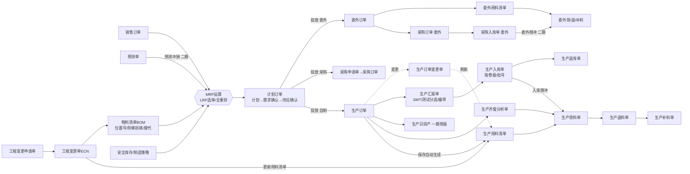
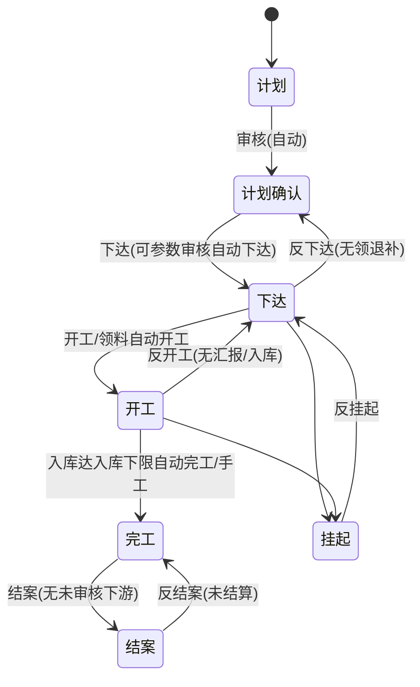

# G1a 计划与生产（MRP/BOM/ECN/生产/日排产/委外）需求章节

> 依据：金蝶云星空帮助中心 生产制造 下的5个模块，详细摘要见 kingdee-digest/{计划管理,工程数据,生产管理,日排产,委外管理}.md。
> - **字段标注规则**：中文字段名都取自金蝶原文。标【扩展】的是电子元器件行业的补充建议，**不是金蝶原文**。表名、列名是本项目的设计，不是金蝶的物理表。
> - **分期**：一期 = 电子元器件工厂最小闭环，覆盖 SMT 贴片、测试分选、编带、批次/卷盘；二期 = 增强功能。
> - **范围边界**：工序级 MES、SMT 上料表、工序汇报、HMI 归 G1b。本章只定义接口。

## 1. 业务总流程

## 2. 单据清单与分期

| # | 单据/资料 | 一期/二期 | 电子场景说明 |
|---|---|---|---|
| 1 | 物料清单 BOM（含阶梯用量、替代设置） | 一期 | 位置号用来写 SMT 贴片位号，例如 R1、C12。阶梯损耗是原文说明的电子行业电容电阻用法 |
| 2 | 替代方案 | 一期 | 同规格、多品牌的电阻电容和 IC 互替 |
| 3 | 工程变更申请单 | 二期（一期可以直接走 ECN） | 客户反馈的变更 |
| 4 | 工程变更单 ECN | 一期 | 料号切换，支持"用完旧料" |
| 5 | 工艺路线（简版：工序号、作业、工作中心） | 一期（详细版归 G1b） | SMT → AOI → 测试分选 → 编带 → 包装 |
| 6 | 工作日历、班次 | 一期 | 两班或三班 |
| 7 | 安全库存设置、制造策略（MTS/MTO） | 一期 | 一期只做 MTO 计划跟踪号和 MTS 两种 |
| 8 | 计划方案 + MRP 运算（LRP 选单 / 全重排） | 一期 | 一期不做 MPS、多组织、计划区 |
| 9 | 计划订单 | 一期 | 投放后生成生产订单、采购申请单或委外订单 |
| 10 | 预测单、预测冲销 | 二期 | 分销备货型产品 |
| 11 | 预留（强/弱）、预留单 | 二期（一期用计划跟踪号隔离） | |
| 12 | 生产订单 | 一期 | |
| 13 | 生产用料清单 | 一期 | |
| 14 | 生产订单变更单、生产用料清单变更单 | 一期 | 改数量、换料 |
| 15 | 生产齐套分析单 | 一期 | 开线前的齐套检查 |
| 16 | 生产领料单、生产退料单、生产补料单 | 一期 | SMT 按卷盘领料，退回尾料卷 |
| 17 | 生产领料申请单（含拣货） | 二期 | |
| 18 | 生产发料通知单、挪料单、月末在制转移、倒冲差异分摊、生产直送 | 二期 | |
| 19 | 生产汇报单 | 一期 | 按工段或测试分选结果汇报良品、不良数 |
| 20 | 生产入库单、生产退库单 | 一期 | 编带后按卷盘、批号入库 |
| 21 | 产线日产量 + 生产日排产（简版：顺排、锁定、确认） | 一期 | 按 SMT 线、分选机、编带机的日产量排产 |
| 22 | 日排产齐套、日排产发料、委外日排产、APS | 二期 | |
| 23 | 委外订单 + 委外用料清单 + 委外领料/退料/补料 | 一期 | 外协电镀、测试、编带 |
| 24 | 委外订单变更单、拆分、委外超耗单、委外齐套、委外倒冲 | 二期 | |
| 25 | 缺料分析单、追料报告 | 二期（一期用齐套分析单的缺料清单代替） | IC 交期长 |

## 3. 各单据：字段表与状态机

以下所有单据都有公共字段，表里不再重复列出：
- 单据编号、单据类型、单据日期、单据状态（暂存、创建、审核中、已审核、重新审核）
- 创建人/时间、审核人/时间

### 3.1 物料清单 BOM（一期）

| 字段（原文） | 说明 | 期 |
|---|---|---|
| 父项物料编码、BOM版本、BOM分类（标准BOM/配置BOM）、BOM用途（自制/委外/通用/组装/报价）、成品率、是否变更中 | 表头 | 一期（BOM分类二期） |
| 项次、子项物料编码、子项类型（标准件/替代件/返还件）、子项单位、用量类型（固定/变动/阶梯）、分子、分母、固定损耗、变动损耗率、生效日期、失效日期 | 子项 | 一期 |
| 起始数量、截止数量 + 分子、分母、损耗（阶梯用量） | 阶梯损耗 | 一期 |
| 发料方式（直接领料/直接倒冲/调拨领料/调拨倒冲/不发料）、倒冲时机（汇报倒冲/入库倒冲）、默认发料仓库、超发控制方式、最小发料批量、是否发损耗、是否关键件、工序、位置号 | 物料控制 | 一期 |
| 替代策略、替代方式、替代优先级、替代主料 | 替代 | 一期 |
| 联副产品（联产品/副产品、成本权重） | 二期 |  |
| 【扩展】贴装面（TOP/BOT）、封装 | SMT 用 | 一期，可选 |

- **状态机**：创建 → 审核中 → 已审核 ⇄ 禁用。
- 存在未生效的 ECN 时，"是否变更中"为是。
- 参数"BOM存在库存或未完成单据不允许禁用"。【来源:物料清单】【来源:工程数据参数】

### 3.2 替代方案（一期）
- **字段**：
  - 表头：替代编码、替代策略（混用/手工/整批/整批+混用）、替代方式（替代/取代/按比例）、替代类型（BOM替代/订单替代）、生效日期、失效日期。
  - 主物料页签：物料、分子、分母。
  - 替代物料页签：物料、优先级、分子、分母、替代主料、净需求比例。【来源:替代方案】
- **规则**：一个主物料组只能有一个替代主料，并做唯一性校验。
- **状态**：创建 → 审核 → 禁用。

### 3.3 工程变更申请单（二期）与工程变更单 ECN（一期）
- **申请单**：
  - 字段：变更来源（内部发现/客户反馈）、申请部门、申请人、客户、物料、BOM版本、变更等级、变更内容、版本升级、现场更新、变更状态。
  - 变更状态：未处理 → 处理中 → 已生效 → 已关闭，由下游 ECN 反写。【来源:工程变更申请单】
- **ECN**：
  - 表头字段：变更组织、变更原因、变更类型（立即变更/按日期变更/用完旧料）、生效日期、版本升级、更新用料清单、子项更换（保留/删除替代料）。
  - 明细字段：行标示（新增/修改前/修改后/失效/删除）、父项、指定项次、子项、用量、损耗。【来源:工程变更单】
  - 状态机：创建 → 审核中（会签）→ 已审核 → 生效（立即生效，或到生效日期由定时任务生效，或用完旧料时由旧料清理触发）。
  - 生效时可以升 BOM 版本，或直接修改原版本。勾选"更新用料清单"时，会刷新在制的生产用料清单和委外用料清单。

### 3.4 计划方案 / MRP 运算（一期简版）
- **计划方案字段**：方案编码、名称、计划展望期、需求时界、计划时界。
- **需求来源**：一期只取销售订单，二期加入预测单和冲销结果。
- **供给参数**：计划订单、生产订单、委外订单、采购申请单、采购订单、即时库存。
- **运算参数**：损耗率、成品率、现有库存、安全库存、预计入库/已分配、订货策略批量调整、替代物料、供给优先顺序。
- **仓库参数**：MPS/MRP 可用仓。一期要把不良品仓、待检仓排除在外。【来源:计划方案】
- **计算公式**（来自【来源:计划方案】【来源:制造策略】）：
  - 净需求 = 毛需求 × (1 + 损耗率) − 现有库存 + 安全库存 − 预计入库 + 已分配
  - 计划订单量 = 净需求 ÷ 成品率
- **运算日志**：运算编号、方案、开始/结束时间、状态。展开前先跑低位码运算并做 BOM 完整性检查（缺 BOM 记例外代码 50）。
- **例外信息**（二期）：例外代码 6/7/8/10/11/15/16/20/21/25/50/96。

### 3.5 计划订单（一期）
- **字段**：
  - 单据类型（MRP计划订单；MPS 二期）、投放类型（生产订单类/采购申请类/委外订单类）
  - 物料、BOM版本、净需求、需求日期
  - 建议采购/生产日期、建议到货/完工日期、建议订单量、确认订单量
  - 生产车间、供应商、计划员、计划跟踪号、数据来源（运算生成/合并生成/拆分生成/手工录入）、运算编号、业务状态
  - 计划BOM 页签：允许替代、替代方案。【来源:计划订单】
- **状态机**：计划 →（需求确认）→ 需求确认 →（供应确认）→ 供应确认 →（投放）→ 关闭（投放关闭）。
  - 另有手工关闭、合并关闭、拆分关闭。
  - 每一步都可以反向操作，前提是下游还没有生成单据。

### 3.6 生产订单（一期）

| 区域 | 字段（原文） |
|---|---|
| 表头 | 生产组织、计划组、计划员 |
| 明细 | 产品类型、物料编码、生产车间、单位、数量、业务状态、计划开工时间、计划完工时间、BOM版本、工艺路线、批号、入库上限、入库下限、挂起状态、仓库、领料状态、产品检验 |
| 执行 | 计划确认日期、下达日期、开工日期、完工日期、结案日期、汇报选单数量、合格品数量、不合格品数量、报废数量、返修品数量、领料套数、合格品入库数量 |
| 参考 | 生成方式、来源单据类型、来源单据编号、销售订单、销售订单行号、计划跟踪号 |
| 【扩展】 | 卷盘规格（每盘数量）、测试程序版本、客户料号 |

- **状态机**（分录级）：

【来源:生产订单】

### 3.7 生产用料清单（一期）
- **生成**：生产订单保存时，按 BOM 版本自动生成。
- **字段**（另见 digest）：
  - 子项物料编码、子项类型、分子、分母、固定损耗、变动损耗率、需求日期
  - 标准用量、需求数量、应发数量
  - 发料方式、倒冲时机、超发控制方式、仓库、位置号、替代策略/替代主料
  - 已领数量、补领数量、报废数量、良品退料数量、来料不良退料数量、作业不良退料数量、已消耗数量、在制材料数量
  - 领料选单数量、退料选单数量、补料选单数量
- **公式**（【来源:生产用料清单】）：
  - 标准用量 = 订单数量 × 使用比例 × 分子 ÷ 分母
  - 在制材料数量 = 已领 + 补领 − 良品退 − 来料不良退 − 作业不良退 − 报废 − 已消耗
- **状态**：创建 → 审核（可以设为下达时自动审核）。启用变更后，审核后的修改只能走变更单。

### 3.8 生产订单变更单、生产用料清单变更单（一期）
- **订单变更单字段**：变更原因、变更类型、生产订单编号、数量、计划开工/完工时间、BOM版本、入库上限/下限。
  - 审核时反写生产订单，并刷新用料清单。
  - 可以自动生成暂存状态的退料单。
- **用料清单变更单字段**：变更原因、变更类型（新增/变更前/变更后）、物料编码、分子、分母、固定损耗、变动损耗率%、应发数量、发料方式。
  - 审核即执行变更。

### 3.9 生产齐套分析单（一期）
- **字段**：
  - 优先顺序
  - 方案：截止日期、即时库存、采购订单、生产订单、物料替代、预留
  - 订单：分析数量、预计齐套数量、库存齐套数量
  - 子项：应发数量、已领数量、可领数量、缺料数量、备料数量、本次领料数
- **状态与动作**：
  - 状态：创建 → 分析 → 提交 → 审核。
  - 审核时反写用料清单的备料数量。
  - 可以生成生产领料单和直接调拨单。【来源:生产齐套分析单】

### 3.10 生产领料单、退料单、补料单（一期）

**生产领料单**
- 字段：发料组织、生产车间、货主、物料编码、申请数量、实发数量、仓库、仓位、批号、生产日期、有效期至。另加【扩展】卷盘号、MSD 等级、开封时间。
- 规则：
  - 保存时反写领料选单数量，审核时反写已领数量。
  - 选单条件：应发 − 领料选单 + 良品退 + 来料不良退 > 0。
  - 超发控制分四种：允许超发、最小发料批量、不允许超发、按损耗率超发。

**生产退料单**
- 退料类型：良品、来料不良、作业不良。
- 下推来源：用料清单、领料单或补料单。
- 审核时反写对应的退料数量。
- 电子场景：SMT 尾料卷按良品退料，退回时要记录剩余数量。

**生产补料单**
- 下推来源：生产订单，或作业不良的退料单。
- 审核时反写补领数量。
- 抛料超额时走审批。
- 状态：创建 → 审核中 → 已审核，三张单都一样。

### 3.11 生产汇报单（一期）
- **字段**：
  - 物料编码、汇报类型、完成数量、合格数量、不合格数量、返修数量、报废数量、返工数量
  - 开始时间、结束时间、人员实作工时、机器实作工时、批号、班组
  - 【扩展】分选档位（BIN1..BINn）各档数量
- **规则**：
  - 保存时反写汇报选单数量，审核时反写合格、不合格等数量。
  - 控制条件：入库上限 − 汇报选单数量 + 返修数量 > 0。
  - 可以按参数在汇报时倒冲。【来源:生产汇报单】

### 3.12 生产入库单、生产退库单（一期）
- **入库单字段**：入库类型（合格品/不合格品/返工品/报废品）、应收数量、实收数量、仓库、仓位、批号、生产日期、有效期至、生产订单号、源单类型、源单编号。另加【扩展】卷盘号（一卷一行，或做子表）、D/C 周期码。
- **入库单规则**：
  - 审核时反写四类入库数量。
  - 合格入库数量达到入库下限时，订单自动完工。
  - 入库倒冲会生成倒冲领料单。【来源:生产入库单】
- **退库单**：只能从入库单生成。字段：退库类型、应退数量、实退数量、退库原因。

### 3.13 产线日产量、生产日排产（一期简版）
- **产线日产量**：产线编码、产线名称、所属车间、人数量、机数量、计划工时；表体：物料、单件工时、日产量、最小排产批量、生效日期、失效日期。【来源:产线日产量】
- **排产明细**：生产订单、产线、排产日期、排产数量、未排数量、确认状态、锁定。
- **规则**：
  - 只支持顺排，策略可选按计划开工日期或按指定开工日期。
  - 插单时锁定已排明细，后面的顺延。
  - 用汇报单或入库单更新上线数量。【来源:生产日排产】【来源:更新已排】
- **状态**：未确认 → 已确认；可以锁定和解锁。

### 3.14 委外订单 + 委外用料清单 + 委外领料/退料/补料（一期），委外超耗单（二期）
- **委外订单字段**：
  - 委外组织、产品类型、物料、供应商、数量、业务状态、计划开工/完工时间、BOM版本、采购组织、领料状态、批号、仓库
  - 采购选单数量、采购执行数量、入库数量
  - 来源单据、销售订单、采购订单
- **委外订单状态**：计划 → 计划确认 → 下达 → 完工 → 结案，另有挂起。和生产订单相比少了"开工"。
- **结案条件**：
  - 用料清单已审核。
  - 采购订单已业务关闭、整单关闭或业务终止。
  - 没有未审核的领料、退料、补料单。【来源:委外订单】
- **委外领料、退料、补料**：结构同生产三单。前提是订单状态为下达或完工，且用料清单已审核。
- **委外超耗单字段**：供应商、申请数量、消耗数量。可以下推标准应收单。

## 4. 下推（单据转换）与反写规则

建议统一用 `sys_bill_link` 记录源单行和目标单行的关系，再由反写规则表驱动累计字段。

| 源单 → 目标单 | 选单条件 | 保存时反写 | 审核时反写 | 期 |
|---|---|---|---|---|
| 计划订单 → 生产订单/采购申请单/委外订单 | 业务状态为供应确认（或参数允许直接投放） | — | 计划订单投放关闭 | 一期 |
| 生产订单 → 生产用料清单 | 订单保存 | 自动生成 | — | 一期 |
| 生产订单/用料清单 → 生产领料单 | 应发 − 领料选单 + 良品退 + 来料不良退 > 0；订单状态下达或开工 | 领料选单数量 | 已领数量；领料状态；领料可自动开工 | 一期 |
| 领料单/补料单 → 生产退料单 | 实发 − 退料选单 > 0 | 退料选单数量 | 良品、来料不良、作业不良三类退料数量 | 一期 |
| 生产订单/作业不良退料单 → 生产补料单 | 实退 − 补料选单 > 0 | 补料选单数量 | 补领数量、报废数量 | 一期 |
| 生产订单 → 生产汇报单 | 入库上限 − 汇报选单 + 返修 > 0 | 汇报选单数量 | 合格、不合格、返修、报废、返工数量 | 一期 |
| 生产订单（直接入库）/汇报单（汇报入库）→ 生产入库单 | 不超过入库上限 | 入库选单数 | 四类入库数量；在制扣减；自动完工；入库倒冲 | 一期 |
| 生产入库单 → 生产退库单 | 实收 − 已退 > 0 | — | 冲减入库数量 | 一期 |
| 生产齐套分析单 → 领料单/直接调拨单 | 审核后 | — | 用料清单的备料数量、使用比例 | 一期 |
| 生产订单变更单 → 生产订单 | — | — | 订单字段；刷新用料清单 | 一期 |
| 工程变更单 → BOM/用料清单 | 审核并生效 | — | BOM 版本；在制用料清单；申请单变更状态 | 一期 |
| 委外订单 → 采购订单 | 状态为下达 | 采购选单数量 | 采购执行数量；回填供应商 | 一期 |
| 采购入库单（委外）→ 委外订单 | — | — | 入库数量；触发委外倒冲（二期） | 一期 |
| 委外订单/委外用料清单 → 委外领料、退料、补料 | 同生产三单 | 同生产三单 | 同生产三单 | 一期 |
| 委外超耗单 → 标准应收单 | 审核后 | — | — | 二期 |
| 汇报单/入库单 → 日排产明细 | — | — | 上线数量 | 一期 |

**反审核规则**：做反审核时，按相反方向冲减审核时反写的数量；有下游有效单据时禁止反审核（原文："反下达需无领退补"、"反开工需无汇报入库"）。

## 5. 工作流引擎审批节点

原文只给出"审核中/重新审核"这两个状态，以及领料申请单的两个角色（领料员提交、仓管员审核拣货）。下面的审批链是本项目的建议。

| 单据 | 触发 | 建议节点 | 期 |
|---|---|---|---|
| BOM（新建、升版） | 提交 | 工艺/工程师 → 工程主管 | 一期 |
| 工程变更单 ECN | 提交 | 工程 → 品质 → 计划（评估在制和库存，选择用完旧料或立即变更）→ 采购 → 工程经理；全部通过后生效 | 一期 |
| 替代方案 | 提交 | 工程 → 品质（确认物料已承认） | 一期 |
| 计划订单 | 投放前 | 计划员确认 → 计划主管审核；可配置"金额/数量超阈值才审核" | 一期 |
| 生产订单 | 提交 | 计划主管审核；审核后自动计划确认，下达前由生产主管确认 | 一期 |
| 生产订单变更单、用料清单变更单 | 提交 | 计划 → 生产主管；涉及换料时加品质 | 一期 |
| 生产补料单（超额补料） | 超过损耗率时触发 | 线长 → 生产主管 → 计划（抛料超标） | 一期 |
| 生产领料单 | 提交 | 仓管审核（实发） | 一期 |
| 生产入库单 | 提交 | QC 判定 → 仓管审核 | 一期 |
| 委外订单 | 提交 | 计划 → 采购主管 | 一期 |
| 委外超耗单 | 提交 | 采购 → 财务（应收扣款） | 二期 |
| 生产齐套分析单 | 提交 | 计划审核（锁定备料） | 一期 |

**引擎能力要求**：
- 条件分支，例如按金额、数量、超损耗比例走不同路径。
- 会签和或签。
- 驳回到发起人，对应状态"重新审核"。
- 撤销提交。
- 审批通过时触发审核动作，执行反写和自动下达。
- 定时生效，用于 ECN 按日期生效。

## 6. MySQL 核心表（一期为主）

| 表名 | 主要字段（括号内为对应原文字段） | 期 |
|---|---|---|
| md_bom | id, material_id(父项物料编码), version(BOM版本), bom_type(BOM分类), usage(BOM用途), yield_rate(成品率), is_changing(是否变更中), status, forbid_status | 一期 |
| md_bom_entry | id, bom_id, seq(项次), child_material_id, child_type(子项类型), unit_id, qty_type(用量类型), numerator(分子), denominator(分母), fixed_scrap(固定损耗), scrap_rate(变动损耗率), issue_type(发料方式), backflush_time(倒冲时机), over_issue_ctrl(超发控制方式), min_issue_qty, is_key(是否关键件), oper_no(工序), position_no(位置号 TEXT), sub_strategy, sub_priority, is_sub_main(替代主料), eff_date, exp_date | 一期 |
| md_bom_ladder | id, entry_id, from_qty(起始数量), to_qty(截止数量), numerator, denominator, fixed_scrap, scrap_rate | 一期 |
| md_substitute / md_substitute_entry | id, code(替代编码), strategy, mode(替代方式), sub_type(替代类型), eff_date, exp_date / main_flag, material_id, priority, numerator, denominator, net_ratio(净需求比例) | 一期 |
| md_route / md_route_oper | id, code, material_id, bom_id, workshop_id / route_id, oper_no(工序号), work_center_id, process_id(作业), base_qty, report_upper_ratio, report_lower_ratio | 一期简版 |
| md_calendar / md_shift | 日历、日期、是否工作日 / 班次、开始时间、结束时间、工作小时数 | 一期 |
| ecn_request / ecn_request_entry | 变更来源, customer_id, material_id, bom_id, change_level, change_content, change_status | 二期 |
| ecn_order / ecn_order_entry | change_type(变更类型), eff_date, upgrade_version, update_ppbom, reason / row_flag(行标示), parent_bom_id, seq, child_material_id, numerator, denominator, scrap_rate | 一期 |
| pl_safety_stock | material_id, safe_qty, reorder_point, eoq, max_qty | 一期 |
| pl_mrp_scheme | code, name, horizon_days, demand_fence, plan_fence, params_json(需求/供给/运算/投放/仓库参数) | 一期 |
| pl_mrp_run / pl_mrp_run_log | run_no(运算编号), scheme_id, type(MRP/MPS), mode(全重排/选单), start_at, end_at, status / material_id, exception_code(例外代码), msg | 一期 |
| pl_mrp_detail | run_id, material_id, date, gross_req, onhand, scheduled_receipt, allocated, safety, net_req, src_bill_type, src_entry_id（供需明细，用于追溯） | 一期 |
| pl_plan_order | bill_no, bill_type, release_type(投放类型), material_id, bom_id, net_req(净需求), demand_date, sugg_start, sugg_finish, sugg_qty, firm_qty(确认订单量), workshop_id, supplier_id, planner_id, mto_no(计划跟踪号), data_source(数据来源), run_id, biz_status(计划/需求确认/供应确认/关闭), close_type | 一期 |
| pl_plan_order_bom | plan_order_id, child_material_id, need_qty, need_date, allow_sub | 一期 |
| pl_forecast / pl_forecast_entry | 预测组织, customer_id, material_id, qty, start_date, end_date, reserve_type, mto_no, exec_qty, close_status | 二期 |
| pl_reserve_link | demand_bill_type, demand_entry_id, supply_bill_type, supply_entry_id, reserve_type(强/弱), qty, reserve_to | 二期（一期用 mto_no） |
| pp_mo | bill_no, bill_type, prd_org_id, planner_id, status, date | 一期 |
| pp_mo_entry | mo_id, product_type, material_id, workshop_id, qty, biz_status(计划/计划确认/下达/开工/完工/结案), plan_start, plan_finish, bom_id, route_id, lot_no(批号), in_upper, in_lower, suspend, wh_id, pick_status, report_sel_qty, good_qty, ng_qty, scrap_qty, rework_qty, in_good_qty, pick_sets, so_entry_id, mto_no, src_bill_type, src_entry_id, confirm_date, release_date, start_date, finish_date, close_date；【扩展】reel_qty, test_prog_ver | 一期 |
| pp_ppbom / pp_ppbom_entry | mo_entry_id, material_id, bom_id, qty, status / child_material_id, child_type, numerator, denominator, fixed_scrap, scrap_rate, need_date, std_qty, need_qty, must_qty(应发), issue_type, backflush_time, over_ctrl, wh_id, position_no, picked_qty, repick_qty, scrap_qty, good_ret_qty, inc_bad_ret_qty, op_bad_ret_qty, consume_qty, wip_qty, pick_sel_qty, ret_sel_qty, feed_sel_qty, prepare_qty(备料数量) | 一期 |
| pp_mo_change / pp_ppbom_change | 变更原因, change_type, 源单 id, 变更前/后字段 JSON | 一期 |
| pp_kitting / pp_kitting_order / pp_kitting_entry | 方案参数, priority / mo_entry_id, analyse_qty, kit_qty, stock_kit_qty / ppbom_entry_id, must_qty, picked_qty, avail_qty, short_qty, prepare_qty, this_pick_qty | 一期 |
| pp_pick / pp_pick_entry | issue_org, workshop_id, owner / ppbom_entry_id, material_id, apply_qty, actual_qty, wh_id, loc_id, lot_no, prod_date, exp_date, ret_sel_qty, is_backflush；【扩展】reel_no, msd_level | 一期 |
| pp_return / pp_return_entry | ret_type(良品/来料不良/作业不良), src_entry_id, apply_qty, actual_qty, wh_id, lot_no, feed_sel_qty；【扩展】reel_no, remain_qty | 一期 |
| pp_feed / pp_feed_entry | 同领料单, feed_reason | 一期 |
| pp_report / pp_report_entry | mo_entry_id, report_type, finish_qty, good_qty, ng_qty, rework_qty, scrap_qty, start_at, end_at, labor_hours, machine_hours, team_id, lot_no, in_sel_qty；【扩展】pp_report_bin(bin_code, qty) | 一期 |
| pp_instock / pp_instock_entry | in_type(合格品/不合格品/返工品/报废品), must_qty, real_qty, wh_id, loc_id, lot_no, prod_date, exp_date, mo_entry_id, src_bill_type, src_entry_id；【扩展】pp_instock_reel(reel_no, qty, date_code) | 一期 |
| pp_restock / pp_restock_entry | restock_type, src_instock_entry_id, must_qty, real_qty, reason | 一期 |
| pp_line_capacity / pp_line_capacity_entry / pp_line_capacity_adj | line_code, line_name, workshop_id, worker_qty, machine_qty, plan_hours / material_id, unit_hours, day_qty, min_batch, eff_date, exp_date / date, adj_worker, adj_hours, adj_ratio | 一期 |
| pp_day_schedule | mo_entry_id, line_id, sched_date, sched_qty, online_qty, confirm_status, locked, version | 一期 |
| sub_order / sub_order_entry | sub_org_id, planner_id / material_id, supplier_id, qty, biz_status, plan_start, plan_finish, bom_id, purchase_org_id, pick_status, lot_no, wh_id, po_sel_qty, po_exec_qty, in_qty, mto_no | 一期 |
| sub_ppbom / sub_ppbom_entry | 同 pp_ppbom | 一期 |
| sub_pick / sub_return / sub_feed (+_entry) | 同生产三单 + supplier_id | 一期 |
| sub_overuse / sub_overuse_entry | supplier_id, apply_qty, consume_qty | 二期 |
| sys_bill_link | src_form, src_bill_id, src_entry_id, tgt_form, tgt_bill_id, tgt_entry_id, qty, link_rule_id, created_at | 一期 |
| sys_writeback_rule | src_form, tgt_form, src_field, tgt_field, on_event(save/audit), formula, ctrl_expr(超额校验) | 一期 |
| wf_* | 由工作流章节定义；业务表只保留 status 和 wf_instance_id | 一期 |

**索引建议**：
- 所有 `*_entry` 表建 (bill_id)、(material_id)、(src_entry_id)。
- `pp_mo_entry` 建 (biz_status, plan_start)。
- `pl_mrp_detail` 建 (run_id, material_id, date)。

## 7. 电子元器件场景映射（建议）
- **SMT 贴片**：
  - BOM 的位置号存贴片位号，子项发料方式设为"直接倒冲"或"直接领料"按卷盘领料。
  - 抛料用阶梯损耗表示，例如 0402 电阻在 1k 以内和 10k 以上用不同损耗率（原文："电子行业电容电阻"阶梯损耗）。
  - SMT 上料表归 G1b；原文"下达时自动审核SMT上料表"可以作为接口。
- **测试分选**：
  - 生产汇报单的合格、不合格、报废数量对应分选结果。【扩展】BIN 档位子表。
  - 不同档位如果需要作为不同物料入库，可以用联副产品（二期），或在入库单的入库类型/辅助属性里区分（二期）。
- **编带**：作为最后一道工序或一张独立生产订单（返工生产类型）。入库按卷盘号逐盘入库，带批号和 D/C。
- **批次和卷盘**：
  - 原文批号贯穿生产订单、领料、入库、退库各单。
  - 卷盘号、MSD、D/C 是【扩展】字段，建议作为批号下的子维度（库存表增加 reel_no）。
- **MTO**：客户定制编带规格或打标，用计划跟踪号隔离库存。

## 8. 待确认问题（交给合稿人或老板）
1. 一期是否只做单组织？原文大量涉及多组织（委托组织、供应组织、组织间受托），本稿一期按单组织设计。
2. 测试分选的分档是否需要不同料号入库？这决定一期是否就要联副产品。
3. 卷盘是否要求逐盘条码管理？这需要和条码、库存章节对齐。
4. 委外一期是否只做"整单外协"？工序委外归 G1b。
