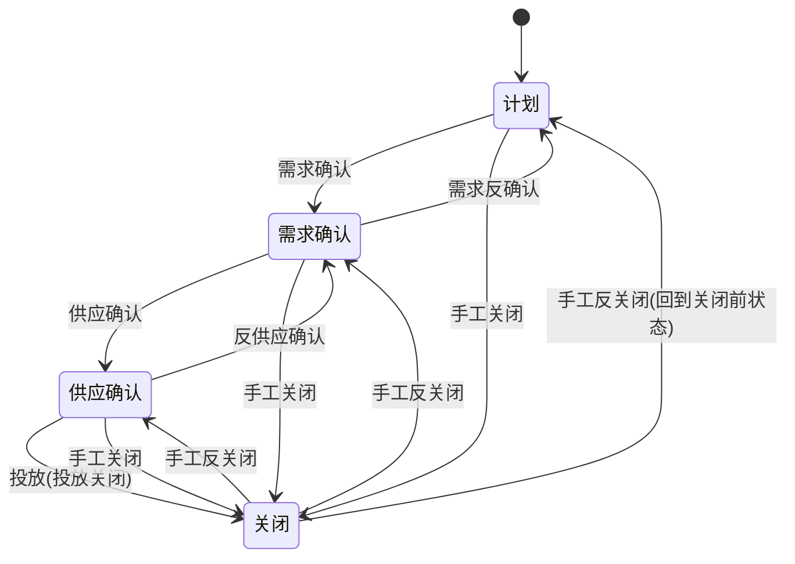
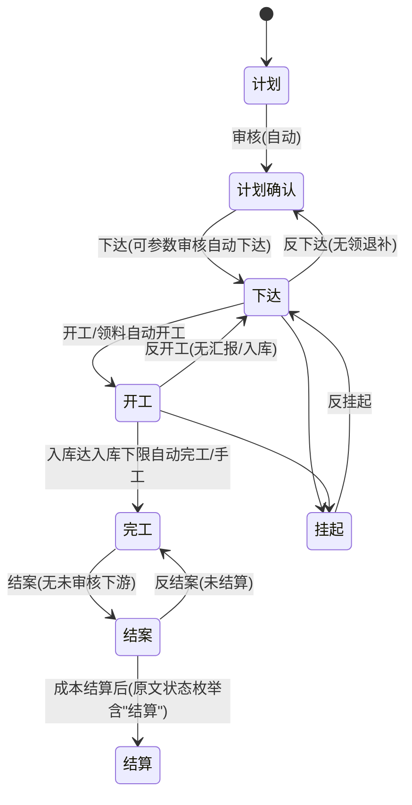

## 3. 各单据：字段表与状态机

> **第二轮修订（2026-11-13）**：本节依据 G1a 范围内全部「字段说明」列重写，原文已逐字补读完。
> - **列含义**：
>   - 原文含义：金蝶对字段的解释。
>   - 必填：只有原文写了"必录"、"必须"、"不能为空"，或截图带 * 时才标"是"；带条件的写明条件。
>   - 取值来源：原文写的携带、选择范围或计算公式。
>   - 默认值：原文写的默认值。
> - "—" 表示原文没有说明，**不做推断**。
> - 【扩展】是本项目对电子行业的建议，不是金蝶原文。
> - 来源格式：【来源:页面名】；看图得到的内容标【来源:页面名-图】。

**公共字段**（各单据通用，下文不再重复）

| 字段 | 原文含义 | 必填 | 取值来源 | 默认值 |
|---|---|---|---|---|
| 单据编号 | 按编码规则自动生成；唯一，不可重复 | 系统生成 | 编码规则 | — |
| 单据类型 | 定义必录字段、打印、审核和流程控制 | 是（BOM 截图带 *） | 新增时可以改，**保存后不可改** | 该单据的默认单据类型 |
| 单据日期 | 有关账规则（见下） | — | 手工填写 | 当前系统日期 |
| 单据状态 | 由系统根据操作自动标识 | 系统 | 暂存、创建、审核中、已审核、重新审核 | — |
| 业务流程 | 预设流程，用户可以自定义 | — | — | 见各单据 |

- **关账规则**：适用于领料、退料、补料、入库、退库、超耗单。
  - 库存组织未关账时：单据日期 ≥ 库存启用日期。
  - 已关账时：单据日期 > MAX(组织最近关账日, 货主最近关账日)。
  【来源:生产补料单】【来源:生产入库单】【来源:生产退库单】【来源:委外超耗单】

### 3.1 物料清单 BOM（一期）

| 字段 | 原文含义 | 必填 | 取值来源/规则 | 默认值 | 期 |
|---|---|---|---|---|---|
| BOM版本 | 物料清单的编码 | — | 具有唯一性 | 编码规则 | 一期 |
| BOM分类 | 标准BOM / 配置BOM | 是（图*） | — | — | 一期（配置二期） |
| BOM用途 | 自制、委外、通用等 | 是（图*） | 生产订单默认取"自制+通用"的最新版本，委外订单默认取"委外+通用" | — | 一期 |
| 父项物料编码 | — | 是（图*） | 父项是外购件时，子项只能是外购件 | — | 一期 |
| 父项物料单位 | — | 是（图*） | 可以修改 | 生产单位 | 一期 |
| 成品率 | 投入 100 套原材料能产出多少套成品 | — | 计划订单量 = 净需求 ÷ 成品率 | — | 一期 |
| 是否变更中 | 存在未生效、未作废的 ECN 时为是 | 系统 | — | — | 一期 |
| 项次 | **同一组替代关系的物料，项次相同** | — | 新增分录时依次递增 | — | 一期 |
| 子项物料编码 | — | 是（图*） | 不能与父项相同 | — | 一期 |
| 子项类型 | 标准件、替代件、返还件 | 是（图*） | **替代件不能手工指定，只能由替代设置产生** | — | 一期 |
| 子项单位 | — | 是（图*） | — | — | 一期 |
| 用量类型 | 固定：与父项数量无关；变动：线性；阶梯：非线性区间 | 是（图*） | 阶梯区间不能重叠 | — | 一期 |
| 分子、分母 | 分子一般填子项用量，分母填父项用量 | — | — | — | 一期 |
| 固定损耗 | 与父项用量无关 | — | — | — | 一期 |
| 变动损耗率 | 与父项用量成比例 | — | 损耗计算公式由工程数据参数指定：1/(1+损耗率) 或 1/(1−损耗率) | — | 一期 |
| 生效日期 | — | — | — | 系统日期或指定日期（由工程数据参数决定） | 一期 |
| 供应组织 | 原文建议存在委托加工关系时才维护 | — | 维护后子项 BOM 版本才可以修改；**MRP 时优先于供应来源比例**【来源:供应来源与bom中的供应组织关系-图】 | — | 二期 |
| 供应类型 | 即计划订单的投放类型 | — | — | — | 一期 |
| 发料方式 | 直接领料、直接倒冲、调拨领料、调拨倒冲、不发料 | — | 父项是生产线模式时只能选调拨倒冲或发料；返还件强制不发料 | — | 一期 |
| 倒冲时机 | 汇报倒冲、入库倒冲等 | 发料方式为倒冲时才可维护 | 父项是生产线模式时一律为汇报倒冲 | — | 一期 |
| 超发控制方式 | 允许超发、最小发料批量、不允许超发、按损耗率超发 | — | — | — | 一期 |
| 最小发料批量 | 一般为最小包装数量 | — | — | — | 一期 |
| 发料组织 | — | — | 必须具有库存职能 | — | 一期 |
| 提前期偏置时间 | 相对第一道工序开工的时间；负数表示开工前就要备好料 | — | 单位：天、时、分、秒 | — | 一期 |
| 工序 | — | — | **必须是正整数** | — | 一期 |
| 位置号 | **子项物料的插件位置** | — | — | — | 一期（SMT 位号） |
| 辅助属性 | — | 影响计划时必录（在保存还是提交时校验，由参数决定） | — | — | 一期 |
| 联副产品·成本权重 | — | — | — | 100 | 二期 |
| 联副产品·倒冲领料 | 勾选后，入库或汇报时生成倒冲领料 | — | — | — | 二期 |
| BOP：生产线、工位/工序 | — | — | 同一生产线、相同项次的分子之和必须等于子项明细的分子 | — | 二期（G1b） |
| 【扩展】贴装面、封装 | SMT 用 | — | — | — | 一期，可选 |

- **状态机**：创建 → 审核中 → 已审核 ⇄ 禁用。
- **禁止禁用的情况**：BOM 有即时库存，或有未完成的生产订单、委外订单、用料清单。
- **父项禁用**：可以设置为自动禁用 BOM。
【来源:物料清单】【来源:工程数据参数】【来源:产品配置】

### 3.2 替代方案（一期）

| 字段 | 原文含义 | 必填 | 规则 | 默认值 |
|---|---|---|---|---|
| 替代策略 | 混用：主料和替代料同时作为供给；手工：按指定比例；整批：要么全用主料，要么全用替代料；**整批+混用：先按整批，满足不了再按混用** | — | — | — |
| 替代方式 | 替代：需求满足不了时产生主物料的供给；取代：产生替代物料的供给；按比例：按净需求比例同时产生 | — | — | — |
| 替代类型 | BOM 替代（针对子项）；订单替代（针对成品的不同辅助属性） | — | — | — |
| 优先级 | **数值越小，优先级越高** | — | — | — |
| 替代主料 | MRP 根据替代主料的供给判定是否触发替代 | — | **优先级相同的替代物料中，有且只能有一个替代主料** | — |
| 生效/失效日期 | — | — | 同一组的日期必须相同；生效 ≤ 失效 | — |
| 净需求比例 | — | 只有替代方式为"按比例"时可维护 | — | — |
| 物料 | — | — | 主料和替代料都只能是自制、外购、委外或配置类 | — |

- **状态**：创建 → 审核 → 禁用。【来源:替代方案】

### 3.3 工程变更申请单（二期）与工程变更单 ECN（一期）

**申请单**【来源:工程变更申请单】

| 字段 | 原文含义 | 必填 | 规则 | 默认值 |
|---|---|---|---|---|
| 变更来源 | 内部发现 / 客户反馈 | — | — | — |
| 变更组织 | — | — | 必须具有工厂职能 | — |
| 物料 | — | — | 必须勾选"可为主产品" | — |
| BOM版本 | — | — | 必须是已审核状态 | — |
| 变更等级 | 辅助资料 | — | — | — |
| 变更类型 | 用完旧料、立即变更、按日期变更 | — | — | — |
| 版本升级 / 现场更新 | — | — | **两者不能同时勾选** | 都不勾选 |
| 变更状态 | — | 系统 | 由下游 ECN 反写 | — |
| 原因分析：分析类别、分析结果、需要验证、分析部门、人员、时间 | — | 勾选"需要验证"后，"需要结果"必录 | — | — |
| ECN单号 | 记录下游 ECN 的单号 | 系统 | — | — |

**ECN**【来源:工程变更单】

| 字段 | 原文含义 | 必填 | 规则 | 默认值 |
|---|---|---|---|---|
| 变更类型 | 立即变更、按日期变更、用完旧料 | — | — | — |
| 生效日期 | 变更类型为按日期变更时使用 | — | — | — |
| 版本升级 | 是否生成新的 BOM 版本 | — | — | — |
| 更新用料清单 | 是否同步更新生产和委外用料清单 | — | — | — |
| 子项更换 | 保留替代料 / 删除替代料 | — | — | — |
| 申请单号、申请组织、申请部门、申请人 | — | — | 从申请单下推时携带，不可修改；手工新建时可以维护 | — |
| BOM版本 | — | — | 使用组织必须等于变更组织；**BOM 父项必须勾选"启用ECN"** | — |
| 行标示 | 新增、修改前、修改后、失效、删除 | — | 决定子项字段的选择范围和是否可编辑 | — |
| 指定项次 | — | — | — | 为空时加到最后 |
| 子项物料编码 | — | — | 新增、修改后行：从物料列表选；修改前、删除、失效行：只能选 BOM 中现有子项 | — |
| 阶梯：起始数量（含）、截止数量 | — | — | 各行区间不能重叠；单位固定为子项单位 | — |
| 联副产品 | 行类型：新增、修改、失效、删除 | — | 物料必须勾选"可为联副产品" | — |
| 指定升级BOM版本页签 | 原BOM版本、指定BOM版本、新BOM版本 | — | — | — |

- **状态机**：创建 → 审核中 → 已审核 → 生效。生效方式有三种：
  - 立即生效。
  - 按日期由定时任务生效。
  - 用完旧料，由旧料清理触发。
- **旧料清理**：查询本组织和其他组织的库存与预计入，单据类别包括生产订单、采购申请、采购订单、采购入库、盘盈、其他入库。【来源:ECN旧料清理】

### 3.4 计划方案 / MRP 运算（一期简版）

**计划方案主要字段**【来源:计划方案】

| 字段 | 原文含义 | 规则 | 默认值 |
|---|---|---|---|
| 方案编码 | — | 唯一 | — |
| 计划展望期 | 系统时间 + 展望期 = 最大需求日期（原文例：展望期 10 日、当天 7/22，则 8/2 的订单不参与） | — | — |
| 需求时界 / 计划时界 | 开始到需求时界：取销售订单；需求时界到计划时界：取销售与预测中较大者；计划时界之后：取预测 | — | — |
| 重复生产计划 | **原文：不支持** | — | — |
| 强制覆盖计算参数 | 勾选则取方案上的参数，否则取物料基础资料和制造策略 | 损耗率公式取自工程数据参数 | — |
| 订货策略 / 批量调整 | LFL、POQ、FOQ；最大订货量、最小订货量、批量增量 | — | — |
| 供给优先顺序 | 按单据：生产订单 > 委外订单 > 采购订单 > 采购申请 > 计划订单 > 其他入库 > 调拨入库；或者按日期 | — | — |
| 预留释放方式 | 全部释放（手工预留除外，建议全重排时用）；全部释放弱预留（建议净改变时用）；不释放（建议选单计算和插单时用） | — | — |
| 投放参数 | 运算完成直接投放、投放时间范围 X 天、默认生产单据类型、采购申请单投放后的状态（创建或审核）、采购申请单最大分录数 | — | — |
| 本次计算可用仓 | — | 库存状态为"MRP可用"的才参与 | 允许 MRP 计划的仓库默认勾选 |

**制造策略公式**【来源:制造策略】

| 勾选项 | 公式 |
|---|---|
| 考虑现有库存 | 净需求 = 毛需求 − 现有库存 |
| 考虑安全库存（必须先勾"考虑现有库存"） | 净需求 = 毛需求 + 安全库存 |
| 考虑预计入库和已分配 | 净需求 = 毛需求 − 预计入库 + 已分配 |
| 考虑成品率 | 计划订单量 = 净需求 ÷ 成品率 |

- 计划模式有 MTS、MTO、IHT 三种。IHT：上级物料按 MTO 号运算时，本物料也按 MTO 号运算。
- **需求和供给的取数口径**（原文逐条，用作一期 MRP 取数规则）：

| 类别 | 单据 | 参与条件 | 数量 |
|---|---|---|---|
| 需求 | 计划BOM | 非暂存；需求确认或供应确认；非返还件 | 考虑损耗时取需求数量，否则取标准用量 |
| 需求 | 生产用料清单 | 订单为计划确认、下达、开工或完工；未作废；非返还件 | 需求数量 − 已领 + 良品退料 + 来料不良退料 |
| 需求 | 委外用料清单 | 订单为计划确认、下达或完工 | — |
| 需求 | 生产/委外补料单 | 非暂存、未审核、未作废 | 申请数量 |
| 供给 | 计划订单 | 需求确认或供应确认（计划状态是否参与由参数控制） | 确认订单量 |
| 供给 | 生产订单 | 计划确认、下达或开工，未作废 | 数量 − 合格品入库 − 不合格品入库 − 报废品入库 |
| 供给 | 委外订单 | 计划确认或下达，未作废 | 数量 − 采购选单数量 |
| 供给 | 采购申请单 | 计划确认，且未作废、未关闭、未终止 | 剩余数量 |
| 供给 | 采购订单 | 未作废、未关闭、未冻结、未终止 | 剩余入库数量 |

【来源:计划方案】【来源:主计划方案】
- **期末可用量** = 期初可用库存 + 预计入可用量 − 安全库存 − 总需求 + 计划订单 + 组织间需求单。【来源:mrp周期计划】
- **运算日志和例外信息**：与第一轮一致。例外代码 6/7/8/10/11/15/16/20/21/25/50/96 放在二期。

### 3.5 计划订单（一期）

| 字段 | 原文含义 | 必填 | 取值来源/锁定 | 默认值 | 期 |
|---|---|---|---|---|---|
| 单据类型 | MPS 计划订单 / MRP 计划订单 | — | 跟随物料的计划策略 | MPS 物料默认 MPS 计划订单，MRP 物料默认 MRP 计划订单 | 一期（MPS 二期） |
| 投放类型 | 生产订单类、采购申请类、委外订单类、组织间受托类、生产线类（只作生产线需求来源，**不可投放**） | — | — | — | 一期只做前三类 |
| 物料编码 | — | — | 必须与单据类型的计划策略匹配；生产类要求"允许生产"，采购类要求"允许采购"，委外类要求"允许委外" | — | 一期 |
| BOM编号 | — | **投放类型为生产或委外时必录** | BOM 用途要匹配：生产用自制或通用，委外用委外或通用 | — | 一期 |
| 辅助属性 | — | 影响计划时必录 | — | — | 一期 |
| 需求组织 | — | — | — | 当前组织 | 一期 |
| 建议采购/生产日期、建议到货/完工日期 | — | — | 必须落在供应组织的日历内；手工录入时，建议完工 = 建议开工 + 固定提前期 + 建议订单量 ÷ 变动提前期批量 × 变动提前期；**需求确认后锁定** | 运算生成 | 一期 |
| 建议订单量 | — | — | 必须 > 0；**需求确认后锁定** | 运算生成 | 一期 |
| 确认采购/生产日期、确认到货/完工日期、确认订单量 | — | — | 订单量必须 > 0；日期在日历内；**供应确认后锁定** | — | 一期 |
| 采购申请部门 | — | — | 只有采购申请类可维护 | — | 一期 |
| 生产车间、计划员 | — | — | 只有生产类或委外类可维护 | — | 一期 |
| 供应商 | — | — | 采购类只能选供应类别不是委外的；委外类只能选供应类别为委外的 | — | 一期 |
| 货主类型 / 货主 | — | — | 生产类、采购类的货主类型锁定为业务组织；货主锁定为供应组织 | — | 一期 |
| 计划跟踪号 | — | — | 只有制造策略为 MTO 或 IHT 时可维护 | — | 一期 |
| 数据来源 | 运算生成、合并生成、拆分生成、手工录入 | 系统 | — | — | 一期 |
| 运算编号 | — | 系统 | 每次运算重新赋值 | 手工新增时显示最近一次的编号 | 一期 |

**计划BOM 页签**：
- 子项：从 BOM 携带，不可修改；虚拟件取下层物料；手工新增的子项不能等于主产品。
- 使用比例：无替代时为 100%；非组合替代时主料加替代料合计 100%；组合替代时关键料合计 100%。
- 需求日期 = 确认开工 + 偏置提前期；超过确认完工日期时取确认完工日期。
- 标准用量：固定用量 = 使用比例 × 分子 ÷ 分母；变动用量 = 数量 × 使用比例 × 分子 ÷ 分母；返还件为 0。
- 应发数量：是否发损耗为"是"时取计划投料数量，否则取标准用量。
- 发料组织：锁定为生产组织。
- 倒冲时机、仓库：BOM 上为空时取物料上的值。
【来源:计划订单】

**状态机**（第二轮按状态图修正）：

- **关闭状态的类型**：手工关闭、投放关闭、拆分关闭、合并关闭。
- **修正点**：
  - 第一轮写成"每一步都可以反向操作"。状态图实际显示：**计划、需求确认、供应确认三个状态都能直接手工关闭**，反关闭后回到关闭前的状态。
  - 第一轮漏写了字段锁定规则：需求确认后建议字段锁定，供应确认后确认字段锁定。
  【来源:计划订单-图】【来源:计划订单】

### 3.5b 预测单（二期，新增状态机）

| 字段 | 必填 | 规则 | 默认值 |
|---|---|---|---|
| 供应组织 | — | 不允许维护 | — |
| BOM版本、辅助属性 | 影响计划时必录 | — | — |
| 预测开始日期 / 结束日期 | — | 开始日期必须大于系统日期；结束日期不能早于开始日期 | 变更单新增行的开始日期默认为当前日期 |
| 需求优先级 | — | 取值 1–99；预留类型为强或弱时可维护 | 变更单新增行默认为空 |
| 计划跟踪号 | — | 只有 MTO 或 IHT 时可维护 | 变更单新增行默认为空 |
| 关联数量 / 执行数量 | 系统 | 关联数量 = 与销售订单冲销的数量；执行数量 = 下推销售订单的数量 | — |

- **关闭状态**：
  - 默认为未关闭。
  - 用户手工关闭：手工关闭。
  - MRP 运算中关闭：自动关闭。
  - 下推销售订单后执行数量 > 预测数量：下推关闭。
  - **只有手工关闭的单据可以反关闭。**
【来源:预测单】【来源:预测单变更单】

### 3.6 生产订单（一期）

| 字段 | 原文含义 | 必填 | 取值来源/规则 | 默认值 | 期 |
|---|---|---|---|---|---|
| 生产组织 | — | — | 必须具有生产职能 | 当前组织 | 一期 |
| 委托组织 | — | 只有组织委托加工类单据类型必录 | 只有单据类型勾选了"组织间受托加工"才可维护 | — | 二期 |
| 计划组 / 计划员 | 业务组类型为计划组 / 业务员类型为计划员 | — | 原文此处写成"委外申请单的委外组织"，**疑为原文笔误** | — | 一期 |
| 产品类型 | 主产品、联产品、副产品 | 系统 | 不可编辑；联副产品由 BOM 携带 | — | 一期 |
| 物料编码 | — | — | 只能选勾选"允许生产"的物料 | — | 一期 |
| 生产车间 | — | **下达前必录** | 必须是具有车间职能的部门 | — | 一期 |
| 单位 | — | — | 可以修改 | 生产单位 | 一期 |
| 业务状态 | 计划、计划确认、下达、开工、完工、结案、**结算** | 系统 | 主产品的状态同步到联副产品 | — | 一期 |
| 计划开工时间 | — | — | 必须落在车间日历的可生产日；≤ 计划完工 | **系统当前日期** | 一期 |
| 计划完工时间 | — | 系统 | 由开工日期和生产数量自动计算 | — | 一期 |
| BOM版本 | — | 影响计划时必录 | 可选生产组织下审核未禁用的标准 BOM | **用途为"自制+通用"的最新版本** | 一期 |
| 工艺路线 | — | — | 按数量和日期规则自动带出，可以修改；联副产品不可设置 | 自动带出 | 一期 |
| 批号 | — | — | 批次管理物料可编辑 | — | 一期 |
| 入库上限 | — | — | 可以修改，但 ≥ 数量 | 数量 × (1 + 入库超收比例) | 一期 |
| 入库下限 | — | — | 可以修改，但 ≤ 数量 | 按入库欠收比例计算 | 一期 |
| 挂起状态 | — | 系统 | 不可编辑 | — | 一期 |
| 领料状态 | 未领料、部分领料、全部领料、**超额领料** | 系统 | 未领料：领料套数 = 0 且没有领料单；部分领料：套数 = 0 但已关联领料单，或 0 < 套数 < 数量；全部领料：套数 = 数量；超额领料：套数 > 数量 | — | 一期 |
| 入库货主 | — | — | — | 生产组织 | 一期 |
| 入库组织 | — | — | 来源是销售订单时取其库存组织；手工新增时取生产组织（须有库存职能）；也可以是委托保管的受托方 | — | 一期 |
| 仓库 | — | — | 入库组织下审核未禁用的仓库 | — | 一期 |
| 产品检验 | 勾选后必须做产品检验 | — | — | — | 一期 |
| 成本权重 | — | — | 联产品取 BOM 上的值 | 主产品 100，副产品固定 0 | 二期 |
| 计划确认日期、排产日期、核算日期 | — | 系统 | — | — | 一期 |
| 下达、开工、完工、结案日期 | — | — | 用户指定或系统产生 | — | 一期 |
| 累计字段：汇报选单数量、合格/不合格/报废/返修品数量、备料数量、领料套数、各类入库（选单）数量 | — | 系统 | 由下游反写 | — | 一期 |
| 生成方式 | 手工录入、MRP生成、MPS生成、拆分 | 系统 | — | — | 一期 |
| 来源单据类型 | 销售订单 / 空 | 系统 | — | — | 一期 |
| 业务流程 | — | — | — | 预设"生产直接入库流程"、"生产汇报入库流程" | 一期 |
| 【扩展】卷盘规格（每盘数量）、测试程序版本、客户料号 | — | — | — | — | 一期 |

**状态机**（分录级，第二轮补上"结算"）：

- 执行机器人可以自动完工、结案：
  - 触发条件可选：入库数量等于订单数量、入库上限或入库下限。
  - 可以结案的业务状态：下达、开工、完工。
- 原文没有写"结案 → 结算"由哪个动作触发，图中转换的条件是本章的推断，标为待确认。
【来源:生产订单】【来源:生产订单执行机器人】

### 3.7 生产用料清单（一期）

| 字段 | 原文含义/取值 | 必填 | 默认值 | 期 |
|---|---|---|---|---|
| 表头：产品编码、生产组织、车间、BOM版本、数量、单位、生产订单类型/编号/行号/状态、辅助属性 | 从生产订单携带 | 系统 | — | 一期 |
| 备注 | 从生产订单携带，可以修改 | — | — | 一期 |
| 子项物料编码 | 从 BOM 携带，不可修改；虚拟件取下层；可以新增，但非返工订单的子项不能等于产品 | — | BOM 子项 | 一期 |
| 子项类型 | 标准件、返还件不能改成替代件；替代件不能改成标准件或返还件；标准件和返还件可以互换；新增行只能是标准件或返还件 | — | BOM 上的值 | 一期 |
| 用量类型 | 取 BOM 上的值，不可维护；新增行只能选固定或变动 | — | BOM 上的值 | 一期 |
| 使用比例 | 无替代 100%；非组合替代时主料加替代料合计 100%；组合替代时关键料合计 100% | — | — | 一期 |
| 分子、分母、固定损耗、变动损耗率 | 固定或变动用量取子项明细；阶梯用量按生产数量取阶梯行，找不到再取子项明细；可以手工维护 | — | BOM 上的值 | 一期 |
| 子项单位 | 可以修改 | — | BOM 单位；手工新增时取物料的 BOM 单位 | 一期 |
| 需求日期 | 可以手工维护；不能晚于计划完工；必须在车间日历内 | — | 计划开工 + 偏置提前期 | 一期 |
| 标准用量 | 固定 = 使用比例 × 分子 ÷ 分母；变动和阶梯 = 订单数量 × 使用比例 × 分子 ÷ 分母 | 系统 | — | 一期 |
| 需求数量 | 公式按三种用量类型 × 两种损耗公式组合，例如变动 + (1+损耗率)：订单数量 × 使用比例 × 分子 ÷ 分母 × (1 + 变动损耗率) + 固定损耗；**按单位精度向上取整，不受"舍入类型"影响** | 系统 | — | 一期 |
| 应发数量 | 是否发损耗为"是"时 = 需求数量，否则 = 标准用量 | 系统 | — | 一期 |
| 发料组织 | 可以手工维护 | — | 取值顺序：BOM 上的发料组织 → 生产组织（须有库存职能）→ 跨组织领料关系的默认目标组织 → 空 | 一期 |
| BOM版本（子项） | 物料勾选"计划考虑BOM版本"时，提交时必录 | 条件必录 | 取产品 BOM 中的子项版本，或按展开逻辑取最新版本 | 一期 |
| 辅助属性 | 影响计划时必录 | 条件必录 | BOM 上的值 | 一期 |
| 货主类型 / 货主 | 可以手工维护 | — | 取 BOM 上的值；BOM 没有值时，货主类型为业务组织，货主为生产组织 | 一期 |
| 批号 | 启用批号控制的物料可以维护 | — | — | 一期 |
| 位置号、工序序列、工序、作业编码、是否发损耗、仓库、仓位 | 从 BOM 携带，可以手工维护；仓位须属于所选仓库 | — | BOM 上的值 | 一期 |
| 偏置提前期（含单位） | 从 BOM 携带 | — | BOM 上的值 | 一期 |
| 发料方式 | 可以手工维护；**返还件强制为不发料** | — | BOM 上的值 | 一期 |
| 倒冲时机 | 发料方式为倒冲时必录；非倒冲时为空并锁定 | 条件必录 | 取值顺序：BOM → 物料 → 单据类型参数 | 一期 |
| 超发控制方式 | 允许超发、最小发料批量、不允许超发、按损耗率超发 | — | BOM 上的值 | 一期 |
| 拨出组织、拨出仓库、拨出仓位 | 发料方式为调拨时使用 | — | — | 二期 |
| 是否关键件 | — | — | 物料上的值 | 一期 |
| 是否展开 | 用于半成品跳层 | — | 虚拟件默认为是 | 一期 |
| 替代策略、替代方式、替代优先级、替代主料 | 同替代方案 | — | — | 一期 |
| 预留类型、需求优先级 | 弱预留或强预留；需求优先级控制 MRP 的计算顺序 | — | — | 二期 |
| 累计字段：调拨、已领、补领、报废、良品退料、来料不良退料、作业不良退料、已消耗数量；领料、退料、补料、调拨选单数量 | 系统自动控制 | 系统 | — | 一期 |
| 在制材料数量 | = 已领 + 补领 − 良品退 − 来料不良退 − 作业不良退 − 报废 − 已消耗 | 系统 | — | 一期 |
| 实领数量 | = 已领 + 补领 − 良品退 − 来料不良退 − 作业不良退 − 报废 | 系统 | — | 一期 |
| 业务流程 | — | — | 预设"生产领退补料流程" | 一期 |

- **生成**：生产订单保存时，按 BOM 版本自动生成。
- **状态**：创建 → 审核（可以设置为下达时自动审核）。启用变更后，审核后的修改只能走变更单。
【来源:生产用料清单】

### 3.8 生产订单变更单、生产用料清单变更单（一期）

**生产订单变更单**

| 字段 | 规则 | 默认值 |
|---|---|---|
| 单据类型 | 保存后不可改 | — |
| 变更类型 | 新增 / 变更；为"变更"时，物料、订单编号、单位、BOM版本、工艺路线锁定 | — |
| 计划开工 / 计划完工 | — | 变更类型为"新增"时都默认为当前日期 |
| 可变更的订单状态 | **计划、计划确认、下达、开工**；完工后不能变更 | — |

- 新增行审核后，按 BOM 自动生成用料清单，并锁定 BOM 版本。
- 审核时反写生产订单，并刷新用料清单。
- 可以自动生成暂存状态的退料单。
【来源:生产订单变更单】

**生产用料清单变更单**：
- 字段：变更原因、变更类型（新增 / 变更前 / 变更后）、物料编码、分子、分母、固定损耗、变动损耗率%、应发数量、发料方式。
- 审核即执行变更。
- 新增行的默认值和锁定规则（按本页原文逐字核对）：

| 字段 | 变更类型为"新增"时 | 变更类型为"变更后"时 |
|---|---|---|
| 生产用料清单编号 | 可编辑，录入符合条件的用料清单 | 不可编辑，由用料清单携带 |
| 物料编码 | 可选生产组织下的物料 | 不可编辑，携带原值 |
| 分子、分母 | 默认 1 | 携带原值，可改（联动标准用量、应发数量、需求数量） |
| 固定损耗、变动损耗率% | 默认 0 | 携带原值，可改 |
| 单位 | 默认物料的库存单位，可改；只能选与物料有固定换算关系的单位 | 携带原值，锁定 |
| 用量类型 | 默认"变动" | 携带原值；原值为"阶梯"时不可编辑 |
| 子项类型、发料方式 | — | 携带原值；**领料、补料、退料、调拨选单数量任一 > 0 时锁定** |
| 货主类型 | 默认"业务组织" | 携带原值 |
| 货主、供应组织、发料组织 | 默认"生产组织" | 携带原值 |
| 发料仓库 | 依次取物料在发料组织下的默认仓库、仓库 | 携带原值 |
| 拨出仓库 | 发料方式为调拨领料或调拨倒冲时必录 | 携带原值 |
| 倒冲时机 | — | 锁定，不允许修改 |
| 是否关键件 | 取物料上的设置 | 携带原值 |
| 是否发损耗 | 默认"是" | 携带原值 |
| 需求日期 | 默认为订单分录的计划开工日期；不能晚于计划完工日期 | 携带原值 |

【来源:生产用料清单变更单】

### 3.8b 生产订单拆分（一期）
- 可拆分数量 = Min(生产数量 − 已汇报, 生产数量 − 已入库)。
- 订单拆分方式：一单一分录 / 一单多分录。
- 新订单状态：创建、审核、审核中。
- 继承原用料清单：勾选则复制原清单，否则按 BOM 重新生成。
- 生成类型：生产订单 / 委外订单。
【来源:生产订单拆分】

### 3.9 生产齐套分析单（一期）
- **单据类型**：目前只支持标准齐套分析单。生产组织锁定。
- **方案字段**：
  - 优先顺序：需求优先级、计划开工日期、计划完工日期。
  - 考虑预留：考虑弱预留 / 忽略弱预留。
  - 物料替代：考虑 / 忽略。
  - 物料范围：齐套物料、非倒冲物料、全部物料。
  - 供应允许提前天数。
  - 数据状态：默认只取已审核。
  - 计划开工日期：固定范围，或"当天 + x 天"滚动。【来源:生管平台分析方案】
- **调拨策略**：补足车间库存、补齐调拨数量、按齐套数调拨。
- **供应范围**：收料通知单、采购订单、生产订单、委外采购订单、委外订单、组织间需求单、受托加工收料。
- **订单字段**：分析数量、预计齐套数量、库存齐套数量。
  - **原文笔误**：这两个字段的说明写反了。以生管平台的定义为准：库存齐套按现有库存算，预计齐套按库存加预计量算。
- **子项字段**：应发数量、已领数量、可领数量、缺料数量、备料数量、本次领料数、已调拨数量、待调拨数量、调拨数量。
- **缺料公式**（生管平台）：缺料 = 应发 − 已领 − 预留库存 − 预留预计入 − 分配库存 − 分配预计入。
- **状态与动作**：
  - 状态：创建 → 分析 → 提交 → 审核。
  - 审核时反写用料清单的备料数量。
  - 可以生成领料单或直接调拨单。【来源:生产齐套分析单】【来源:生管平台】

### 3.10 生产领料单、退料单、补料单（一期）、生产领料申请单（二期）

| 单据 | 字段 | 规则 | 默认值 |
|---|---|---|---|
| 领料单 | 物料编码 | 从上游携带，不可修改 | — |
| 领料单 | 申请数量 / 实发数量 | 系统自动计算，可以修改；申请数量不能大于下推数量 | 自动计算 |
| 退料单 | 收料组织 | 必须具有库存职能 | — |
| 退料单 | 生产车间 | 只作过滤，不保存 | — |
| 退料单 | 申请数量 | 不能大于下推数量 | 自动计算 |
| 退料单 | 实收数量 | 不能超出用料清单的数量控制 | 自动计算 |
| 补料单 | 发料组织 | 必须具有库存职能 | — |
| 补料单 | 生产组织 | 必须具有工厂职能 | — |
| 补料单 | 生产车间、表头仓库 | 只作过滤，不保存 | — |
| 补料单 | 货主类型 / 货主 | 货主类型可选组织、供应商、客户；货主随货主类型变化 | — |
| 补料单 | 物料编码 | 发料组织下审核未禁用、可库存的物料 | — |
| 补料单 | 单位 | 从上游携带，不可修改；手工新增时可以选 | — |
| 补料单 | 申请数量 / 实发数量 | 自动计算，可以修改；从退料单生成时不能超过退料单的数量 | 自动计算 |
| 补料单 | 仓库 | 必须是发料组织下的仓库；影响仓位 | — |
| 补料单 | 仓位 | 仓库启用仓位管理时才填，否则为空 | — |
| 补料单 | 保质期 | 启用保质期管理时必录 | — |
| 补料单 | 退料选单数量 | 对应退料单的数量 | 系统 |
| 三张单 | 批号 | 启用批次管理时录入 | — |
| 三张单 | 【扩展】卷盘号、MSD 等级、开封时间 | — | — |

【来源:生产领料单】【来源:生产退料单】【来源:生产补料单】

**生产领料申请单（二期）**【来源:生产领料申请单】

| 字段 | 规则 | 默认值 |
|---|---|---|
| 单据编号 | 预设编码规则 | LLSQ + 8 位流水号 |
| 申请日期 | — | 当天 |
| 申请组织 | — | 用料清单的生产组织 |
| 申请部门 | — | 用料清单的生产车间 |
| 申请人 | — | 当前用户 |
| 发料仓库 / 仓管员 | — | 空 |
| 待申请总数 | = 应发 − 领料选单数 + 良品退 + 来料不良退 − 申请中数量，小于 0 时取 0 | 系统 |
| 本次申请数 | 可以修改；须满足超发控制；审核中时仓管员不能修改 | 等于待申请总数 |
| 拣货数量 | 可以通过"自动拣货"填充；须满足超发控制 | 0 |
| 已领数量 | 领料单**保存**时就反写 | 系统 |
| 欠领数量 | = 本次申请数 − 已领数量 | 系统 |
| 关闭状态 | 欠领数量 ≤ 0 时自动关闭；不再满足时自动回到未关闭；手工关闭的不会自动回到未关闭 | 未关闭 |

- **单据状态**：暂存、创建、审核中、重新审核、已审核。
- **角色泳道**：
  - 领料员：创建并提交。
  - 仓管员：在审核中做拣货（自动拣货 → 打印 → 线下拣货 → 微调）→ 审核 → 点"发料"生成领料单。
  【来源:生产领料申请单-图】

### 3.11 生产汇报单（一期）

| 字段 | 原文含义 | 规则 | 默认值 |
|---|---|---|---|
| 单据类型 | — | 新增时可以改，保存后不可改 | 默认单据类型 |
| 单据日期 | — | 可以修改 | 当前系统日期 |
| 生产组织 | 进行产品加工的组织 | 必须具有工厂职能 | — |
| 表头生产车间 | — | 只作过滤，不保存 | — |
| 物料编码 / 单位 | — | 从上游携带，不可修改 | — |
| 汇报类型 | 有效工时、无效工时、中性工时 | 支持自定义 | — |
| 产品类型 | 主产品、联产品、副产品 | — | — |
| 完成数量 | = 合格 + 不合格 + 返修 + 返工 + 报废 | — | — |
| 合格、不合格、返修、报废、返工数量 | 原文分别有定义（返修：重新加工后能达标；返工：需要返工生产） | — | — |
| 责任部门 | 造成不合格的部门，可以是车间或采购等 | — | — |
| 人数、机台数、开始/结束时间、单位标准工时、人员/机器准备工时、人员/机器实作工时 | — | — | — |
| 班组 | — | 表体车间下审核未禁用的班组 | — |
| 合格品、不合格品、报废品、返工品入库选单数量 | 生成入库单时累计 | 系统 | — |
| 【扩展】分选档位（BIN1..BINn）各档数量 | — | — | — |

【来源:生产汇报单】
- **执行角色**（简单生产流程图）：
  - 调度员在 PC 端下达。
  - 班组长在 HMI 开工、汇报。
  - 检验员或操作工在 HMI 做入库申请。
  - 仓管员在 PC 端做入库确认。
  - HMI 部分归 G1b。【来源:简单生产加工流程-图】

### 3.12 生产入库单、生产退库单（一期）

| 字段 | 原文含义 | 规则 | 默认值 |
|---|---|---|---|
| 入库组织 | 存放产品的组织 | 必须具有库存职能 | — |
| 生产组织 | — | 必须具有工厂职能 | — |
| 表头生产车间、表头仓库 | — | 只作过滤，不保存 | — |
| 货主 | — | **固定为生产组织** | 生产组织 |
| 入库类型 | 合格品、不合格品、返工品、报废品 | — | — |
| 应收 / 实收数量 | — | 自动计算，可以修改，但不能超出生产订单的数量控制 | 自动计算 |
| 仓库 | — | 必须是入库组织下的仓库 | — |
| 仓位 | — | 仓库启用仓位管理时才填 | — |
| 库存状态 | — | 随仓库联动 | — |
| 保质期 | — | 启用保质期管理时必录 | — |
| 保管者类型 / 保管者 | 供应商、业务组织、客户 | 保管者随类型变化 | — |
| 生产订单号 / 行号、源单类型 / 编号 / 行号 | — | 系统携带 | — |
| 【扩展】卷盘号、D/C 周期码 | — | — | — |

- **生产退库单**：
  - 退库组织必须具有库存职能；仓管员只作过滤。
  - 退库类型：合格品、不合格品、返工品、报废品。
  - 应退、实退数量不能超出生产入库单的数量控制。
【来源:生产入库单】【来源:生产退库单】

### 3.13 产线日产量、生产日排产（一期简版）

- **产线日产量**：
  - 创建组织和使用组织都必须具有生产职能。
  - 单位默认取生产单位。
  - 调整比例 = 调整后日产量 ÷ 原日产量。【来源:产线日产量】
- **排产明细**：
  - 未排数量 = 生产数量 − 排产数量。
  - 入库数量有两种取值方式：按实际入库（按入库单日期匹配排产日期），或按排产明细顺序逐天分配。【来源:生产订单排产明细】
- **日排产参数**：
  - 不允许删除当前日期之前的排产明细。
  - 不允许删除已执行的排产明细（已有上线、齐套或发料数量）。
  - 生产排产不更新计划完工日期，生效条件：原计划没有拖期，且最早排产日期不大于计划完工时间。【来源:日排产参数】
- **查询**：生产组织有且只能选一个。今天之前可以显示上线和发料数量；今天及以后可以显示齐套数量1和齐套数量2。【来源:生产日排产查询】
- **执行节奏**（看图得到）：

  | 时间点 | 责任方 | 动作 | 期 |
  |---|---|---|---|
  | T−7 | 采购 | 缺料分析 | 原图标为未来版本规划，本项目放二期 |
  | T−3 | 供应商 | 采购追料 | 原图标为未来版本规划，本项目放二期 |
  | T−1 | 生管 | 齐套分析 | 一期 |
  | T−1 | 物控 | 材料预留 | 二期 |
  | T−1 | 仓库 | 生产发料 | 一期 |

  【来源:日排产-图】
- **状态**：未确认 → 已确认；可以锁定和解锁。

### 3.14 委外订单 + 委外用料清单 + 委外领料/退料/补料（一期），委外超耗单（二期）

**委外订单**【来源:委外订单】

| 字段 | 规则 | 默认值 |
|---|---|---|
| 委外组织 | 必须具有委外职能 | 当前组织 |
| 物料 | 只能选勾选"允许委外"的物料 | — |
| 供应商 | 采购组织下、供应类别为委外或综合、已审核未禁用的供应商；**下推采购订单后更新为采购订单上的供应商** | — |
| 单位 | — | 委外单位 |
| 计划开工 | — | 系统当前日期 |
| 计划完工 | 由开工日期和委外数量自动计算；必须在委外车间日历的可委外日 | 自动计算 |
| BOM版本 | — | **用途为"委外+通用"的最新版本** |
| 采购组织 | 委外组织有采购职能时取委外组织，否则选委托采购关系中的受托方 | 委外组织 |
| 领料状态 | 与生产订单相同的四个值 | — |
| 入库货主 | — | 委外组织 |
| 入库组织 | 规则与生产订单相同 | — |
| 采购选单数量、采购执行数量、入库数量 | 系统累计 | — |
| 生成方式 | 手工录入、**手工分解**、MRP生成、MPS生成、拆分 | — |
| 业务流程 | — | 预设"委外直接入库流程" |

- **委外订单状态（第二轮更正）**：
  - 原文字段说明中，业务状态 = 计划、计划确认、下达、**开工**、完工、结案、结算。委外补料单的反审核条件、委外领料报表也都包含"开工"。
  - 第一轮写的"委外订单没有开工状态"不准确。不过操作说明里没有开工按钮，开工如何触发列为待确认。
  - 产品蓝图上的顺序是"计划确认 → 审核 → 下达"，文字页写的是"审核时自动计划确认"，以文字为准。【来源:委外管理-图】
- **结案条件**（第一轮已写）：
  - 用料清单已审核。
  - 采购订单已业务关闭、整单关闭或业务终止。
  - 没有未审核的领料、退料、补料单。
  - 未入库的委外订单只能强制结案。【来源:委外单据类型参数】
- **变更单**：只能变更计划、计划确认、下达状态的订单；新增行审核后自动生成委外用料清单并锁定 BOM。
- **拆分**：
  - 可拆分数量 = 数量 − 采购选单数量。
  - 拆分方式：生成新的订单，或生成新的分录。
  - 参数可以设置保留原单号 + 001。【来源:委外订单变更单】【来源:委外订单拆分】【来源:委外管理参数】

**委外用料清单与变更单**
- **委外用料清单**：子项规则与生产用料清单相同。
  - 需求日期 = 计划开工 + 偏置提前期。
  - 需求数量向上取整。
  - 返还件强制不发料。
  - 货主类型默认为业务组织，货主默认为委外组织。
  - 业务流程预设"委外领退补料流程"。【来源:委外用料清单】
- **委外用料清单变更单**：
  - 新增行默认值：分子、分母为 1；固定损耗、变动损耗率为 0；用量类型为变动；子项类型为标准件；货主类型为业务组织；货主、供应组织、发料组织为委外组织；是否发损耗为是；需求日期为订单的计划开工日期。
  - **领料、补料、退料、调拨选单数量任一 > 0 时，子项类型和发料方式锁定。**
  - 调拨发料时，拨出组织和拨出仓库必录。【来源:委外用料清单变更单】

**委外领料、退料、补料**
- 结构与生产三单相同。
- 申请数量不能大于下推数量。
- 补料单从退料单生成时，数量不能超过退料单。
- 委外补料单的委外组织必须具有工厂职能。【来源:委外领料单】【来源:委外退料单】【来源:委外补料单】

**委外超耗单（二期）**【来源:委外超耗单】

| 字段 | 规则 | 默认值 |
|---|---|---|
| 库存组织 | 必须具有库存职能 | — |
| 委外组织 / 采购组织 | — | 当前组织 |
| 供应商 | 已审核、未禁用，且在有效期内 | — |
| 仓管员 | 没有录入库存组织时不允许维护 | — |
| 单位 | — | 库存单位 |
| 消耗数量 | **必须 > 0** | — |
| VMI业务 | 货主是 VMI 供应商时标记 | — |

**委外单据类型参数中影响一期的项**：
- 委外类型：标准委外，或返工委外（用料清单为产品本身）。
- 审核时自动下达；下达时自动审核用料清单。
- 倒冲方式：交互式或后台。
- 领料单生成时机：入库单提交时或审核时。
- 非返还件结案控制：在制为零 / 在损耗范围内 / 在损耗及最小发料批量范围内 / 不控制。
- 结案时可以做子项损耗报失。
【来源:委外单据类型参数】

- **委外备料单（二期）**：业务类型有齐套分析、**欠料分析**、缺料分析三种（第一轮漏了欠料分析）。【来源:委外备料单】
- **委外蓝图中原文有、本章放二期的功能**：委外协同平台（询报价、交期回复、交货）、假退假领。【来源:委外管理-图】

