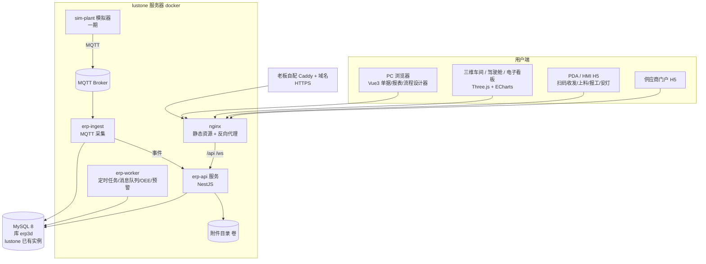
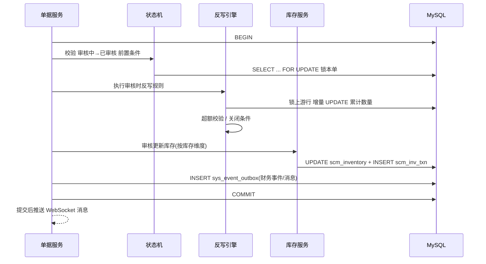

# 电子元器件生产 ERP 完整系统 · 技术方案与分工（V1.0 合稿）

> - 版本：V1.0 合稿，2026-11-13（北京时间），配套《需求说明书.md》《待老板确认.md》。
> - 本文只写方案，**不碰服务器**。lustone 上的建库、装 MQTT、docker 部署、HTTPS，都要老板授权后由 AI运维执行。
> - 标「建议」的是我方设计取舍；标【待确认】的问题编号见《待老板确认.md》。

---

## 第一部分　写给老板

- **技术路线**：推荐后端用 NestJS（TypeScript，和现在的三维前端同一种语言），流程引擎自己写一个轻量的，再用开源的 bpmn-js 画流程图。备选是 Spring Boot + Flowable 7.2（Java）。两条路都要自己写单据状态和下推反写，差别只在“审批”这一层。**需要老板定（Q01）**。
- **部署**：ERP 程序用 docker 跑在 ib-v6 上；数据库用 lustone 上已有的 MySQL，新建一个库 `erp3d`。
- **怎么分工**：拆成 21 个任务包，分三波并行，交给 5 个模型 bot 和主 bot 的执行线；界面设计图交 UI设计 bot，共 48 个页面。
- **大概多久**：按 AI bot 并行开发估计，老板确认后约 10–12 周能在 lustone 上跑通一期主线并开始试用（见第 11 章里程碑）。

---

## 1. 技术栈

### 1.1 两个后端选项

| 项 | 选项 A（推荐）：NestJS + 自研轻量引擎 + bpmn-js | 选项 B：Spring Boot + Flowable 7.2 |
|---|---|---|
| 语言 | TypeScript（前后端同语言） | Java 17+ |
| 框架 | NestJS 10+，ORM 用 Prisma 或 TypeORM（「建议」Prisma） | Spring Boot 3.x，MyBatis-Plus |
| 审批层 L2 | 自研，只实现需求说明书 F1–F21 列出的 BPMN 子集；BPMN XML 由 bpmn-js 画，后端解析成内部 JSON 执行 | Flowable 7.2（Apache 2.0，基于 Spring Boot 3）；会签用多实例；驳回、加签、撤回用 ChangeActivityState 和自定义命令 |
| L1 / L3 / L4 | 自写 | 自写（Flowable 不覆盖） |
| 事务 | 审批、状态、反写、库存在同一个 MySQL 事务 | 业务表与 Flowable 同库可共事务，但中国式审批二开多 |
| 表数量 | 引擎约 8 张 | Flowable 自带约 80 张 ACT_* 表 + 自写表 |
| 部署 | 一个 Node 服务 | 一个 Java 服务（内存占用更高） |
| 风险 | 并发和回滚正确性要自己保证 | 二开命令多；前端仍要做中文属性面板 |
| 适合 | 单工厂、几十个用户、团队偏前端/全栈 | 已有 Java 团队、以后要接大量 Java 生态 |

**不选的方案**：Camunda 7 社区版 2025-10-14 发布 7.24 后停止维护；Camunda 8 从 8.6 起 Self-Managed 用于生产需要企业许可，并需要 Zeebe 和 Elasticsearch，对单台服务器过重。【来源:流程引擎调研 6.1】

**推荐 A 的理由**：ERP 最关键的状态机、下推、反写（L1、L3、L4）没有现成引擎能替代，必须自写；审批只需要子集；同语言同事务最省事；bpmn-js 只做建模和展示，以后真要迁 Flowable，BPMN 定义还能复用。bpmn-js 采用 bpmn.io 许可，可以免费商用，但渲染图上的 bpmn.io 水印必须保留可见。【来源:流程引擎调研 6.2】

**状态：待老板定（Q01）**。下文库表、接口以选项 A 写；选 B 时表结构、接口、任务包不变，只把 WP03 换成“Flowable 集成 + 二开命令”。

### 1.2 其余技术选型（「建议」，两个选项通用）

| 层 | 选型 | 说明 |
|---|---|---|
| 前端框架 | Vue 3 + Vite + TypeScript + Element Plus（浅色主题定制） | 单据类页面多，组件库现成；v1 的原生 JS 三维模块原样封装成组件复用 |
| 三维 | Three.js 0.160（沿用 v1 的 `src/three/*`）| 画质不低于 v1 和参考页；只把数据源换成接口 |
| 图表 | ECharts 5（沿用 v1） | |
| 流程设计器 | bpmn-js + 自研中文属性面板 | 保留水印 |
| 移动 / PDA / HMI | 同一前端工程的 H5 页面（响应式），PDA 用扫码枪键盘输入或摄像头扫码 | 一期不做原生 App |
| 实时 | WebSocket（Socket.IO）推前端；MQTT（Mosquitto 或 Aedes 内嵌）接设备 | broker 装在 lustone 需授权（Q08） |
| 缓存 / 队列 | 一期不引入 Redis；终端消息队列用 MySQL 表 `mq_message` + 后台 worker（照金蝶“事件 → 队列 → 落单”） | 二期压力大再加 Redis |
| 数据库 | MySQL 8（lustone 已有实例），库 `erp3d`，utf8mb4，时区 Asia/Shanghai | |
| 测试 | 后端 Jest（单元 + 引擎规则用例）、Playwright（主线端到端） | |
| 规范 | ESLint + Prettier；OpenAPI 文档自动生成；数据库迁移脚本受版本控制 | |

## 2. 系统架构

### 2.1 后端模块划分（NestJS）

| 模块 | 内容 | 对应任务包 |
|---|---|---|
| `core` | 鉴权、RBAC、字段权限、数据规则、日志、编码规则、参数、附件、消息 | WP01 |
| `bill-engine` | 单据元数据、状态机、通用操作服务、转换规则、反写规则、`sys_bill_link`、上查下查、网络互斥 | WP02 |
| `workflow` | 流程定义、模板、实例、任务、委托、待办 | WP03 |
| `md` | 基础资料 | WP04 |
| `plan` | MRP、计划订单 | WP05 |
| `prd` / `sub` | 生产、委外 | WP06 / WP07 |
| `scm` | 采购、销售、信用、库存、条码 | WP08 / WP09 / WP10 |
| `qm` | 质量 | WP11 |
| `sfc` | 车间执行 | WP12 |
| `eqp` | 设备、采集、OEE、安灯、SMT 上料 | WP13 |
| `report` / `print` | 报表、套打、预警 | WP17 |

### 2.2 单据框架的统一做法

每张单据只写三样东西，其余由框架提供：

1. **元数据**（JSON）：表头/分录字段、类型、必录、F8 来源、默认值。
2. **状态机配置**（JSON，存 `sys_state_machine`）：状态、操作、前置条件、各状态的字段锁定和按钮可用。
3. **业务钩子**：保存校验、审核时的库存更新等。

转换规则、反写规则、审批模板都是配置数据，由引擎统一执行。前端用同一套“列表页 + 编辑页”模板按元数据渲染。

### 2.3 一次审核的事务边界

- 上游行按主键顺序加锁，避免死锁；报工等高频反写用增量 UPDATE（金蝶也为高频报工单独提供了“反写算法模型”）。【来源:车间管理参数】
- 消息、财务事件写 outbox 表，提交后由 worker 发送，保证不丢不重。「建议」

## 3. 数据库设计（MySQL 8，库 `erp3d`）

### 3.1 约定

- 字符集 utf8mb4，排序 utf8mb4_0900_ai_ci；时区 Asia/Shanghai。
- 主键 `id BIGINT`（雪花或自增，「建议」雪花，便于多端生成）；时间 `DATETIME(3)`；数量 `DECIMAL(23,10)`，金额 `DECIMAL(23,10)`，单价 `DECIMAL(23,10)`。
- 单据拆 **头表 + `_entry` 行表**，必要时加子表。
- **头表公共列**：`id, org_id, bill_no, bill_type_id, bill_date, biz_date, status(DRAFT/CREATED/AUDITING/AUDITED/REAUDIT), close_status, cancel_status, wf_instance_id, creator_id, created_at, modifier_id, modified_at, auditor_id, audited_at, remark, src_system, version(乐观锁)`。
- **行表公共列**：`id, bill_id, line_no, material_id, aux_prop_id, unit_id, qty, base_unit_id, base_qty, lot_no, mto_no, src_form, src_bill_id, src_entry_id, biz_close, biz_freeze, biz_terminate`。
- **财务预留列**（按 G4 总表加到相关单据）：`acct_org_id, currency_id, owner_type, owner_id, settle_org_id, cost_center_id, stock_category_id, io_direction, ar_ap_generated, budget_org_id(建议)`。
- 业务表都带 `org_id`；索引：所有行表建 `(bill_id)`、`(material_id)`、`(src_entry_id)`；`pp_mo_entry (biz_status, plan_start)`；`pl_mrp_detail (run_id, material_id, date)`；`scm_inventory` 唯一键 = 库存维度。
- `eqp_point_value` 按月分区，超过 N 万条自动清理（金蝶“超过 x 万条自动删除”）。

### 3.2 一期核心表清单

共 **249 张**物理表（个别行把“头表 / 行表”写在一起，编号已按两张计）。

#### 3.2.1 平台（sys_，41 张）

| # | 表 | 关键字段 |
|---|---|---|
| 1 | sys_org | code, name, form(公司/工厂), functions(销售/采购/库存/工厂/质检/结算) |
| 2 | sys_dept | org_id, code, name, parent_id, leader_emp_id, forbid |
| 3 | sys_position | dept_id, code, name, parent_position_id |
| 4 | sys_employee | code, name, mobile, email, card_no |
| 5 | sys_emp_position | employee_id, position_id, is_main, start_date, end_date |
| 6 | sys_user | account, name, employee_id, org_id, status(启用/禁用/锁定), pwd_hash, pwd_changed_at, must_change_pwd, fail_count, sign_image, last_login_at, last_login_ip, user_type(内部/供应商) |
| 7 | sys_role | code, name, forbid |
| 8 | sys_user_role | user_id, role_id |
| 9 | sys_biz_object | code, name, subsystem, form_meta_json |
| 10 | sys_perm_item | code, name(查看/新增/修改/删除/提交/审核/反审核/关闭/作废/引入/引出/打印/附件/下推…) |
| 11 | sys_role_perm | role_id, object_id, perm_item_id, effect(允许/禁止) |
| 12 | sys_field_perm | role_id, object_id, field_key, can_view, can_edit |
| 13 | sys_data_rule | object_id, name, filter_json(变量:当前用户/本部门及下级/当前组织), ops(查看/修改/删除/审核) |
| 14 | sys_role_data_rule | role_id, data_rule_id, post_rule(本人/直接下属/所有下属), combine(交集/并集) |
| 15 | sys_menu | parent_id, name, object_id, route, sort |
| 16 | sys_coding_rule | object_id, bill_type_id, segments_json, allow_edit, gen_on(保存/新增), refill_on_delete |
| 17 | sys_coding_seq | rule_id, group_key, current_no（行锁分配） |
| 18 | sys_bill_type | object_id, code, name, coding_rule_id, required_json, locked_json, wf_template_id, print_ctrl_json, params_json |
| 19 | sys_param | scope(全局/组织), org_id, module, key, value |
| 20 | sys_dict | type(辅助资料), code, name, sort |
| 21 | sys_op_log | user_id, at, ip, subsystem, object_id, op, bill_no, desc |
| 22 | sys_data_log | object_id, bill_id, version, field_key, old_value, new_value, user_id, at |
| 23 | sys_login_log | user_id, at, ip, device, success, reason |
| 24 | sys_api_log | req_id, at, client_ip, app_id, user_id, path, method, object, op, cost_ms, status, success, trace_id |
| 25 | sys_job | name, cron, handler, enabled, only_prod_node |
| 26 | sys_job_log | job_id, start_at, end_at, status, msg |
| 27 | sys_attachment | object_id, bill_id, file_name, path, size, mime, uploader_id |
| 28 | sys_message | type(待办/结果/通知/预警/公告), level(紧急/警告/提醒), title, content, to_user_id, link, read_at, created_at |
| 29 | sys_message_template | code, title_tpl, content_tpl |
| 30 | sys_message_config | object_id, op, timing, condition_json, receivers_json, level, template_id |
| 31 | sys_monitor_scheme | object_id, condition_json, cron, receivers_json, group_by |
| 32 | sys_warn_rule | object_id, ops, condition_json, level(提示/禁止), receivers_json |
| 33 | sys_print_template | object_id, bill_type_id, name, layout_json, scope(通用/角色/用户) |
| 34 | sys_print_log | template_id, bill_id, user_id, at, copies |
| 35 | sys_idempotent_key | key, object_id, bill_id, created_at |
| 36 | sys_bill_lock | object_id, bill_id, user_id, locked_at（网络互斥） |
| 37 | sys_ext_id_map | system, object, ext_id, local_id（迁移和集成） |
| 38 | sys_event_outbox | event_type, object_id, bill_id, payload_json, status, retry, created_at |
| 39 | sys_broadcast | title, content, expire_at |
| 40 | sys_mask_rule | type(手机/邮箱/身份证/银行账号), pattern, channels |
| 41 | sys_backup_log | file_name, start_at, end_at, size, status, err |

#### 3.2.2 流程引擎（sys_ / wf_，13 张）

| # | 表 | 关键字段 |
|---|---|---|
| 42 | sys_state_machine | object_id, bill_type_id, version, states_json, ops_json, field_lock_json, menu_ctrl_json |
| 43 | sys_bill_link | src_form, src_bill_id, src_entry_id, tgt_form, tgt_bill_id, tgt_entry_id, base_qty, rule_id, flow_instance_no, created_at |
| 44 | sys_convert_rule | code, src_form, tgt_form, bill_type_map_json, field_map_json, group_json, filter_expr, allow_src_bill_types, status(草稿/正常/禁用) |
| 45 | sys_writeback_rule | code, src_form, tgt_form, src_field, tgt_field, on_event(save/audit), mode(累加/扣减/覆盖), formula, over_ctrl(禁止/一次/允许), over_expr, close_expr, close_scope(全部行/任一行), alloc(自上而下/权重), status |
| 46 | sys_writeback_log | rule_id, src_entry_id, tgt_entry_id, delta, event, at（回滚依据） |
| 47 | wf_definition | key, name, object_id, version, bpmn_xml, model_json, status |
| 48 | wf_template | object_id, bill_type_id, definition_key, start_condition, eff_date, exp_date, enabled, node_view_json |
| 49 | wf_instance | definition_id, object_id, bill_id, bill_no, starter_id, status(运行/暂停/终止/完成), current_nodes_json, started_at, ended_at |
| 50 | wf_task | instance_id, node_key, assignee_id, delegator_id, status(待办/已办/已撤回/已转交), due_at, vote, is_cc |
| 51 | wf_action_log | instance_id, task_id, node_key, action(同意/驳回/转交/加签/撤回/终止), opinion, sign_image, user_id, at |
| 52 | wf_delegate | delegator_id, delegatee_id, template_scope_json, eff_date, exp_date, enabled |
| 53 | wf_node_timeout | task_id, remind_at, reminded |
| 54 | wf_variable | instance_id, key, value |

#### 3.2.3 基础资料（md_，27 张）

| # | 表 | 关键字段 |
|---|---|---|
| 55 | md_unit | code, name, precision, round_type |
| 56 | md_unit_conv | material_id, from_unit_id, to_unit_id, rate |
| 57 | md_currency | code, name, precision |
| 58 | md_exchange_rate | currency_id, date, rate |
| 59 | md_tax_rate | code, rate, eff_date, exp_date, precision, allow_edit, tolerance |
| 60 | md_aux_prop | code, name（阻值/精度/封装/包装） |
| 61 | md_aux_prop_value | aux_prop_id, value |
| 62 | md_aux_combo | material_id, combo_json |
| 63 | md_material_group | parent_id, code, name |
| 64 | md_material | code, name, spec, group_id, base_unit_id, prd/pur/stk/sal 单位, allow_produce, allow_purchase, allow_subcontract, allow_asset, lot_ctrl, shelf_life_ctrl, iqc_required, oqc_required, plan_strategy(MTS/MTO), safety_stock, mpq, stock_category_id, tax_class_code, status, forbid |
| 65 | md_material_ec【扩展】 | material_id, package, mount_side, msl_level, floor_life_h, rohs, brand, mpn, reel_qty, approve_status(未承认/已承认/禁用) |
| 66 | md_customer | code, name, tax_no, credit_file_id, group_id |
| 67 | md_cust_material | customer_id, material_id, cust_code, cust_name |
| 68 | md_supplier | code, name, supply_type(采购/委外/综合), tax_no, invoice_type |
| 69 | md_supplier_source | material_id, supplier_id, mfr, mpn, mpq, priority, eff_date, exp_date |
| 70 | md_work_center | code, name, dept_id |
| 71 | md_resource | code, name, work_center_id, type |
| 72 | md_line | code, name, workshop_id, scene_line_id（三维线体） |
| 73 | md_calendar | org_id, date, is_workday |
| 74 | md_shift | code, start_time, end_time, hours |
| 75 | md_route | code, material_id, bom_id, workshop_id |
| 76 | md_route_oper | route_id, oper_no, work_center_id, activity, ctrl_code, is_instock_point, report_upper_ratio, report_lower_ratio, ideal_cycle_sec【扩展】 |
| 77 | md_bom | material_id, version, bom_type, usage, yield_rate, is_changing, enable_ecn, status, forbid |
| 78 | md_bom_entry | bom_id, seq, child_material_id, child_type, unit_id, qty_type, numerator, denominator, fixed_scrap, scrap_rate, issue_type, backflush_time, over_issue_ctrl, min_issue_qty, is_key, oper_no, position_no(TEXT), offset_lead, eff_date, exp_date |
| 79 | md_bom_ladder | entry_id, from_qty, to_qty, numerator, denominator, fixed_scrap, scrap_rate |
| 80 | md_substitute | code, strategy, mode, sub_type, eff_date, exp_date, status |
| 81 | md_substitute_entry | substitute_id, is_main, material_id, priority, numerator, denominator, net_ratio |

#### 3.2.4 计划与工程（pl_ / ecn_，9 张）

| # | 表 | 关键字段 |
|---|---|---|
| 82 | pl_mrp_scheme | code, horizon_days, demand_fence, plan_fence, params_json |
| 83 | pl_mrp_run | run_no, scheme_id, mode(全重排/选单), start_at, end_at, status |
| 84 | pl_mrp_run_log | run_id, material_id, exception_code, msg |
| 85 | pl_mrp_detail | run_id, material_id, date, gross_req, onhand, scheduled_receipt, allocated, safety, net_req, src_form, src_entry_id |
| 86 | pl_plan_order | bill_no, bill_type, release_type, material_id, bom_id, sugg_start, sugg_finish, sugg_qty, firm_start, firm_finish, firm_qty, workshop_id, supplier_id, planner_id, mto_no, data_source, run_id, biz_status, close_type |
| 87 | pl_plan_order_bom | plan_order_id, child_material_id, use_ratio, std_qty, need_qty, need_date, issue_org_id |
| 88 | pl_mrp_selected | run_id, src_form, src_entry_id（选单计算的需求范围） |
| 89 | ecn_order | change_type, eff_date, upgrade_version, update_ppbom, sub_keep, reason, status, effect_status |
| 90 | ecn_order_entry | ecn_id, row_flag(新增/修改前/修改后/失效/删除), bom_id, seq, child_material_id, numerator, denominator, scrap_rate, ladder_json |

#### 3.2.5 生产与委外（pp_ / sub_，39 张）

| # | 表 | 关键字段 |
|---|---|---|
| 91 | pp_mo | 公共头 + prd_org_id, planner_id |
| 92 | pp_mo_entry | material_id, product_type, workshop_id, qty, biz_status, suspend, plan_start, plan_finish, bom_id, route_id, lot_no, in_upper, in_lower, wh_id, pick_status, pick_sets, report_sel_qty, good_qty, ng_qty, scrap_qty, rework_qty, repair_qty, in_good_qty, in_ng_qty, in_scrap_qty, in_rework_qty, so_entry_id, mto_no, first_inspect, first_inspect_mode, first_inspect_status, confirm/release/start/finish/close 日期, cost_center_id, acct_org_id, co_weight；【扩展】reel_qty, test_prog_ver, cust_part_no |
| 93 | pp_ppbom | mo_entry_id, material_id, bom_id, qty, status |
| 94 | pp_ppbom_entry | child_material_id, child_type, qty_type, use_ratio, numerator, denominator, fixed_scrap, scrap_rate, need_date, std_qty, need_qty, must_qty, issue_type, backflush_time, over_ctrl, wh_id, position_no, is_key, picked_qty, repick_qty, scrap_qty, good_ret_qty, inc_bad_ret_qty, op_bad_ret_qty, consume_qty, pick_sel_qty, ret_sel_qty, feed_sel_qty, prepare_qty |
| 95 | pp_mo_change | 公共头 + change_type, mo_id |
| 96 | pp_mo_change_entry | mo_entry_id, before_json, after_json |
| 97 | pp_ppbom_change | 公共头 + reason |
| 98 | pp_ppbom_change_entry | ppbom_entry_id, change_type(新增/变更前/变更后), material_id, numerator, denominator, fixed_scrap, scrap_rate, must_qty, issue_type |
| 99 | pp_kitting | 公共头 + scheme_json(优先顺序/考虑预留/替代/物料范围/提前天数) |
| 100 | pp_kitting_order | kitting_id, mo_entry_id, analyse_qty, kit_qty, stock_kit_qty |
| 101 | pp_kitting_entry | order_id, ppbom_entry_id, must_qty, picked_qty, avail_qty, short_qty, prepare_qty, this_pick_qty |
| 102 | pp_pick | 公共头 + issue_org_id, workshop_id |
| 103 | pp_pick_entry | ppbom_entry_id, apply_qty, actual_qty, wh_id, loc_id, lot_no, prod_date, exp_date, owner_id, ret_sel_qty, is_backflush, acct_dims |
| 104 | pp_pick_reel【扩展】 | pick_entry_id, reel_id, qty |
| 105 | pp_return | 公共头 |
| 106 | pp_return_entry | ret_type(良品/来料不良/作业不良), src_entry_id, apply_qty, actual_qty, wh_id, lot_no, feed_sel_qty；reel_id, remain_qty【扩展】 |
| 107 | pp_feed | 公共头 + feed_reason |
| 108 | pp_feed_entry | 同领料行 + ret_entry_id |
| 109 | pp_report | 公共头 |
| 110 | pp_report_entry | mo_entry_id, report_type, finish_qty, good_qty, ng_qty, repair_qty, rework_qty, scrap_qty, resp_dept_id, team_id, start_at, end_at, labor_hours, machine_hours, lot_no, inspect_sel_qty, in_sel_qty |
| 111 | pp_report_bin【扩展】 | report_entry_id, bin_code, qty |
| 112 | pp_instock | 公共头 + in_org_id, owner_id |
| 113 | pp_instock_entry | in_type(合格/不合格/返工/报废), must_qty, real_qty, wh_id, loc_id, stock_status_id, lot_no, prod_date, exp_date, mo_entry_id, src_form, src_entry_id, cost_amount(二期反写) |
| 114 | pp_instock_reel【扩展】 | instock_entry_id, reel_id, qty, date_code |
| 115 | pp_restock | 公共头 |
| 116 | pp_restock_entry | restock_type, src_instock_entry_id, must_qty, real_qty |
| 117 | pp_line_capacity | line_id, worker_qty, machine_qty, plan_hours |
| 118 | pp_line_capacity_entry | capacity_id, material_id, unit_hours, day_qty, min_batch, eff_date, exp_date |
| 119 | pp_day_schedule | mo_entry_id, line_id, sched_date, sched_qty, online_qty, confirm_status, locked |
| 120 | sub_order | 公共头 + sub_org_id, planner_id |
| 121 | sub_order_entry | material_id, supplier_id, qty, biz_status, plan_start, plan_finish, bom_id, purchase_org_id, pick_status, lot_no, wh_id, po_sel_qty, po_exec_qty, in_qty, mto_no, acct_org_id |
| 122 | sub_ppbom | sub_entry_id, material_id, bom_id, qty, status |
| 123 | sub_ppbom_entry | 同 pp_ppbom_entry |
| 124 | sub_pick | 公共头 + supplier_id |
| 125 | sub_pick_entry | 同 pp_pick_entry |
| 126 | sub_return | 公共头 + supplier_id |
| 127 | sub_return_entry | 同 pp_return_entry |
| 128 | sub_feed | 公共头 + supplier_id |
| 129 | sub_feed_entry | 同 pp_feed_entry（委外补料行，归在此处编号） |

#### 3.2.6 车间执行、设备、安灯、SMT（sfc_ / eqp_ / oee_ / andon_ / smt_ / mq_，42 张）

| # | 表 | 关键字段 |
|---|---|---|
| 130 | sfc_op_plan | mo_id, mo_entry_id, route_id, 公共头 |
| 131 | sfc_op_plan_entry | seq_no, seq_type, op_no, work_center_id, activity_id, ctrl_code, is_instock_point, qty, plan_start, plan_end, act_start, act_end, status, report_sel_qty, ok_qty, scrap_work_qty, scrap_mat_qty, loss_qty, rework_qty, trans_in_qty, trans_out_qty, dispatched_qty, barcode, dispatch_enabled, first_inspect, first_inspect_status, first_inspect_mode, ideal_cycle_sec |
| 132 | sfc_dispatch | op_entry_id, qty, shift_id, team_id, resource_id, equipment_id, status, done_sel_qty, plan_start, plan_end, barcode |
| 133 | sfc_dispatch_operator | dispatch_id, employee_id |
| 134 | sfc_report | 公共头 + bill_type(工序生产汇报/工序入库汇报) |
| 135 | sfc_report_entry | op_entry_id, dispatch_id, ok_qty, rework_qty, scrap_work_qty, scrap_mat_qty, loss_qty, done_qty, confirm_mode, equipment_id, shift_id, team_id, start_at, end_at, work_min, pause_min, defect_type_id, is_rework_report, src_report_entry_id, inspect_sel_qty, in_sel_qty, source(HMI/PDA/EQP/PC) |
| 136 | sfc_report_operator | report_entry_id, employee_id, work_min |
| 137 | sfc_report_bin【扩展】 | report_entry_id, bin_code, qty |
| 138 | sfc_transfer | 公共头 + from_op_entry_id, to_op_entry_id, type, qty |
| 139 | sfc_defect | report_entry_id, defect_reason_id, qty, decision(工废/料废/返修), resp_dept_id, resp_emp_id |
| 140 | sfc_task_status | employee_id, op_entry_id, dispatch_id, status, since |
| 141 | sfc_task_flow | employee_id, op_entry_id, action(开始/暂停/报工), at, pause_event_id |
| 142 | sfc_permission | user_id/role_id, work_center_id, can_report, can_proxy |
| 143 | eqp_equipment | code, name, category, dept_id, line_id, resource_id, cur_status(加工/异常停机/空闲/占用/关机), cur_event_id, net_enabled, calc_oee, kanban_show, monitor_order, model_type, scene_node_id, ideal_cycle_sec |
| 144 | eqp_point | equipment_id, point_no, name, proc_type, unit, auto_push, auto_alarm, event_type_id, upper_limit, auto_delete, monitor_show |
| 145 | eqp_status_map | equipment_id, scada_code, status |
| 146 | eqp_fault_map | equipment_id, fault_code, event_id |
| 147 | eqp_point_value | point_id, at, value, proc_done（按月分区） |
| 148 | eqp_event_def | code, name, affect_status, oee_time_type, msg_mode, is_material, pause_collect, lamp |
| 149 | eqp_event_path | event_id, stage_seq, stage_id, role_id, accept_min, signin_min, handle_min, field_perm_json, can_reject, can_close |
| 150 | eqp_event_handler | path_id, user_id |
| 151 | eqp_event_escalation | event_id, level, after_min, receivers_json |
| 152 | eqp_status_log | equipment_id, from_status, to_status, event_id, oee_time_type, start_at, end_at, duration_sec, op_entry_id, operator_id, source |
| 153 | eqp_task_rt | equipment_id(UNIQUE), op_entry_id, dispatch_id, start_counter, last_counter, operator_ids, shift_id |
| 154 | eqp_task_his | 同上 + end_at, end_type(完工待机/移交/结束) |
| 155 | eqp_calendar | equipment_id, date, shift_id, start, end, is_temp |
| 156 | oee_rt | equipment_id, calc_at, avail, perf, quality, oee, run_min, down_min, idle_min, plan_stop_min, good_qty, total_qty, success, msg |
| 157 | oee_his | 同上 + is_daily |
| 158 | andon_ticket | bill_no, dept_id, line_id, equipment_id, call_type, event_id, urgency, severity_id, status, stage_id, level, handler_id, occur_at, expect_close_at, reason_id, desc, analysis, correction, prevention, mo_entry_id, op_entry_id, sub_material_id, lot_no, supplier_id, source(HMI/SCADA/PC) |
| 159 | andon_step_log | ticket_id, stage_id, action(受理/签到/处理/驳回/转交/延时/关闭), user_id, at, conclusion, attachment_ids |
| 160 | andon_deadline | ticket_id, stage_id, latest_accept, latest_signin, latest_handle, act_accept, act_signin, act_handle |
| 161 | andon_prevent_track | 公共头 + ticket_id, measures, owner_id, due_date, result |
| 162 | smt_feeder_spec | code, width, pitch |
| 163 | smt_feeder | code, spec_id, status(空闲/占用/维修/报废) |
| 164 | smt_station_table | product_id, version, line_id, mounter_pos, mounter_model, program, status |
| 165 | smt_station_table_entry | table_id, side(A/B), track, slot, material_id, feeder_spec_id, numerator, denominator, nozzle, position_nos, direction |
| 166 | smt_feed_table | mo_entry_id, line_id, station_table_ids, status |
| 167 | smt_feed_table_entry | feed_table_id, station_entry_id, material_id, load_status(待上料/已上料/已下线) |
| 168 | smt_feed_log | feed_table_entry_id, type(上料/续料/换料/下料), equipment_id, track, feeder_id, reel_id, material_id, lot_no, qty, result(通过/拒绝), reason, user_id, at |
| 169 | station_material_stock | line_id, equipment_id, slot, mo_entry_id, material_id, reel_id, lot_no, qty_loaded, qty_consumed, avail_min, loaded_at, updated_at |
| 170 | mq_message | type, payload_json, status(不执行/待执行/执行中/成功/失败), retry, err, created_at |
| 171 | mq_message_his | 同上 + done_at |

#### 3.2.7 供应链、条码、质量、门户（scm_ / bc_ / qm_ / srm_，78 张）

| # | 表 | 关键字段 |
|---|---|---|
| 172 | scm_warehouse | code, name, stock_status_type, default_status_id, allow_negative, loc_enabled |
| 173 | scm_location | warehouse_id, code, name |
| 174 | scm_stock_status | code, name, can_use, can_sale, can_pick, can_lock, mrp_available |
| 175 | scm_inventory | 唯一键(org, material, aux_prop, lot_no, prod_date, exp_date, bom_id, mto_no, stock_status, owner_type, owner_id, keeper_type, keeper_id, warehouse, location), qty, lock_qty, base_qty |
| 176 | scm_inv_txn | inventory_id, form, bill_id, entry_id, direction, base_qty, at |
| 177 | scm_inv_balance | close_date, inventory_key, begin_qty, in_qty, out_qty, end_qty |
| 178 | scm_inv_close | org_id, close_date, closed_by |
| 179 | scm_lot_master | org_id, material_id, lot_no(UNIQUE), in_date, prod_date, exp_date, supplier_lot, recheck_date |
| 180–181 | scm_pur_req / scm_pur_req_entry | 采购申请头 / 行：apply_qty, approve_qty, arrive_date, sugg_supplier_id, link_qty, order_qty, remain_qty |
| 182 | scm_pur_order | 公共头 + supplier_id, purchaser_id, currency_id, rate, pricelist_id, tax_incl, amount, change_flag, revision |
| 183 | scm_pur_order_entry | qty, deliver_date, price, tax_price, discount, tax_rate, amount, is_gift, mpq_checked, mfr, mpn, ctrl_deliver_qty, deliver_upper, deliver_lower, earliest_date, latest_date, rcv_qty, in_qty, ret_qty, settle_org_id |
| 184 | scm_pur_order_plan | entry_id, date, qty, delivered_qty |
| 185 | scm_pur_order_pay | order_id, due_date, ratio, amount, is_prepay |
| 186 | scm_order_change | 采购/销售新变更单头：src_form, src_bill_id, reason, new_revision |
| 187 | scm_order_change_entry | src_entry_id, before_json, after_json |
| 188 | scm_receive | 公共头 + supplier_id, receiver_id, settle_org_id, owner_id |
| 189 | scm_receive_entry | deliver_qty, arrive_qty, receive_qty, reject_qty, wh_id, loc_id, stock_status_id, lot_no, supplier_lot, prod_date, exp_date, iqc_required, urgent_release, inspect_link_qty, inspect_qty, ok_qty, reject_judge_qty, concession_qty, scrap_work_qty, scrap_mat_qty, in_qty, ret_qty |
| 190–191 | scm_pur_instock / scm_pur_instock_entry | 采购入库头 / 行：in_type(合格/让步接收/不合格), wh_id, loc_id, stock_status_id, lot_no, prod_date, exp_date, real_qty, price, owner_id, settle_org_id, ap_generated |
| 192–193 | scm_pur_return / scm_pur_return_entry | 采购退料头 / 行：ret_type(检验退货/库存退货), ret_mode(退货补货/退货扣款), refill_mode |
| 194 | scm_pur_return_req | 退料申请（单表，行内含物料） |
| 195–196 | scm_pur_pricelist / scm_pur_pricelist_entry | 采购价目表：supplier_id / material_id, price, eff_date, exp_date, limit_price |
| 197–198 | scm_sal_quote / scm_sal_quote_entry | 销售报价头 / 行 |
| 199 | scm_sal_order | 公共头 + customer_id, sale_dept_id, saler_id, receiver/settler/payer, currency_id, pricelist_id, below_limit_flag, credit_status, change_flag, revision |
| 200 | scm_sal_order_entry | qty, price, tax_price, tax_rate, amount, need_date, stock_org_id, settle_org_id, lot_no, deliver_upper, deliver_lower, notice_qty, out_qty, ret_notice_qty, ret_qty, ar_qty, dc_not_before【扩展】, cust_part_no |
| 201 | scm_sal_order_pay | order_id, ratio, amount, due_date, ctrl_point |
| 202–203 | scm_delivery_notice / scm_delivery_notice_entry | 发货通知头 / 行：out_wh_id, prep_wh_id, out_upper, out_lower, out_qty, inspect_qty, ok_qty, ng_saleable_qty |
| 204–205 | scm_sal_outstock / scm_sal_outstock_entry | 销售出库头 / 行：must_qty, real_qty, wh_id, loc_id, stock_status_id, lot_no, prod_date, exp_date, owner_id, tax_price, ar_generated |
| 206–207 | scm_return_notice / scm_return_notice_entry | 退货通知头 / 行：ret_type(退货/退货补货), reason, inspect_qty, judge_ret_qty |
| 208–209 | scm_sal_return / scm_sal_return_entry | 销售退货头 / 行 |
| 210–211 | scm_sal_pricelist / scm_sal_pricelist_entry | 销售价目表：price, min_price, eff_date, exp_date |
| 212 | scm_credit_file | customer_id, status(正常/冻结/免检), limit_amt, single_limit, overdue_days, overdue_amt, eff_date |
| 213 | scm_credit_rule | object_id, check_point(提交/审核), strength(预警/取消交易/冻结) |
| 214 | scm_credit_occupy | customer_id, form, entry_id, amount, direction, at |
| 215–216 | scm_stock_bill / scm_stock_bill_entry | 库存类通用单据头 / 行（其他入库、其他出库、直接调拨、状态转换、批号调整、初始库存，按 form 区分；字段见 G2 第 4 节）「建议」合表 |
| 217 | scm_count_plan | type(全盘/动盘), scope_json |
| 218–219 | scm_count_job / scm_count_job_entry | 盘点作业头 / 行：book_qty, count_qty, diff_qty, diff_rate |
| 220–221 | scm_count_diff / scm_count_diff_entry | 盘盈 / 盘亏单（按方向区分） |
| 222 | bc_barcode_rule | object_id, mode(主档对照/动态解析), segments_json |
| 223 | bc_barcode_master | barcode(UNIQUE), material_id, lot_no, qty, location_id, status(入库/出库), reel_id【扩展】, mpn, date_code, msl_level, opened_at, floor_life_h, exposed_min, bake_count, last_bake_at, msl_status, parent_barcode |
| 224 | bc_scan_log | barcode, form, bill_id, entry_id, op, user_id, device, at |
| 225 | bc_msl_log【扩展】 | barcode, event(开封/回柜/烘烤开始/烘烤完成/超时冻结), at, user_id, temp, hours |

| # | 表 | 关键字段 |
|---|---|---|
| 226–227 | bc_split / bc_split_entry | 条码拆分单：主码 → 子码（主码-流水号）、数量 |
| 228–229 | qm_sampling_plan / qm_sampling_plan_entry | 抽样类型、检验水平、严格度、AQL / 批量区间、样本量、Ac、Re |
| 230 | qm_gb2828_code | 批量区间 × 检验水平 → 样本量字码（国标资料） |
| 231 | qm_gb2828_table | 字码 × AQL × 严格度 → 样本量、Ac、Re |
| 232 | qm_inspect_item | code, method, instrument, standard |
| 233–234 | qm_inspect_scheme / qm_inspect_scheme_item | 质检方案 / 检验项目指标：比较符、目标值、上下限、抽样方案 |
| 235–236 | qm_defect_type / qm_defect_reason | 缺陷类型（致命/重/轻）/ 缺陷原因 |
| 237 | qm_inspect_bill | 公共头 + biz_type(来料/委外来料/产品/自制工序/首检/发货/退货/库存), src_org_id, qc_org_id, qc_dept_id, inspector_id |
| 238 | qm_inspect_entry | material_id, qc_status(计划/开始/完成), result(合格/不合格/保留), inspect_qty, ok_qty, ng_qty, scheme_id, supplier_id, customer_id, workshop_id, lot_no, inspect_times, src_form, src_entry_id, first_inspect_flag |
| 239 | qm_inspect_decision | entry_id, status, qty, decision, defect_handle, mrb, saleable, judge_return |
| 240 | qm_inspect_sample | entry_id, plan_id, sample_type, level, strictness, aql, sample_qty, ac, re, sample_ng_qty, destroy_qty |
| 241 | qm_inspect_defect | entry_id, defect_type_id, qty, reason_id, grade, consequence |
| 242 | qm_inspect_item_result | entry_id, item_id, value, judge |
| 243–244 | qm_stock_req / qm_stock_req_entry | 库存请检（库存/发货）：qty, inspect_sel_qty, accept_qty, ng_qty, scrap_qty, frozen |
| 245–246 | qm_defect_handle / qm_defect_handle_entry | 不良品处理：src_inspect_entry_id, handle(接收/让步接收/判退/不良/报废…), qty, handle_status, discount_amount(二期) |
| 247 | srm_user_supplier | user_id, supplier_id |
| 248 | srm_po_confirm | po_entry_id, confirm_qty, confirm_date, supplier_user_id, at |
| 249 | srm_delivery_confirm | po_entry_id, ship_date, qty, label_printed, at |

## 4. 接口约定

### 4.1 REST

- 前缀 `/api/v1`；资源名用单据代码，例如 `/api/v1/bills/pp_mo`、`/api/v1/md/material`。
- **通用单据接口**（由单据框架统一提供，每张单据不再各写一套）：

| 方法 | 路径 | 说明 |
|---|---|---|
| GET | `/bills/{form}` | 列表：过滤方案、分页、合计行、列设置 |
| GET | `/bills/{form}/{id}` | 详情：头 + 分录 + 子分录 + 当前状态允许的操作和字段锁定 |
| POST | `/bills/{form}` | 暂存 / 保存（`?mode=draft|save`） |
| PUT | `/bills/{form}/{id}` | 修改（带 `version` 乐观锁） |
| POST | `/bills/{form}/{id}/ops/{op}` | 执行操作：submit、audit、unaudit、cancel(作废)、uncancel、close、unclose，以及业务操作（如 `release` 下达、`start` 开工、`finish` 完工、`close_mo` 结案、`exec_to?target=` 执行至） |
| POST | `/bills/{form}/batch-ops/{op}` | 批量操作，逐单返回结果 |
| POST | `/convert/{rule}` | 下推 / 选单：入参源单分录和数量，返回目标单草稿（按转换规则分组合单） |
| GET | `/bills/{form}/{id}/links?dir=up|down` | 上查 / 下查（`sys_bill_link`） |
| GET | `/bills/{form}/{id}/flow` | 审批历史和流程图（bpmn-js 渲染） |

- 返回体统一 `{code, msg, data, traceId}`；业务校验失败返回 `code=BIZ_xxx` 和逐行错误；批量操作返回 `results:[{id, ok, msg}]`。
- 所有写操作带 `Idempotency-Key` 请求头，防止 PDA 弱网重复提交。「建议」
- OpenAPI 文档由代码自动生成，前端用生成的 TS 类型。

### 4.2 WebSocket 与 MQTT

- 三维和看板的 MQTT 主题、WebSocket 事件、REST 快照照《需求说明书》8.3 实现，不另定义。
- 平台消息事件：`msg.new`（站内消息铃铛）、`todo.changed`（待办数变化）、`bill.changed`（单据被他人改动，提示刷新）。
- 鉴权：WebSocket 握手带 JWT；大屏只读账号用长期令牌，只能订阅指定产线的事件。

### 4.3 鉴权

- 登录换 JWT（访问令牌 2 小时 + 刷新令牌 7 天）；密码 bcrypt；登录失败锁定次数和密码策略照 G3 第 2 节。
- 权限校验三层：功能权限（业务对象 × 权限项）→ 数据规则（组织、部门、本人、授权仓库 / 产线）→ 字段权限（例如销售员看不到成本价），在单据框架统一做。

## 5. 流程引擎实现（选项 A）

### 5.1 四层和代码位置

| 层 | 职责 | 代码 | 配置表 |
|---|---|---|---|
| L1 单据状态机 | 通用状态 + 业务状态、操作前置条件、字段锁定、按钮可用 | `bill-engine/state` | `sys_state_machine` |
| L2 审批流 | 解析 BPMN 子集，生成任务；顺签 / 或签 / 会签、条件分支、驳回、撤回、转交、加签、代理 | `workflow` | `wf_*` |
| L3 业务流 | 一期只做“审批通过后自动下推”的钩子，路线控制放二期（F20） | `bill-engine/flow` | `sys_convert_rule.auto_push` |
| L4 转换与反写 | 字段映射、分组合单、选单控制；保存 / 审核时累加扣减覆盖，删除 / 反审核 / 作废回滚；超额控制；关闭条件 | `bill-engine/convert`、`bill-engine/writeback` | `sys_convert_rule`、`sys_writeback_rule`、`sys_bill_link` |

### 5.2 L1 与 L2 的接口

- 提交：L1 校验后，若该单据类型挂了生效的流程模板，状态置“审核中”并由 L2 建实例；没有模板时直接“审核中”，等人工审核。
- L2 终审节点通过：调用 L1 的 `audit` 操作，**审核和反写、库存在同一事务**（见 2.3）。审核失败（例如库存不足）时任务回到终审节点并提示，不留半截状态。
- 驳回到发起人：L1 置“重新审核”；撤回同。
- 作废、反审核在一期不走流程（F16 二期），只校验权限和前置状态。作废只能在创建 / 重新审核状态下做（见需求说明书 C-01 改判）。

### 5.3 必须写的自动化测试（引擎验收用）

1. 反写：下推 → 保存 → 审核 → 反审核 → 作废 → 删除，每一步上游累计数量都回到正确值。
2. 并发：两张下游单同时审核同一上游行，不超额、不死锁。
3. 超额：入库上限、领料超发控制方式（允许 / 最小发料批量 / 不允许 / 按损耗率）四种都覆盖。
4. 合单：补料单按“发料组织 + 生产组织 + 货主 + 货主类型”、入库单按“生产组织 + 货主 + 货主类型”分组。
5. 生产订单：正反执行跳跃；结案“控制范围 × 控制强度”9 种组合；已结算不能反结案。
6. 审批：会签按比例、驳回到任一节点后重新提交、代理期内待办归属。

## 6. 三维接入

- 沿用 v1 的 `src/three/*`、`src/app/workshop.js`、`devicePanel.js`、`cockpit.js`，包成 Vue 组件；画质、相机、灯光、材质不降。
- 数据源：把 v1 `src/app/runtime.js` 里本地生成状态的部分拆出去，前端只留“快照 + WebSocket 增量”的数据层；`runtime.js` 的设备参数生成逻辑移到后端 `sim-plant` 服务里复用。
- 设备 id 和 `src/data/plant.js` 保持一致；`plant.js` 的布局数据迁入 `eqp_equipment`（加坐标、朝向、模型类型列），前端改为从接口拉布局。
- 断线：显示“连接中断”并保留最后状态（C-13）。界面上不出现“演示数据”字样。
- 点击设备弹出的面板接 `GET /eqp/{id}/detail`；安灯单、工位缺料预警在三维里高亮，点击跳到对应单据。

## 7. 部署（docker：程序在 ib-v6，数据库在 lustone）

> 以下全部是方案。**每一步服务器操作都要老板授权后由 AI运维执行**（Q07、Q08）。

| 容器 | 镜像 | 说明 |
|---|---|---|
| `erp-web` | nginx:alpine | 前端静态资源 + 反向代理 `/api`、`/ws` |
| `erp-api` | node:20-alpine | 后端 API |
| `erp-worker` | 同 erp-api 镜像，不同启动命令 | 定时任务、outbox、OEE、预警、消息队列 |
| `erp-ingest` | 同上 | MQTT 采集 |
| `sim-plant` | 同上 | 一期模拟器，二期接真设备后停掉 |
| `mqtt` | eclipse-mosquitto 或内嵌 Aedes | 只在 docker 内网和指定端口开放 |

- **老板已定（2026-11-13）：ERP 程序部署在 ib-v6，lustone 只提供 MySQL。**
- 程序主机 ib-v6（instabox-x）：4 核 x86（AMD EPYC）、7.8G 内存、数据盘 /data 剩 14G、Debian 13，金融平台不用，固定给 ERP。镜像为 amd64。附件目录挂 `/data/erp3d/files`，并每天同步一份到 lustone 备份目录（instabox 机器被回收时不丢附件）。
- **两个前置条件：**① ib-v6 未装 Tailscale，而 lustone MySQL 只绑 Tailscale 100.123.98.52:3306，需老板授权后由 AI运维把 ib-v6 加入同一 tailnet；② 据金融大平台观察，instabox 连续运行约 8 小时会被强制冷却约 2 小时，需在 ib-v6 上核实。若属实，按老板 2026-11-13 13:55 决定：ERP 程序在 ib-v6 和 ib-v7 两台 Instabox 之间轮换，一台冷却时切到另一台，两台都装 Tailscale、都连 lustone 的 erp3d 库，轮换脚本独立于金融平台的切换脚本（Q07b）。
- 数据库：lustone 上金融平台的 MySQL 8 容器 `sentiment-mysql`，新建独立库 `erp3d`。金融大平台的条件必须遵守：① 专用账号只授权 `erp3d.*`，host 限定 Tailscale 网段 100.64.0.0/10，不用 root、不用 `%`；② ERP 连接池上限 ≤30；③ 不改 MySQL 全局参数、不重启该容器（重启会触发金融平台故障切换）；④ `erp3d` 单独加 mysqldump，并确认现有 /data/backups/mysql 是否已覆盖。ERP 不在库上跑重查询，报表走汇总表。跨机访问库有网络延迟，后端接口要合并查询、少做逐行往返。
- 内存：ib-v6 空闲约 7G，ERP 容器合计控制在 3G 以内，每个容器设 `mem_limit`。MQTT 用 Mosquitto 或内嵌 Aedes。
- ib-v 到 ib-v5 是金融平台主备机，不得占用。
- 一个 `docker-compose.yml` + `.env`（数据库密码等放 `.env`，不进代码库）；附件目录挂卷 `/data/erp3d/files`。
- 备份：每天 `mysqldump erp3d` + 附件目录打包，保留 14 天「建议」（Q09）。
- HTTPS：老板自配 Caddy 和域名，反代到 `erp-web` 端口。
- 发布：AI运维拉镜像、跑数据库迁移、滚动重启；保留上一版镜像便于回滚。

## 8. 前端页面清单（交 UI设计 bot 出图，共 48 页）

单据类页面共用“列表页 + 编辑页”模板，UI 只需画模板和有特殊交互的页面。风格：浅色主题，信息密度偏高的企业后台；三维相关页面画质对齐 v1。

| # | 页面 | 类型 | 说明 |
|---|---|---|---|
| UI01 | 登录 | 平台 | 浅色，带厂区三维缩略背景 |
| UI02 | 工作台首页 | 平台 | 待办、消息、常用功能、关键指标卡片 |
| UI03 | 通用单据列表模板 | 模板 | 过滤方案、列设置、批量操作、状态标签 |
| UI04 | 通用单据编辑模板 | 模板 | 表头 + 分录页签 + 子分录；按状态锁字段；上查下查；附件；审批历史侧栏 |
| UI05 | 下推 / 选单弹窗 | 模板 | 选目标单据类型、勾选分录、显示可下推数量 |
| UI06 | 上查下查关系图 | 模板 | 单据链路图 |
| UI07 | 基础资料列表 + 编辑模板 | 模板 | 含分组树 |
| UI08 | 物料编辑 | 基础 | 多页签（基本、库存、计划、生产、质量、元器件扩展属性） |
| UI09 | BOM 编辑与树形展开 | 基础 | 位号、阶梯损耗、替代 |
| UI10 | 替代方案 | 基础 | 主料 / 替代料优先级 |
| UI11 | 工艺路线 | 基础 | 工序序列图 + 表 |
| UI12 | SMT 站位表 | 基础 | 贴片机 × 料站 × 物料 |
| UI13 | ECN 编辑 + 影响查询 | 工程 | 在制、在途、库存影响 |
| UI14 | MRP 运算向导 | 计划 | 选方案、运算进度、日志 |
| UI15 | MRP 结果与供需明细 | 计划 | 例外信息高亮 |
| UI16 | 计划订单工作台 | 计划 | 确认、投放、拆分、合并 |
| UI17 | 生产订单编辑 | 生产 | 行级业务状态条、执行至 / 反执行至 |
| UI18 | 生产齐套分析 | 生产 | 订单 × 材料齐套矩阵、缺料明细、缺料汇总 |
| UI19 | 日排产甘特 | 生产 | 产线 × 时间，拖拽、锁定 |
| UI20 | 生产订单执行进度 | 生产 | 领料、汇报、入库进度 |
| UI21 | 委外订单编辑 | 委外 | |
| UI22 | 工序计划 | 车间 | 工序序列、工序状态 |
| UI23 | 调度派工工作台 | 车间 | 工作中心 × 任务看板 |
| UI24 | HMI 工位终端 | 车间 | 大按钮：开工、报工、安灯、首检 |
| UI25 | PDA 首页与扫码通用页 | PDA | 扫码、结果、错误提示音 |
| UI26 | PDA 收料 / 入库 | PDA | |
| UI27 | PDA 领料（先进先出提示） | PDA | |
| UI28 | PDA SMT 上料防错 | PDA | 站位 × 卷盘，错料红屏 |
| UI29 | PDA 盘点 | PDA | |
| UI30 | 安灯看板 | 车间 | 待处理 / 处理中，超时颜色 |
| UI31 | 安灯处理单 | 车间 | 受理、签到、处理、关闭时间轴 |
| UI32 | 三维车间主页 | 三维 | 对齐 v1 画质，设备状态颜色、产线切换 |
| UI33 | 设备详情面板 | 三维 | 状态时间轴、OEE、参数曲线、告警 |
| UI34 | OEE 分析 | 设备 | 趋势、损失瀑布图 |
| UI35 | 驾驶舱 | 看板 | 产量、合格率、OEE、准交率、库存金额 |
| UI36 | 电子看板（产线大屏） | 看板 | 1920×1080 只读 |
| UI37 | 采购订单编辑 + 变更 | 采购 | 版本对比 |
| UI38 | 销售订单编辑 + 信用提示 | 销售 | |
| UI39 | 即时库存查询 | 库存 | 按型号、品牌、封装、批次、卷盘 |
| UI40 | 卷盘 MSL 管理 | 条码 | 开封计时、烘烤、超时冻结 |
| UI41 | 检验单 | 质量 | 抽样（AQL）、检验项目结果、使用决策 |
| UI42 | 批号 / 卷盘追溯 | 质量 | 溯源 / 去向树 |
| UI43 | 报表通用模板 | 报表 | 过滤、图表、导出 |
| UI44 | 流程设计器 | 平台 | bpmn-js 画布 + 中文属性面板（保留水印） |
| UI45 | 待办中心 | 平台 | 待办、已办、我发起、抄送 |
| UI46 | 用户、角色、权限 | 平台 | 权限矩阵 |
| UI47 | 转换 / 反写规则配置 | 平台 | 字段映射表 |
| UI48 | 供应商门户 | 门户 | 订单确认、送货确认、打印标签 |

## 9. 任务包（21 个）

| WP | 名称 | 内容 | 依赖 | 波次 |
|---|---|---|---|---|
| WP01 | 平台核心 | 工程脚手架、鉴权、RBAC、字段/数据权限、编码规则、参数、附件、日志、消息 | — | 1 |
| WP02 | 单据引擎 | 元数据、L1 状态机、通用操作、L4 转换与反写、`sys_bill_link`、上查下查、网络互斥 | WP01 | 1 |
| WP03 | 审批流 | L2：BPMN 子集解析、任务、会签、驳回、撤回、转交、加签、代理、待办、bpmn-js 设计器 | WP02 | 1 |
| WP04 | 基础资料 | 组织、物料（含元器件扩展属性）、BOM、替代、工艺路线、仓库仓位、客户供应商、单位等 32 类 | WP02 | 1 |
| WP05 | 计划 | MRP（选单 / 全重排）、计划订单、ECN | WP04 | 2 |
| WP06 | 生产 | 生产订单、用料清单、变更单、齐套、领退补、汇报、入库、退库、日排产 | WP04 | 2 |
| WP07 | 委外 | 委外订单、用料清单、领退补 | WP06 | 2 |
| WP08 | 采购 | 申请、订单、变更、收料、入库、退料 | WP04 | 2 |
| WP09 | 销售与信用 | 报价、订单、变更、发货、出库、退货、信用 | WP04 | 2 |
| WP10 | 库存与条码 | 即时库存、库存流水、其他出入库、调拨、状态转换、批号调整、盘点、条码主档、卷盘、MSL | WP04 | 2 |
| WP11 | 质量 | 抽样方案、质检方案、检验单（来料 / 产品 / 首检 / 末序 / 发货 / 退货 / 库存）、请检、不良品处理 | WP08、WP06 | 2 |
| WP12 | 车间执行 | 工序计划、派工、工序汇报、转移、工序不良、HMI | WP06 | 2 |
| WP13 | 设备与采集 | 设备档案、仪表点、状态映射、计数自动报工、OEE、安灯、SMT 上料防错 | WP12 | 2 |
| WP14 | 模拟器 | `sim-plant`：32 台设备、故障/待料/保养注入 | WP13 接口定稿 | 2 |
| WP15 | 三维与看板 | v1 三维模块组件化、接口驱动、驾驶舱、电子看板 | WP13 | 2 |
| WP16 | 前端框架 | Vue 工程、列表/编辑模板按元数据渲染、PDA/HMI 外壳、浅色主题 | WP01、UI 出图 | 1 |
| WP17 | 报表、打印、预警 | RP01–RP14、套打模板、操作时预警 | 各业务 WP | 3 |
| WP18 | 供应商门户 | 订单确认、送货确认、标签打印 | WP08 | 3 |
| WP19 | 数据迁移 | 基础资料 → 期初库存和往来 → 未完成单据三段导入 | WP04、WP10 | 3 |
| WP20 | 部署与运维 | docker 镜像、compose、迁移脚本、备份、监控（AI运维执行，需授权） | WP01 | 1–3 |
| WP21 | 联调与验收 | 主线端到端用例、引擎验收用例（5.3）、性能（并发审核、高频报工） | 全部 | 3 |

## 10. 分工

| 角色 | 负责 | 交叉复核 |
|---|---|---|
| 主 bot 执行线 | 总架构、WP01、WP02、WP03（引擎是全系统正确性的根，自己写）、WP21 联调验收、代码合并 | Nemotron-3-Ultra 复核 WP02 反写用例 |
| Claude Sonnet 5 | WP06 生产、WP07 委外、WP05 计划 | Nemotron-3-Ultra（对照它的生产计划复核稿） |
| Grok | WP08 采购、WP09 销售与信用、WP18 门户 | Mistral-Large-4 |
| Mistral-Large-4 | WP11 质量、WP10 库存与条码 | Claude Sonnet 5 |
| 反重力 | WP16 前端框架、WP15 三维与看板（沿用 v1 代码）、WP04 基础资料前端 | 主 bot 执行线（画质验收） |
| Nemotron-3-Ultra | WP12 车间执行、WP13 设备与采集、WP14 模拟器 | Grok |
| UI设计 bot | 第 8 章 48 页设计图，先出 UI03、UI04、UI24、UI25、UI32 五个模板页定风格 | 老板看图拍板 |
| AI运维 | WP20：lustone 上建库、建账号、装 MQTT、docker 部署、备份 | 每步先报方案，老板授权后执行 |
| WP17、WP19 | 第三波时分给先完成的 bot | — |

规则：

1. 每个 WP 交付 = 代码 + 数据库迁移脚本 + 单元测试 + 对照需求说明书条目号的自测清单（例如“R08 合单分组：已测”）。
2. 业务 WP 只能通过单据引擎的配置和钩子实现状态与反写，不允许绕过引擎直接改上游数量。
3. 交叉复核 bot 只读代码和测试结果，提问题清单，不直接改代码。
4. 所有代码放 `/workspace/erp-3d/fullsys/code/`（Git 仓库），每个 WP 一个分支，主 bot 执行线合并。

## 11. 里程碑

按老板确认 A 类问题后开始计算（第 0 周）。

| 周 | 里程碑 | 验收 |
|---|---|---|
| 0 | 老板拍板 A 类问题；UI 出五个模板页 | 《待老板确认.md》A 类有答案 |
| 1–3 | 第一波：WP01–WP04、WP16；AI运维在本地容器先跑通 compose | 引擎验收用例 1–4 通过；物料、BOM 能录入审核 |
| 4–8 | 第二波：WP05–WP15 | 主线能从销售订单走到生产入库、销售出库；三维接模拟器数据实时变色 |
| 9–10 | 第三波：WP17–WP19、WP21 | 主线端到端用例全通过；14 张报表出数 |
| 10–12 | 授权后部署到 lustone 试用 | 老板和关键用户按主线走一遍；问题清单清零 |

## 12. 风险

| 风险 | 影响 | 应对 |
|---|---|---|
| 反写和并发出错 | 数量对不上，整个系统不可信 | 引擎自写 + 5.3 用例必须先过；上游行按主键顺序加锁 |
| 金蝶原文有 3,335 张图未识别 | 少数字段和流程细节可能缺 | 实施到具体单据时，对应图片再人工看；已知缺口见需求说明书附录 C |
| 原文自身矛盾（作废、让步接收等） | 做错一套规则 | 已在附录 A 裁决，C-04 等交老板定 |
| 多个模型 bot 风格不一 | 代码难维护 | 统一脚手架、lint、单据框架；主 bot 合并把关 |
| 三维画质在组件化时下降 | 老板不满意 | 组件化只换数据源不改渲染代码；截图对比 v1 验收 |
| 服务器操作 | 误伤 lustone 上已有服务 | 只新建库和容器，不改已有配置；每步先报方案再授权 |

## 13. 与需求说明书的对应

| 需求说明书 | 本方案 |
|---|---|
| 第 3 章单据清单（基础 32 类、业务 55 张） | 第 3.2 节表清单；WP04–WP13 |
| 第 4 章状态机 SM-01 至 SM-15 | `sys_state_machine` 配置；WP02 |
| 第 5 章下推反写 R01–R45 | `sys_convert_rule` / `sys_writeback_rule` 配置；WP02 + 各业务 WP |
| 第 6 章引擎 F1–F21 | 第 5 章；WP02、WP03 |
| 第 7 章行业特性 E01–E16 | WP10（卷盘、MSL、D/C）、WP13（SMT 上料）、WP11（AQL） |
| 第 8 章三维接口 | 第 4.2、6 章；WP13–WP15 |
| 第 9、10 章平台和权限 | WP01 |
| 第 11 章报表 | WP17 |
| 第 12 章财务预留 | 3.1 财务预留列；outbox 财务事件 |
