# 电子元器件生产 ERP 完整系统 · 需求说明书（V1.0 合稿）

> - 版本：V1.0 合稿，2026-11-13（北京时间）。由合稿执行线依据各路需求稿整理，交主 bot 终审后再请老板确认。
> - 业务依据：金蝶云星空帮助中心原文（全站抓取 4,047 页，读到 4,046 页；图片 3,335 张未做文字识别）。
> - 输入稿：`parts/` 下 G1a 计划与生产、G1b 车间执行与设备、G2 供应链与质量、G3 平台与流程、G4 财务成本、G5 营销零售餐饮、PLM、孤立页要点与分拣表；`流程引擎调研.md`；复核稿 `review/Mistral-质量独立提炼.md`。生产计划复核稿 `review/Nemotron-生产计划独立提炼.md` 合稿时还没送达，对比结果见附录 B。
> - 标注：
>   - 【来源:页面名】：规则出自金蝶原文。
>   - 【扩展】：电子元器件行业需要、金蝶原文没有，是我方设计。
>   - 「建议」：我方设计取舍，原文没有明确规定。
>   - 【待确认】：要老板拍板，问题编号见《待老板确认.md》（Q 开头）。
> - 配套文件：《技术方案与分工.md》（技术栈、库表、任务包、UI 页面、里程碑）；《待老板确认.md》（所有要拍板的问题和建议默认答案）。
> - 各路冲突的裁决记录在附录 A「冲突与裁决」（C 开头编号）。

---

## 第一部分　写给老板（一页看懂）

### 1. 这套系统要做成什么

把昨天的三维演示做成一套能真正用起来的工厂系统：前端、后端、MySQL 数据库都齐，单据会真的保存、审批、流转和扣减库存，三维车间显示的是设备实时状态而不是固定动画。业务规则照金蝶云星空来做，再补上电子元器件行业特有的卷盘、湿敏（MSL）、生产周期码（D/C）和贴片上料防错。

### 2. 一期做什么（一段话）

一期打通一条完整的工厂主线：**接销售订单 → 跑物料需求计划（MRP）→ 生成生产工单和采购申请 → 采购到货、来料检验、入库 → 生产领料（扫卷盘码、先进先出）→ SMT 贴片和测试、编带车间按工序派工报工（设备计数可以自动报工）→ 首检和完工检验 → 按卷盘、批号入库 → 发货检验 → 销售出库**。同时做：一个自研的流程引擎（单据状态、多级审批、上下游单据下推、数量反写），三维车间实时显示设备状态、OEE（设备综合效率）、安灯呼叫和工位缺料预警，条码和卷盘从来料一直追溯到出货。财务一期不做，只在单据上把二期财务要用的字段先留好。

### 3. 分期总表

| 范围 | 一期（首个上线版本） | 二期 | 三期及以后 | 不做 |
|---|---|---|---|---|
| 平台 | 组织（单工厂）、用户角色权限、编码规则、单据框架、流程引擎（状态机 + 审批 + 下推反写）、消息预警、套打、日志、备份、数据导入 | 多组织、企业微信/钉钉、超时自动处理、自定义报表、双因素登录 | 三员分立、加密存储 | 云之家、RPA、翻译 |
| 计划与工程 | 物料、BOM（位号、阶梯损耗、替代）、ECN、工艺路线简版、MRP（选单/全重排）、计划订单 | 预测单与预测冲销、预留、MPS、缺料分析、APS | — | — |
| 生产与委外 | 生产订单、用料清单、变更、拆分、齐套、领退补、汇报、入库、日排产简版；整单委外 | 领料申请、挪料、倒冲差异、委外变更与超耗、工序委外 | — | — |
| 车间执行与设备 | 工序计划、派工、HMI/PDA 报工、工序转移、首检、设备状态与 OEE、计数自动报工（模拟器）、安灯、SMT 上料防错 | 扫码过站和单件追溯、真实设备接入（OPC UA/SCADA）、包装扫描、过程检测 | — | 雾端部署 |
| 供应链 | 采购申请到退料、销售报价到退货、库存全套、盘点、条码、卷盘、MSL、FIFO、供应商门户精简 | 合同、配额、对账、VMI、寄售、序列号、WMS | — | — |
| 质量 | 来料、产品、末序工序、发货、退货、库存检验，首检，AQL 抽样，不良品处理，批号追溯 | MRB 评审、巡检、宽严转换、控制图、SN 追溯 | — | — |
| 三维与看板 | 三维车间实时状态、设备面板、OEE、安灯、缺料预警、驾驶舱、电子看板 | 大屏免登链接、AGV 调度 | — | — |
| 财务成本 | 只预留字段和事件钩子（87 项，见第 12 章） | 应收应付、存货核算、产品成本、总账、发票、资产 | 预算、经营会计 | 纳税申报（待评估） |
| 研发 PLM | ERP 内的物料、BOM、ECN 已覆盖日常需要 | 研发物料申请、设计 BOM、EDA 集成、ECR、文档管理【待确认 Q03】 | 超级 BOM、项目、TR 评审 | — |
| 营销零售餐饮 | — | 经销商订货门户、返利、内部要补货、分支要货与总仓分配、配送路线 | 渠道积分、促销执行、VMI/寄售货主 | B2C 网店中台、POS、礼券、外卖、团餐、食品/餐饮加工 |

### 4. 要老板拍板的事

一共 41 条，都写成能直接回答的一句话，附建议默认答案，见《待老板确认.md》。开工前必须先定的只有 9 条（A 类），最重要的三条：后端用 NestJS 还是 Spring Boot；是不是只有一个工厂；同不同意在 lustone 上建库、装 MQTT、用 docker 部署（服务器操作需要老板授权）。

---

## 第二部分　需求正文

## 1. 总体目标和范围

### 1.1 目标

1. **主线跑通**：一期上线后，一张销售订单能从接单走到出库，中间每张单据都在系统里留痕、可上查下查、可审批、可追溯。
2. **规则可信**：单据状态、下推条件、反写数量都按金蝶原文实现；原文没写的行业规则标【扩展】，单独说明。
3. **车间可视**：三维车间里每台设备的颜色、计数、OEE、告警都来自后端实时数据；没有真实设备时由模拟器按真实规则发数据。三维画面质量不低于 v1 演示版和参考页。
4. **流程可配**：审批链、单据转换规则、反写规则、状态机用配置表达，不用改代码就能调整。
5. **二期不返工**：财务、多组织、PLM 要用的字段一期先留好。

### 1.2 全局约定

- 界面只用浅色主题；界面上不出现“演示数据”一类字样，模拟数据只在交付说明里写明。【来源:老板要求】
- 一期只有一个组织（单法人、单工厂），所有业务表都带 `org_id`，二期开多组织时不改表结构。【来源:G3 1.1】【待确认 Q02】
- 数量一律按基本单位换算后传递和反写。【来源:单位换算处理】
- 库存更新时机按组织参数设为“审核时”。【来源:库存管理系统参数】
- 界面一期只做中文，文案预留多语言键值。

### 1.3 业务全景

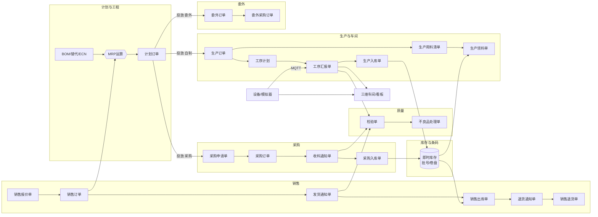

## 2. 一期主线流程

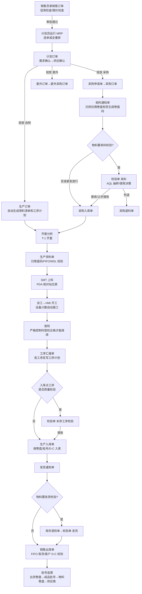

**各步谁做、系统做什么**

| 步骤 | 角色 | 单据 | 系统动作 | 依据 |
|---|---|---|---|---|
| 1 接单 | 销售员 | 销售订单 | 提交时做信用检查；低于最低限价打“低于限价”标识走特批；审核后参与 MRP | 【来源:销售订单】【来源:信用检查规则】【来源:销售价格管理】 |
| 2 计划 | 计划员 | MRP 运算记录、计划订单 | 按计划方案取需求和供给（取数口径见 G1a 3.4）；生成计划订单；需求确认后锁定建议量，供应确认后锁定确认量 | 【来源:计划方案】【来源:计划订单】 |
| 3 投放 | 计划主管 | 生产订单 / 采购申请单 / 委外订单 | 供应确认后投放，计划订单“投放关闭” | 【来源:计划订单】 |
| 4 工单 | 计划员、生产主管 | 生产订单 | 保存时按 BOM 自动生成用料清单；审核自动计划确认；下达生成工序计划 | 【来源:生产订单】【来源:生产用料清单】【来源:工序计划】 |
| 5 采购 | 采购员 | 采购申请、采购订单 | 数量按最小包装量（MPQ）校验；交货上下限和交货日期窗口控制收料 | 【来源:采购订单】【来源:采购管理系统参数】 |
| 6 收料检验 | 仓管、IQC | 收料通知、检验单 | 物料勾“来料检验”才生成检验单；AQL 按 GB/T2828.1 带出样本量和 Ac/Re | 【来源:收料通知单】【来源:抽样方案】 |
| 7 入库 | 仓管 | 采购入库单 | 审核更新库存，反写收料单和订单累计入库；卷盘码登记到条码主档 | 【来源:采购入库单】【扩展】 |
| 8 齐套和领料 | 生管、仓管 | 齐套分析单、生产领料单 | 齐套审核反写备料数量；领料扫码，严格先进先出（物料+批号+仓库）；MSL 超时卷盘禁止发料【扩展】 | 【来源:生产齐套分析单】【来源:条码管理系统参数】 |
| 9 上料 | 上料员 | 生产 SMT 上料表、上下料流水 | PDA 扫设备、轨道、飞达、料盘，与上料表不符就拒绝 | 【来源:生产smt上料表】【来源:生产上料】 |
| 10 执行 | 班组长、操作工 | 派工明细、工序汇报单 | 开工、暂停、报工；设备计数差值自动生成工序汇报单；审核反写工序计划 | 【来源:派工工序报工】【来源:复杂工序联网-场景14.1-联网采集自动报工-原始点值方式】 |
| 11 首检 | IPQC | 检验单（首检） | 严格控制：首检完成或首检状态为空才允许汇报，首检完成才允许入库；非严格控制不卡 | 【来源:产品检验】 |
| 12 完工检验 | QC | 检验单 | 入库点工序控制码为“质量检验”时，工序汇报审核自动生成检验单 | 【来源:车间移动质检_参数设置】【来源:工序计划】 |
| 13 入库 | 仓管 | 生产入库单 | 按卷盘逐盘入库，带批号和 D/C【扩展】；反写入库数量，达到入库下限自动完工 | 【来源:生产入库单】【来源:生产订单】 |
| 14 发货 | 销售、OQC、仓管 | 发货通知、库存请检、检验单、销售出库 | 出库数 ≤ 合格数 + 不良可销售数；库存状态只能“可用”；客户 D/C 限制校验【扩展】 | 【来源:发货检验】【来源:销售出库单】 |
| 15 追溯 | 品质 | 批号追溯报表 | 溯源（父→子）和去向（子→父），层级最多 100 | 【来源:质量追溯】 |

## 3. 一期单据清单

### 3.1 基础资料（一期，共 32 类）

基础资料统一走“创建 → 审核 → 禁用 / 反禁用”，已被引用的不能删只能禁用。【来源:bos通用操作列表】

| # | 基础资料 | 要点 | 来源 |
|---|---|---|---|
| B01 | 组织 | 单组织；业务职能有销售、采购、库存、工厂、质检、结算 | 【来源:组织机构】 |
| B02 | 部门 | 树形；部门负责人供审批取人 | 【来源:部门】 |
| B03 | 岗位、员工、员工任岗 | 汇报关系供审批和数据权限用 | 【来源:岗位信息】 |
| B04 | 用户、角色 | 见第 10 章 | 【来源:用户】 |
| B05 | 计量单位、单位换算 | 基本单位 + 辅助单位，精度和舍入 | 【来源:计量单位】 |
| B06 | 币别、汇率、税率 | 税率带生效/失效日期 | 【来源:税率】 |
| B07 | 辅助属性、辅助属性值组合 | 阻值、精度、封装、包装方式的合法组合 | 【来源:辅助属性值组合】 |
| B08 | 物料 | 允许生产/采购/委外/资产；批号、保质期、来料检验、发货检验；【扩展】封装、MSL 等级、RoHS、品牌、制造商料号 MPN、卷盘规格、承认状态 | 【来源:物料】【扩展】 |
| B09 | 客户、客户物料对应表 | 客户料号；纳税识别号（财务预留） | 【来源:客户】 |
| B10 | 供应商、货源清单 | 供应类别（委外/综合）；货源清单带 MPQ 和制造商 | 【来源:供应商】【来源:货源清单】 |
| B11 | 仓库、仓位 | 允许负库存、启用仓位管理、默认库存状态 | 【来源:仓库】 |
| B12 | 库存状态 | 可用/待检/冻结/退回冻结/在途/收货冻结/废品/不良，及“MRP 可用”等属性 | 【来源:库存状态】 |
| B13 | 工作中心、资源、产线 | 产线对应三维场景的线体 | 【来源:工作中心】 |
| B14 | 工厂日历、班次 | 两班或三班 | 【来源:工厂日历】 |
| B15 | 工艺路线（简版） | 工序号、作业、工作中心、工序控制码、入库点、汇报上下限比例；【扩展】理论节拍 | 【来源:工艺路线】 |
| B16 | 物料清单 BOM | 位置号存贴片位号；阶梯用量；替代；发料方式和倒冲时机 | 【来源:物料清单】 |
| B17 | 替代方案 | 混用、手工、整批、整批+混用 | 【来源:替代方案】 |
| B18 | 安全库存、制造策略 | 一期只做 MTS 和 MTO（计划跟踪号） | 【来源:制造策略】 |
| B19 | 计划方案 | 展望期、时界、订货策略、供给优先顺序 | 【来源:计划方案】 |
| B20 | 采购价目表、销售价目表 | 生效/失效日期；最低限价 | 【来源:采购价目表】【来源:销售价目表】 |
| B21 | 信用档案、信用检查规则 | 额度、单笔限额、逾期；控制强度 | 【来源:信用档案】 |
| B22 | 条码规则、条码主档 | 主档对照或动态解析；【扩展】卷盘码扩展列 | 【来源:条码规则】 |
| B23 | 抽样方案、AQL 国标资料 | GB/T2828.1-2012 字码表、检索表 | 【来源:抽样方案】 |
| B24 | 检验项目、质检方案 | 检验指标的目标值和上下限 | 【来源:质检方案】 |
| B25 | 缺陷类型、缺陷原因 | 缺陷等级致命/重/轻 | 【来源:检验单】 |
| B26 | 设备、仪表点、状态映射、故障映射 | 5 种设备状态；12 种处理类型 | 【来源:设备】 |
| B27 | 生产事件（含处理路径、处理人、升级策略） | 影响至设备状态、OEE 时间类型 | 【来源:生产事件管理】 |
| B28 | 飞达、飞达规格 | 空闲/占用/维修/报废 | 【来源:飞达明细】 |
| B29 | 站位表 | 产品 + 产线 + 贴片机位置 + 程序 | 【来源:站位表】 |
| B30 | 车间调度汇报权限 | 用户 × 工作中心，含代理报工 | 【来源:车间调度汇报权限】 |
| B31 | 编码规则、单据类型 | 见第 9 章 | 【来源:编码规则】【来源:单据类型】 |
| B32 | 产线日产量 | 日排产用 | 【来源:产线日产量】 |

### 3.2 业务单据（一期，共 55 张）

“状态机”一列见第 4 章编号。所有单据都有通用状态 L1（暂存 / 创建 / 审核中 / 已审核 / 重新审核，加关闭、作废），这里只写各单据自己的业务状态。

| # | 模块 | 单据 | 业务状态（行级） | 状态机 | 主要来源 |
|---|---|---|---|---|---|
| D01 | 计划 | 计划订单 | 计划 / 需求确认 / 供应确认 / 关闭（手工、投放、拆分、合并） | SM-02 | 【来源:计划订单】 |
| D02 | 工程 | 工程变更单 ECN | 创建 / 审核中 / 已审核 / 生效（立即、按日期、用完旧料） | SM-03 | 【来源:工程变更单】 |
| D03 | 生产 | 生产订单 | 计划 / 计划确认 / 下达 / 开工 / 完工 / 结案 / 结算，另有挂起 | SM-04 | 【来源:生产订单】 |
| D04 | 生产 | 生产用料清单 | 创建 / 审核（可下达时自动审核） | SM-01 | 【来源:生产用料清单】 |
| D05 | 生产 | 生产订单变更单 | 通用状态；审核即生效 | SM-01 | 【来源:生产订单变更单】 |
| D06 | 生产 | 生产用料清单变更单 | 通用状态；审核即执行 | SM-01 | 【来源:生产用料清单变更单】 |
| D07 | 生产 | 生产齐套分析单 | 创建 / 分析 / 提交 / 审核 | SM-05 | 【来源:生产齐套分析单】 |
| D08 | 生产 | 生产领料单 | 通用状态 | SM-01 | 【来源:生产领料单】 |
| D09 | 生产 | 生产退料单（良品/来料不良/作业不良） | 通用状态 | SM-01 | 【来源:生产退料单】 |
| D10 | 生产 | 生产补料单 | 通用状态；超损耗补料走审批 | SM-01 | 【来源:生产补料单】 |
| D11 | 生产 | 生产汇报单（订单级路线） | 通用状态 | SM-01 | 【来源:生产汇报单】 |
| D12 | 生产 | 生产入库单 | 通用状态 | SM-01 | 【来源:生产入库单】 |
| D13 | 生产 | 生产退库单 | 通用状态 | SM-01 | 【来源:生产退库单】 |
| D14 | 生产 | 生产日排产（排产明细） | 未确认 / 已确认；锁定 / 解锁 | SM-06 | 【来源:生产日排产查询】 |
| D15 | 委外 | 委外订单 | 计划 / 计划确认 / 下达 / 开工 / 完工 / 结案 / 结算 | SM-07 | 【来源:委外订单】 |
| D16 | 委外 | 委外用料清单 | 创建 / 审核 | SM-01 | 【来源:委外用料清单】 |
| D17 | 委外 | 委外领料单 | 通用状态 | SM-01 | 【来源:委外领料单】 |
| D18 | 委外 | 委外退料单 | 通用状态 | SM-01 | 【来源:委外退料单】 |
| D19 | 委外 | 委外补料单 | 通用状态 | SM-01 | 【来源:委外补料单】 |
| D20 | 车间 | 工序计划 | 创建 / 计划 / 计划确认 / 下达 / 开工 / 完工 / 关闭；首检状态 | SM-08 | 【来源:工序计划状态控制】 |
| D21 | 车间 | 派工明细 | 未开工 / 开工 / 完工 | SM-09 | 【来源:派工明细】 |
| D22 | 车间 | 工序汇报单（工序生产汇报 / 工序入库汇报） | 通用状态 | SM-01 | 【来源:工序汇报】 |
| D23 | 车间 | 工序转移单（一期只做正常转移） | 转移申请=创建，转移确认=审核 | SM-01 | 【来源:工序转移单】 |
| D24 | 车间 | 工序不良品明细 | 通用状态 | SM-01 | 【来源:工序不良品明细】 |
| D25 | 车间 | 现场异常处理单（安灯） | 待处理 / 处理中 / 已关闭；异常等级一级→三级 | SM-10 | 【来源:现场异常处理单】 |
| D26 | 车间 | 预防措施跟踪单 | 通用状态 | SM-01 | 【来源:预防措施跟踪单】 |
| D27 | 车间 | 生产 SMT 上料表 | 行：待上料 / 已上料 / 已下线 | SM-11 | 【来源:生产smt上料表】 |
| D28 | 采购 | 采购申请单 | 通用状态；审核中可改批准数量；行业务关闭 | SM-01 | 【来源:采购申请单】 |
| D29 | 采购 | 采购订单 | 通用状态；行业务关闭/冻结/终止；变更标志 | SM-12 | 【来源:采购订单】 |
| D30 | 采购 | 采购订单新变更单 | 通用状态；审核并生效后订单版本号 +1 | SM-01 | 【来源:采购订单变更单】 |
| D31 | 采购 | 收料通知单 | 通用状态；紧急放行 | SM-01 | 【来源:收料通知单】 |
| D32 | 采购 | 采购入库单 | 通用状态 | SM-01 | 【来源:采购入库单】 |
| D33 | 采购 | 退料申请单 | 通用状态 | SM-01 | 【来源:退料申请单】 |
| D34 | 采购 | 采购退料单 | 通用状态 | SM-01 | 【来源:采购退料单】 |
| D35 | 销售 | 销售报价单 | 通用状态；可多次下推 | SM-01 | 【来源:销售报价单】 |
| D36 | 销售 | 销售订单 | 通用状态；行业务关闭/冻结/终止；变更标志 | SM-12 | 【来源:销售订单】 |
| D37 | 销售 | 销售订单新变更单 | 通用状态 | SM-01 | 【来源:销售订单变更单】 |
| D38 | 销售 | 发货通知单 | 通用状态；全部行达出库下限后整单自动关闭 | SM-12 | 【来源:发货通知单】 |
| D39 | 销售 | 销售出库单 | 通用状态 | SM-01 | 【来源:销售出库单】 |
| D40 | 销售 | 退货通知单 | 通用状态 | SM-01 | 【来源:退货通知单】 |
| D41 | 销售 | 销售退货单 | 通用状态；退货补货时自动反关闭原订单 | SM-01 | 【来源:销售退货单】 |
| D42 | 库存 | 初始库存 | 通用状态；只能在初始化未结束时录入 | SM-01 | 【来源:初始库存】 |
| D43 | 库存 | 其他入库单 | 通用状态 | SM-01 | 【来源:其他入库单】 |
| D44 | 库存 | 其他出库单 | 通用状态 | SM-01 | 【来源:其他出库单】 |
| D45 | 库存 | 直接调拨单 | 通用状态 | SM-01 | 【来源:直接调拨单】 |
| D46 | 库存 | 库存状态转换单 | 通用状态；可由请检或检验自动生成和删除 | SM-01 | 【来源:库存状态转换】 |
| D47 | 库存 | 批号调整单（卷盘拆分/合并） | 通用状态 | SM-01 | 【来源:批号调整单】 |
| D48 | 库存 | 物料盘点作业（含盘点方案） | 通用状态 | SM-01 | 【来源:库存盘点方案】 |
| D49 | 库存 | 盘盈单 | 不能反审核 | SM-01 | 【来源:物料盘点作业】 |
| D50 | 库存 | 盘亏单 | 不能反审核 | SM-01 | 【来源:物料盘点作业】 |
| D51 | 条码 | 条码拆分单 | 主码 → 子码（主码-流水号），自动扣减主码数量 | SM-01 | 【来源:条码拆分】 |
| D52 | 条码 | MSL 开封 / 烘烤记录【扩展】 | 通用状态；卷盘 MSL 状态见 SM-14 | SM-14 | 【扩展】 |
| D53 | 质量 | 检验单（来料 / 产品 / 末序工序 / 发货 / 退货 / 库存 / 首检） | 质检状态：计划 / 质检开始 / 质检完成；检验结果：合格 / 不合格 / 保留 | SM-13 | 【来源:检验单】 |
| D54 | 质量 | 库存请检单（库存 / 发货） | 通用状态；审核后自动冻结 | SM-01 | 【来源:库存请检单】 |
| D55 | 质量 | 不良品处理单 | 不良品处理状态：进行中 / 已完成；关闭状态 | SM-15 | 【来源:不良品处理单】 |

另有一期的**系统记录**（不是单据，没有审批）：MRP 运算记录与日志、库存流水、库存余额（关账）、批号主档、条码扫描记录、设备状态变更日志、设备联网任务实时/历史表、仪表采集值、OEE 实时/历史、上下料流水、工位上料剩余数量、消息队列、操作日志、业务数据日志。

**一期供应商门户（精简）**：供应商账号登录后可做采购订单确认、送货通知确认、按我方规则打印卷盘来料标签。不单独算单据。【来源:供应商协同】【扩展】

### 3.3 二期才做的单据（摘要）

工程变更申请单（ECR）、预测单、预留单、生产领料申请单、挪料单、委外订单变更单/拆分/超耗单、缺料分析单、MRB 评审单、工序巡检、合同、对账、VMI 物权转移、组织间结算清单、序列号相关单据、辅助工时、包装与箱码。【来源:G1a 第 2 节】【来源:G1b 第 7 节】【来源:G2 第 11 节】

## 4. 状态机

### 4.1 通用单据状态（SM-01，所有单据都有）

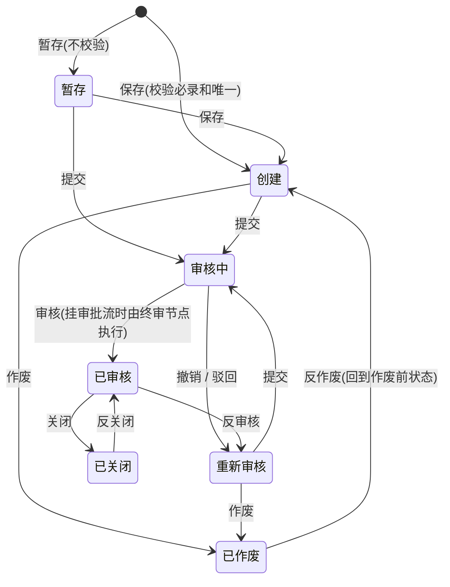

| 规则 | 内容 | 来源 |
|---|---|---|
| 删除 | 只能删暂存或创建状态的单据 | 【来源:bos通用操作列表】 |
| 修改 | 只能改暂存、创建、重新审核状态的单据 | 【来源:bos通用操作列表】 |
| 提交 | 适用于暂存、创建、重新审核；先保存再提交 | 【来源:单据状态通用说明】 |
| 作废 | **只能作废创建或重新审核状态的单据，已审核的必须先反审核**；作废后除查看、反作废、打印、附件、引入引出外不能做任何操作；作废释放保存时占用的选单数量（见裁决 C-01） | 【来源:采购申请单】【来源:期初采购订单】【来源:生产领料申请单】【来源:生产补料单】 |
| 关闭 | 只对已审核单据有效；另有行级业务关闭，由反写的关闭条件自动置位 | 【来源:bos通用操作列表】【来源:反写规则】 |
| 报表 | 统计时不计暂存单据 | 【来源:单据状态通用说明】 |
| 职责分离 | 审核人≠创建人；反审核人=审核人；删除人、修改人=创建人（按单据配置） | 【来源:单据参数配置】 |
| 反审核限制 | 有下游有效单据时禁止反审核；盘盈/盘亏单不能反审核 | 【来源:生产订单】【来源:物料盘点作业】 |
| 字段与按钮 | 每个状态下哪些字段能改、哪些按钮能点，由状态机配置决定 | 【来源:单据状态】 |

行级状态（与表头状态并存）：业务关闭（按数量自动）、业务冻结（手工）、业务终止（手工）；整单关闭可按“全部行关闭”或“任一行关闭”。【来源:采购订单】【来源:反写规则】

### 4.2 计划订单（SM-02）

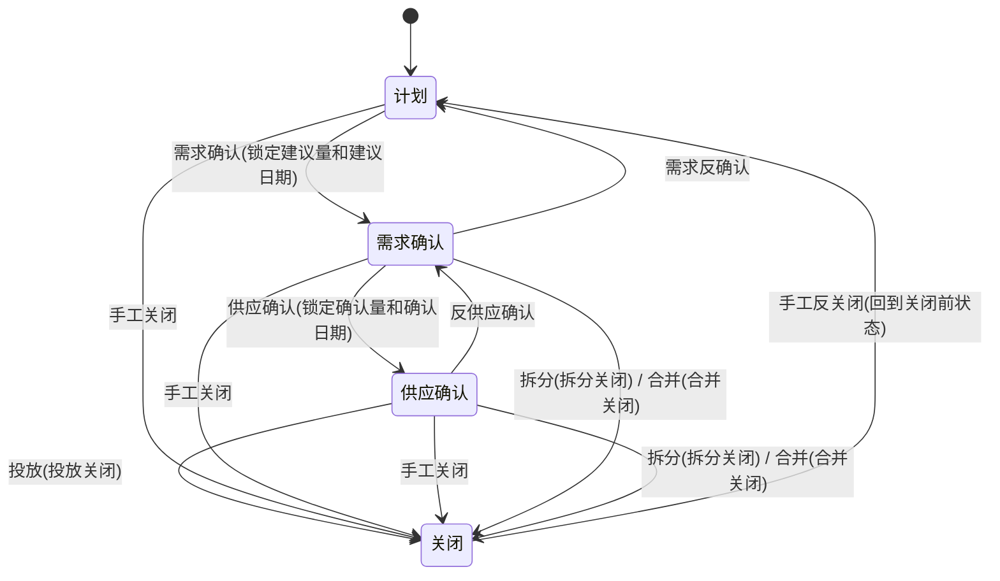

关闭类型：手工关闭、投放关闭、拆分关闭、合并关闭；反关闭回到关闭前的状态。拆分、合并会生成新的计划订单，原单置拆分关闭 / 合并关闭。原文没有写拆分、合并的前置业务状态，图上按“需求确认、供应确认”画，计划状态是否允许拆分合并在实施时按金蝶实测补。【来源:计划订单】【来源:计划订单-图】

### 4.3 工程变更单 ECN（SM-03）

创建 → 审核中 → 已审核 → 生效。生效方式三种：立即生效；按日期由定时任务生效；用完旧料由旧料清理触发。用完旧料时，在 BOM 里把旧料设为替代件（优先级 0）、新料设为主料（优先级 1），只限修改子项。【来源:工程变更单】【来源:ECN旧料清理】【来源:设计变更管理】

### 4.4 生产订单（SM-04，分录级）

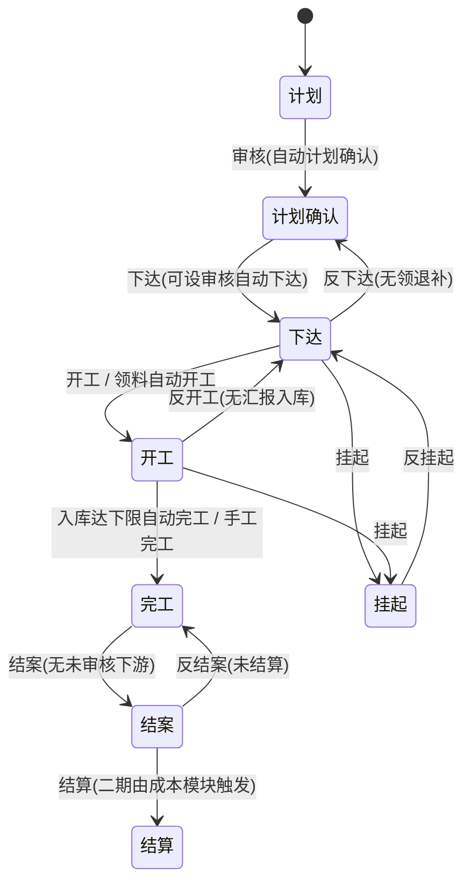

- **正向执行、反向执行都可跳跃**：可直接“执行至下达 / 开工 / 完工 / 结案”，也可“反执行至计划 / 计划确认 / 下达 / 开工 / 完工”，中间各步的校验逐一执行。【来源:生产订单】【来源:生产订单样例】
- **手工完工**：不能有非作废、非审核的入库单；勾选“手工完工考虑产品的入库下限”时，主产品及联副产品（入库 − 退库）须 ≥ 入库下限。【来源:生产订单】【来源:生产单据类型参数】
- **结案控制**（在生产订单的单据类型里设）：控制范围 = 所有物料 / 非倒冲物料 / 关键物料；控制强度 = 在制材料数量为零 / 在制材料数量在损耗范围内 / 不控制；返还件用同一组强度参数单独控制。结案时不能有非审核、非作废的下游单据（领退补、汇报、入库）。**已结算的订单不能反结案。**【来源:生产订单】
- **反审核限制**：存在未审核的生产用料清单变更单时，生产订单不能反审核。【来源:生产单据类型参数】
- 执行机器人可自动完工、结案，触发条件可选“入库数量等于订单数量 / 入库上限 / 入库下限”；可结案的业务状态为下达、开工、完工。【来源:生产订单执行机器人】
- 领料状态：未领料 / 部分领料 / 全部领料 / 超额领料，按领料套数计算。【来源:生产订单】
- “结算”状态原文只出现在状态枚举里，没有写触发动作。一期保留这个状态值但不提供触发入口，二期成本结算后置位（裁决 C-03，【待确认 Q22】）。

### 4.5 齐套分析单（SM-05）

创建 → 分析 → 提交 → 审核；未分析或分析后改过订单页签的不能提交。审核时反写用料清单的备料数量，可生成领料单或直接调拨单。参与分析的订单分录须为下达、开工或完工且未挂起。【来源:生产齐套分析单】

- 分析步骤：按优先顺序（优先级 + 计划开工日期 / 计划开工日期 + 优先级 / 计划完工日期 + 优先级）给订单分录排序；取方案仓库范围内的现有库存和符合条件的预计入，扣掉已预留部分；再逐行分配。子项发料仓不在方案仓库范围内时，也计入该发料仓的库存。【来源:生产备料单】【来源:生管平台】
- **缺料 = 应发数量 − 已领数量 − 预留数量_库存 − 预留数量_预计入 − 分配库存 − 分配预计入**；有缺料为“不齐套”，预计齐套数 = 库存齐套数时为“库存齐套”，预计齐套数 > 库存齐套数时为“预计齐套”。缺料汇总按货主、货主类型、物料、辅助属性、BOM 版本、计划跟踪号合计。【来源:生管平台】

### 4.6 日排产（SM-06）

未确认 → 已确认；可锁定、解锁。不允许删除当前日期之前、或已有上线/齐套/发料数量的排产明细。【来源:日排产参数】

### 4.7 委外订单（SM-07）

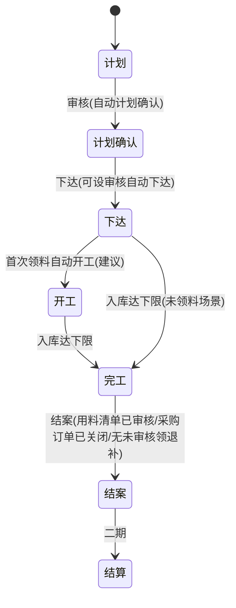

原文状态枚举含“开工”，但操作说明没有开工按钮（裁决 C-02，【待确认 Q23】）。未入库的委外订单只能强制结案。【来源:委外订单】【来源:委外单据类型参数】

### 4.8 工序计划（SM-08，分录级）

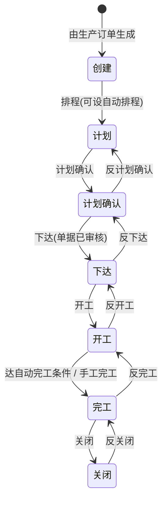

分录状态支持正向和逆向跳跃，跳跃时依次执行中间各步。首检状态：空 / 待首检 / 首检中 / 首检完成（裁决 C-08）。【来源:工序计划状态控制】【来源:首检_柔性单件】【来源:产品检验】

### 4.9 派工明细（SM-09）

未开工 → 开工 → 完工，由终端执行情况反填；转派数量 = 原派工数量 − 已完工。启用派工明细后，PC 端不能直接下推工序汇报单。【来源:派工明细】【来源:工序派工】

### 4.10 现场异常处理单 / 安灯（SM-10）

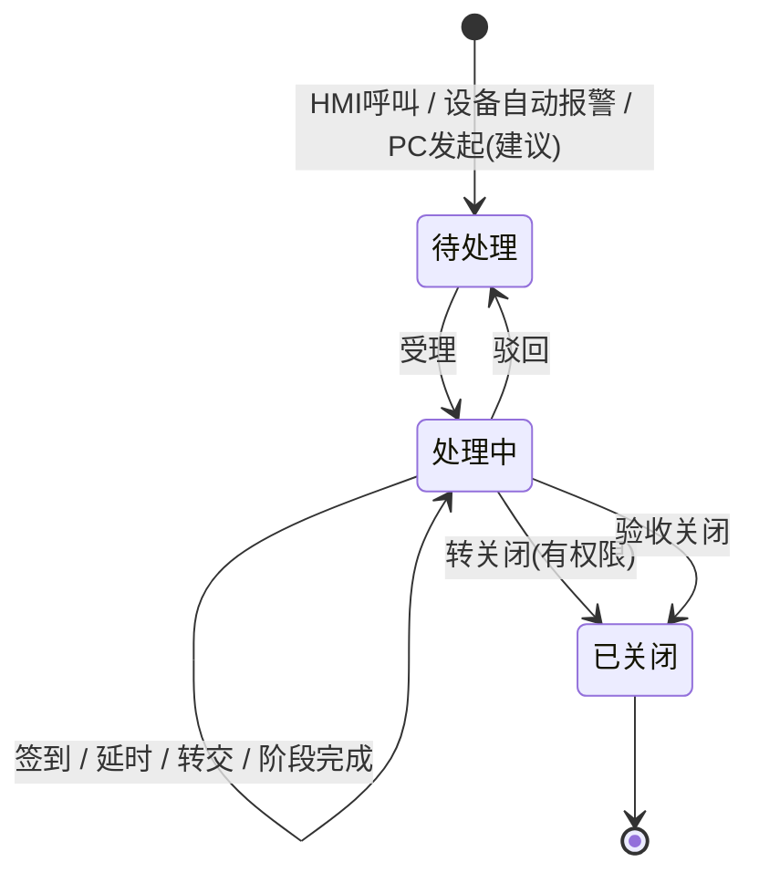

- 处理阶段第一个必须是“发起呼叫”、最后一个必须是“验收关闭”，中间可自定义；每阶段配受理、签到、处理时限（分钟）。
- 按处理时长一级 → 二级 → 三级升级，执行计划每 1 分钟检查一次，升级后发消息。
- 金蝶 PC 端不能手工录入此单（【待确认 Q19】）。【来源:生产事件管理】【来源:现场异常处理单】【来源:车间异常处理绩效统计表】

### 4.11 SMT 上料表行（SM-11）

待上料 → 已上料 → 已下线；上下料流水类型：上料 / 续料 / 换料 / 下料 / 挪料（二期）/ 不良退料（二期）。【来源:生产smt上料表】【来源:上下料流水表】

### 4.12 采购订单 / 销售订单 / 发货通知（SM-12，行级执行状态）

- 行：业务关闭（数量达到关闭条件自动置位）、业务冻结、业务终止；整单全部行关闭时自动关闭。
- 订单变更走“新变更单”：变更标志 空 / 变更中 / 已变更 / 取消；新数量 ≥ max(累计收货, 累计入库, 累计开票)。【来源:采购订单】【来源:销售订单】【来源:采购订单变更单】

### 4.13 检验单（SM-13）

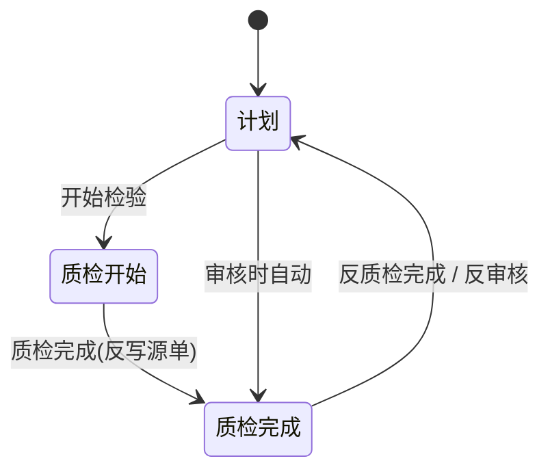

- 检验结果：合格 / 不合格 / 保留；使用决策为“接收”时状态为合格，其余为不合格。【来源:检验单】
- 各检验类型的使用决策（一期用到的）：来料（接收、让步接收、挑选全检、判退；委外来料加工废、料废）；产品（接收、不良、返修、返工、报废、挑选全检）；自制工序（接收、让步接收、返修、挑选全检、工废、料废）；发货、退货、库存（接收、不良、报废、挑选全检）。【来源:检验单】
- 让步接收是否算合格，原文前后矛盾（裁决 C-04，【待确认 Q13】）。

### 4.14 卷盘 MSL 状态（SM-14）【扩展】

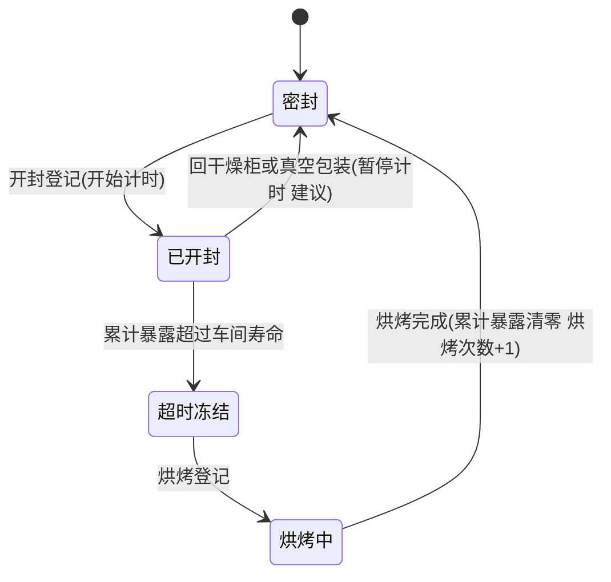

超时后自动生成库存状态转换单转为“冻结”；烘烤记录审核后转回“可用”。思路借用原文“复检到期查询 / 新有效期至”。【扩展】【来源:库存物料复检到期查询】

### 4.15 不良品处理单（SM-15）

保存时不良品处理状态为进行中，审核时为已完成，反审核回到进行中；关闭后不能再产生应付或应收折让单（折让放二期）。【来源:不良品处理单】

## 5. 下推与反写总表（一期）

### 5.1 统一规则

1. **两段反写**：下游单据**保存**时累加上游的“××选单数量 / 关联数量”（占用可转数量）；**审核**时累加上游的“累计××数量 / 执行数量”（业务完成）；删除或反审核时按相反方向回滚。【来源:反写规则】【来源:采购申请单】【来源:销售订单】
2. **可转数量** = 源单数量 − 已关联数量（按基本单位）。【来源:单据转换规则】【来源:单位换算处理】
3. **超额控制**：禁止超额 / 允许超额一次 / 允许按公式超额（例如入库数量 > 采购数量 × 1.2 时禁止）。【来源:反写规则】
4. **关闭控制**：例如累计入库 ≥ 采购数量 × 98% 时行自动业务关闭；整单关闭按“全部行关闭”或“任一行关闭”。【来源:反写规则】
5. **同一事务**：下游单据的保存/审核、上游反写、库存更新、单据关联记录在同一个数据库事务里完成。「建议」
6. **反审核保护**：有下游有效单据时禁止反审核（例如“反下达需无领退补”“反开工需无汇报入库”）。【来源:生产订单】
7. 所有关联都写入通用关联表 `sys_bill_link`（源单行 → 目标单行 + 数量），供上查、下查、全流程跟踪和回滚使用。

### 5.2 总表

列说明：“保存时 / 审核时”指**下游**单据的动作，后面是被反写的**上游**字段。

| # | 源单 → 目标单 | 下推/选单条件 | 保存时反写 | 审核时反写 / 联动 | 来源 |
|---|---|---|---|---|---|
| R01 | 销售订单、安全库存 → MRP → 计划订单 | 销售订单非暂存且未关闭；按计划方案的时界和取数口径 | — | 生成计划订单，记运算编号和供需明细 | 【来源:计划方案】【来源:主计划方案】 |
| R02 | 计划订单 → 生产订单 / 采购申请单 / 委外订单（投放） | 业务状态为供应确认（或参数允许直接投放）；生产/委外类 BOM 必录 | — | 计划订单“投放关闭” | 【来源:计划订单】 |
| R03 | 生产订单 → 生产用料清单 | 生产订单保存 | 自动生成 | 下达时可自动审核用料清单 | 【来源:生产用料清单】 |
| R04 | 生产订单 → 工序计划 | 生产订单生成；参数设自动排程时为计划态 | — | 生成工序计划和分录条码（工序计划单编号-序列号-工序号） | 【来源:工序计划】【来源:生产工序执行流程】 |
| R05 | 生产订单 → 生产齐套分析单 → 领料单 / 直接调拨单 | 分析方案选定的订单；只取已审核数据 | — | 审核反写用料清单“备料数量” | 【来源:生产齐套分析单】【来源:生管平台】 |
| R06 | 生产用料清单 → 生产领料单 | 订单分录为下达、开工或完工且未挂起；用料清单已审核；应发 − 领料选单 + 良品退 + 来料不良退 > 0 | 领料选单数量 | 已领数量；订单领料状态；领料可自动开工 | 【来源:生产领料单】【来源:生产用料清单】 |
| R07 | 生产领料单 / 补料单 → 生产退料单 | 实发 − 退料选单 > 0 | 退料选单数量 | 良品退料、来料不良退料、作业不良退料数量 | 【来源:生产退料单】 |
| R08 | 生产订单（取用料清单） / 作业不良退料单 → 生产补料单 | 订单分录下达、开工或完工且未挂起；从退料单生成时实退 − 补料选单 > 0；超损耗率补料走审批；**合单分组：发料组织 + 生产组织 + 货主 + 货主类型相同的分录合成一张** | 补料选单数量 | 补领数量、报废数量 | 【来源:生产补料单】 |
| R09 | 工序计划分录 → 派工明细 | 工序计划已下达；启用派工明细 | 已派工数量 += 派工数量 | — | 【来源:派工明细】 |
| R10 | 工序计划分录 / 派工明细 → 工序汇报单 | 启用派工时只能从派工明细（HMI）报工 | 汇报选单数量 | 合格、废品、工废、料废、待返工数量；实际开工/完工时间；达到自动完工条件置完工；派工明细完成选单数量和状态 | 【来源:工序汇报】【来源:派工明细】 |
| R11 | 设备计数点 → 工序汇报单（自动报工） | 处理类型 = 批量报工；开工时记开工基准，计数溢出按上限值复位 | 同 R10 | 同 R10 | 【来源:复杂工序联网-场景14.1-联网采集自动报工-原始点值方式】 |
| R12 | 工序计划 → 工序转移单 | 转移申请生成创建态单据 | — | 转出、转入数量 | 【来源:工序转移单】【来源:转移申请】 |
| R13 | 工序汇报单 → 工序不良品明细 | 有不良数量 | — | 返修类单据：使用决策（工废/料废/返修）审核时反写源工序汇报单 | 【来源:工序不良品明细】【来源:返修工作台】 |
| R14 | 工序汇报单 → 检验单（首检 / 末序工序检验） | 首检标识；或工序控制码为“质量检验”且单据类型参数“审核自动生成检验单” | 检验选单数量 | 质检完成：接收、不良、工废、料废数量反写工序汇报单；首检检验单更新首检状态（合格→首检完成，不合格→空，保留→首检中） | 【来源:车间移动质检_参数设置】【来源:自制工序检验】【来源:产品检验】 |
| R15 | 生产订单 → 生产汇报单（订单级路线） | 订单分录为开工或完工；入库上限 − 汇报选单 + 返修 > 0；严格首检控制时首检完成或为空 | 汇报选单数量 | 合格、不合格、返修、报废、返工数量 | 【来源:生产汇报单】【来源:产品检验】 |
| R16 | 生产汇报单 → 检验单（产品检验） | 检验数量默认 = 完成数量 − 检验选单数量 | 检验选单数量 | 质检完成：合格、不良、报废、返修、返工数量反写汇报单和生产订单 | 【来源:产品检验】【来源:检验单】 |
| R17 | 入库点工序汇报单 / 生产汇报单 / 生产订单（直接入库）→ 生产入库单 | 不超过入库上限；**合单分组（下推和选单都一样）：生产组织 + 货主 + 货主类型相同的分录合成一张**；反审核要求订单为开工或完工；严格首检控制时首检完成才允许合格品入库 | 入库选单数量 | 合格、不合格、返工、报废四类入库数量；达到入库下限自动完工；入库倒冲生成领料 | 【来源:生产入库单】【来源:工序汇报】【来源:生产订单】 |
| R18 | 生产入库单 → 生产退库单 | 实收 − 已退 > 0 | — | 冲减入库数量 | 【来源:生产退库单】 |
| R19 | 生产订单变更单 → 生产订单 | 订单状态为计划、计划确认、下达、开工 | — | 改写订单字段，刷新用料清单；可自动生成暂存退料单 | 【来源:生产订单变更单】 |
| R20 | 生产用料清单变更单 → 生产用料清单 | 领料/补料/退料/调拨选单数量任一 > 0 时，子项类型和发料方式锁定 | — | 审核即执行变更 | 【来源:生产用料清单变更单】 |
| R21 | 工程变更单 → BOM / 在制用料清单 | 审核并生效；BOM 父项勾选“启用ECN” | — | 生成或修改 BOM 版本；勾“更新用料清单”时同步在制生产/委外用料清单 | 【来源:工程变更单】 |
| R22 | 入库单 / 汇报单 → 日排产明细 | — | — | 上线数量 | 【来源:生产订单排产明细】 |
| R23 | 委外订单 → 采购订单（委外） | 委外订单已下达 | 采购选单数量 | 采购执行数量；回填供应商 | 【来源:委外订单】 |
| R24 | 委外用料清单 → 委外领料 / 退料 / 补料 | 同 R06–R08 | 同 R06–R08 | 同 R06–R08 | 【来源:委外领料单】【来源:委外退料单】【来源:委外补料单】 |
| R25 | 采购入库单（委外）→ 委外订单 | 委外收料、来料检验（业务类型为委外检验）后入库 | — | 委外订单入库数量；委外倒冲放二期 | 【来源:委外订单】【来源:来料检验】 |
| R26 | 采购申请单 → 采购订单 | 申请已审核、未关闭、未终止 | 关联数量 | 订单数量；订单数量 ≥ 批准数量时行自动关闭 | 【来源:采购申请单】 |
| R27 | 采购订单 → 收料通知单 | 订单已审核、未关闭；控制交货数量时关联数 ≤ 交货上限，收料日期在最早、最晚交货日期之间 | — | 累计收料数量 | 【来源:采购订单】 |
| R28 | 收料通知单 → 检验单（来料） | 物料勾选来料检验且未紧急放行；检验数量默认 = 实收 − 检验关联数量 | 检验关联数量 | 质检完成：检验数量、合格、判退、让步接收、工废、料废数量；接收数、退料数 | 【来源:收料通知单】【来源:来料检验】 |
| R29 | 收料通知单 → 采购入库单 | 需检：接收数 > 入库关联数；免检或紧急放行：实收 > 退料关联 + 入库关联 | — | 收料单和订单的累计入库数量 | 【来源:收料通知单】【来源:采购入库单】 |
| R30 | 收料通知单 → 采购退料单（检验退货） | 需检看判退数，免检看实收 | — | 累计退料数量；补料方式为“创建补货订单”时生成补货采购订单 | 【来源:收料通知单】【来源:采购退料单】 |
| R31 | 采购入库单 → 退料申请单 / 采购退料单（库存退货） | 退料数 ≤ 实收 − 退料关联 | — | 订单累计退料数量 | 【来源:采购入库单】【来源:采购退料单】 |
| R32 | 采购 / 销售订单新变更单 → 原订单 | 新数量 ≥ max(累计收货, 累计入库, 累计开票) | — | 审核并生效后版本号 +1 | 【来源:采购订单变更单】 |
| R33 | 销售报价单 → 销售订单 | 报价已审核且未失效；原文允许多次下推、**默认无关联数量控制** | — | 一期按原文不控数量，只记关联关系（需要控数量时在转换规则里配） | 【来源:销售报价单】 |
| R34 | 销售订单 → 发货通知单 | 订单已审核、未冻结；关联数 ≤ 发货上限 | — | 累计发货通知数量 | 【来源:销售订单】 |
| R35 | 发货通知单 → 库存请检单（发货）→ 检验单（发货） | 物料启用发货检验；请检审核后自动冻结库存 | 检验选单数量 | 质检完成：接收、不良、报废数量；自动生成库存状态转换单 | 【来源:发货检验】【来源:库存请检单】 |
| R36 | 发货通知单 / 销售订单 → 销售出库单 | 需检时出库数 ≤ 合格数 + 不良可销售数；库存状态只能“可用” | — | 发货通知和订单累计出库数量；达到出库下限自动关闭 | 【来源:销售出库单】【来源:发货通知单】【来源:发货检验】 |
| R37 | 销售出库单 / 订单 → 退货通知单 → 检验单（退货）→ 销售退货单 | 订单已有出库数量；启用退货检验时只有判退数量能下推退货单 | — | 累计退货通知数量、累计退货数量；退货类型为“退货补货”时自动反关闭原订单 | 【来源:退货通知单】【来源:销售退货单】【来源:退货检验】 |
| R38 | 检验单 → 不良品处理单 | 使用决策勾选“不良处理”且未关联；可设质检完成时自动生成 | 检验单使用决策、合格数、不合格数；不良品处理状态 = 进行中 | 按检验类型把不良数量累加到对应上游单据（来料→收料通知单；产品→生产汇报单；末序工序→工序汇报单；库存、发货→库存请检单；退货→退货通知单），状态 = 已完成（裁决 C-05） | 【来源:不良品处理单】 |
| R39 | 库存请检单 → 检验单（库存）→ 库存状态转换单 | 请检审核后自动冻结；复检到期查询可生成请检单 | 检验选单数量 | 质检完成后检验结果与库存状态不符时自动生成状态转换单；反质检或反审核时自动删除 | 【来源:库存检验】【来源:库存检验控制码】【来源:库存物料复检到期查询】 |
| R40 | 不良品处理单 → 库存状态转换单 | 参数“不良品处理单审核自动转换库存状态” | — | 自动生成；反审核时自动删除 | 【来源:库存检验控制码】 |
| R41 | 物料盘点作业 → 盘盈单 / 盘亏单 | 作业已审核 | — | 更新库存；盘盈/盘亏单不能反审核，反审核作业会删除它们 | 【来源:物料盘点作业】 |
| R42 | 现场异常处理单 → 预防措施跟踪单 | 下推 | — | — | 【来源:预防措施跟踪单】 |
| R43 | 生产领料单 + 补料单 → SMT 上料（上下料流水 → 工位上料剩余） | 可上料数量 = 领料数量 + 补料数量 − 已上料数量；PDA 核对上料表 | — | 上料状态；工位剩余数量；可用时间 ≤ 60 分钟预警 | 【来源:柔性生产_批次上料】【来源:生产smt上料表】【来源:预设轻分析看板_柔性产线车间综合看板】 |
| R44 | 销售订单 / 发货通知 / 销售出库 → 信用占用 | 按信用检查规则的单据和时点（提交或审核） | — | 订单、通知、出库占用额度；退货释放；订单关闭或终止时释放；占用在上下游之间转移 | 【来源:信用管理】【来源:信用检查规则】 |
| R45 | 采购入库单 / 销售出库单 / 销售退货单审核 → 财务事件（二期立应付应收） | 单据已审核 | — | 一期只写事件和“已生成应收/应付”标识字段，二期消费 | 【来源:G4 0.1 总表】 |

**反审核与删除**：按相反方向回滚上表审核时的反写；盘盈/盘亏单、工序在制盘点单审核后不能反审核。【来源:反写规则】【来源:工序在制盘点单】

## 6. 流程引擎

### 6.1 四层结构

金蝶把“流程”拆成四层，我们的引擎照这四层做。通用 BPMN 引擎（Flowable / Camunda）只覆盖第二层，其余三层无论选哪个方案都要自己写。【来源:流程引擎调研 第 1 节】

| 层 | 管什么 | 我们的实现 | 一期 |
|---|---|---|---|
| L1 单据状态机 | 每张单据和每行的状态，以及“哪个操作把状态从 A 改到 B”，字段锁定和按钮可用性 | 状态机配置（JSON）+ 统一的操作服务（保存、提交、审核、反审核、关闭、作废、删除、行执行/反执行） | 是 |
| L2 审批流 | 提交后的多级审批、条件分支、会签、驳回、撤回、转交、委托 | 自研轻量审批引擎 + bpmn-js 设计器（或 Flowable 7.2，见技术方案） | 是 |
| L3 业务流程 | 单据之间允许走哪条路线（例如生产“直接入库”和“汇报入库”两条路线） | 一期在转换规则里配“允许的源单据类型”；二期做路线实例号 | 简版 |
| L4 单据转换与反写 | 下推、选单时字段怎么带过去；下游怎样回写上游的累计数量和关闭状态 | 转换规则表 + 反写规则表 + `sys_bill_link`，在同一事务里执行 | 是 |

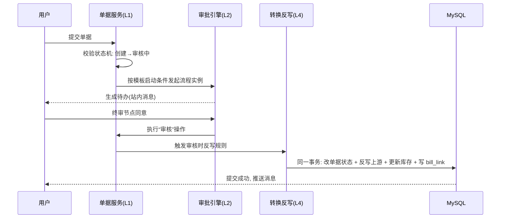

### 6.2 引擎功能清单（F1–F21）

| 编号 | 功能 | 期别 | 对应金蝶 |
|---|---|---|---|
| F1 | 单据状态机：状态、操作、前置条件、字段锁定、菜单控制；通用操作暂存、保存、提交、撤销、审核、反审核、关闭/反关闭、作废、删除；行级业务状态和执行/反执行 | 一期 | 【来源:单据状态】【来源:操作列表】 |
| F2 | 职责分离参数：审核人≠创建人、反审核人=审核人、关键操作二次验权 | 一期 | 【来源:单据参数配置】 |
| F3 | 流程设计器：bpmn-js 可视化建模，只用 BPMN 子集（开始、审批节点、终审标记、排他/并行网关、服务任务、结束），中文属性面板 | 一期 | 【来源:审批流设计】【来源:工作流设计器】 |
| F4 | 流程定义版本、模板、启停：按单据和单据类型配启动条件、生效期、节点视图；一张单据只挂一个模板；运行中的实例继续走旧版本 | 一期 | 【来源:流程配置中心】 |
| F5 | 审批节点参与人：用户、角色、部门负责人、发起人上级、发起人本人；解析不到人时跳过或转管理员（可配） | 一期 | 【来源:工作流设计器-审批-字段说明】 |
| F6 | 顺签 / 或签（任一人通过）和会签（全部通过 / 按比例 / 按票数，可要求按顺序） | 一期 | 【来源:顺签审批流程】【来源:会签审批流程】 |
| F7 | 条件分支（连线表达式，取单据字段如金额）和并行分支（全部汇合） | 一期 | 【来源:条件分支流程】【来源:并行分支流程】 |
| F8 | 驳回：到发起人或任一已走过的节点（运行时选）；驳回后单据为“重新审核” | 一期 | 【来源:审批流设计器-字段说明】 |
| F9 | 撤回：发起人在第一个节点处理前撤回；处理人在下一节点处理前撤回 | 一期 | 【来源:bos通用操作列表】【来源:工作流设计器-审批-字段说明】 |
| F10 | 转交和加签 | 一期：转交、后加签；二期：前加签、传阅 | 【来源:高级选项_页签】【来源:工作流加签规则】 |
| F11 | 代理（委托）：按时间段和流程模板委托，待办标记委托，可撤回 | 一期 | 【来源:流程委托设置】【来源:流程委托规则】 |
| F12 | 待办中心：待办、已办、我发起的、抄送；单据页上直接审批；审批历史时间线；流程图高亮当前节点 | 一期 | 【来源:信息中心_待办任务】 |
| F13 | 消息：到达、驳回、完成时发站内消息（WebSocket 铃铛） | 一期站内；二期邮件、企业微信、钉钉 | 【来源:消息平台】 |
| F14 | 超时：节点时限，到期提醒 | 一期提醒；二期自动通过/转交、工作日历 | 【来源:工作流设计器-审批-字段说明】【来源:工作流日历】 |
| F15 | 自动动作节点：审批通过后自动下推或调用内部服务 | 二期（一期用“审核后自动下推”参数） | 【来源:自动下推】 |
| F16 | 非审核操作走流程（反审核、作废、物料禁用也要审批） | 二期 | 【来源:工作流对其他操作的支持】 |
| F17 | 实例管理：查看、终止（不反审核单据）、转派 | 一期；暂停/恢复/版本迁移二期 | 【来源:流程管理_流程实例】 |
| F18 | 单据转换规则引擎：字段映射（直取/常量/公式/汇总）、分组合并、选单条件、可转数量；下推、选单、上查、下查、全流程跟踪 | 一期 | 【来源:单据转换规则】【来源:下推与特定下推】 |
| F19 | 反写规则引擎：保存/审核时累加、扣减、覆盖；删除/反审核回滚；超额控制；行关闭和整单关闭（含按比例）；多源“自上而下”分配；跨级反写 | 一期（按权重分配二期） | 【来源:反写规则】 |
| F20 | 业务流程路线：限定单据类型允许的下游路线，生成路线实例号 | 二期（一期在转换规则里配允许的源单据类型） | 【来源:业务流程】 |
| F21 | 流程报表：节点平均耗时、超时率、个人待办排行 | 二期 | 【来源:流程总体状况分析报表】 |

另有两项一期必做的配套能力：电子签章（用户签名图片，节点勾“允许签章”）【来源:电子签章】；网络互斥（同一单据同时只能一人编辑）【来源:网络控制】。

### 6.3 一期审批节点清单

除特别标明外，下表审批链是「建议」，原文只给了“审核中 / 重新审核”两个状态和若干角色分工。金额阈值都是【待确认 Q14】。

| # | 单据 | 触发 | 建议审批链 | 来源 |
|---|---|---|---|---|
| A01 | 物料（新建、关键属性修改） | 提交 | 工程 → 品质（承认状态）【扩展】 | 「建议」 |
| A02 | BOM（新建、升版） | 提交 | 工艺/工程师 → 工程主管 | G1a 第 5 节 |
| A03 | 工程变更单 ECN | 提交 | 工程 → 品质 → 计划（评估在制和库存，选用完旧料或立即变更）→ 采购 → 工程经理；“立即变更”加生产主管会签 | G1a 第 5 节；PLM 6.3 |
| A04 | 替代方案 | 提交 | 工程 → 品质（确认物料已承认） | G1a 第 5 节 |
| A05 | 计划订单（投放前） | 可配“数量/金额超阈值才审” | 计划员确认 → 计划主管 | G1a 第 5 节 |
| A06 | 生产订单 | 提交 | 计划主管审核（审核后自动计划确认）；下达前生产主管确认 | G1a 第 5 节 |
| A07 | 生产订单变更单、用料清单变更单 | 提交 | 计划 → 生产主管；换料时加品质 | G1a 第 5 节 |
| A08 | 生产补料单（超损耗） | 超过损耗率时触发 | 线长 → 生产主管 → 计划 | G1a 第 5 节 |
| A09 | 委外订单 | 提交 | 计划 → 采购主管 | G1a 第 5 节 |
| A10 | 采购申请单 | 提交 | 部门主管 → 采购主管；审批中可改批准数量 | 【来源:采购申请单】 |
| A11 | 采购订单 | 提交 | 采购主管；超金额阈值加总经理；低于限价加签 | G2 第 8 节 |
| A12 | 采购/销售订单新变更单 | 提交 | 同原订单 | G2 第 8 节 |
| A13 | 紧急放行 | 收料单执行“紧急放行” | 品质主管 | G2 第 8 节 |
| A14 | 销售订单 | 提交 | 销售主管；信用超标走“信用特批”节点；低于最低限价走“限价特批” | G2 第 8 节；【来源:销售价格管理】 |
| A15 | 不良品处理单 | 提交 | 让步接收、报废需品质主管 | G2 第 8 节 |
| A16 | 盘盈/盘亏 | 提交 | 按差异金额分级：仓库主管 → 财务 → 总经理 | G2 第 8 节 |
| A17 | 库存状态转换（不良 → 可用） | 提交 | 品质确认 | G2 第 8 节 |
| A18 | 现场异常处理单（安灯） | 生产事件的处理路径 | 按事件配置的阶段、处理人、时限和升级策略（原文就是一个小流程） | 【来源:生产事件管理】 |

安灯是原文里最完整的“小流程”，建议作为流程引擎的第一个落地场景来验证引擎。【来源:G1b 0 节】

## 7. 电子元器件行业特性

下表把行业要求和金蝶原文对上号。原文已有的机制直接用；原文没有的标【扩展】。

| # | 特性 | 一期做法 | 原文依据 / 标注 |
|---|---|---|---|
| E01 | **卷盘码（Reel ID）** | 卷盘不作为库存维度（避免即时库存行数爆炸），做成**条码主档**挂在“物料 + 批号 + 仓位”下：Reel ID、MPN、D/C、MSL 等级、数量、来源单据。收料时扫供应商标签解析（主档对照或动态解析）；入库、领料、上料、退料、出库都扫卷盘码；拆盘走条码拆分单（主码-流水号）。是否每盘一码见【待确认 Q05】 | 条码主档、条码拆分、扫描配置【来源:条码规则】【来源:条码拆分】；卷盘码本身【扩展】 |
| E02 | **批号贯穿** | 批号主档（组织+物料+批号唯一，含入库日期、生产日期、有效期至、供应商批号）；批号贯穿采购入库、生产领料、汇报、入库、出库 | 【来源:库存业务专题_库存维度】【来源:生产入库单】 |
| E03 | **MSL 湿敏管控** | 物料带 MSL 等级；卷盘记录开封时间、车间寿命（小时）、累计暴露、烘烤次数、最近烘烤时间；超时自动转“冻结”，烘烤审核后转回“可用”；领料和上料时校验。车间寿命默认值来源见【待确认 Q15】 | 全部【扩展】；状态切换借用【来源:库存状态转换】【来源:库存物料复检到期查询】 |
| E04 | **D/C 周期码** | D/C 存入批次的“生产日期”（来料时由 D/C 换算），界面同时显示 YYWW；销售订单行可设“客户要求 D/C 不早于”，出库拣货时校验。按周还是按日见【待确认 Q16】 | 生产日期字段【来源:收料通知单】；D/C 换算和客户限制【扩展】 |
| E05 | **先进先出** | 参数“先进先出条码控制 = 严格控制”，控制维度 物料+批号+仓库；拣货规则“顺序出库-入库日期”或“近效期先出” | 【来源:条码管理系统参数】【来源:库存管理系统参数】 |
| E06 | **SMT 上料防错** | 站位表（产品+产线+贴片机位置+程序；料站 A/B 面、轨道、飞达规格、分子/分母、吸嘴）→ 按生产订单生成生产 SMT 上料表 → PDA 扫设备/轨道/飞达/料盘核对，不符就拒绝 → 上下料流水 + 工位上料剩余数量；剩余可用时间 ≤ 60 分钟预警到三维和看板。防错粒度可选“按物料品种”或“按品种及数量”；“SMT上料校验飞达”= 是时飞达规格必录 | 【来源:站位表】【来源:生产smt上料表】【来源:生产上料】【来源:柔性产线】【来源:预设轻分析看板_柔性产线车间综合看板】 |
| E07 | **贴片位号** | BOM 子项“位置号”存贴片位号（如 R1、C12），多个位号用逗号分隔；BOM 子项数量应等于位号个数（校验为「建议」） | 位置号=“子项物料的插件位置”【来源:物料清单】；位号数量校验「建议」 |
| E08 | **阶梯损耗** | 电阻电容按订单数量区间用不同损耗率（用量类型 = 阶梯，区间不能重叠） | 原文例子就是“电子行业电容电阻”【来源:物料清单】 |
| E09 | **AQL 抽样** | 抽样类型选“按国标抽样（GB/T2828.1-2012）”，录检验水平（一般 I/II/III、特殊 S-1~S-4）、严格度（正常/加严/放宽）、AQL 后，自动带出样本量字码、样本量、Ac、Re；抽样方案取值顺序：检验单质检方案 → 物料主档。宽严自动转换放二期 | 【来源:抽样方案】【来源:检验单】 |
| E10 | **MPQ 最小包装量** | 采购数量须为最小包装量整数倍（参数“启用最小包装量”）；配额拆分时按最小包装量向上取整（二期配额） | 【来源:采购管理系统参数】【来源:配额下单】 |
| E11 | **测试分选 BIN** | 生产汇报/工序汇报的合格、不合格、报废对应分选结果；另加 BIN1..BINn 各档数量子表；不同档位是否不同料号入库见【待确认 Q06】 | 汇报数量字段【来源:生产汇报单】；BIN 子表【扩展】 |
| E12 | **编带与卷盘入库** | 编带为末道工序（入库点）；按卷盘逐盘入库，每盘生成卷盘码，带批号和 D/C | 入库点【来源:工序计划】；逐盘入库【扩展】 |
| E13 | **客户料号** | 客户物料对应表（客户物料编码/名称），销售订单和标签打印带出 | 【来源:客户物料对应表】 |
| E14 | **元器件扩展属性** | 物料上加封装、贴装面、RoHS、品牌、MPN、承认状态；未承认物料禁止下采购订单（强卡口为默认，【待确认 Q29】） | 全部【扩展】（PLM 原文也没有这些字段，PLM-1-06 已标【扩展】） |
| E15 | **首检** | 严格控制：首检合格后才允许继续汇报和入库；非严格控制：送检后就能继续 | 【来源:产品检验】【来源:首检_柔性单件】 |
| E16 | **防静电 / 料塔** | 三维里智能料塔、防静电工作台一期只显示设备状态；料塔联动出料放二期 | G1b 6.1 |

## 8. 三维车间接口

### 8.1 设备类型对照（与 v1 演示 `src/three/devices/*.js` 和 `src/data/plant.js` 的设备 id 一致）

| 三维类型 | 名称 | 现有设备 id | 金蝶对应 | 计数点「建议」 | 算 OEE | 期 |
|---|---|---|---|---|---|---|
| loader | 上板机 / 下板机 | L1-LDR, L1-ULD, L2-LDR, L2-ULD | 柔性产线站点设备 | 上板数 / 下板数 | 否 | 一期 |
| printer | 锡膏印刷机 | L1-PRN, L2-PRN | 站点 + 运行参数 | 印刷板数 | 是 | 一期 |
| spi | 3D 锡膏检测 | L1-SPI, L2-SPI | 质量检测工位 | 检测板数、不良板数 | 是 | 一期 |
| mounter | 贴片机 | L1-MNT1/2, L2-MNT1/2 | SMT 上料防错主体 | 贴装板数、抛料数 | 是 | 一期 |
| reflow | 回流焊 | L1-RFL, L2-RFL | 运行参数（温区/链速） | 过板数 | 是 | 一期 |
| aoi | AOI | L1-AOI, L2-AOI | 质量检测工位 / 缺陷汇报 | 检测板数、不良点数 | 是 | 一期 |
| tester | 测试分选机 | L3-TST1/2 | 生产工序执行（分 BIN） | 测试数、各 BIN 数 | 是 | 一期 |
| taper | 编带机 | L3-TAP1/2 | 生产工序执行 / 包装（卷盘） | 编带数、卷盘数 | 是 | 一期 |
| reelcab | 智能料塔 | RC-01/02 | 线边仓 | 出/入料盘数 | 否 | 一期状态 / 二期联动 |
| asrs / stacker | 立体仓库 / 堆垛机 | WH-ASRS, WH-STK1/2 | 仓储，仅设备状态 | 作业次数 | 否 | 一期状态 |
| agv / charger | AGV / 充电桩 | AGV-01..04, CH-01/02 | 领送料配送 | 任务数、电量 | 否 | 一期状态 / 二期调度 |
| esdbench / conveyor | 防静电台 / 接驳台 | QA-ESD1/2 | 检验工位 / 线体 | — | 否 | 一期状态 |

【来源:G1b 6.1】

### 8.2 设备状态映射（金蝶 5 态 → 三维颜色）

| 金蝶设备状态 | 典型生产事件 | 三维状态 | 计入 | 依据 |
|---|---|---|---|---|
| 加工 | 开工 | run（绿） | 当日运行 | 【来源:设备】 |
| 占用 | 影响至设备状态 = 占用的生产事件 | run（绿，带“占用”角标） | 当日运行 | 【来源:复杂工序联网-场景2-监控单台设备具体工况】 |
| 空闲 | 待料、午休、完工待机 | idle（橙） | 当日空闲 | 【来源:复杂工序联网-场景9-设备状态实时联动_scada主动推送】 |
| 空闲 / 占用 + OEE 时间类型 = 计划停机 | 保养、点检 | maint（蓝） | 计划停机 | 【来源:生产事件管理】 |
| 异常停机 | 故障代码映射出的事件、安灯异常 | fault（红） | 当日停机 | 【来源:设备】 |
| 关机 | 关机 | off（灰）「建议」，【待确认 Q18】 | 当日空闲 | 「建议」 |

状态切换统一由“生产事件”驱动，每次切换写《设备状态变更日志》，OEE 和停机分析都从这张日志算。【来源:设备状态变更日志】

### 8.3 数据通道

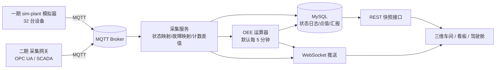

**MQTT 主题（设备 → 后端）**

| 主题 | 载荷（JSON） | 对应金蝶处理类型 |
|---|---|---|
| `plant/{org}/eqp/{eqpId}/status` | `{ts, code:"RUN/IDLE/ALARM/OFF…", faultCode?, src:"sim/scada/opcua"}` | 运行状态；状态映射、故障代码映射 |
| `plant/{org}/eqp/{eqpId}/counter` | `{ts, point:"OUT", value:1211}` 或 `{ts, point:"OUT", delta:3, ng:0}` | 批量报工（原始点值 / 计算后传入） |
| `plant/{org}/eqp/{eqpId}/param` | `{ts, values:{"峰值温度":246.5,"链速":80}}` | 运行参数 |
| `plant/{org}/eqp/{eqpId}/unit` | `{ts, sn, phase:"start/end", result?:"OK/NG"}` | 单件开始/结束（二期） |
| `plant/{org}/eqp/{eqpId}/changeover` | `{ts, moEntry, program, params}` / `{ok}` | 换型请求/结果（二期，双向） |

**WebSocket 事件（后端 → 三维 / 看板）**

| 事件 | 载荷要点 | 来源表 |
|---|---|---|
| `eqp.status` | `{id, status, kdStatus, event, since, task:{mo, op, done, total}}` | eqp_equipment + eqp_status_log + eqp_task_rt |
| `eqp.oee` | `{id, at, avail, perf, quality, oee, runMin, downMin, idleMin, goodQty, totalQty}` | oee_rt |
| `eqp.param` | `{id, at, values}`（只推“监控显示 = 是”的点） | eqp_point_value |
| `andon.ticket` | `{no, id, line, eventName, urgency, level, status, stage, handler, minutes}` | andon_ticket |
| `station.material` | `{line, station, material, lot, remain, availMin, warn}` | station_material_stock |
| `line.kpi` | `{line, planQty, doneQty, okRate, hourly}` | sfc_report 汇总 |

**REST 快照**：首次进入三维页面先拉快照，再接 WebSocket 增量。

- `GET /api/v1/eqp?line=`：设备列表 + 当前状态 + 当前任务
- `GET /api/v1/eqp/{id}/detail?date=`：当日运行/停机/空闲分钟、OEE、产量、状态时间轴、最近告警
- `GET /api/v1/oee/his?eqp=&from=&to=&daily=1`：OEE 历史
- `GET /api/v1/andon?status=open`；`POST /api/v1/andon`；`POST /api/v1/andon/{no}/action`
- `GET /api/v1/station-material?line=`：工位物料剩余和预警
- `POST /api/v1/sim/{eqpId}/fault`：模拟器注入故障，**只在测试环境开放**

【来源:G1b 6.3】

### 8.4 计数自动报工

开工时写《设备联网任务实时表》并记录“开工基准”（每台设备只允许 1 条）；之后每次读数与上次之差生成一张工序汇报单（例：基准 1200，读数 1205、1208、1211 → 产量 5、3、3）；计数溢出按“上限值”复位；不停机交接班时移交前自动采集一次并报工；完工待机或结束任务时删除实时记录、写历史表。【来源:复杂工序联网-场景14.1-联网采集自动报工-原始点值方式】【来源:复杂工序联网-场景8-不停机交接班】【来源:设备联网任务实时表】

### 8.5 OEE 口径

金蝶原文只给出 OEE = 时间稼动率 × 性能稼动率 × 良品率，以及 OEE 时间类型和运算器的输入，没有公开明细公式。【来源:oee计算架构】下面的明细公式是「建议」，【待确认 Q17】。

- 日历时间按设备工作日历和班次计算，临时日历优先。【来源:临时日历】
- 按状态变更日志每段的 OEE 时间类型累计：有效时间、计划停机、休息、停机损失、表现损失、缺陷损失。【来源:生产事件管理】
- 负荷时间 = 日历时间 − 计划停机 − 休息
- 时间稼动率 A = (负荷时间 − 停机损失) / 负荷时间
- 性能稼动率 P = 理论节拍 × 总产量 / 运行时间（理论节拍存在工艺路线工序上，设备上存默认值）
- 良品率 Q = 合格数 / 总产量（取工序汇报单和检验结果，与金蝶运算器输入一致）
- 默认每 5 分钟算一次，写 OEE 实时表（覆盖）和历史表（追加），每天 24:00 再写一条日汇总；失败写原因。【来源:设备oee计算日志】

### 8.6 模拟器（一期）

- 服务 `sim-plant`：读取 `plant.js` 的 32 台设备，用 v1 `runtime.js` 现有的设备参数生成计数、参数和状态，按随机分布注入故障、待料、保养事件，发到 8.3 的 MQTT 主题。
- 后端按金蝶规则处理：状态映射、写变更日志、计数差值自动报工、自动报警生成安灯单、OEE 运算，再推给三维。
- 三维前端改为接口数据驱动；接口断开时显示“连接中断”提示并保留最后状态，不回退成固定动画。「建议」
- 二期接真实设备时只换数据来源（OPC UA / SCADA 经采集网关转成同样的 MQTT 主题），业务层不改。

## 9. 平台通用需求（一期）

详细条目见 `parts/G3-平台与流程-需求.md`，这里列一期必须做到的要点。

| # | 能力 | 一期要点 | 来源 |
|---|---|---|---|
| P01 | 编码规则 | 多段（常量、日期、字段值、流水号）；流水号按编码依据归零；保存时生成（默认）；删除不补号；并发安全 | 【来源:编码规则】 |
| P02 | 单据类型 | 决定编码规则、默认值、必录/锁定字段（与单据设置叠加从严）、流程模板、打印控制 | 【来源:单据类型】 |
| P03 | 单据框架 | 单据头 + 分录 + 子分录；附件；业务数据日志（修改前后差异）；网络互斥；保存后自动提交、提交后自动审核（无审批流时） | 【来源:单据设计与应用】【来源:选项设置】【来源:网络控制】 |
| P04 | 列表与引入引出 | 过滤方案（个人/共享）、列设置、合计、导出；Excel 引入（新增/覆盖；导入为暂存或保存）、错误报告 | 【来源:过滤方案管理】【来源:数据引入工具】 |
| P05 | 防重 | 扫码终端和接口新增单据按幂等键防重 | 【来源:新增单据防重配置】 |
| P06 | 消息 | 站内消息铃铛（WebSocket）；消息模板可插单据字段；消息配置 = 业务对象 + 操作 + 时机 + 条件 + 接收人 + 级别；紧急消息常驻须确认 | 【来源:消息平台】【来源:消息模板】【来源:消息配置】【来源:消息设置】 |
| P07 | 定时预警 | 监控方案 = 业务对象 + 条件 + 执行计划 + 接收人：低于安全库存、采购逾期未到、工单逾期、来料检验超期、复检到期、MSL 超时【扩展】 | 【来源:业务监控】 |
| P08 | 操作时预警（基础版） | 保存或审核时同步校验：采购价高于价目表或历史最高、交期晚于需求日；级别为提示或禁止（G3 建议从二期提前到一期，【待确认 Q21】） | 【来源:预警方案】【来源:预警规则】 |
| P09 | 报表框架 | 明细/汇总列表、交叉表、驾驶舱组件；受数据权限和字段权限约束；导出 Excel | 【来源:报表管理】 |
| P10 | 套打 | 模板设计器（表头、分录、页眉页脚、条码/二维码、签章、审批意见）；预览、打印、导出 PDF、批量和标签连续打印；打印次数控制；模板权限 | 【来源:套打平台】【来源:新建套打】【来源:套打模板权限控制】 |
| P11 | 安全登录 | 强密码（8–20 位含字母、数字、特殊字符）、有效期、首次登录改密、输错 3 次锁定、登录验证码、敏感操作二次验证；JWT + 刷新令牌；空闲超时 | 【来源:安全管理】【来源:二次验权】 |
| P12 | 日志 | 上机操作日志（超 5 万条归档）、登录历史与在线用户、接口和后台任务日志（含跟踪码）、业务数据日志 | 【来源:上机操作日志】【来源:webapi日志】【来源:在线用户列表】 |
| P13 | 备份与环境 | 每日全量备份（MySQL + 附件）；测试环境恢复正式数据时自动脱敏并关闭外发；定时任务只在生产节点执行；启动时校验数据库迁移版本；数据库时区 Asia/Shanghai | 【来源:数据中心备份】【来源:清除第三方集成配置】【来源:时区】 |
| P14 | 对外接口 | `/api/v1/{object}/{operation}`（save/submit/audit/query/view/push）；接口白名单；每个外部系统独立接口用户；调用日志 | 【来源:openapi开发】【来源:webapi接口白名单】 |
| P15 | 数据迁移 | 基础资料 → 期初库存和期初往来 → 未完成单据三段导入；字段映射可记住；判重；逐行结果（【待确认 Q20】） | 【来源:集成平台准备工作】【来源:初始化快速】 |
| P16 | 脱敏 | 手机号、邮箱、身份证、银行账号按规则掩码；列表、表单、导出、打印、接口分别开关 | 【来源:隐私中心】【来源:脱敏规则】 |
| P17 | 首页与移动 | 首页待办卡片、常用功能、关键数量；系统广播；录单紧凑模式；移动 H5：审批、库存查询（按型号、品牌、封装、批次）、PDA 扫码收发 | 【来源:主页管理】【来源:广播消息】【来源:移动平台单据启用设置】 |
| P18 | 实施看板 | 组织、物料、客户、供应商、期初库存、期初往来、用户权限 7 项逐项打勾 | 【来源:自助实施总工作台】 |

## 10. 角色与权限

### 10.1 权限模型

- 功能权限：权限点 = 业务对象 × 权限项（查看、新增、修改、删除、提交、审核、反审核、关闭、作废、引入、引出、打印、附件，及“下推”等专用项）；用户权限是全部角色的并集，冲突时**禁止 > 有权 > 无权**；“查看”是其他权限的前提。【来源:业务对象功能授权】【来源:权限项】【来源:角色】
- 字段权限：单价、金额、成本、供应商价格等敏感字段按角色控制查看/编辑，可一键设为无权。【来源:字段授权】【来源:字段批量授权】
- 数据权限：数据规则（当前用户、本部门及下级、当前组织）+ 岗位体系规则（本人、直接下属、所有下属），组合方式默认交集；上查下查也校验数据范围。【来源:数据权限】【来源:岗位体系数据规则】【来源:启用岗位体系规则】
- 车间调度汇报权限：用户 × 工作中心，含代理报工。【来源:车间调度汇报权限】
- 权限报表：用户最终权限、字段最终权限及来源角色。【来源:用户权限报表】

### 10.2 一期预置角色

| # | 角色 | 主要职责 | 关键权限（举例） | 数据范围 |
|---|---|---|---|---|
| R-01 | 系统管理员 | 用户、角色、参数、流程模板、转换/反写规则 | 平台全部；业务单据只读 | 全部 |
| R-02 | 总经理 | 审批、看驾驶舱 | 全部单据查看、终审 | 全部 |
| R-03 | 销售员 | 报价、订单、发货通知、退货通知 | 销售单据新增/提交；看不到成本 | 本人 |
| R-04 | 销售主管 | 审核销售单据、信用/限价特批 | 销售审核、特批 | 本部门及下属 |
| R-05 | 计划员（PMC） | MRP、计划订单、生产订单、委外订单、齐套、日排产 | 计划和生产订单新增/确认/投放 | 本组织 |
| R-06 | 计划主管 | 审核计划订单、生产订单 | 计划审核 | 本组织 |
| R-07 | 采购员 | 采购申请、订单、退料 | 采购单据新增/提交；看采购价 | 本人 |
| R-08 | 采购主管 | 审核采购单据、委外订单 | 采购审核 | 本部门 |
| R-09 | 仓管员 | 收料、入库、领料、出库、调拨、盘点、扫码 | 库存单据；PDA | 授权仓库 |
| R-10 | 仓库主管 | 审核库存单据、盘点差异 | 库存审核 | 授权仓库 |
| R-11 | 工程师 | 物料、BOM、替代、ECN、工艺路线、站位表 | 工程资料新增/提交 | 本组织 |
| R-12 | 工程主管 | 审核工程资料和 ECN | 工程审核 | 本组织 |
| R-13 | 车间调度 | 工序计划、派工、转移确认 | 车间单据；调度工作台 | 授权工作中心 |
| R-14 | 班组长 / 线长 | 开工、报工、安灯处理、补料申请 | HMI；代理报工 | 授权工作中心 |
| R-15 | 操作工 | 扫码开工、报工、呼叫安灯 | HMI / PDA 最小权限 | 本人任务 |
| R-16 | 上料员 | SMT 上料、续料、换料、下料 | PDA 上料 | 授权产线 |
| R-17 | 检验员（IQC/IPQC/OQC） | 检验单、首检、请检 | 质量单据新增/质检完成 | 授权检验类型 |
| R-18 | 品质主管 | 审核检验和不良处理、紧急放行、让步接收 | 质量审核、特批 | 全部质量单据 |
| R-19 | 设备工程师 | 设备档案、仪表点、生产事件、安灯处理 | 设备资料；安灯处理 | 授权产线 |
| R-20 | 生产主管 | 审核生产订单下达、变更、超耗补料 | 生产审核 | 本组织 |
| R-21 | 供应商（门户） | 订单确认、送货确认、打印来料标签 | 门户最小权限 | 本供应商 |
| R-22 | 财务（预留） | 查看出入库、价格；二期做账 | 只读 | 全部 |
| R-23 | 大屏只读账号 | 看板和三维大屏 | 只读，长期令牌（二期免登） | 指定产线 |

## 11. 一期报表清单

| # | 报表 | 说明 | 来源 |
|---|---|---|---|
| RP01 | 销售订单执行明细 / 汇总、发货及时率 | 订单 → 发货 → 出库 → 退货 | G2 第 10 节 |
| RP02 | 采购订单执行明细、到货及时率 | | G2 第 10 节 |
| RP03 | 物料收发汇总 / 明细、库龄、呆滞、保质期预警、安全库存预警、预计可发量 | | G2 第 10 节 |
| RP04 | 即时库存（按型号、品牌、封装、批次、卷盘） | 同批次合并显示，可切换单位 | 【来源:库存查询显示设置】 |
| RP05 | MRP 运算结果与例外信息、供需明细 | | G1a 3.4 |
| RP06 | 生产订单执行进度、齐套缺料清单 | | G1a |
| RP07 | 生产订单工序进度、离散工序产量日汇总 / 在制品统计、工序不良原因分析、资源利用率 | | 【来源:生产订单工序进度表】【来源:离散工序在制品统计表】 |
| RP08 | 设备状态时间轴、设备停机原因分析、设备时间统计、OEE 趋势 | | 【来源:设备停机原因分析表】 |
| RP09 | 车间异常处理绩效统计（受理、签到、处理、整单超时） | | 【来源:车间异常处理绩效统计表】 |
| RP10 | 供应商质量统计、物料待检明细、缺陷原因分析 | | 【来源:供应商质量统计表】【来源:物料待检明细表】【来源:缺陷原因分析表】 |
| RP11 | 批号追溯（溯源 / 去向）、卷盘追溯 | | 【来源:质量追溯】 |
| RP12 | 信用状况查询 | | 【来源:信用管理】 |
| RP13 | 流程待办与已办统计 | | F12 |
| RP14 | 驾驶舱指标（产量、合格率、OEE、准交率、库存金额） | 指标口径进指标字典 | 【来源:经营大盘】 |

## 12. 财务成本：一期只做预留

财务、税务、成本、资产、管理会计、员工服务整体放二期。一期在生产和供应链单据上**先留好** 87 项字段和接口（完整总表见 `parts/G4-财务成本-需求.md` 第 0.1 节），其中“必须”的要点：

| 主题 | 一期要留什么 |
|---|---|
| 成本对象 | 生产订单带工单编号 + 工单行号 + 成本中心、核算组织、联产品分配权重；汇报单带实际工时；工序汇报带投入产量和完工产量 |
| 核算维度 | 所有业务单据带核算组织、币别、业务日期（与凭证日期分开）、来源系统标记；存货类单据带存货类别、出入库方向、调拨方向；物料带物料分组、存货类别、税收分类编码、允许资产；客户、供应商带纳税识别号，供应商带发票类型 |
| 价格来源 | 采购入库、退料带货主、结算组织、业务日期；销售出库带含税单价；BOM 带变动损耗率、成品率、固定损耗、生效日期；价目表带生效/失效日期 |
| 往来事件 | 采购入库审核、销售出库/退货审核时发出“可立应付/应收”事件，单据上有“已生成应收/应付”标识；委外领退料和委外入库能关联应付单 |
| 反写端口 | 生产入库单留“入库成本”反写接口；入库单反审核时通知成本模块删除完工结转 |
| 资产来源 | 收料单、其他出库单、盘盈单可作为资产建卡来源 |

生产订单“结算”状态由二期成本结算触发（裁决 C-03）。二期启动前要先回答 G4 第 5 节的 10 个问题（核算组织映射、参与核算的单据全集、反写失败处理、零成本取价、凭证字段映射、暂估触发等），已汇入《待老板确认.md》C 类。

## 13. 二期、三期与不做

### 13.1 二期

- **平台**：多组织（启用不可逆，须先过变更检查规则）、企业微信/钉钉入口和移动审批、超时自动处理、前加签与传阅、自动动作节点、非审核操作审批、流程报表、自定义报表、双因素登录、单点登录、敏感字段加密、大屏免登链接。【来源:G3】
- **计划与工程**：预测单与冲销、强弱预留、MPS、缺料分析与追料、MRP 例外代码全集、工程变更申请单（ECR）与影响评估、联副产品、配置 BOM。【来源:G1a】
- **生产与委外**：领料申请（含拣货）、发料通知、挪料、月末在制转移、倒冲差异分摊、日排产齐套和发料、委外变更/拆分/超耗/齐套/倒冲、委外协同平台。【来源:G1a】
- **车间与设备**：柔性产线扫码过站、产品跟踪号、关键件绑定、单件追溯；包装扫描和箱码（斑马 ZPL）；真实设备接入；换型；派工工作台甘特图；工序任务超市；过程检测方案；辅助工时；三色灯；返修工作台；生产线生产模式与 AGV 送料。【来源:G1b 第 7 节】
- **供应链与质量**：合同、调价、配额、对账、供应商评估、VMI、寄售、直运、序列号、受托加工、组装拆卸、WMS 拣货、MRB 评审、巡检、宽严转换、控制图、SN 追溯、组织间结算、信用多维度。【来源:G2 第 11 节】
- **财务成本**：应收、应付、出纳、发票、存货核算、产品成本、标准成本、总账、固定资产、费用。【来源:G4】
- **研发 PLM**（若老板确认需要，【待确认 Q03】）：研发物料申请与编码、生命周期、设计 BOM 与 ERP 制造 BOM 推送、ECR/ECN 闭环、Altium/Cadence/PADS 集成、文档管理。【来源:PLM 第 2 节】
- **营销渠道**：经销商订货门户（审核后下推销售订单）、客户返利与供应商返利、内部要补货、分支要货与总仓分配、直拨/统配与拣货、配送路线与订货日历、渠道资金池、订货预估；营销费用、多组织配货为可选。原文返利算式、资金池规则缺失，二期开发前要先补需求。【来源:G5 第 2 节】

### 13.2 三期及以后

渠道积分与等级、完整促销执行、VMI/寄售货主扩展、B2C 锁库与套件摊价、超级 BOM 与产品配置、研发项目管理、TR 评审、预算、经营会计。【来源:G5 第 3 节】【来源:PLM 第 3 节】

### 13.3 明确不做

B2C 网店中台、门店 POS / 称重 / 礼券 / 外卖 / 堂食、菜谱营养团餐、食品与餐饮“另一套加工”（其中的 BOM、替代、倒冲已并入一期生产核对）、掌上订货（原文只有标题）、全网会员与储值卡、美团抖音核销、云之家、RPA、雾端部署。【来源:G5 第 4 节】【来源:G3 第 11 节】【来源:G1b 第 7 节】

---

## 附录 A　冲突与裁决

原则：各路说法不一致时，回到 `kingdee-raw/pages/` 原文查证裁决；原文自身矛盾的，给出建议并列入《待老板确认.md》；属于分期取舍、原文无从裁决的，按“一期先跑通主线”原则裁决并注明。

| # | 冲突 | 各方说法 | 原文查证 | 裁决 |
|---|---|---|---|---|
| C-01 | 作废的前置状态 | G2 第 0 节：作废只能在“创建 / 重新审核”下操作；流程引擎调研：只对已审核有效 | 原文自身不一致：`bos通用操作列表.txt` 第 133 行写“只对状态=已审核的单据有效”；但具体单据页 `采购申请单.txt` 第 176 行、`期初采购订单.txt` 第 141 行明写“作废只能针对创建或重新审核的单据，已审核的单据不能做废”，`生产领料申请单.txt` 第 164 行“创建或重新审核状态下才允许作废”，`生产补料单`、`生产领料单` 写作废释放保存时占用的选单数（只有未审核单据才有这个占用） | **（复核后改判）按单据页：只能作废创建 / 重新审核的单据，已审核须先反审核**。通用操作列表那一句与多张单据页及两段式反写机制都对不上，视为旧说明。第一稿的裁决作废，G2 原说法正确。Nemotron 复核时发现 |
| C-02 | 委外订单有没有“开工”状态 | G1a 第一轮：没有；G1a 第二轮：有 | `委外订单.txt` 第 34 行业务状态：计划、计划确认、下达、开工、完工、结案、结算；但操作说明没有开工按钮 | 状态枚举保留“开工”；触发方式原文未写，建议首次领料自动开工，列 Q23 |
| C-03 | 生产订单“结算”状态的触发 | G1a：状态枚举有“结算”，触发未知，推测与成本有关；G4：成本核算后反写入库成本 | `生产订单.txt` 业务状态枚举含“结算”，无触发动作说明 | 一期保留状态值、不提供入口；二期由成本结算置位。列 Q22 |
| C-04 | 让步接收算不算合格 | G2：原文矛盾，建议合格数 = 接收 + 让步接收；Mistral：使用决策为“接收”才是合格 | `检验单.txt` 第 71、188 行：来料检验“让步接收”状态为不合格，合格数 = 接收数量；`自制工序检验.txt` 第 24–26 行：合格数 = 接收 + 让步接收 | 原文自相矛盾。**建议按检验单主页面**：合格数只算“接收”，让步接收单独统计、允许以“让步接收入库”类型入库（采购入库单原文有此入库类型）。与 G2 建议不同，列 Q13 由老板定 |
| C-05 | 不良品处理单审核反写到哪张单 | G2 R10：累加到“源请检单”；Mistral：按检验类型累加到各自上游 | `不良品处理单.txt` 第 93–107 行：来料 → 采购收料单；库存、发货 → 库存请检单；退货 → 退货通知单；产品 → 生产汇报单；自制工序 → 工序汇报单；委外工序 → 工序转移单…… | **以原文为准（Mistral 正确）**，总表 R38 已按原文写 |
| C-06 | MRB 评审单何时改写检验单 | G2 1.5 图：审核时改写源检验单决策；Mistral：保存时更新检验单，审核时累加上游 | `mrb评审单.txt` 第 70–79 行：保存时更新检验单使用决策和合格/不合格数量；审核时累加检验单上游源单；挑选全检或决策不一致时审核改写源检验单决策 | 以原文为准，两段都要做。MRB 本身放二期，二期实现时按此 |
| C-07 | 自制工序检验（IPQC）的期别 | G2 1.4：二期；G1b S16 和 R14：一期 | 原文无分期，属取舍 | 一期只做**首检**和**入库点（末道）工序、工序控制码 = 质量检验**的工序检验，作为车间路线的完工检验；巡检、合并检验、宽严转换放二期 |
| C-08 | 首检状态的取值 | G1b：空 / 待首检 / 首检中 / 首检完成；Mistral：空 / 首检中 / 首检完成 | `首检_柔性单件.txt` 第 29 行四个值；`产品检验.txt` 第 66–72 行写结果映射：合格→首检完成，不合格→空，保留→首检中 | 两页都是原文，场景不同。一期取并集四个值；结果映射按产品检验页；严格控制规则按产品检验页第 73–75 行 |
| C-09 | 工程变更申请单（ECR）的期别 | G1a：二期，一期直接走 ECN；PLM：ECR 一期（含影响评估） | 原文无分期 | 一期只做 ERP 内 ECN，审批时提供“在制、在途、库存”影响查询（复用 ECN 旧料清理的取数口径）；ECR 申请单随 PLM 放二期 |
| C-10 | PLM 的期别 | PLM 稿：24 条一期（含 EDA 插件、文档加密、研发物料申请） | 原文无分期 | 老板这次要求的一期主线不含研发设计。**PLM 整体放二期**，一期在 ERP 内用物料、BOM（位号）、替代、ECN 满足日常；列 Q03 请老板确认是否有自主电路/封装设计需要 |
| C-11 | 损耗率计算方式 | G1a 3.1：参数为 1/(1+损耗率) 或 1/(1−损耗率)；G1a 3.7 用料清单：× (1+变动损耗率)；G5 指出食品加工页也两种写法 | `工程数据参数.txt` 第 14 行写“1/(1+损耗率)，1/(1-损耗率)”；`生产用料清单.txt` 第 63 行给出明确公式：方式一 × (1+变动损耗率) + 固定损耗，方式二 ÷ (1−损耗率) + 固定损耗 | 按用料清单页的**明确公式**实现：方式一乘 (1+r)，方式二除以 (1−r)；参数名称照原文显示。默认方式列 Q30 |
| C-12 | 工序汇报“损耗数量”是否生成入库 | G1b 未提及 | `工序汇报.txt` 第 66 行：7.5.1 版默认不入库；7.7.0 补丁改为按废品逻辑默认入库 | 按原文较新版本：损耗按废品逻辑，默认生成报废品入库，可在单据类型参数里关闭 |
| C-13 | 三维前端断开后台时是否回退演示数据 | G1b 6.5：回退本地演示数据并保留 DEMO 标志 | 老板要求界面不出现演示数据字样 | 不回退成演示数据；断开时显示“连接中断”并保留最后状态；模拟器数据走正常后端，只在交付说明里写明 |
| C-14 | 通用关联表和规则表的命名 | G1a：`sys_bill_link`、`sys_writeback_rule`；G2：`scm_bill_link`；调研：`bill_link`、`bill_convert_rule` | 设计命名，无原文 | 统一为 `sys_bill_link`、`sys_convert_rule`、`sys_writeback_rule`；状态码统一为 DRAFT / CREATED / AUDITING / AUDITED / REAUDIT（见技术方案） |
| C-15 | 信用管理的期别 | G2：一期精简（额度检查、占用释放）；G5 2.13：信用占用与回款作为二期可选 | 原文无分期 | 一期按 G2 精简版；回款下推收款、签单协议、多维度信用放二期 |
| C-16 | 委外订单“审核”和“计划确认”的先后 | G1a：蓝图图片为“计划确认 → 审核 → 下达”，文字页为“审核时自动计划确认” | 图片与文字不一致 | 按文字页（G1a 已裁），与生产订单一致 |
| C-17 | 齐套分析单“预计齐套 / 库存齐套”含义 | G1a 指出该页说明写反 | `生产齐套分析单` 与 `生管平台` 定义相反 | 按生管平台定义：库存齐套按现有库存算，预计齐套按库存 + 预计量算 |
| C-18 | 生产订单“计划组 / 计划员”说明提到“委外申请单” | G1a：疑为原文笔误 | `生产订单.txt`、`委外订单.txt` 第 22–23 / 34–35 行都写“委外申请单的委外组织” | 视为原文复制残留，按“生产组织 / 委外组织”实现 |
| C-19 | BOM“位置号”能否存 SMT 贴片位号 | G1a：用位置号存贴片位号；G5：位置号原文只写“插件位置”，没有编码规则，也没有与贴片程序的关系，不能据此做 SMT 位号 | `物料清单` 原文：位置号 = 子项物料的插件位置 | 位置号存位号是**我方用法，标【扩展】**；与贴片程序的对应关系不靠位置号，而靠站位表（原文有贴片机位置、程序、料站），二者在上料表生成时校验 |
| C-20 | G4 所说“委外申请单作为成本核算对象” | G4 0.1：委外申请单带核算组织 | `产品成本核算.txt` 第 70 行“按委外申请单计算……材料成本”；而 `委外订单.txt` 自己的字段说明也把本单叫“委外申请单” | 推断原文新旧名混用，“委外申请单”即本系统的委外订单；预留字段加在委外订单上（推断，二期成本实施时再核） |
| C-21 | 销售报价下推订单是否控数量 | G2：“可多次下推” | `销售报价单.txt` 第 72 行：可多次下推，无关联数量控制 | 一期按原文不控数量，只记关联 |
| C-22 | 安灯单 PC 端能否手工发起 | G1b：金蝶不支持，建议放开 | `现场异常处理单` 原文：PC 端不支持手工录入 | 与原文不同的取舍，列 Q19，默认放开（方便没有 HMI 的工位） |
| C-23 | 领料 / 退料 / 补料的前置订单状态 | 第一稿 R06：订单“下达或开工”；Nemotron：下达、开工、完工且未挂起 | `生产领料单.txt` 第 10–11 行：订单分录处于下达、开工、完工状态且未挂起；生产用料清单必须已审核。退料、补料、领料申请单同 | 以原文为准，R06、R08 已改 |
| C-24 | 生产订单结案控制和反结案 | G1a 只写“结案（无未审核下游）”，没写控制参数；Nemotron：控制范围 + 控制强度两组参数，结算后不能反结案 | `生产订单.txt` 第 193–213 行与 Nemotron 一致 | 补进 SM-04；两组参数放在生产订单单据类型里，一期默认“所有物料 + 在制材料数量在损耗范围内”【待确认 Q41】 |
| C-25 | 补料单、入库单合单分组 | G1a 未写；Nemotron 写了分组规则 | `生产补料单.txt` 第 115、127 行：发料组织 + 生产组织 + 货主 + 货主类型相同可合成一张；`生产入库单.txt` 第 111–145 行：生产组织 + 货主 + 货主类型相同可合成一张（下推、选单都适用） | 以原文为准，写入 R08、R17。一期单组织，分组实际只按货主生效，但规则照做，二期多组织不用改 |

## 附录 B　输入稿与复核情况

| 输入 | 承接方 | 读量 | 合稿处理 |
|---|---|---|---|
| G1a 计划与生产 | 执行线（第二轮补读） | 160 页字段说明全读，关键图 22 张 | 第 3、4、5 章主体 |
| G1b 车间执行与设备 | 执行线 | 443 页 + 9 孤立页 | 第 4、5、7、8 章 |
| G2 供应链与质量 | 执行线 | 619 页 | 第 3、4、5、7 章 |
| G3 平台与流程 + 流程引擎调研 | 执行线 | 流程中心 85 页、BOS 62 页 + 补读 | 第 6、9、10 章 |
| G4 财务成本 | Claude Sonnet 5 | 31 个模块 1,312,930 字 | 第 12 章；问题进 C 类 |
| G5 营销零售餐饮 | Grok | 52 个文件 1,002,049 字 | 第 13 章 |
| PLM + 孤立页 | 反重力 | PLM 27 页；孤立页 906 页分拣、206 页高相关判断 | 第 13 章；孤立页 10 条优先项已并入（见下） |
| 质量独立复核 | Mistral-Large-4 | 质量 + 追溯 17 段，抽查 1,492 处 | 逐条比对，见 B.1 |
| 生产计划独立复核 | Nemotron-3-Ultra | 约 2,200 条（a 部分 191 段按单据去重后 150 类） | 五个重点逐条对原文，见 B.2 |

### B.1 Mistral 质量复核差异逐条处理

| # | Mistral 指出 / 与 G2 的差异 | 处理 |
|---|---|---|
| M-01 | 不良品处理单审核按检验类型反写不同上游（G2 只写了请检单） | 采纳，原文核实，裁决 C-05，总表 R38 |
| M-02 | MRB 保存时就更新检验单使用决策和合格/不合格数 | 采纳，原文核实，裁决 C-06（MRB 二期） |
| M-03 | 使用决策只有“接收”状态为合格 | 原文核实属实，但与自制工序检验页矛盾，裁决 C-04、Q13 |
| M-04 | 首检结果映射：合格→首检完成、不合格→空、保留→首检中 | 采纳，写入 R14 和 C-08 |
| M-05 | 产品检验质检完成反写生产汇报单**和生产订单** | 采纳，写入 R16（G1a 原表缺这一条） |
| M-06 | 检验数量默认 = 源单数量 − 检验选单（关联）数量，各检验类型源单字段不同 | 采纳，写入 R14、R16、R28 |
| M-07 | 库存检验、不良品处理、MRB 审核后状态不符时自动生成库存状态转换单，反审核自动删除 | 采纳，写入 R39、R40 |
| M-08 | 质检状态：审核时自动质检完成，反审核回到计划 | 采纳，写入 SM-13 |
| M-09 | 生产退料检验、委外退料检验、受托材料检验、生产线检验、工序巡检、其他检验 | 均为原文能力；一期不做这些检验类型（主线用不到），二期按 Mistral 稿第 3、7 节实现 |
| M-10 | 宽严度转换、严格度转换日志、物料来源质检规则 | 二期，与 G2 一致 |
| M-11 | 批号序列号关系保存时校验子项批号必须是领料/补料领用的批号 | 一期采纳到批号追溯：成品批号的子项批号只取实际领料记录（SN 级二期） |
| M-12 | Mistral 自查 4 处“原文未找到”（描述性条目） | 合稿未引用这 4 处 |

结论：Mistral 稿与 G2 在检验类型、使用决策、AQL、追溯方向上一致；差异 12 条均已处理，其中 3 条（M-01、M-02、M-05）是 G2 的遗漏或错误，已按原文修正。

### B.2 Nemotron 生产计划复核

Nemotron 稿 a 部分是 15 批直接拼接，按单据名去重后从 191 段归并为 150 类单据；b–e 部分各 2 批，重复很少。下面先核五个重点，再列其他差异。每条都回到 `kingdee-raw/pages/` 原文查过。

| # | Nemotron 说法 | 与 G1a / 第一稿比 | 原文 | 处理 |
|---|---|---|---|---|
| N-01 | 计划订单关闭分手工、投放、合并、拆分四种 | G1a 已有四种关闭类型，但状态图只画了手工和投放 | `计划订单.txt` 第 57、124、148–160 行，一致 | 无冲突；SM-02 补画拆分、合并 |
| N-02 | 结案受“控制范围”和“控制强度”控制；结算后不能反结案 | G1a 缺 | `生产订单.txt` 第 193–213 行，一致 | 补进 SM-04，裁决 C-24 |
| N-03 | 补料单按发料组织 + 生产组织 + 货主 + 货主类型合单；入库单按生产组织 + 货主 + 货主类型合单 | G1a 缺 | `生产补料单.txt` 第 115 行；`生产入库单.txt` 第 111、137 行，一致 | 写入 R08、R17，裁决 C-25 |
| N-04 | 缺料 = 应发 − 已领 − 预留_库存 − 预留_预计入 − 分配库存 − 分配预计入 | G1a 一致，第一稿正文漏写 | `生管平台.txt` 第 109 行，一致 | 补进 SM-05 |
| N-05 | 多组织预测冲销按供应组织匹配：先完全匹配，再空对空，最后非空单据冲空预测；空单据不能冲非空预测 | G1a 未写（预测冲销整体在二期） | `多组织预测冲销.txt` 第 92–97 行，一致；另有“供应组织为空的单据自动按供应规则拆分”参数（第 25 行） | 一期单组织用不到，记入二期预测冲销需求，不改一期 |
| N-06 | 领退补前提：订单下达、开工、完工且未挂起，用料清单已审核 | 第一稿 R06 漏了“完工” | `生产领料单.txt` 第 10–11 行 | 改 R06，裁决 C-23 |
| N-07 | 生产领料申请单、采购申请单：作废只能在创建 / 重新审核下 | 与第一稿 C-01 相反 | 见 C-01 | **C-01 改判**，SM-01 已改 |
| N-08 | 生产订单正反执行都可跳跃；手工完工条件；存在未审核用料清单变更单时不能反审核 | G1a 缺 | `生产订单.txt`、`生产单据类型参数.txt` | 补进 SM-04 |
| N-09 | 汇报单保存、审核要求订单为开工或完工 | G1a 缺 | `生产汇报单` 操作说明 | 补进 R15 |
| N-10 | 净需求 = 毛需求 + 已分配 − 期初库存 − 预计入库 + 安全库存 | 与 G1a 分项公式一致（G1a 按制造策略开关分项写） | `物料供需汇总表` | 无冲突 |
| N-11 | 计划订单业务状态写成“计划、计划确认、下达……结算”（b 部分“计划订单”第一段） | 这是生产订单变更单页的状态，Nemotron 标错了单据 | `生产订单变更单` | 不采纳 |
| N-12 | 生管平台、计划员主页、MTO 库存调整、优先级计算、净需求拆分、能力中心等 | 均为二期能力，G1a 也放二期 | — | 不进一期，二期实施时参考 Nemotron 稿 d 部分 |

Nemotron 自报 2 处来源标注不准（“样本破坏数”只在生产单据类型参数页；“预计入时间”不在 mrp 例外信息查询表页），两处都不影响本说明书的结论。合稿结论：五个重点全部与原文一致；其中 N-02、N-03、N-06、N-07、N-08、N-09 是第一稿的遗漏或错误，已按原文修正。第 3–5 章计划与生产部分复核完成。

### B.3 孤立页高相关要点的吸收

| 孤立页要点 | 处理 |
|---|---|
| 模式 33 完全接单生产（计划跟踪号贯穿） | 一期 MTO 计划跟踪号已覆盖 |
| 模式 21 预测通用部件 + 接单装配 | 依赖预测和预留，二期 |
| 柔性生产组装扫描（关键件防错、满足 BOM 投入后自动报工） | 二期扫码过站 T1 |
| 首检严格 / 非严格控制 | 一期，E15 |
| 复杂工序联网场景 9（SCADA 状态码映射） | 一期状态映射表（模拟器）+ 二期真实接入 |
| 设备九宫格监控（OEE、扫码开工） | 一期设备详情面板和 HMI |
| 配额下单按最小包装量向上取整 | 二期配额；MPQ 校验一期（E10） |
| PDA 轻报工实作工时 | 一期按实际工时报工（开始/暂停流水） |
| 模具一模多穴 | 不适用于当前 SMT/测试/编带主线，二期视封装产线需要 |
| 组织间需求单 | 随多组织二期 |

## 附录 C　原文缺口（实施时要带着的风险）

1. 全站 3,335 张图片未做文字识别，流程图、状态图里的细节以文字页为准；状态图只看过 G1a、G1b 下载的关键图。
2. OEE 明细公式、审批链、MSL、卷盘码、D/C 规则原文都没有，均为「建议」或【扩展】。
3. 生产订单、委外订单“结算”的触发，委外订单“开工”的触发，原文没写。
4. 让步接收的合格口径原文矛盾。
5. PLM 生命周期操作矩阵、EDA 字段映射默认行、设计工艺字段都在图片里，读不到。
6. G5 的返利算式、资金池规则、订货预估净需求公式原文缺失，二期前要另写需求。
7. G4 的核算组织映射、凭证字段映射、暂估触发条件原文未见。
8. 认证信息页抓取失败 1 页；正文不足 30 字的孤立页 37 页。
